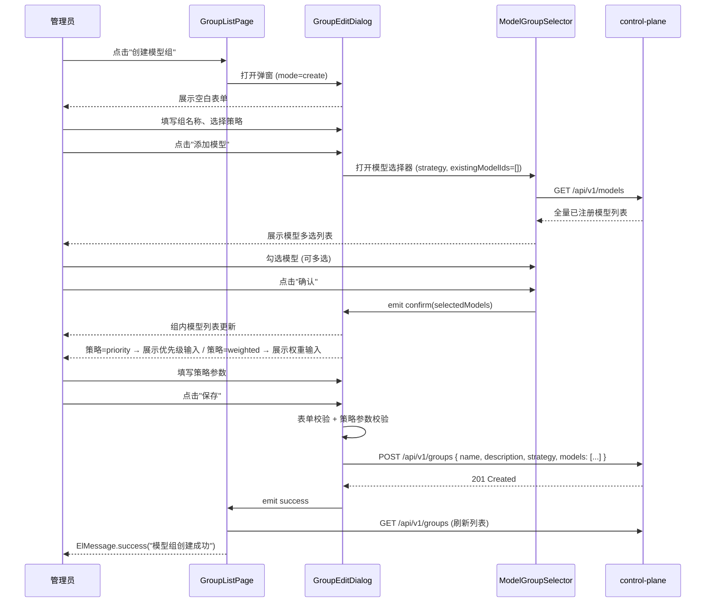
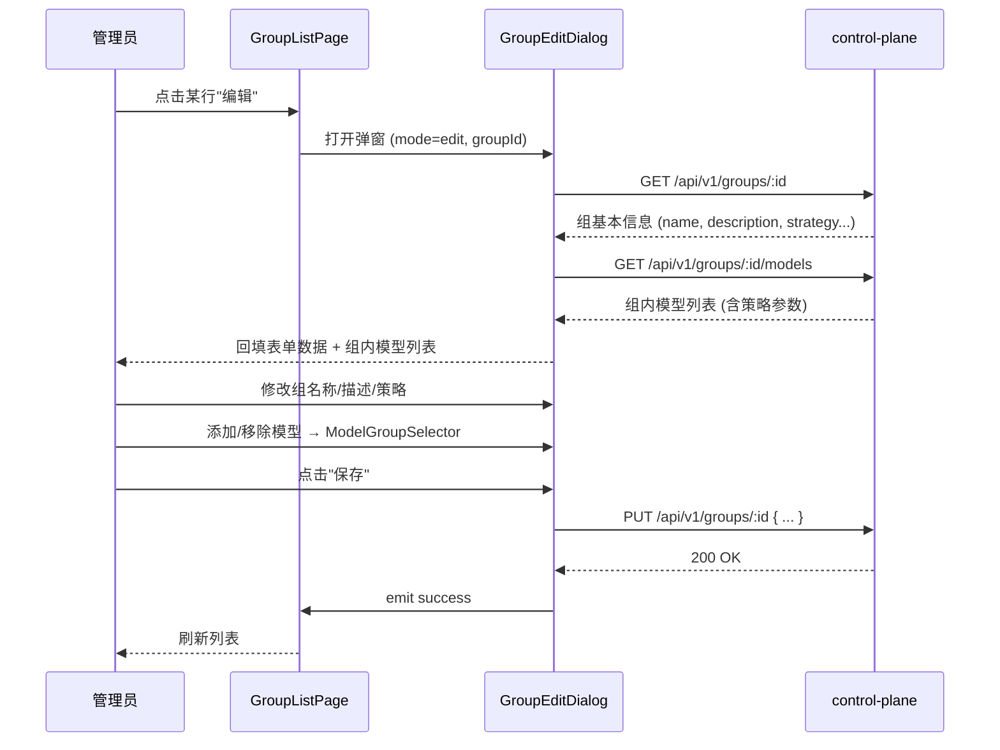

# ops-console 技术设计变更 — CHG-20260525-001

> 基线：xspec/modules/ops-console/design.md (v1.2)

## 变更摘要

新增模型组管理页面及三个核心组件（GroupListPage、GroupEditDialog、ModelGroupSelector），在导航菜单新增"模型组"入口。所有组件消费 control-plane 的模型组 CRUD 接口。

---

## 1. 设计决策

### 决策 1：策略切换提示

| 项 | 内容 |
| :--- | :--- |
| 问题 | 编辑模型组时用户切换路由策略类型，已有策略参数如何处理？ |
| 选择 | 切换策略类型时弹出警告提示"切换策略将清除已有策略参数"，确认后清空 priority/weight 值 |
| 理由 | 不同策略类型的参数语义不同（priority vs weight），直接保留会导致数据不一致；提示可防止误操作 |
| 备选方案 | 静默清除参数——用户可能未察觉参数丢失，体验不佳 |

**实现要点**：
- 使用 `watch` 监听 `form.strategy` 变化
- 仅在编辑模式（mode === 'edit'）且已有模型列表非空时触发警告
- 使用 `ElMessage.warning('切换策略将清除已有策略参数')` 展示提示
- 清空所有已选模型的 `priority` 和 `weight` 字段

### 决策 2：删除确认方式

| 项 | 内容 |
| :--- | :--- |
| 问题 | 模型组删除操作如何做二次确认？ |
| 选择 | 使用 Element Plus `ElMessageBox.confirm`，设置 `type: 'warning'`，确认按钮样式 `confirmButtonClass: 'el-button--danger'` |
| 理由 | 与渠道管理页、模型管理页的删除确认交互保持一致；删除不可逆，危险样式可强化警示 |
| 备选方案 | 自定义弹窗组件——增加开发量但无额外收益 |

**确认文案**：
```
确定删除模型组「{name}」？删除后组内模型配置将一并清除，此操作不可恢复。
```

### 决策 3：模型选择器数据来源与多选逻辑

| 项 | 内容 |
| :--- | :--- |
| 问题 | 模型选择器中的模型列表从哪里获取？已加入组的模型如何展示？ |
| 选择 | 从 control-plane `GET /api/v1/models` 加载全量已注册模型；已加入当前组的模型在前端标记为 `checked + disabled`（不可取消勾选） |
| 理由 | 同一模型允许出现在多个组中，因此选择器展示全量模型而非排除已选模型；disabled 标记使已选关系可读但不可通过选择器移除（移除操作在组内模型列表中完成） |
| 备选方案 | 选择器中隐藏已在组内的模型——管理员无法看到组内模型的全量列表，不利于认知当前组的完整配置 |

**交互细节**：
- 已加入组的模型显示为勾选状态且置灰（`:disabled="isModelInGroup(model.id)"`）
- 搜索过滤仅作用于显示层面，不影响已选模型的 disabled 状态
- 确认后将新增勾选的模型 emit 给父组件

### 决策 4：策略参数输入控件

| 项 | 内容 |
| :--- | :--- |
| 问题 | 不同策略类型下策略参数用什么输入控件？ |
| 选择 | 优先级策略：`el-input-number` 范围 0-999，整数，step=1；加权策略：`el-input-number` 范围 1-100，整数，step=1；轮询策略：不展示参数输入 |
| 理由 | 数字输入组件限制输入范围，防止无效值提交；按策略类型条件渲染，减少无关 UI 元素 |
| 备选方案 | 统一使用 `el-input`——需要额外校验逻辑，不如 `el-input-number` 语义明确 |

**条件渲染规则**：

| 策略 | 优先级输入 (0-999) | 权重输入 (1-100) | 说明 |
| :--- | :---: | :---: | :--- |
| round_robin | 不展示 | 不展示 | 无策略参数 |
| priority | 展示 | 不展示 | 每模型填写优先级数字 |
| weighted | 不展示 | 展示 | 每模型填写权重值 |

### 决策 5：不引入 Pinia Store

| 项 | 内容 |
| :--- | :--- |
| 问题 | 模型组管理页面状态是否需要使用 Pinia？ |
| 选择 | 使用组件内 `ref`/`reactive` 管理，不引入 Pinia store |
| 理由 | 页面状态仅限组件树内部使用，无跨页面共享需求；与现有 `UnifiedEntryPage`、`ModelListPage` 状态管理方式一致 |
| 备选方案 | 使用 Pinia store——增加复杂度但无实际收益 |

---

## 2. 组件详细设计

### 2.1 GroupListPage — 模型组列表页

**基本信息**：

| 项 | 内容 |
| :--- | :--- |
| 路由 | `/groups` |
| 组件文件 | `src/views/admin/GroupListPage.vue` |
| 职责 | 模型组列表展示、关键词搜索、打开创建/编辑弹窗、触发删除 |

**Vue 3 Composition API 结构**：

```typescript
import { ref, reactive, computed, onMounted, watch } from 'vue'
import { ElMessage, ElMessageBox } from 'element-plus'
import { useDebounceFn } from '@vueuse/core'
import GroupEditDialog from '@/components/admin/GroupEditDialog.vue'

interface GroupsState {
  groups: GroupListItem[]
  loading: boolean
  error: string | null
  searchKeyword: string
}

const state = reactive<GroupsState>({
  groups: [],
  loading: false,
  error: null,
  searchKeyword: ''
})

const editDialogVisible = ref(false)
const editDialogMode = ref<'create' | 'edit'>('create')
const editingGroupId = ref<string | null>(null)

const debouncedSearch = useDebounceFn((keyword: string) => {
  state.searchKeyword = keyword
  fetchGroups()
}, 300)

async function fetchGroups(): Promise<void> { /* GET /api/v1/groups?search= */ }
async function handleDelete(group: GroupListItem): Promise<void> { /* 二次确认 → API 调用 → 刷新 */ }
function handleCreate(): void { editDialogMode.value = 'create'; editingGroupId.value = null; editDialogVisible.value = true }
function handleEdit(group: GroupListItem): void { editDialogMode.value = 'edit'; editingGroupId.value = group.id; editDialogVisible.value = true }
function onDialogSuccess(): void { editDialogVisible.value = false; fetchGroups() }

onMounted(() => { fetchGroups() })
```

**el-table 列定义**：

| 列名 | 字段 | 宽度 | 渲染方式 |
| :--- | :--- | :--- | :--- |
| 组名称 | name | auto | 文本 |
| 路由策略 | strategy_label | 100px | el-tag（轮询=info / 优先级=warning / 加权=success） |
| 模型数量 | model_count | 100px | 数字 |
| 状态 | enabled | 80px | el-tag（启用=success / 禁用=danger） |
| 操作 | — | 160px | el-button-group：编辑 + 删除 |

**搜索**：

```
┌──────────────────────────────────────────────────────────────┐
│  [🔍 搜索模型组名称...              ]    [+ 创建模型组]      │
│  debounce 300ms，输入时实时过滤                               │
└──────────────────────────────────────────────────────────────┘
```

- el-input 绑定 `@input` 触发 `debouncedSearch`
- 搜索为空时加载全量列表

**多态状态**：

| 状态 | 条件 | UI 表现 |
| :--- | :--- | :--- |
| 加载中 | `loading === true` | el-table 显示 `v-loading`，骨架占位 |
| 正常 | `groups.length > 0` | 渲染表格数据 |
| 空态 | `groups.length === 0 && !loading && !error` | el-empty description="暂无模型组，点击创建第一个模型组" |
| 错误 | `error !== null` | el-alert type="error" title="加载失败，请刷新重试" + 刷新按钮 |

**删除确认流程**：
```typescript
async function handleDelete(group: GroupListItem) {
  try {
    await ElMessageBox.confirm(
      `确定删除模型组「${group.name}」？删除后组内模型配置将一并清除，此操作不可恢复。`,
      '确认删除',
      {
        confirmButtonText: '确认删除',
        cancelButtonText: '取消',
        type: 'warning',
        confirmButtonClass: 'el-button--danger'
      }
    )
    await groupsApi.delete(group.id)
    ElMessage.success('模型组已删除')
    fetchGroups()
  } catch (err) {
    if (err !== 'cancel') {
      ElMessage.error('操作失败，请重试')
    }
  }
}
```

---

### 2.2 GroupEditDialog — 创建/编辑弹窗

**基本信息**：

| 项 | 内容 |
| :--- | :--- |
| 组件文件 | `src/components/admin/GroupEditDialog.vue` |
| 职责 | 模型组的创建/编辑表单，包含基本信息区与组内模型列表区 |
| Props | `visible: boolean`, `mode: 'create' | 'edit'`, `groupId: string | null` |
| Emits | `update:visible`, `success` |

**Vue 3 Composition API 结构**：

```typescript
import { ref, reactive, watch, computed } from 'vue'
import { ElMessage, ElMessageBox } from 'element-plus'
import ModelGroupSelector from '@/components/admin/ModelGroupSelector.vue'
import type { GroupForm, GroupModel, Strategy } from '@/types/group'

interface GroupEditState {
  form: GroupForm
  submitting: boolean
  selectedModels: GroupModel[]
}

const props = defineProps<{ visible: boolean; mode: 'create' | 'edit'; groupId: string | null }>()
const emit = defineEmits<{ (e: 'update:visible', v: boolean): void; (e: 'success'): void }>()

const state = reactive<GroupEditState>({
  form: { name: '', description: '', strategy: 'round_robin' },
  submitting: false,
  selectedModels: []
})

const modelSelectorVisible = ref(false)
const formRef = ref<FormInstance>()

const dialogTitle = computed(() => props.mode === 'create' ? '创建模型组' : '编辑模型组')

// 策略切换警告
watch(() => state.form.strategy, (newVal, oldVal) => {
  if (props.mode === 'edit' && oldVal && newVal !== oldVal && state.selectedModels.length > 0) {
    ElMessage.warning('切换策略将清除已有策略参数')
    state.selectedModels.forEach(m => { m.priority = undefined; m.weight = undefined })
  }
})

// 编辑模式加载已有数据
watch(() => props.visible, async (val) => {
  if (val && props.mode === 'edit' && props.groupId) {
    // GET /api/v1/groups/:id 加载组详情
    // GET /api/v1/groups/:id/models 加载组内模型
  } else if (val && props.mode === 'create') {
    resetForm()
  }
})
```

**模板结构**：

```
┌──────────────────────────────────────────────────────┐
│  创建模型组 / 编辑模型组                  [×]         │
├──────────────────────────────────────────────────────┤
│                                                      │
│  ── 基本信息 ────────────────────────────────────── │
│                                                      │
│  组名称 *     [______________________________]       │
│               必填，最多 64 字符                      │
│                                                      │
│  组描述       [______________________________]       │
│               选填                                     │
│                                                      │
│  路由策略 *   ○ 轮询 (round_robin)                   │
│               ○ 优先级 (priority)                    │
│               ○ 加权 (weighted)                      │
│               ↓ 切换时警告                            │
│               ↓ 提示："添加模型时需指定优先级数字"     │
│               ↓ 或 "添加模型时需指定权重值"           │
│                                                      │
│  ── 组内模型 ────────────────────────────────────── │
│                                                      │
│  ┌──────────────────────────────────────────────┐   │
│  │ 模型名称      策略参数        操作            │   │
│  ├──────────────────────────────────────────────┤   │
│  │ gpt-4o        优先级: 1        [移除]        │   │
│  │ qwen-turbo    权重: 80         [移除]        │   │
│  └──────────────────────────────────────────────┘   │
│  [+ 添加模型]                                        │
│                                                      │
├──────────────────────────────────────────────────────┤
│                  [取消]      [保存]                   │
└──────────────────────────────────────────────────────┘
```

**el-form 校验规则**：

```typescript
const rules = {
  name: [
    { required: true, message: '请输入组名称', trigger: 'blur' },
    { max: 64, message: '组名称不能超过 64 个字符', trigger: 'blur' },
    { whitespace: true, message: '组名称不能为纯空格', trigger: 'blur' }
  ],
  strategy: [
    { required: true, message: '请选择路由策略', trigger: 'change' }
  ]
}

// 提交时额外校验
async function handleSubmit() {
  await formRef.value?.validate()
  if (state.selectedModels.length === 0) {
    ElMessage.warning('请至少添加一个模型')
    return
  }
  // 策略参数校验
  if (state.form.strategy === 'priority') {
    const hasInvalidPriority = state.selectedModels.some(
      m => m.priority == null || m.priority < 0 || m.priority > 999
    )
    if (hasInvalidPriority) { ElMessage.warning('请为每个模型设置有效的优先级 (0-999)'); return }
  }
  if (state.form.strategy === 'weighted') {
    const hasInvalidWeight = state.selectedModels.some(
      m => m.weight == null || m.weight < 1 || m.weight > 100
    )
    if (hasInvalidWeight) { ElMessage.warning('请为每个模型设置有效的权重 (1-100)'); return }
  }

  state.submitting = true
  try {
    if (props.mode === 'create') {
      await groupsApi.create(state.form, state.selectedModels)
    } else {
      await groupsApi.update(props.groupId!, state.form, state.selectedModels)
    }
    ElMessage.success(props.mode === 'create' ? '模型组创建成功' : '模型组更新成功')
    emit('success')
  } catch (err: any) {
    // 错误处理见 contracts.delta.md
  } finally {
    state.submitting = false
  }
}
```

**策略提示文案**（form.strategy 下方）：

| 策略 | 提示文案 |
| :--- | :--- |
| priority | "添加模型时需指定优先级数字（0-999）" |
| weighted | "添加模型时需指定权重值（1-100）" |
| round_robin | 无提示 |

**组内模型列表**：
- 编辑模式下，打开弹窗时通过 `GET /api/v1/groups/:id/models` 加载已有组内模型
- 创建模式下，列表初始为空
- 每个模型条目显示：模型名称 + 策略参数（按策略类型条件渲染）+ 移除操作
- 移除操作：`state.selectedModels.splice(index, 1)`

---

### 2.3 ModelGroupSelector — 模型选择器

**基本信息**：

| 项 | 内容 |
| :--- | :--- |
| 组件文件 | `src/components/admin/ModelGroupSelector.vue` |
| 职责 | 从全量已注册模型中多选要加入当前组的模型 |
| 展示形式 | `el-drawer` 或 `el-dialog` |
| Props | `visible: boolean`, `existingModelIds: string[]`, `strategy: Strategy` |
| Emits | `update:visible`, `confirm(selected: GroupModel[])` |

**Vue 3 Composition API 结构**：

```typescript
import { ref, reactive, computed, watch, onMounted } from 'vue'
import { ElMessage } from 'element-plus'
import type { ModelOption, GroupModel, Strategy } from '@/types/group'

const props = defineProps<{
  visible: boolean
  existingModelIds: string[]
  strategy: Strategy
}>()
const emit = defineEmits<{
  (e: 'update:visible', v: boolean): void
  (e: 'confirm', models: GroupModel[]): void
}>()

interface SelectorState {
  allModels: ModelOption[]
  searchKeyword: string
  selectedIds: Set<string>
  loading: boolean
}

const state = reactive<SelectorState>({
  allModels: [],
  searchKeyword: '',
  selectedIds: new Set(),
  loading: false
})

const filteredModels = computed(() =>
  state.allModels.filter(m =>
    m.name.toLowerCase().includes(state.searchKeyword.toLowerCase())
  )
)

function isModelInGroup(modelId: string): boolean {
  return props.existingModelIds.includes(modelId)
}

async function loadModels() {
  state.loading = true
  try {
    const models = await modelsApi.list() // GET /api/v1/models
    state.allModels = models
    state.selectedIds = new Set(props.existingModelIds)
  } catch {
    ElMessage.error('模型列表加载失败')
  } finally {
    state.loading = false
  }
}

function handleConfirm() {
  const result: GroupModel[] = state.allModels
    .filter(m => state.selectedIds.has(m.id) && !isModelInGroup(m.id))
    .map(m => ({
      group_id: '',
      model_id: m.id,
      model_name: m.name,
      priority: props.strategy === 'priority' ? undefined : undefined,
      weight: props.strategy === 'weighted' ? undefined : undefined
    }))
  emit('confirm', result)
}

watch(() => props.visible, (val) => { if (val) loadModels() })
```

**模板结构**：

```
┌──────────────────────────────────────────────────────┐
│  选择模型                               [×]          │
├──────────────────────────────────────────────────────┤
│                                                      │
│  [🔍 搜索模型名称...              ]                  │
│                                                      │
│  ┌──────────────────────────────────────────────┐   │
│  │ ☑ gpt-4o (已禁用/已选)                       │   │
│  │ ☐ gpt-4o-mini                                │   │
│  │ ☑ qwen-turbo (已禁用/已选)                    │   │
│  │ ☐ qwen-max                                   │   │
│  │ ☐ text-embedding-v3                          │   │
│  │ ...                                           │   │
│  └──────────────────────────────────────────────┘   │
│                                                      │
├──────────────────────────────────────────────────────┤
│                  [取消]      [确认]                   │
└──────────────────────────────────────────────────────┘
```

**空态处理**：
- `allModels.length === 0 && !loading` → el-empty description="当前无已注册模型，请先在模型管理中注册模型"
- 空态时"确认"按钮置灰

**checkbox 状态逻辑**：

```html
<el-checkbox
  v-for="model in filteredModels"
  :key="model.id"
  :model-value="state.selectedIds.has(model.id)"
  :disabled="isModelInGroup(model.id)"
  @change="(val) => toggleModel(model.id, val)"
>
  {{ model.name }}
  <el-tag v-if="isModelInGroup(model.id)" size="small" type="info">已在组内</el-tag>
</el-checkbox>
```

- 已在组内的模型：`checked=true, disabled=true`，显示"已在组内"标签
- 新勾选的模型：`checked=true, disabled=false`
- 未勾选的模型：`checked=false, disabled=false`

---

### 2.4 导航变更

**Sidebar 导航新增菜单项**：

```typescript
// 在现有导航配置中新增
{
  path: '/groups',
  name: 'GroupList',
  component: () => import('@/views/admin/GroupListPage.vue'),
  meta: { title: '模型组', icon: 'Collection' }  // Element Plus Icons: Collection
}
```

**路由注册**：

```typescript
{
  path: '/groups',
  name: 'GroupList',
  component: () => import('@/views/admin/GroupListPage.vue'),
  meta: { title: '模型组', icon: 'Collection' }
}
```

**导航菜单位置**（建议放在"模型管理"下方）：

```
Sidebar
  ├── 统一接入
  ├── 渠道管理
  ├── 模型管理
  └── 模型组          ← 新增
```

---

## 3. 关键流程

### 3.1 模型组创建流程



### 3.2 编辑模型组流程



### 3.3 策略切换流程

```mermaid
flowchart TD
    A[用户切换策略类型] --> B{是否为编辑模式?}
    B -->|是| C{已有模型列表?}
    B -->|否(创建模式)| D[直接切换策略类型]
    C -->|是| E[ElMessage.warning: 切换策略将清除已有策略参数]
    C -->|否| D
    E --> F[清空所有模型的 priority 和 weight]
    F --> D
    D --> G{切换至什么策略?}
    G -->|priority| H[模型列表：展示优先级输入 0-999]
    G -->|weighted| I[模型列表：展示权重输入 1-100]
    G -->|round_robin| J[模型列表：隐藏策略参数列]
```

---

## 4. 状态管理

### 4.1 GroupsState — 列表页状态

```typescript
interface GroupsState {
  groups: GroupListItem[]
  loading: boolean
  error: string | null
  searchKeyword: string
}

const initialGroupsState: GroupsState = {
  groups: [],
  loading: false,
  error: null,
  searchKeyword: ''
}
```

**状态变更场景**：

| 场景 | groups | loading | error | searchKeyword |
| :--- | :--- | :--- | :--- | :--- |
| 初始状态 | [] | false | null | '' |
| 进入页面 / 发起请求 | 保持 | true | null | — |
| 请求成功 | GroupListItem[] | false | null | — |
| 请求成功但无数据 | [] | false | null | — |
| 请求失败 | [] | false | "加载失败，请刷新重试" | — |
| 用户搜索（防抖） | — | true | null | 输入值 |
| 创建/编辑/删除成功 | 触发 fetchGroups | — | — | — |

### 4.2 GroupEditState — 编辑弹窗状态

```typescript
interface GroupEditState {
  form: GroupForm
  submitting: boolean
  selectedModels: GroupModel[]
}

const initialGroupEditState: GroupEditState = {
  form: { name: '', description: '', strategy: 'round_robin' },
  submitting: false,
  selectedModels: []
}
```

**重置逻辑**：
```typescript
function resetForm() {
  state.form = { name: '', description: '', strategy: 'round_robin' }
  state.selectedModels = []
  state.submitting = false
}
```

### 4.3 ModelGroupSelector 状态

```typescript
interface ModelGroupSelectorState {
  allModels: ModelOption[]
  searchKeyword: string
  selectedIds: Set<string>
  loading: boolean
}
```

### 4.4 组件间数据流

```
GroupListPage
  │  state: groups[], loading, error, searchKeyword
  │
  ├──→ GroupEditDialog (props: visible, mode, groupId)
  │      │  state: form, submitting, selectedModels[]
  │      │
  │      └──→ ModelGroupSelector (props: visible, existingModelIds, strategy)
  │             │  state: allModels[], searchKeyword, selectedIds, loading
  │             │
  │             └── emit confirm(selected: GroupModel[])
  │
  │  emit: success → GroupListPage.fetchGroups()
  │
  └── API calls:
       GET /api/v1/groups?search=
       DELETE /api/v1/groups/:id
```

**Props 传递关系**：

| 父组件 | 子组件 | Props | 类型 |
| :--- | :--- | :--- | :--- |
| GroupListPage | GroupEditDialog | visible | boolean |
| GroupListPage | GroupEditDialog | mode | 'create' \| 'edit' |
| GroupListPage | GroupEditDialog | groupId | string \| null |
| GroupEditDialog | ModelGroupSelector | visible | boolean |
| GroupEditDialog | ModelGroupSelector | existingModelIds | string[] |
| GroupEditDialog | ModelGroupSelector | strategy | Strategy |