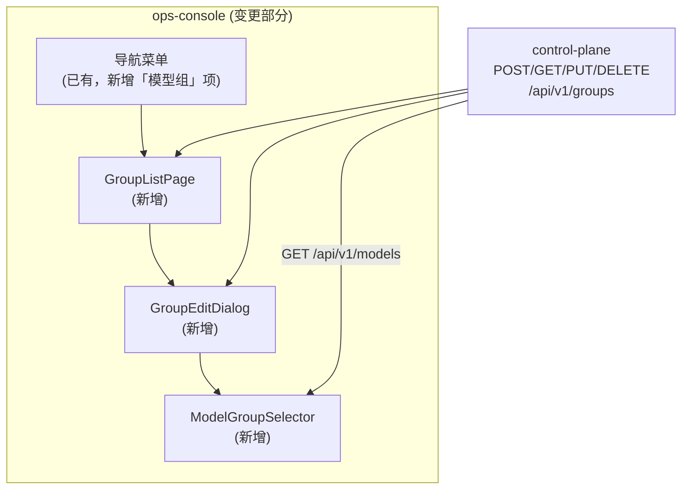
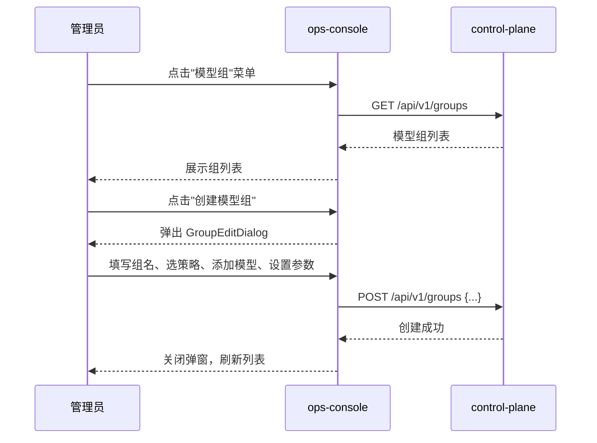

# ops-console 概要设计变更 — CHG-20260525-001

> 基线：xspec/modules/ops-console/hld.md (v1.2)

## 变更摘要

在现有管理后台导航中新增"模型组"菜单及三个核心组件：GroupListPage（组列表页）、GroupEditDialog（创建/编辑面板）、ModelGroupSelector（组内模型选择器）。新增组件消费 control-plane 的模型组 CRUD 接口。

## 架构变更



## 新增组件

| 组件 | 职责 | 路由 |
| :--- | :--- | :--- |
| 模型组菜单项 | 导航中新增"模型组"入口 | `/groups` |
| GroupListPage | 模型组列表展示、搜索、删除确认 | `/groups` |
| GroupEditDialog | 模型组创建/编辑表单（名称、描述、策略选择） | 弹窗形式 |
| ModelGroupSelector | 组内模型选择器：多选已注册模型、设置优先级/权重、移除 | 内嵌于 GroupEditDialog |

## 页面结构

```
/groups                           — 模型组列表页
  ├── 搜索框（按组名搜索）
  ├── 模型组列表（组名/策略/模型数/状态）
  │   ├── [编辑] → GroupEditDialog
  │   └── [删除] → 二次确认弹窗
  └── [创建模型组] → GroupEditDialog

GroupEditDialog                   — 创建/编辑弹窗
  ├── 基本信息区（组名/描述/策略选择）
  ├── 模型列表区
  │   ├── [已选模型 - 策略参数 - 移除]
  │   └── [添加模型] → ModelGroupSelector
  └── [保存] / [取消]

ModelGroupSelector                — 模型选择面板
  ├── 搜索过滤框
  ├── 全量模型列表（多选 + 已选禁用）
  └── [确认] / [取消]
```

## 交互流程



## 关键决策

| 决策 | 选择 | 理由 |
| :--- | :--- | :--- |
| 模型选择器来源 | 从 control-plane 全量模型列表中多选 | 跨组允许，同一模型可出现在多个组 |
| 策略切换提示 | 切换策略类型时弹提示"将清除策略参数" | 防止切换策略后残留不兼容参数 |
| 删除确认 | 二次确认弹窗 | 删除不可逆，防止误操作 |

## 技术选型

无新增技术选型。沿用现有 Vue 3 + Element Plus 前端技术栈，通过 HTTP 调用 control-plane 接口。