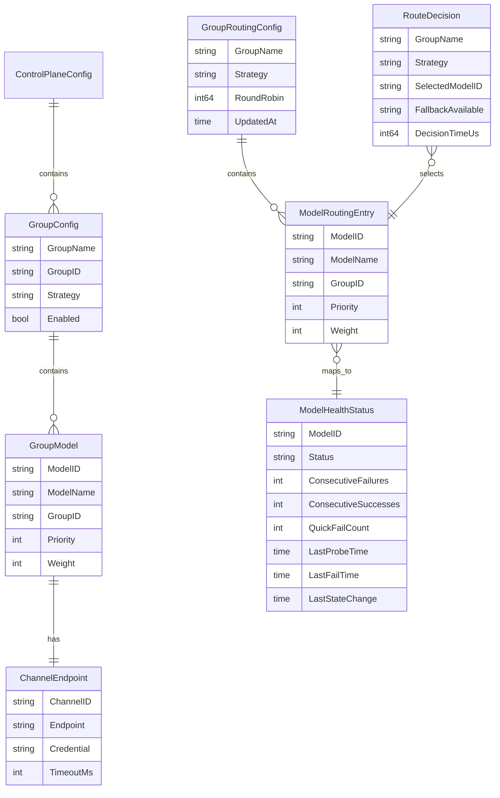

# scheduler Web 后端数据模型

## 0. 文档信息

| 属性 | 内容 |
| :--- | :--- |
| **所属变更** | CHG-20260525-001 |
| **模块名称** | scheduler |
| **模块类型** | web-backend |
| **创建时间** | 2026-05-25 |

### 修订记录

| 版本号 | 修改日期 | 修改内容摘要 | 修改人 |
| :--- | :--- | :--- | :--- |
| v1.0 | 2026-05-25 | 初稿创建 | OpenCode |

---

## 1. 数据模型概述

scheduler 模块所有数据均为**内存驻留**，不涉及持久化存储。数据来源分为两类：
- **配置数据**：从 control-plane HTTP 拉取，存入 RouteTable
- **运行时状态数据**：由健康探测产生，存入 HealthStore

重启后所有数据从 control-plane 重新拉取，健康状态通过探测重新建立。

---

## 2. 实体关系图



---

## 3. 枚举类型定义

### 3.1 RoutingStrategy — 路由策略枚举

```go
type RoutingStrategy string

const (
    StrategyRoundRobin RoutingStrategy = "round_robin" // 轮询
    StrategyPriority   RoutingStrategy = "priority"    // 优先级链
    StrategyWeighted   RoutingStrategy = "weighted"    // 加权随机
)

func (s RoutingStrategy) Valid() bool {
    switch s {
    case StrategyRoundRobin, StrategyPriority, StrategyWeighted:
        return true
    }
    return false
}
```

### 3.2 HealthStatus — 健康状态枚举

```go
type HealthStatus string

const (
    HealthStatusHealthy   HealthStatus = "healthy"   // 健康（可路由）
    HealthStatusUnhealthy HealthStatus = "unhealthy" // 不健康（不可路由）
)
```

---

## 4. 核心实体定义

### 4.1 GroupConfig — 模型组配置（来自 control-plane）

| 字段 | 类型 | 必填 | 说明 |
| :--- | :--- | :--- | :--- |
| GroupName | string | 是 | 模型组名称，唯一标识，作为路由查询 key |
| GroupID | string | 是 | 模型组内部 ID，由 control-plane 分配 |
| Strategy | RoutingStrategy | 是 | 路由策略，枚举值：round_robin / priority / weighted |
| Enabled | bool | 是 | 是否启用，false 时该组不参与路由 |
| Models | []GroupModel | 是 | 组内模型列表 |

```go
type GroupConfig struct {
    GroupName string          `json:"group_name"`
    GroupID   string          `json:"group_id"`
    Strategy  RoutingStrategy `json:"strategy"`
    Enabled   bool            `json:"enabled"`
    Models    []GroupModel    `json:"models"`
}
```

**校验规则**：
- `GroupName` 非空，长度 1-128
- `Strategy` 必须为有效枚举值
- `Enabled=false` 时组配置仍存储但不参与路由
- 若 `Enabled=true` 但 `Models` 为空，路由时返回 `ErrNoAvailableModel`

---

### 4.2 GroupModel — 组内模型（来自 control-plane）

| 字段 | 类型 | 必填 | 说明 |
| :--- | :--- | :--- | :--- |
| ModelID | string | 是 | 模型唯一标识 |
| ModelName | string | 是 | 模型展示名称 |
| GroupID | string | 是 | 所属模型组 ID |
| Priority | int | 否 | 优先级（仅 priority 策略使用），1 为最高，默认 999 |
| Weight | int | 否 | 权重（仅 weighted 策略使用），范围 1-100，默认 1 |
| ChannelInfo | ChannelEndpoint | 是 | 渠道连接信息 |

```go
type GroupModel struct {
    ModelID     string          `json:"model_id"`
    ModelName   string          `json:"model_name"`
    GroupID     string          `json:"group_id"`
    Priority    int             `json:"priority"`
    Weight      int             `json:"weight"`
    ChannelInfo ChannelEndpoint `json:"channel_info"`
}
```

**校验规则**：
- `Weight` 范围为 [1, 100]，control-plane 侧校验，scheduler 信任上游数据
- `Priority` 越小优先级越高，同优先级模型内部轮询
- 不可路由模型策略下 `Priority` / `Weight` 不参与计算

---

### 4.3 ChannelEndpoint — 渠道连接信息

| 字段 | 类型 | 必填 | 说明 |
| :--- | :--- | :--- | :--- |
| ChannelID | string | 是 | 渠道 ID |
| Endpoint | string | 是 | 渠道端点 URL |
| Credential | string | 是 | 认证凭证（API Key 等） |
| TimeoutMs | int | 是 | 探测超时时间（毫秒），默认 5000 |

```go
type ChannelEndpoint struct {
    ChannelID  string `json:"channel_id"`
    Endpoint   string `json:"endpoint"`
    Credential string `json:"credential"`
    TimeoutMs  int    `json:"timeout_ms"`
}
```

**校验规则**：
- `Endpoint` 必须以 `http://` 或 `https://` 开头
- `TimeoutMs` 最小 1000ms，最大 30000ms

---

### 4.4 ModelHealthStatus — 模型健康状态（运行时）

| 字段 | 类型 | 说明 |
| :--- | :--- | :--- |
| ModelID | string | 模型唯一标识 |
| Status | HealthStatus | 当前健康状态 |
| ConsecutiveFailures | int | 连续失败次数（连续成功时清零） |
| ConsecutiveSuccesses | int | 连续成功次数（连续失败时清零） |
| FailureWindow | *FailureRingBuffer | 5s 滑动窗口失败时间戳环形缓冲 |
| QuickFailCount | int | 60s 内快速失败次数 |
| QuickFailWindowStart | time.Time | 快速失败窗口起始时间 |
| LastProbeTime | time.Time | 最后一次主动探测时间 |
| LastFailTime | time.Time | 最后一次失败时间（含被动和主动） |
| LastStateChange | time.Time | 最后状态变更时间 |
| CreatedAt | time.Time | 首次注册时间 |

```go
type ModelHealthStatus struct {
    ModelID             string             `json:"model_id"`
    Status              HealthStatus       `json:"status"`
    ConsecutiveFailures int                `json:"consecutive_failures"`
    ConsecutiveSuccesses int               `json:"consecutive_successes"`
    FailureWindow       *FailureRingBuffer `json:"failure_window"`
    QuickFailCount      int                `json:"quick_fail_count"`
    QuickFailWindowStart time.Time         `json:"quick_fail_window_start"`
    LastProbeTime       time.Time          `json:"last_probe_time"`
    LastFailTime        time.Time          `json:"last_fail_time"`
    LastStateChange     time.Time          `json:"last_state_change"`
    CreatedAt           time.Time          `json:"created_at"`
}
```

**状态转换规则**：

| 当前状态 | 触发条件 | 目标状态 |
| :--- | :--- | :--- |
| 无 (nil) | 模型首次注册 | Healthy |
| Healthy | 5s 滑动窗口内失败次数 ≥ 3 | Unhealthy |
| Healthy | 60s 内快速失败次数 ≥ 5 | Unhealthy |
| Unhealthy | 连续成功次数 ≥ 3 | Healthy |

---

### 4.5 FailureRingBuffer — 失败滑动窗口

```go
type FailureRingBuffer struct {
    timestamps []time.Time // 固定容量环形数组
    head       int         // 写入位置
    size       int         // 当前有效元素数
    cap        int         // 容量（足够容纳 5s 窗口内的最大失败数）
}

func NewFailureRingBuffer(capacity int) *FailureRingBuffer {
    return &FailureRingBuffer{
        timestamps: make([]time.Time, capacity),
        cap:        capacity,
    }
}

// Record 记录一次失败
func (b *FailureRingBuffer) Record(t time.Time) {
    b.timestamps[b.head] = t
    b.head = (b.head + 1) % b.cap
    if b.size < b.cap {
        b.size++
    }
}

// RecentFailures 返回最近 window 内的失败次数
func (b *FailureRingBuffer) RecentFailures(window time.Duration) int {
    cutoff := time.Now().Add(-window)
    count := 0
    for i := 0; i < b.size; i++ {
        idx := (b.head - 1 - i + b.cap) % b.cap
        if b.timestamps[idx].After(cutoff) {
            count++
        } else {
            break // 时间戳按插入顺序排列，更早的一定不在窗口内
        }
    }
    return count
}
```

**设计要点**：
- 环形缓冲避免无限增长的内存占用
- 容量默认 100，可容纳 5s 窗口内最大合理失败次数
- `RecentFailures` 从最新向最早遍历，遇到首个超出窗口的记录即停止

---

### 4.6 RouteDecision — 路由决策结果

| 字段 | 类型 | 说明 |
| :--- | :--- | :--- |
| GroupName | string | 路由所在模型组名称 |
| Strategy | string | 使用的路由策略 |
| SelectedModelID | string | 选中的模型 ID |
| SelectedModelName | string | 选中的模型名称 |
| ChannelID | string | 选中模型对应的渠道 ID |
| ChannelEndpoint | string | 渠道端点 URL |
| ChannelCredential | string | 渠道认证凭证 |
| FallbackAvailable | bool | 同组是否还有可用备选模型 |
| DecisionTimeUs | int64 | 决策耗时（微秒） |

```go
type RouteDecision struct {
    GroupName          string `json:"group_name"`
    Strategy           string `json:"strategy"`
    SelectedModelID    string `json:"selected_model_id"`
    SelectedModelName  string `json:"selected_model_name"`
    ChannelID          string `json:"channel_id"`
    ChannelEndpoint    string `json:"channel_endpoint"`
    ChannelCredential  string `json:"channel_credential"`
    FallbackAvailable  bool   `json:"fallback_available"`
    DecisionTimeUs     int64  `json:"decision_time_us"`
}
```

---

## 5. 内存存储结构

### 5.1 RouteTable

```go
type RouteTable struct {
    mu     sync.RWMutex
    groups map[string]*GroupRoutingConfig // key: group_name
}

type GroupRoutingConfig struct {
    GroupName  string
    Strategy   RoutingStrategy
    Models     []*ModelRoutingEntry
    RoundRobin atomic.Int64
    UpdatedAt  time.Time
}

type ModelRoutingEntry struct {
    ModelID     string
    ModelName   string
    GroupID     string
    Priority    int
    Weight      int
    ChannelInfo ChannelEndpoint
}
```

### 5.2 HealthStore

```go
type HealthStore struct {
    mu     sync.RWMutex
    states map[string]*ModelHealthStatus // key: model_id
}
```

---

## 6. 配置同步数据结构

control-plane HTTP API 返回的 JSON 结构：

```json
{
  "version": "20260525-001",
  "groups": [
    {
      "group_name": "high_intelligence",
      "group_id": "grp_001",
      "strategy": "priority",
      "enabled": true,
      "models": [
        {
          "model_id": "model_deepseek_v3",
          "model_name": "DeepSeek V3",
          "group_id": "grp_001",
          "priority": 1,
          "weight": 0,
          "channel_info": {
            "channel_id": "ch_deepseek_prod",
            "endpoint": "https://api.deepseek.com/v1",
            "credential": "sk-xxxxx",
            "timeout_ms": 5000
          }
        }
      ]
    }
  ]
}
```

---

## 7. 数据生命周期

| 阶段 | 数据范围 | 操作 |
| :--- | :--- | :--- |
| 初始化 | RouteTable, HealthStore | 空 map 创建，ConfigSyncer 首次拉取后填充 |
| 运行时更新 | RouteTable | ConfigSyncer 每 5s 全量替换，写锁 |
| 运行时更新 | HealthStore | HealthProber 被动/主动探测更新，写锁 |
| 运行时读取 | RouteTable | Router / FailoverHandler 读锁 |
| 运行时读取 | HealthStore | Router / FailoverHandler FilterHealthy 读锁 |
| 运行时清理 | HealthStore | ConfigSyncer 同步后，删除不在配置中的 model_id 健康状态 |
| 关闭 | 全部 | goroutine 停止，内存由 GC 回收 |