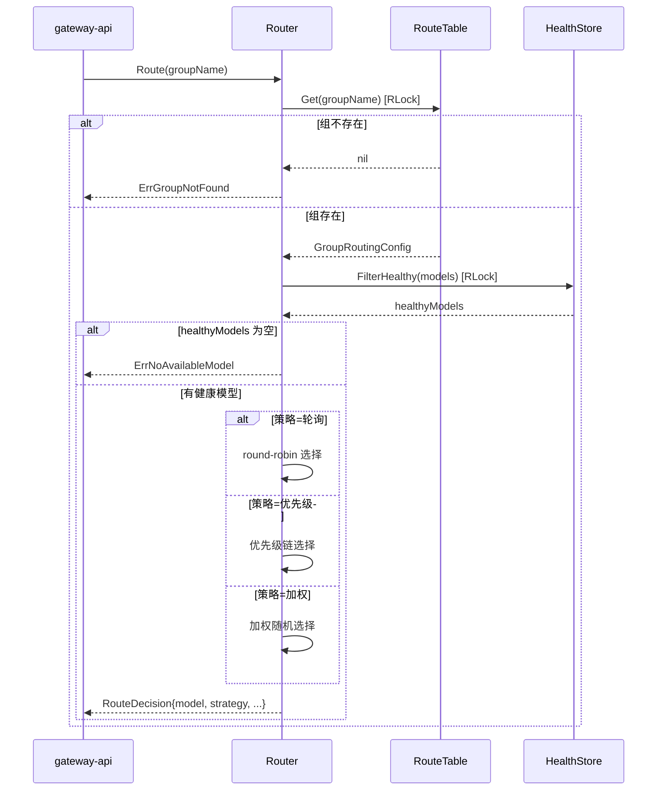
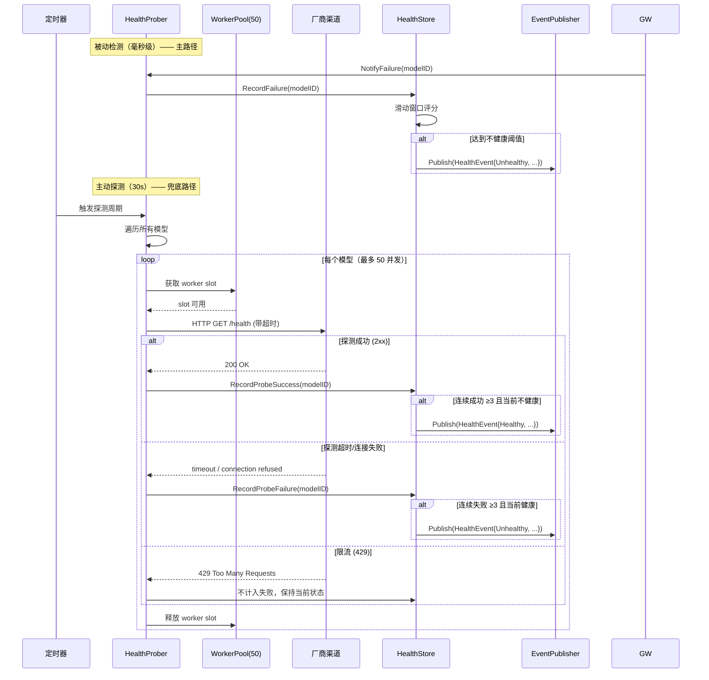
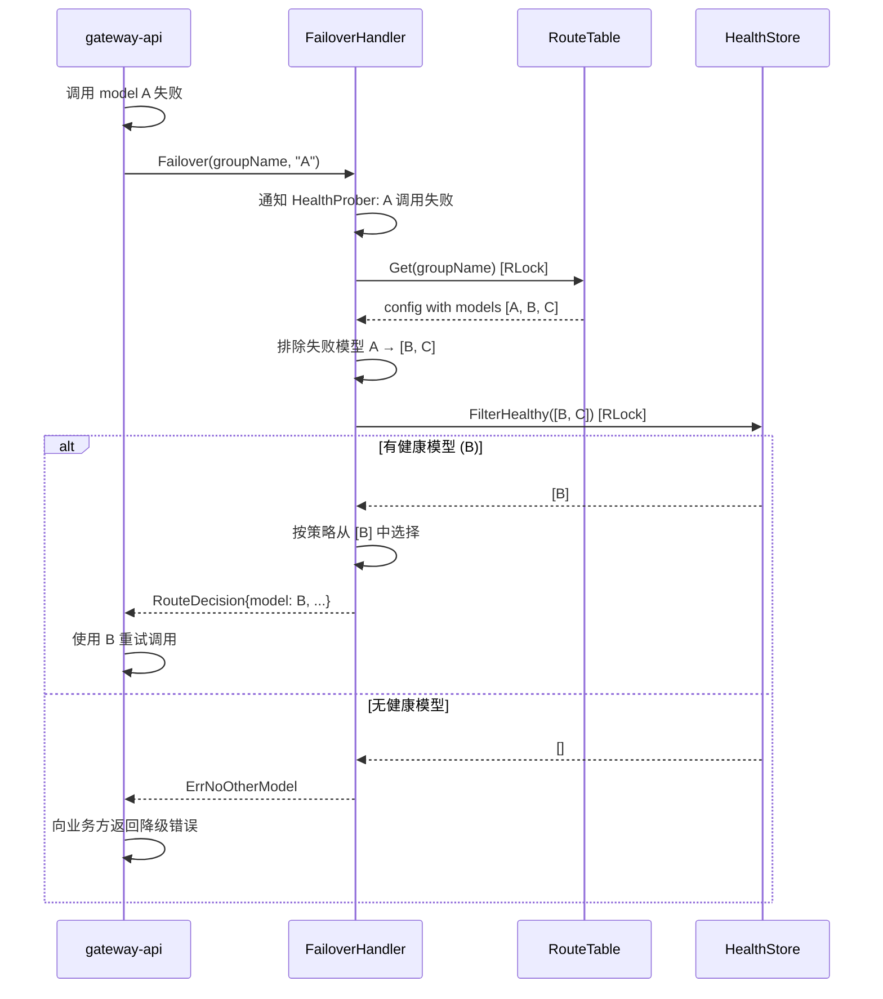
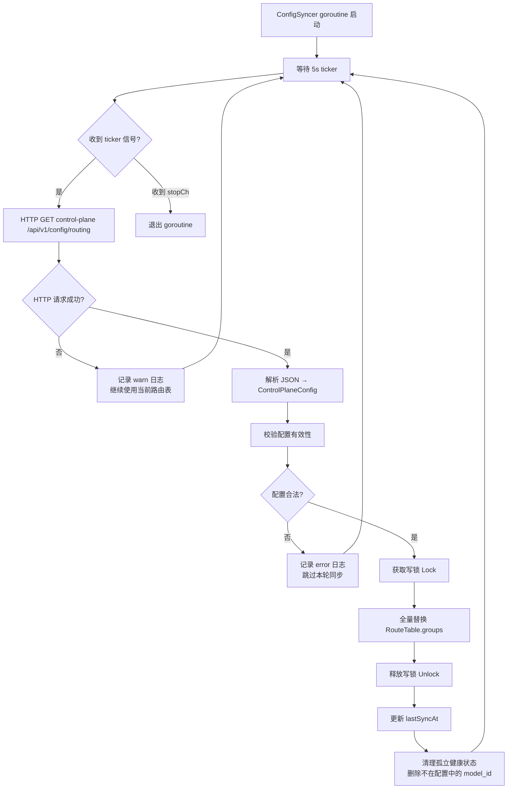

# scheduler Web 后端详细设计

## 0. 文档信息

| 属性 | 内容 |
| :--- | :--- |
| **所属变更** | CHG-20260525-001 |
| **模块名称** | scheduler |
| **模块类型** | web-backend |
| **创建时间** | 2026-05-25 |

### 修订记录

| 版本号 | 修改日期 | 修改内容摘要 | 修改人 |
| :--- | :--- | :--- | :--- |
| v1.0 | 2026-05-25 | 初稿创建 | OpenCode |

---

## 1. 设计决策

本章节记录 scheduler 模块的核心技术决策，所有决策已与 spec/hld 对齐，无需进一步讨论。

| 编号 | 决策项 | 选择方案 | 理由 | 替代方案及淘汰原因 |
| :--- | :--- | :--- | :--- | :--- |
| DD-01 | 健康评分机制 | 5s 滑动窗口，失败 ≥3 → 不健康，连续成功 ≥3 → 恢复 | 短窗口 + 低阈值兼顾灵敏度和抗抖动；5s 窗口足以过滤网络偶发抖动，3 次阈值避免单次超时就触发切换 | 固定计数无时间窗口：开关状态过于颠簸，不适合生产环境 |
| DD-02 | 路由表更新 | 每 5s 全量从 control-plane HTTP 拉取替换 | 与 control-plane 配置下发周期一致，实现简单，全量替换避免增量同步的一致性问题 | WebSocket 推送：增加 control-plane 复杂度，全量拉取已满足 5s 最终一致需求 |
| DD-03 | 快速失败 | 60s 内同模型切换 ≥5 次 → 直接标不健康 | 防止故障模型反复被选中→失败→切换的"抖动重试"循环浪费网关资源 | 无此机制：故障模型在定时探测兜底前会被反复选中和切换，浪费调用链路 |
| DD-04 | 探测并发 | worker pool 上限 50 goroutine | 限制同时探测的 goroutine 数量，避免大量模型同时探测造成资源冲击；50 为经验值，可配置 | 无限制 goroutine：模型数超过数百时 goroutine 爆炸，内存和调度开销不可控 |

---

## 2. 核心组件设计

scheduler 作为 Go package 嵌入 gateway-api 进程内运行，不独立部署。gateway-api 通过函数调用使用 scheduler 的路由和切换能力。scheduler 内部通过 HTTP 客户端访问 control-plane（配置同步）和各厂商渠道（健康探测）。

### 2.1 组件总览

```
scheduler package
├── RouteTable      内存路由表 (sync.RWMutex)
├── HealthStore     模型健康状态存储 (atomic map)
├── Router          路由决策引擎
├── FailoverHandler 故障切换处理器
├── ConfigSyncer    配置同步器（后台 goroutine）
├── HealthProber    健康探测引擎（后台 goroutine pool）
└── EventPublisher  事件发布器
```

---

### 2.2 RouteTable — 内存路由表

存储组→策略→模型的完整映射关系，是路由决策的唯一数据源。

**Go 结构体定义**：

```go
type RouteTable struct {
    mu     sync.RWMutex
    groups map[string]*GroupRoutingConfig // key: group_name
}

type GroupRoutingConfig struct {
    GroupName  string
    Strategy   RoutingStrategy    // 路由策略枚举
    Models     []*ModelRoutingEntry // 组内模型列表
    RoundRobin atomic.Int64       // 轮询计数器（仅轮询策略使用）
    UpdatedAt  time.Time          // 最后更新时间
}

type ModelRoutingEntry struct {
    ModelID   string           // 模型唯一标识
    ModelName string           // 模型名称
    GroupID   string           // 所属组 ID
    Priority  int              // 优先级（仅优先级策略使用，1 最高）
    Weight    int              // 权重（仅加权策略使用，1-100）
    ChannelInfo ChannelEndpoint // 渠道连接信息
}

type ChannelEndpoint struct {
    ChannelID  string // 渠道 ID
    Endpoint   string // 渠道端点 URL
    Credential string // 认证凭证
    TimeoutMs  int    // 探测超时（毫秒）
}
```

**并发模型**：
- 读路径（路由决策）：持有 RLock，多 goroutine 并发读
- 写路径（配置同步）：持有 Lock，全量替换组配置
- 轮询计数器：使用 `atomic.Int64` 无锁递增，避免写锁竞争

---

### 2.3 HealthStore — 健康状态存储

存储每个模型的实时健康状态、连续成功/失败计数和滑动窗口记录。

**Go 结构体定义**：

```go
type HealthStore struct {
    mu     sync.RWMutex
    states map[string]*ModelHealthStatus // key: model_id
}

type ModelHealthStatus struct {
    ModelID             string        // 模型唯一标识
    Status              HealthStatus   // 当前状态：Healthy / Unhealthy
    ConsecutiveFailures int           // 连续失败次数
    ConsecutiveSuccesses int           // 连续成功次数
    FailureWindow        *FailureRingBuffer // 5s 滑动窗口失败记录
    QuickFailCount       int           // 60s 内快速失败次数
    QuickFailWindowStart time.Time    // 快速失败窗口起始时间
    LastProbeTime        time.Time     // 最后一次主动探测时间
    LastFailTime         time.Time     // 最后一次失败时间（含被动和主动）
    LastStateChange      time.Time     // 最后状态变更时间
    CreatedAt            time.Time     // 首次注册时间
}

// FailureRingBuffer 5s 滑动窗口环形缓冲
type FailureRingBuffer struct {
    timestamps []time.Time // 固定容量环形数组
    head       int         // 写入位置
    size       int         // 当前有效元素数
    cap        int         // 容量
}
```

**评分逻辑**：

```
// 被动检测：调用失败通知到达时
OnCallFailure(modelID):
    health := store.Get(modelID)
    health.FailureWindow.Record(now)
    health.ConsecutiveFailures++
    health.ConsecutiveSuccesses = 0
    health.LastFailTime = now

    if health.FailureWindow.RecentFailures(5s) >= 3:
        health.markUnhealthy()     // 标记不健康 + 发布事件
    end

    if now - health.QuickFailWindowStart > 60s:
        health.QuickFailCount = 0
        health.QuickFailWindowStart = now

    health.QuickFailCount++
    if health.QuickFailCount >= 5:
        health.markUnhealthy()     // 快速失败触发
    end

// 主动探测：定时器触发
OnProbeResult(modelID, success):
    health := store.Get(modelID)
    if success:
        health.ConsecutiveSuccesses++
        health.ConsecutiveFailures = 0
        if health.ConsecutiveSuccesses >= 3:
            health.markHealthy()   // 标记健康 + 发布事件
    else:
        health.FailureWindow.Record(now)
        health.ConsecutiveFailures++
        health.ConsecutiveSuccesses = 0
        health.LastFailTime = now
        if health.ConsecutiveFailures >= 3:
            health.markUnhealthy()
    health.LastProbeTime = now
```

---

### 2.4 Router — 路由决策引擎

根据组策略类型和当前健康状态选择目标模型。

**三种策略的算法伪代码**：

```
func Route(groupName string) (*RouteDecision, error):
    config := routeTable.Get(groupName)
    if config == nil:
        return nil, ErrGroupNotFound

    healthyModels := healthStore.FilterHealthy(config.Models)
    if len(healthyModels) == 0:
        return nil, ErrNoAvailableModel

    switch config.Strategy:
    case StrategyRoundRobin:
        return routeRoundRobin(config, healthyModels)
    case StrategyPriority:
        return routePriority(healthyModels)
    case StrategyWeighted:
        return routeWeighted(healthyModels)
```

**策略实现**：

```
routeRoundRobin(config, healthyModels):
    // 使用 atomic 计数器，跳过不健康模型
    for attempt := 0; attempt < len(healthyModels); attempt++:
        idx := config.RoundRobin.Add(1) - 1
        model := healthyModels[idx % len(healthyModels)]
        if model is healthy:
            return &RouteDecision{SelectedModel: model, ...}
    // 理论上不应走到此处，安全兜底返回第一个健康模型
    return &RouteDecision{SelectedModel: healthyModels[0], ...}
```

```
routePriority(healthyModels):
    // 按 priority 升序排列，同优先级内部轮询
    sort by priority asc
    // 找到优先级最高的健康模型集合
    minPriority := healthyModels[0].Priority
    topModels := filter(healthyModels, priority == minPriority)
    // 同优先级内部轮询
    return topModels[pollCounter % len(topModels)]
```

```
routeWeighted(healthyModels):
    // 将健康模型的权重归一化到总和区间
    totalWeight := sum(model.Weight for model in healthyModels)
    if totalWeight == 0:
        return nil, ErrNoAvailableModel

    // 区间映射：model[0] → [0, w0), model[1] → [w0, w0+w1), ...
    rand := randInt(0, totalWeight)
    cumulative := 0
    for model in healthyModels:
        cumulative += model.Weight
        if rand < cumulative:
            return &RouteDecision{SelectedModel: model, ...}
```

---

### 2.5 ConfigSyncer — 配置同步器

后台 goroutine，周期性从 control-plane HTTP 拉取全量配置并替换路由表。

**Go 结构体定义**：

```go
type ConfigSyncer struct {
    httpClient *http.Client
    cpBaseURL  string           // control-plane 地址
    routeTable *RouteTable
    pollInterval time.Duration  // 拉取间隔，默认 5s
    stopCh     chan struct{}
    lastSyncAt time.Time
}

// control-plane 返回的配置结构
type ControlPlaneConfig struct {
    Groups []GroupConfig `json:"groups"`
    Version string       `json:"version"` // 配置版本，预留
}

type GroupConfig struct {
    GroupName string          `json:"group_name"`
    GroupID   string          `json:"group_id"`
    Strategy  RoutingStrategy `json:"strategy"`
    Enabled   bool            `json:"enabled"`
    Models    []GroupModel    `json:"models"`
}

type GroupModel struct {
    ModelID     string         `json:"model_id"`
    ModelName   string         `json:"model_name"`
    GroupID     string         `json:"group_id"`
    Priority    int            `json:"priority"`
    Weight      int            `json:"weight"`
    ChannelInfo ChannelEndpoint `json:"channel_info"`
}
```

**同步流程**：

```
func (cs *ConfigSyncer) Run():
    ticker := time.NewTicker(cs.pollInterval)
    defer ticker.Stop()

    for:
        select:
        case <-ticker.C:
            cs.doSync()
        case <-cs.stopCh:
            return

func (cs *ConfigSyncer) doSync():
    resp, err := cs.httpClient.Get(cs.cpBaseURL + "/api/v1/config/routing")
    if err != nil:
        log.Warn("config sync failed", "error", err)
        return  // 失败不覆盖现有路由表，继续使用上一次成功配置

    config := parseResponse(resp)
    cs.routeTable.ReplaceAll(config)  // 全量替换，写锁
    cs.lastSyncAt = time.Now()
```

---

### 2.6 HealthProber — 健康探测引擎

双机制并行：被动检测（调用失败即时降级，毫秒级）+ 主动探测（定时 HTTP 探测，30s 兜底）。

**Go 结构体定义**：

```go
type HealthProber struct {
    httpClient  *http.Client
    healthStore *HealthStore
    routeTable  *RouteTable
    probeInterval time.Duration  // 探测间隔，默认 30s
    workerPool   chan struct{}   // 并发控制，cap=50
    stopCh       chan struct{}
}
```

**双机制设计**：

**机制一 — 被动检测（毫秒级，主要路径）**：

```
// gateway-api 调用模型失败后调用
func (hp *HealthProber) NotifyFailure(modelID string):
    hp.healthStore.RecordFailure(modelID)
    // 评分计算见 2.3 节评分逻辑
```

**机制二 — 主动探测（30s 兜底路径）**：

```
func (hp *HealthProber) Run():
    ticker := time.NewTicker(hp.probeInterval)
    defer ticker.Stop()

    for:
        select:
        case <-ticker.C:
            hp.probeAll()
        case <-hp.stopCh:
            return

func (hp *HealthProber) probeAll():
    allModels := hp.routeTable.GetAllModels()
    var wg sync.WaitGroup
    for _, model := range allModels:
        hp.workerPool <- struct{}{} // 阻塞获取 worker slot
        wg.Add(1)
        go func(m *ModelRoutingEntry):
            defer func():
                <-hp.workerPool
                wg.Done()
            hp.probeOne(m)           // 单次探测
    wg.Wait()

func (hp *HealthProber) probeOne(model):
    ctx, cancel := context.WithTimeout(context.Background(), model.ChannelInfo.TimeoutMs)
    defer cancel()

    req, _ := http.NewRequestWithContext(ctx, "GET", model.ChannelInfo.Endpoint+"/health", nil)
    resp, err := hp.httpClient.Do(req)
    if err != nil:
        hp.healthStore.RecordProbeFailure(model.ModelID)
        return

    if resp.StatusCode >= 200 && resp.StatusCode < 300:
        hp.healthStore.RecordProbeSuccess(model.ModelID)
    else:
        hp.healthStore.RecordProbeFailure(model.ModelID)

    // 限流等临时错误（429）不计为失败
    if resp.StatusCode == 429:
        hp.healthStore.RecordProbeSuccess(model.ModelID) // 临时错误保留当前状态
```

---

### 2.7 FailoverHandler — 故障切换处理器

排除已失败的模型，从同组剩余健康模型中重新路由。

**Go 结构体定义**：

```go
type FailoverHandler struct {
    router      *Router
    healthStore *HealthStore
    routeTable  *RouteTable
}
```

**切换流程**：

```
func (fh *FailoverHandler) Failover(groupName, failedModelID string) (*RouteDecision, error):
    config := fh.routeTable.Get(groupName)
    if config == nil:
        return nil, ErrGroupNotFound

    // 从组内排除已失败模型
    allModels := config.Models
    remainingModels := filter(allModels, modelID != failedModelID)
    if len(remainingModels) == 0:
        return nil, ErrNoOtherModel

    healthyModels := fh.healthStore.FilterHealthy(remainingModels)
    if len(healthyModels) == 0:
        return nil, ErrNoOtherModel

    // 按组策略从剩余健康模型中重新选择
    return fh.router.selectByStrategy(config.Strategy, healthyModels)
```

---

## 3. 关键流程

### 3.1 路由决策流程



### 3.2 健康探测周期



### 3.3 故障切换流程



### 3.4 RouteTable 更新周期



---

## 4. 错误处理与降级

| 故障场景 | 检测方式 | 处理策略 | 对上游影响 | 降级路径 |
| :--- | :--- | :--- | :--- | :--- |
| control-plane 不可达 | ConfigSyncer HTTP 请求超时/拒绝 | 继续使用上一次成功同步的配置，持续重试拉取（5s 间隔），记录 warn 日志 | 无影响，路由表保持最新一次有效配置 | 若启动时首次同步即失败，scheduler 初始化路由表为空，所有路由请求返回 ErrGroupNotFound |
| control-plane 返回非法配置 | JSON 解析失败 / 配置校验失败 | 跳过本轮同步，不覆盖路由表，记录 error 日志 | 无影响 | 保留上一轮有效配置 |
| 组内所有模型不健康 | Router.FilterHealthy 返回空集 | 返回 `ErrNoAvailableModel` 错误码 | gateway-api 向业务方返回 503 + 可理解提示 | gateway-api 可配置降级为直连组内首个注册模型（不管健康状态） |
| 故障切换时无其他可用模型 | FailoverHandler 剩余健康模型为空 | 返回 `ErrNoOtherModel` 错误码 | gateway-api 向业务方返回调用失败 | gateway-api 记录失败事件到 observability-hub |
| 健康探测渠道超时 | context.WithTimeout 触发 | 计为一次失败，不阻塞其他模型的探测（每模型独立 goroutine） | 该模型评分下降，可能被标记为不健康 | 定时探测周期内同一模型只计一次超时 |
| 健康探测渠道返回 429（限流） | HTTP 状态码 429 | 不计为失败，保留当前健康状态 | 无影响 | 避免因渠道自我保护导致的误判 |
| 路由表被写锁阻塞 | 配置同步持有 Lock 期间 | 路由决策请求排队等待 RLock，写锁释放后立即获取 | 5s 一次的全量同步写锁持有时间极短（<1ms），路由决策几乎不受影响 | 配置同步失败不影响路由表可用性 |
| scheduler 模块加载失败 | gateway-api 启动时初始化失败 | gateway-api 降级为跳过调度逻辑，直连组内首个注册模型 | 丧失路由策略和健康过滤能力 | 降级模式下仍可完成基本代理调用 |

---

## 5. 并发模型

```
                    ┌──────────────────────────────────┐
                    │          RouteTable               │
                    │  sync.RWMutex                     │
                    │  ┌──────────────────────────┐     │
                    │  │ groups map[string]*...    │     │
                    │  │   └─ RoundRobin atomic   │     │
                    │  └──────────────────────────┘     │
                    └────┬──────────────┬───────────────┘
                         │ RLock        │ Lock (Write)
              ┌──────────┴──┐      ┌────┴──────────┐
              │  Router     │      │ ConfigSyncer  │
              │  Failover   │      │ (5s 周期)      │
              └─────────────┘      └───────────────┘

                    ┌──────────────────────────────────┐
                    │          HealthStore              │
                    │  sync.RWMutex                     │
                    │  ┌──────────────────────────┐     │
                    │  │ states map[string]*...    │     │
                    │  │   └─ FailureRingBuffer   │     │
                    │  └──────────────────────────┘     │
                    └────┬──────────────┬───────────────┘
                         │ RLock        │ Lock (Write)
              ┌──────────┴──┐      ┌────┴──────────────┐
              │  Router     │      │ HealthProber      │
              │  Failover   │      │ (passive + active) │
              └─────────────┘      │ ConfigSyncer      │
                                   │ (清理孤立状态)     │
                                   └───────────────────┘
```

- **RouteTable**：读路径（Router / FailoverHandler）持有 RLock 并发读；写路径（ConfigSyncer）持有 Lock，5s 一次，持有时间 <1ms
- **HealthStore**：读路径（Router / FailoverHandler FilterHealthy）持有 RLock；写路径（HealthProber / ConfigSyncer）持有 Lock
- **RoundRobin 计数器**：使用 `atomic.Int64`，无需锁
- **Worker pool**：channel 实现，cap=50，阻塞式获取 slot，探测完成后释放

---

## 6. 模块初始化与生命周期

```go
type Scheduler struct {
    router          *Router
    failoverHandler *FailoverHandler
    configSyncer    *ConfigSyncer
    healthProber    *HealthProber
    eventPublisher  *EventPublisher
}

func NewScheduler(cfg SchedulerConfig) (*Scheduler, error):
    routeTable := NewRouteTable()
    healthStore := NewHealthStore()

    s := &Scheduler{
        router:          NewRouter(routeTable, healthStore),
        failoverHandler: NewFailoverHandler(routeTable, healthStore),
        configSyncer:    NewConfigSyncer(cfg.ControlPlaneURL, routeTable),
        healthProber:    NewHealthProber(routeTable, healthStore),
        eventPublisher:  NewEventPublisher(),
    }

    // 启动后台 goroutine
    go s.configSyncer.Run()
    go s.healthProber.Run()

    return s, nil

func (s *Scheduler) Shutdown():
    close(s.configSyncer.stopCh)
    close(s.healthProber.stopCh)
    // 等待 goroutine 优雅退出
```