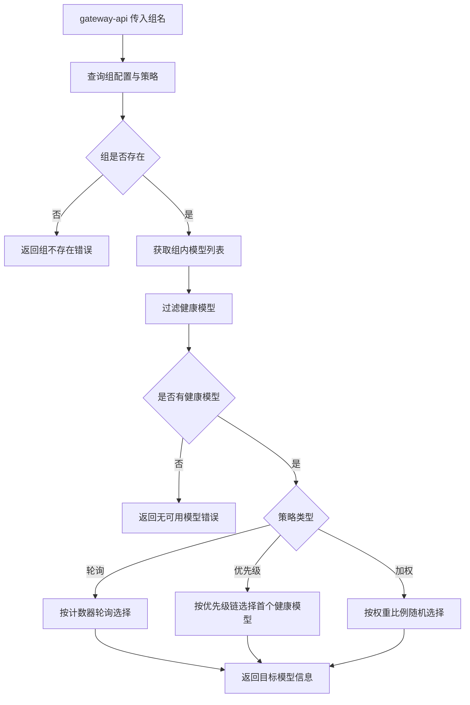
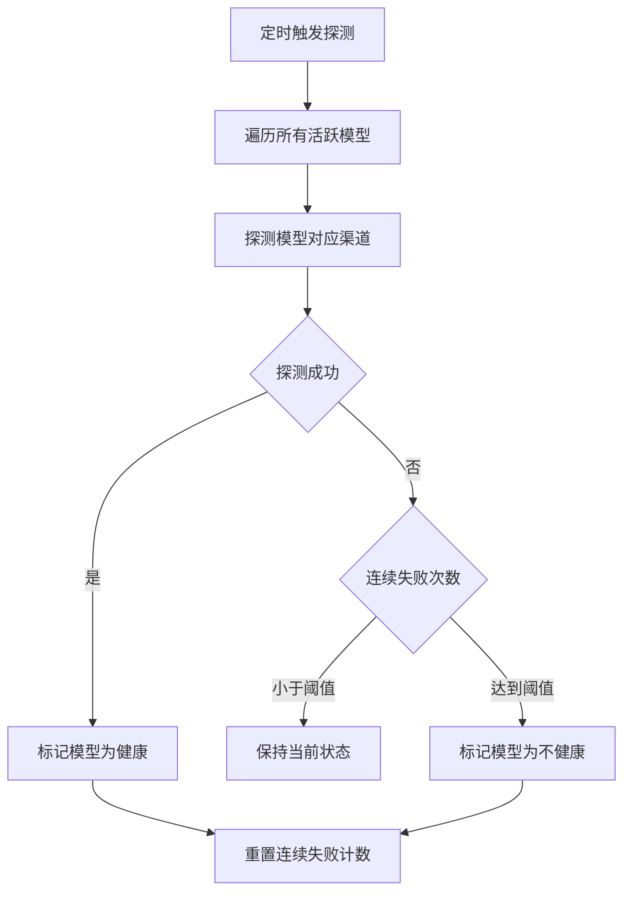
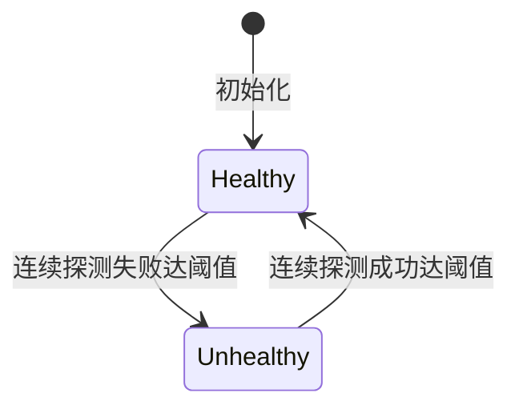

# scheduler Web 后端需求规范

## 0. 文档信息

| 属性 | 内容 |
| :--- | :--- |
| **所属变更** | CHG-20260525-001 |
| **模块名称** | scheduler |
| **模块类型** | web-backend |
| **创建时间** | 2026-05-25 |

### 修订记录

| 版本号 | 修改日期 | 修改内容摘要 | 修改人 |
| :--- | :--- | :--- | :--- |
| v1.0 | 2026-05-25 | 初稿创建 | OpenCode |

---

## 1. 业务背景与系统目标

* **业务背景**：当前 gateway-api 调用方直接指定模型名（如 `deepseek-chat`），业务与具体厂商和渠道强耦合。引入模型组概念后，需要独立的调度层承接组名→模型解析、组内路由决策、负载均衡、健康探测和故障切换，将调度逻辑从网关主链路中解耦。
* **核心目标**：实现模型组内多维度路由决策——根据管理员配置的策略（轮询/优先级/权重）从组内健康模型中选出目标，支持实时健康探测与秒级故障切换，确保调用方不感知底层模型可用性变化。
* **关键衡量指标**：
  - 组内路由决策耗时不超过 10 毫秒
  - 健康检查探测周期不超过 30 秒
- 故障检测到切换完成在百毫秒级闭环（调用失败即时触发切换，不等待定时探测周期）
- 健康检查探测周期不超过 30 秒（背景兜底）

---

## 2. 关键概念

- **模型组（Model Group）**：管理员自定义的逻辑分组，聚合跨渠道模型，组内模型共享同一路由策略
- **路由策略（Routing Strategy）**：组内选择目标模型的方式，支持轮询（round-robin）、优先级（priority，首选→备选链）、加权（weighted，按比例分配）
- **健康探测（Health Probe）**：定时检查组内模型对应渠道的可用性，探测结果决定模型在路由中是否候选
- **故障切换（Failover）**：当前选中模型不可用时，按组内策略自动选择下一个可用模型，调用方无感知
- **模型状态**：健康（可路由）/ 不健康（不可路由），由健康探测结果驱动，实时更新

---

## 3. 超出范围

- 不负责模型组的创建和管理（由 control-plane 负责）
- 不负责调用日志、用量统计、指标聚合（由 observability-hub 负责）
- 不负责权限校验和身份解析（由 auth 和 gateway-api 负责）
- 不处理组名不存在的场景（由 gateway-api 在调用 scheduler 前校验）
- 不做故障恢复后的自动回切（待后续版本）
- 不做跨组的全局调度策略

---

## 4. 角色与权限控制（RBAC）

| 角色名称 | 角色描述 | 操作权限 | 数据范围 |
| :--- | :--- | :--- | :--- |
| gateway-api | 消费路由决策的内部服务 | 调用路由决策接口，获取目标模型 | 所有已配置的模型组 |
| control-plane | 提供模型组和策略配置的内部服务 | 提供组配置、模型列表、策略参数的读取接口 | 所有已配置的模型组和模型 |

---

## 5. 业务流程与状态机

### 5.1 路由决策流程

### 5.2 健康探测流程

### 5.3 模型健康状态机

| 当前状态 | 触发动作 | 目标状态 | 前置条件 |
| :--- | :--- | :--- | :--- |
| 无 | 模型注册 | 健康 | 模型已加入至少一个组 |
| 健康 | 连续 N 次探测失败 | 不健康 | 失败次数达到阈值 [待确认: 阈值的具体值] |
| 不健康 | 连续 N 次探测成功 | 健康 | 成功次数达到恢复阈值 |

---

## 6. 详细功能需求

### 6.1 组内路由决策

**A. 功能说明**

gateway-api 在收到业务方请求后，将组名传给 scheduler，scheduler 根据组配置的路由策略和当前模型健康状态，返回一个具体的目标模型（含渠道和模型标识）。scheduler 不关心请求内容，只根据组名和策略做纯路由决策。

**B. 用户故事**

#### US-RT-01 — 轮询策略路由 (P0)

**作为**业务开发团队，**我想要**组内模型以轮询方式被选择，**以便**请求均匀分配到同组各模型上。

**功能说明**：
- 每个组维护一个轮询计数器，每次路由决策后计数器递增
- 轮询时跳过不健康的模型，只从健康模型集合中按序选择
- 组内模型变更（增删）时计数器不重置，继续从当前位置轮询

**异常与边界**：
- 组内所有模型均不健康 → 返回明确错误"该模型组当前无可用模型"
- 组内仅剩一个健康模型 → 无论轮询计数器位置如何，始终选择该模型

#### US-RT-02 — 优先级策略路由 (P0)

**作为**管理员，**我想要**为组内模型设定优先级顺序，**以便**系统按主备链路依次选择，仅在主模型不可用时才走备选。

**功能说明**：
- 组内模型按管理员设定的优先级排序（数字越小优先级越高）
- 路由时从优先级最高的模型开始检查，选择第一个健康的模型
- 高优先级模型恢复健康后不会自动回切（本次版本不做回切）

**异常与边界**：
- 同优先级存在多个模型 → 对同优先级模型内部采用轮询
- 所有优先级模型均不健康 → 返回"该模型组当前无可用模型"错误

#### US-RT-03 — 加权策略路由 (P0)

**作为**管理员，**我想要**为组内模型分配权重比例，**以便**按设定比例将流量分配到不同模型上。

**功能说明**：
- 管理员为每个模型分配权重值（正整数）
- 路由时按权重比例随机选择模型，权重越高被选中概率越大
- 不健康的模型权重不参与计算，健康模型权重在组内重新归一化

**异常与边界**：
- 管理员配置的所有模型权重均为 0 → 等效于所有模型均不可用，返回错误
- 权重值超出系统允许范围（1-100）→ 创建/编辑时校验拒绝

### 6.2 健康探测

**A. 功能说明**

scheduler 定时对所有组内模型对应的渠道执行健康探测，根据探测结果更新模型健康状态。探测结果驱动路由决策中的模型过滤。

**B. 用户故事**

#### US-HP-01 — 定时健康探测（背景兜底） (P1)

**作为**系统，**我想要**定时探测所有组内模型的渠道可用性，**以便**及时发现不可用模型并将其从路由候选集中移除。

**功能说明**：
- 对所有活跃模型组的全部模型执行健康探测，探测周期可配置 [待确认: 默认探测周期值]
- 探测成功标准：渠道端点返回可接受范围内的响应
- 探测结果记录连续成功/失败计数，达到阈值后触发状态变更
- 探测发起的并发数应有上限，避免同时探测大量渠道造成资源冲击

**异常与边界**：
- 探测请求超时 → 计为一次失败，不阻塞其他模型的探测
- 渠道返回临时错误（如限流） → 不计为失败（与真正的连接失败区分）
- 模型未被任何组引用 → 不纳入探测范围，节省资源

#### US-HP-02 — 故障标记与恢复 (P1)

**作为**系统，**我想要**在模型连续失败达到阈值后标记为不健康，并在恢复后重新标记为健康，**以便**路由决策始终基于真实可用性。

**功能说明**：
- 连续探测失败达到阈值时，模型状态从健康切换为不健康
- 不健康模型仍接受探测，连续成功达到恢复阈值后状态切回健康
- 状态变更时产生事件记录，供 observability-hub 消费

**异常与边界**：
- 模型从未健康过（初始状态不健康） → 首次成功不应立即标为健康，仍需达到连续成功阈值
- 健康模型偶发单次失败 → 不应立即标记为不健康，需达到连续失败阈值

#### US-HP-03 — 调用失败即时标记 (P0)

**作为**系统，**我想要**在 gateway-api 实际调用模型失败时立即收到通知并降低该模型的健康评分，**以便**故障感知不依赖定时探测周期，实现百毫秒级故障切换。

**功能说明**：
- gateway-api 调用模型失败后，通过故障切换接口通知 scheduler 该模型调用失败
- scheduler 收到失败通知后立即降低该模型的健康评分，短时间内多次失败则直接标记为不健康
- 标记为不健康的模型从路由候选集中移除，后续路由不再选中
- 该机制与定时健康探测并行运作：调用失败即时反应（毫秒级），定时探测背景兜底（秒级）

**异常与边界**：
- 偶发单次失败（如网络抖动）→ 降低评分但不立即标记不健康，连续多次失败后才标记
- 模型已为不健康状态 → 调用失败通知保持现有状态，不重复处理

### 6.3 故障切换

**A. 功能说明**

当路由决策返回的目标模型在调用时实际失败，gateway-api 可请求 scheduler 进行故障切换，scheduler 从同组剩余健康模型中重新选择一个目标。

**B. 用户故事**

#### US-FO-01 — 调用失败后切换 (P0)

**作为**gateway-api，**我想要**在目标模型调用失败时请求 scheduler 快速切换至同组其他健康模型，**以便**调用方不感知底层故障并将失败影响降到最低。

**功能说明**：
- gateway-api 在调用目标模型失败后，携带原组名和已失败模型标识请求 scheduler 重新路由
- scheduler 从同组健康模型中排除已失败模型，按组策略重新选择
- 返回新目标模型信息，gateway-api 使用新目标重试调用

**异常与边界**：
- 同组内除已失败模型外无其他健康模型 → 返回"该模型组无其他可用模型"错误
- 短时间内同一模型触发多次切换 → 触发快速失败机制，临时降低该模型的健康评分但不强制标记为不健康

---

## 7. 数据流与外部接口

* **输入**：gateway-api 传入组名，scheduler 返回目标模型信息（模型标识、渠道信息）
* **配置源**：从 control-plane 读取模型组列表、组内模型、路由策略配置，配置变更需在 5 秒内对 scheduler 生效
* **健康探测**：scheduler 主动向各组内模型的对应渠道发起探测请求
* **事件输出**：健康状态变更、切换事件写入 observability-hub 供后续消费

---

## 8. 非功能需求

* **性能**：路由决策在 10 毫秒内完成；健康探测不阻塞路由决策主链路
* **可靠性**：scheduler 自身故障时，gateway-api 应有降级策略（如直接路由到组内首个模型）
* **可观测性**：每次路由决策产出结构化日志（组名、策略、选中模型、决策耗时）；健康探测结果可追溯

---

## 9. 验收标准

| 编号 | 关联 | Given（前置状态） | When（触发动作） | Then（预期结果） | 优先级 |
| :--- | :--- | :--- | :--- | :--- | :--- |
| AC-RT-01 | US-RT-01 | Given 模型组"日常推理"内有 3 个健康模型，策略为轮询 | When 连续发起 3 次路由决策请求 | Then 3 次分别选择不同模型，按顺序轮询 | P0 |
| AC-RT-02 | US-RT-02 | Given 模型组"高智能"有 A（优先级1，健康）、B（优先级2，健康） | When 发起路由决策 | Then 选择优先级最高的 A 模型 | P0 |
| AC-RT-03 | US-RT-02 | Given 模型组"高智能"有 A（优先级1，不健康）、B（优先级2，健康） | When 发起路由决策 | Then 跳过 A，选择 B 模型 | P0 |
| AC-RT-04 | US-RT-03 | Given 模型组"测试"有 A（权重80）、B（权重20），均为健康 | When 发起 100 次路由决策 | Then A 被选中的次数约为 B 的 4 倍 | P0 |
| AC-HP-01 | US-HP-01 | Given 模型组内有 5 个模型 | When 健康探测周期触发 | Then 所有 5 个模型均被探测，结果更新至模型状态 | P0 |
| AC-HP-02 | US-HP-01 | Given 模型 A 的渠道不可达 | When 连续探测失败达到阈值 | Then 模型 A 状态变为不健康，路由决策跳过 A | P0 |
| AC-HP-03 | US-HP-02 | Given 模型 A 为不健康状态 | When 连续探测成功达到恢复阈值 | Then 模型 A 状态恢复为健康，重新参与路由 | P1 |
| AC-FO-01 | US-FO-01 | Given 模型组内有 A（健康）、B（健康） | When 路由决策选中 A 且 A 调用失败后请求切换 | Then scheduler 排除 A，返回 B 作为新目标 | P0 |
| AC-FO-02 | US-FO-01 | Given 模型组内只有 A（不健康）、B（不健康） | When 请求路由决策 | Then 返回"该模型组当前无可用模型"错误 | P0 |
| AC-FO-03 | US-FO-01 | Given 模型组内仅 A（已失败）和 B（不健康） | When A 调用失败后请求切换 | Then 返回"该模型组无其他可用模型"错误 | P0 |

---

## 10. 假设与依赖

- 依赖 control-plane 提供模型组、组内模型、路由策略的完整配置数据
- 依赖 gateway-api 在调用前完成组名有效性校验
- 假设组内模型对应的渠道均支持标准的健康探测方式
- 健康探测不会对渠道产生显著的负载压力
- 风险：若 control-plane 配置下发延迟，scheduler 可能在短暂窗口内使用过期配置进行路由决策