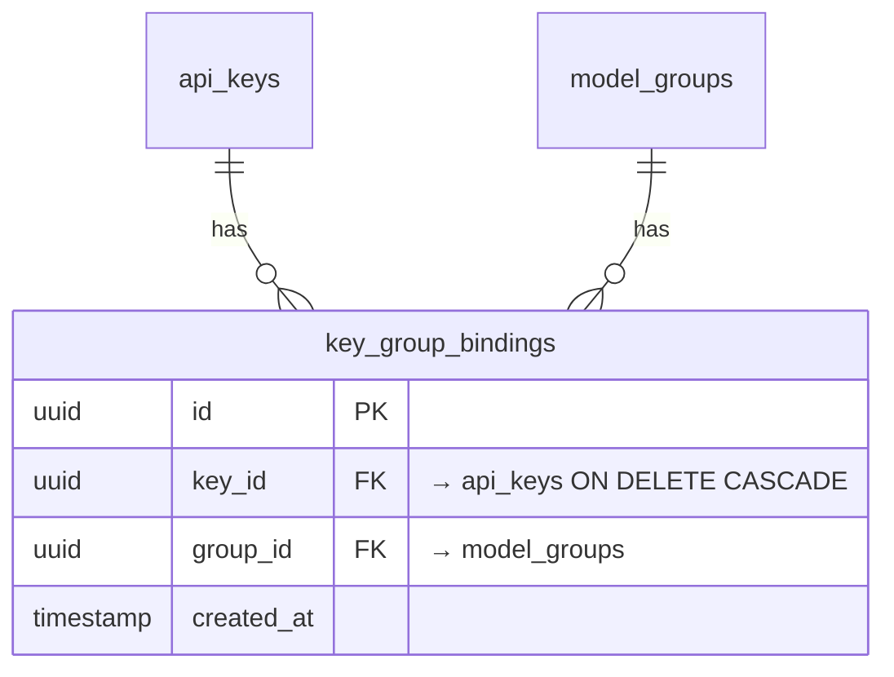

# control-plane 数据模型变更 — CHG-20260526-001

> 基线：xspec/modules/control-plane/data-model.md (v1.3)

## 变更摘要

新增 `key_group_bindings` 关联表实现 Key ↔ 模型组多对多绑定。通过外键约束保证引用完整性，UNIQUE 约束防止重复绑定。

## 实体关系变更



## 新增表

### key_group_bindings

Key 与模型组的多对多关联表。一条记录表示一个 Key 绑定了一个模型组。

| 字段 | 类型 | 约束 | 说明 |
| :--- | :--- | :--- | :--- |
| id | UUID | PK, NOT NULL, DEFAULT gen_random_uuid() | 主键 |
| key_id | UUID | NOT NULL, FK → api_keys(id) ON DELETE CASCADE | Key 被删除时联动删除绑定记录 |
| group_id | UUID | NOT NULL, FK → model_groups(id) | 模型组被删除时通过应用层控制（model_groups 软删除不走 CASCADE） |
| created_at | TIMESTAMPTZ | NOT NULL, DEFAULT NOW() | 绑定创建时间 |

**约束**：
- `UNIQUE(key_id, group_id)` — 同一 Key 不可重复绑定同一模型组
- `INDEX idx_kbg_key_id ON key_group_bindings(key_id)` — 加速按 Key 查询绑定
- `INDEX idx_kbg_group_id ON key_group_bindings(group_id)` — 加速按组查询关联的 Key（预留扩展）

## 查询模式

### 按 Key 查询绑定组（含组启停状态）

```sql
SELECT g.id, g.name, g.enabled, g.strategy, g.description
FROM key_group_bindings kbg
JOIN model_groups g ON g.id = kbg.group_id
WHERE kbg.key_id = ?
  AND g.deleted_at IS NULL;  -- GORM 软删除过滤
```

### 校验组是否绑定

```sql
SELECT EXISTS(
  SELECT 1 FROM key_group_bindings
  WHERE key_id = ? AND group_id = ?
);
```

### 批量插入（去重安全）

```sql
INSERT INTO key_group_bindings (key_id, group_id)
VALUES (?, ?), (?, ?), ...
ON CONFLICT (key_id, group_id) DO NOTHING;
```

## 迁移方案

### 迁移文件

```sql
-- migrate/xxxxxx_create_key_group_bindings.up.sql

CREATE TABLE IF NOT EXISTS key_group_bindings (
    id UUID PRIMARY KEY DEFAULT gen_random_uuid(),
    key_id UUID NOT NULL,
    group_id UUID NOT NULL,
    created_at TIMESTAMPTZ NOT NULL DEFAULT NOW(),
    CONSTRAINT fk_kbg_key FOREIGN KEY (key_id) REFERENCES api_keys(id) ON DELETE CASCADE,
    CONSTRAINT fk_kbg_group FOREIGN KEY (group_id) REFERENCES model_groups(id),
    CONSTRAINT uq_kbg_key_group UNIQUE (key_id, group_id)
);

CREATE INDEX idx_kbg_key_id ON key_group_bindings(key_id);
CREATE INDEX idx_kbg_group_id ON key_group_bindings(group_id);
```

```sql
-- migrate/xxxxxx_create_key_group_bindings.down.sql

DROP INDEX IF EXISTS idx_kbg_group_id;
DROP INDEX IF EXISTS idx_kbg_key_id;
DROP TABLE IF EXISTS key_group_bindings;
```

### 回滚策略

- 新表无历史数据，直接 DROP TABLE 即可回滚
- api_keys 和 model_groups 未修改，不受影响

### 对现有数据的影响

- 新增表，不影响已有数据和查询
- 现有 Key 在迁移后默认无任何模型组绑定（`/v1/models` 返回空列表）
- 管理员需手动为存量 Key 补充组绑定