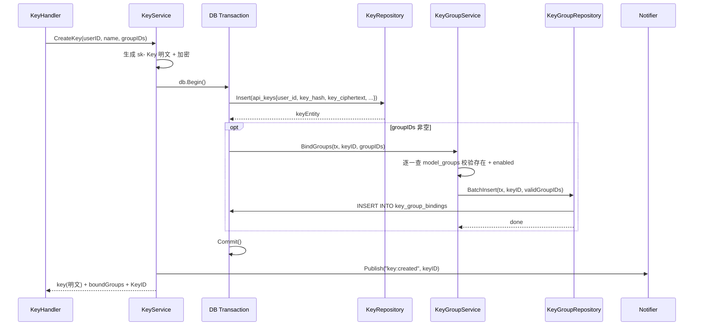
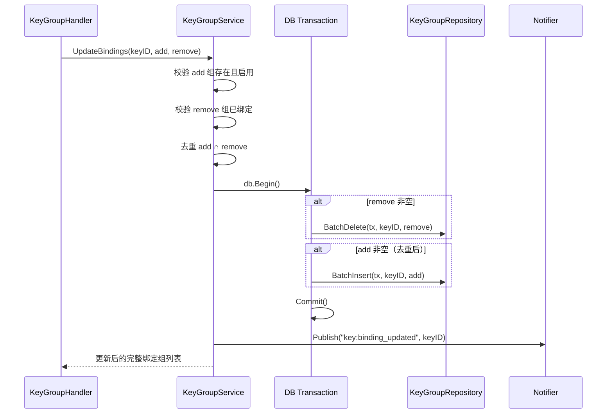
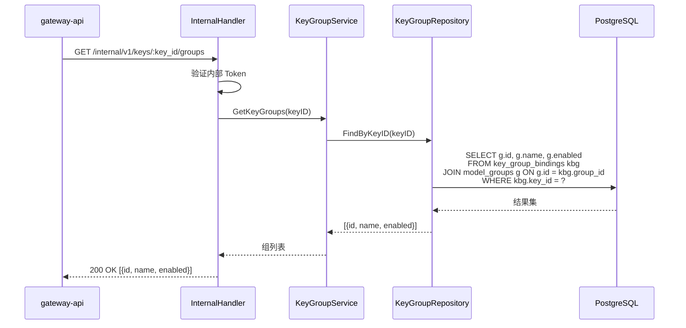

# control-plane 技术设计变更 — CHG-20260526-001

> 基线：xspec/modules/control-plane/design.md (v1.3)

## 变更摘要

在 Key 创建链路中嵌入模型组绑定逻辑：CreateKey 在同一数据库事务内完成 Key 记录写入和 key_group_bindings 批量插入。新增 KeyGroupHandler/Service/Repository 三层管理绑定增删查。提供内部接口供 gateway-api 实时查询 Key 绑定的模型组列表。

## 设计决策

| 决策点 | 选择 | 理由 |
| :--- | :--- | :--- |
| Key 创建与绑定原子性 | 同一 DB 事务 | Key 创建 QPS < 1，事务开销可忽略；避免 Key 已创建但绑定失败的半状态 |
| 绑定变更接口风格 | PATCH 增量 {add, remove} | 前端一次调用完成增删操作；增量更新不误覆盖未展示的绑定 |
| Redis 通知颗粒度 | 绑定变更时发布 key:binding_updated + key_id | gateway-api 可精确感知哪些 Key 绑定变化 |

## 组件详细设计

### KeyGroupHandler

```go
// handler/key_group_handler.go

type KeyGroupHandler struct {
    svc *KeyGroupService
}

// POST /api/v1/keys/:id/groups — 增量变更组绑定
// body: { "add": ["uuid-g1", "uuid-g2"], "remove": ["uuid-g3"] }
// add 和 remove 至少提供一个非空数组
func (h *KeyGroupHandler) UpdateBindings(c *gin.Context)

// GET /api/v1/keys/:id/groups — 查询 Key 当前绑定组列表
func (h *KeyGroupHandler) ListBindings(c *gin.Context)
```

### KeyGroupService

```go
// service/key_group_service.go

type KeyGroupService struct {
    repo   *KeyGroupRepository
    keyRepo *KeyRepository
    groupRepo *GroupRepository
    notifier *Notifier
}

// BindGroups — 创建 Key 时绑定模型组（事务内调用，不单独开事务）
// 校验：所有 groupIDs 在 model_groups 中存在且 status=enabled
// 跳过已不存在的组（记录日志不中断）
func (s *KeyGroupService) BindGroups(ctx context.Context, tx *gorm.DB, keyID string, groupIDs []string) error

// UpdateBindings — PATCH 增量变更绑定
// 步骤：
//  1. 校验 all add groupIDs 存在且启用
//  2. 校验 all remove groupIDs 当前已绑定该 Key
//  3. 去重：add ∩ remove → 忽略
//  4. 事务内：先 delete remove，再 insert add
//  5. 通知 Redis: key:binding_updated
func (s *KeyGroupService) UpdateBindings(ctx context.Context, keyID string, add, remove []string) ([]GroupInfo, error)

// GetKeyGroups — 查询 Key 绑定的模型组（含启停状态）
// 返回 JOIN model_groups 的结果，自动过滤已物理删除的组
func (s *KeyGroupService) GetKeyGroups(ctx context.Context, keyID string) ([]GroupInfo, error)

// ListAvailableGroups — 查询所有已启用模型组（供 Key 创建时选择）
func (s *KeyGroupService) ListAvailableGroups(ctx context.Context) ([]GroupSummary, error)
```

### KeyGroupRepository

```go
// repository/key_group_repository.go

type KeyGroupRepository struct {
    db *gorm.DB
}

// BatchInsert — 批量写入 key_group_bindings，跳过已存在的 (key_id, group_id)
// 使用 INSERT ... ON CONFLICT (key_id, group_id) DO NOTHING
func (r *KeyGroupRepository) BatchInsert(ctx context.Context, tx *gorm.DB, keyID string, groupIDs []string) error

// BatchDelete — 批量删除 key_group_bindings
func (r *KeyGroupRepository) BatchDelete(ctx context.Context, tx *gorm.DB, keyID string, groupIDs []string) error

// FindByKeyID — 查询 Key 所有绑定（JOIN model_groups 获取组名和状态）
func (r *KeyGroupRepository) FindByKeyID(ctx context.Context, keyID string) ([]GroupBinding, error)
```

### KeyService 变更

```go
// service/key_service.go（修改部分）

func (s *KeyService) CreateKey(ctx context.Context, userID string, name string, groupIDs []string) (*CreateKeyResult, error) {
    // 生成 sk- Key 明文
    // 加密 Key 密文

    var result *CreateKeyResult

    err := s.db.Transaction(func(tx *gorm.DB) error {
        // 原有：Insert api_keys
        keyEntity, err := s.keyRepo.Insert(tx, ...)
        if err != nil { return err }

        // 新增：如果提供了 groupIDs，在事务内绑定
        if len(groupIDs) > 0 {
            if err := s.keyGroupSvc.BindGroups(ctx, tx, keyEntity.ID, groupIDs); err != nil {
                return err
            }
        }

        result = &CreateKeyResult{...}
        return nil
    })

    // 事务提交后发布 Redis 通知
    s.notifier.Publish("key:created", keyEntity.ID)
    return result, err
}
```

### 核心流程

#### Key 创建（含组绑定）



#### 绑定变更



#### gateway-api 查询绑定组



## 错误处理

| 场景 | HTTP 状态码 | 错误码 | 说明 |
| :--- | :---: | :--- | :--- |
| Key 不存在 | 404 | KEY_NOT_FOUND | 校验 key_id 有效性 |
| add 中包含不存在的组 | 400 | GROUP_NOT_FOUND | 列出无效的 group_id |
| add 中包含已绑定组 | 400 | GROUP_ALREADY_BOUND | 列出已绑定的组名 |
| remove 中包含未绑定组 | 400 | GROUP_NOT_BOUND | 列出未绑定的组名 |
| add 和 remove 同时为空 | 400 | INVALID_REQUEST | 至少提供一个非空数组 |
| 内部 Token 无效 | 401 | UNAUTHORIZED | 内部接口 |
| DB 事务失败 | 500 | INTERNAL_ERROR | 记录详细错误日志 |