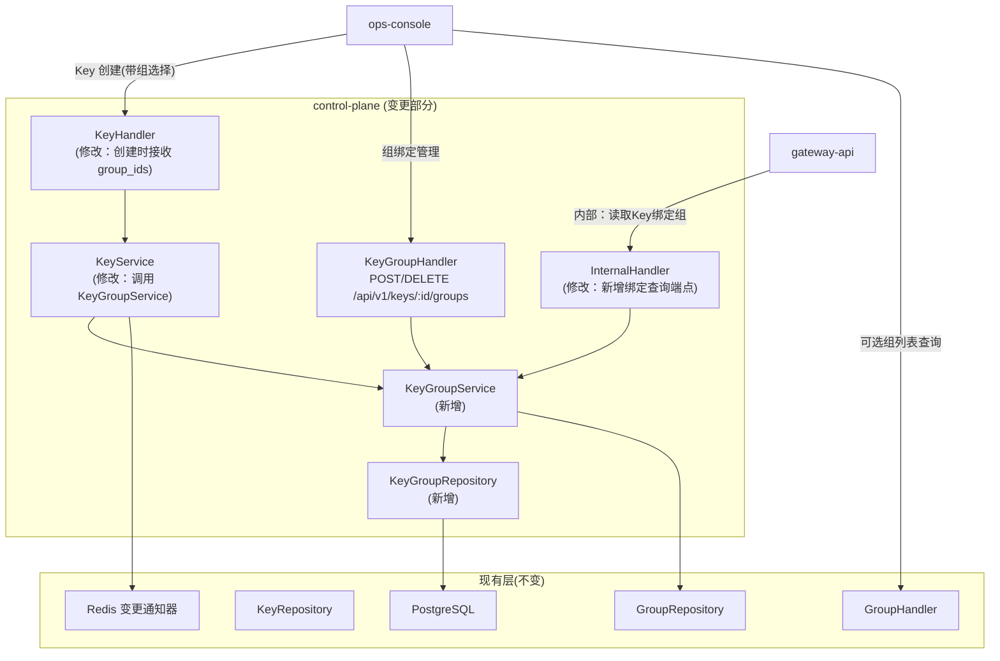
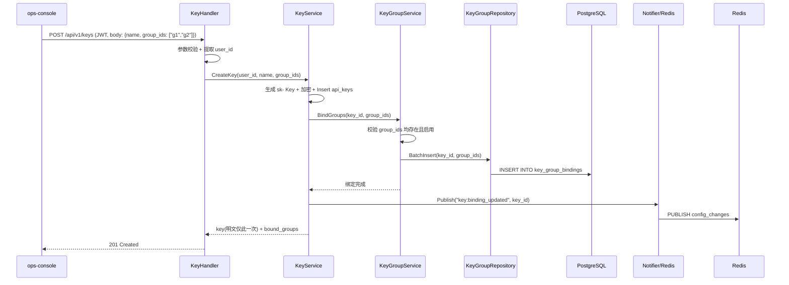
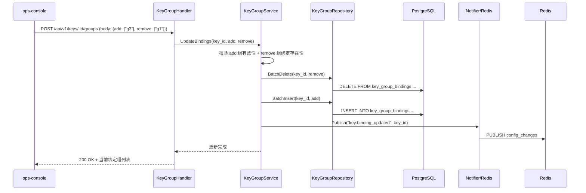
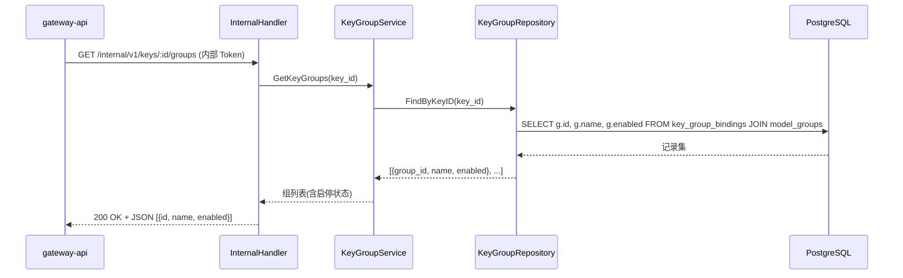

# control-plane 概要设计变更 — CHG-20260526-001

> 基线：xspec/modules/control-plane/hld.md (v1.3)

## 变更摘要

在现有 Key CRUD 和 Group CRUD 分层架构上新增 Key↔模型组多对多绑定：key_group_bindings 关联表 + KeyGroupService 管理绑定关系 + 供 gateway-api 读取绑定的内部接口。Key 创建时可选择模型组，支持后续增删绑定，已启用的模型组列表供员工选择时查询。

## 架构变更

### Key 创建含组绑定流程

### 组绑定变更流程

### gateway-api 查询 Key 绑定组流程

## 新增组件

| 组件 | 位置 | 职责 |
| :--- | :--- | :--- |
| KeyGroupHandler | handler/key_group_handler.go | Key 组绑定 HTTP 入口：POST 变更绑定（add+remove）、GET 查询绑定列表 |
| KeyGroupService | service/key_group_service.go | 绑定业务逻辑：组有效性校验、重复绑定检查、去重后的批量增删 |
| KeyGroupRepository | repository/key_group_repository.go | key_group_bindings 表持久化：BatchInsert、BatchDelete、FindByKeyID |

## 变更组件

| 组件 | 变更 | 说明 |
| :--- | :--- | :--- |
| KeyHandler | 修改 | POST /api/v1/keys 接收可选 group_ids 参数，传递给 KeyService |
| KeyService | 修改 | CreateKey 完成后调用 KeyGroupService.BindGroups 完成绑定 |
| InternalHandler | 修改 | 新增 GET /internal/v1/keys/:id/groups 端点，调 KeyGroupService 查询 |

## 新增端点

| 端点 | 方法 | 认证 | 说明 |
| :--- | :--- | :--- | :--- |
| /api/v1/keys/:id/groups | POST | JWT | 变更组绑定：{add: ["g3"], remove: ["g1"]} |
| /api/v1/keys/:id/groups | GET | JWT | 查询 Key 当前绑定组列表（含启停状态） |
| /api/v1/groups/available | GET | JWT | 查询所有已启用模型组，供 Key 创建时选择 |
| /internal/v1/keys/:id/groups | GET | 内部 Token | 供 gateway-api 读取 Key 绑定的组列表 |

## 数据存储变更

新增 `key_group_bindings` 表：

| 字段 | 类型 | 说明 |
| :--- | :--- | :--- |
| id | UUID | 主键 |
| key_id | UUID | FK → api_keys，ON DELETE CASCADE（Key 删除时联动删除绑定） |
| group_id | UUID | FK → model_groups |
| created_at | TIMESTAMP | 绑定创建时间 |

**约束**：UNIQUE(key_id, group_id) — 同一 Key 不可重复绑定同一组。

## 技术选型变更

无变更。沿用 Go + Gin + GORM + PostgreSQL + Redis 技术栈，不引入新依赖。

## 安全设计补充

| 威胁 | 防御措施 |
| :--- | :--- |
| Key 被删除后绑定残留 | ON DELETE CASCADE 自动清理；GORM 软删除模式使用 ForeignKey 约束 |
| 绑定已删除的模型组 | BatchInsert 前逐一校验 group_id 存在性；GetKeyGroups 时 JOIN model_groups 自动过滤已删除记录 |