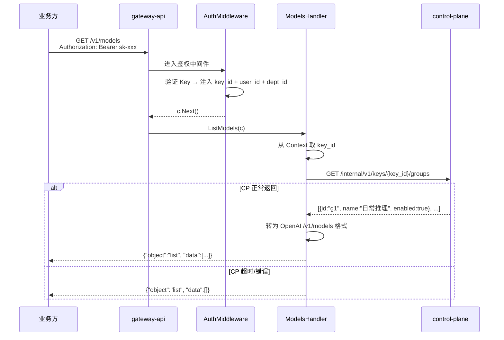
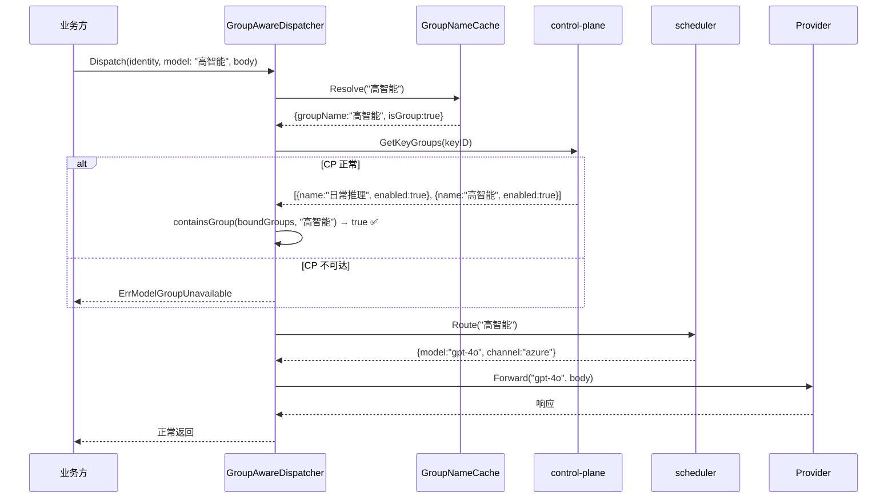

# gateway-api 技术设计变更 — CHG-20260526-001

> 基线：xspec/modules/gateway-api/design.md (v1.2)

## 变更摘要

修改 ModelsHandler（原 MeHandler）：`/v1/models` 从返回部门维度的个体模型列表改为通过 control-plane `/internal/v1/keys/:id/groups` 获取 Key 绑定的模型组列表。在 GroupAwareDispatcher 中追加绑定校验步骤：组名路由前校验该组在 Key 绑定范围内，不在范围则直接拒绝。

## 设计决策

| 决策点 | 选择 | 理由 |
| :--- | :--- | :--- |
| 绑定校验查询粒度 | 全量列表 + 客户端 contains 比对 | CP 全量接口已存在；组数 < 100 调用开销极小 |
| 校验位置 | GroupAwareDispatcher 内，scheduler 路由之前 | 越早拒绝越省资源；scheduler 不关心 Key 权限 |
| 校验失败语义 | 统一返回"模型组不可用" | 不区分组不存在 vs 未绑定，防止枚举攻击 |
| 绑定缓存 | 本期不做 | 保证变更即时生效；后续高频场景按需补 |

## 组件详细设计

### ModelsHandler（修改）

```go
// handler/models_handler.go（原 me_handler.go）

type ModelsHandler struct {
    cpClient *controlplane.Client
}

// GET /v1/models — 返回 Key 绑定的模型组列表
func (h *ModelsHandler) ListModels(c *gin.Context) {
    // 1. 从 Context 获取 key_id（AuthMiddleware 注入）
    keyID := c.GetString("key_id")

    // 2. 调 control-plane 获取绑定组
    ctx, cancel := context.WithTimeout(c.Request.Context(), 500*time.Millisecond)
    defer cancel()
    groups, err := h.cpClient.GetKeyGroups(ctx, keyID)

    // 3. 超时/失败降级：返回空列表
    if err != nil {
        logger.Warn("cp GetKeyGroups failed", "key_id", keyID, "err", err)
        c.JSON(200, gin.H{"object": "list", "data": []ModelItem{}})
        return
    }

    // 4. 转为 OpenAI /v1/models 格式
    items := make([]ModelItem, 0, len(groups))
    for _, g := range groups {
        items = append(items, ModelItem{
            ID:      g.Name,       // 组名作为 ID
            Object:  "model",
            Created: time.Now().Unix(), // 或 g.CreatedAt
            OwnedBy: "organization",    // 固定值
        })
    }

    c.JSON(200, gin.H{
        "object": "list",
        "data":   items,
    })
}
```

### GroupAwareDispatcher（修改）

```go
// dispatcher/group_aware.go（修改部分）

type GroupAwareDispatcher struct {
    cpClient      *controlplane.Client
    scheduler     *scheduler.Engine
    providerLayer *provider.Layer
    groupCache    *GroupNameCache  // 已有，不变
}

func (d *GroupAwareDispatcher) Dispatch(ctx context.Context, identity Identity, model string, body []byte) (*Response, error) {
    // 已有：判定组名还是模型名
    groupName, isGroup := d.groupCache.Resolve(model)
    if !isGroup {
        // 模型名：走原有直连逻辑（不变）
        return d.providerLayer.Forward(ctx, model, body)
    }

    // 【新增】绑定校验：查询 Key 绑定的组列表
    cpCtx, cancel := context.WithTimeout(ctx, 500*time.Millisecond)
    defer cancel()
    boundGroups, err := d.cpClient.GetKeyGroups(cpCtx, identity.KeyID)
    if err != nil {
        // CP 不可达：拒绝请求，安全优先
        logger.Error("cp GetKeyGroups failed during dispatch", "key_id", identity.KeyID, "err", err)
        return nil, ErrModelGroupUnavailable
    }

    // 客户端 contains 比对
    if !containsGroup(boundGroups, groupName) {
        return nil, ErrModelGroupUnavailable
    }

    // 原有：委托 scheduler 路由（不变）
    target, err := d.scheduler.Route(groupName)
    if err != nil {
        return nil, mapSchedulerError(err)
    }

    // 原有：转发调用 + 故障切换逻辑（不变）
    resp, err := d.providerLayer.Forward(ctx, target.Model, body)
    if err != nil {
        // 故障切换：scheduler.Failover（不变）
        ...
    }
    return resp, nil
}

func containsGroup(groups []controlplane.GroupInfo, groupName string) bool {
    for _, g := range groups {
        if g.Name == groupName && g.Enabled {
            return true
        }
    }
    return false
}
```

### controlplane.Client 新增方法

```go
// client/controlplane.go

type Client struct {
    baseURL    string
    httpClient *http.Client
    token      string
}

// GetKeyGroups 查询 Key 绑定的模型组列表
func (c *Client) GetKeyGroups(ctx context.Context, keyID string) ([]GroupInfo, error) {
    url := fmt.Sprintf("%s/internal/v1/keys/%s/groups", c.baseURL, keyID)
    req, _ := http.NewRequestWithContext(ctx, "GET", url, nil)
    req.Header.Set("X-Internal-Token", c.token)

    resp, err := c.httpClient.Do(req)
    // ... 解析 JSON → []GroupInfo
}
```

## 核心流程

### /v1/models 模型组列表查询



### 组名调用 + 绑定校验



## 错误处理

| 场景 | 返回 | HTTP 状态 | 说明 |
| :--- | :--- | :---: | :--- |
| CP GetKeyGroups 超时 | ErrModelGroupUnavailable | 400 | 安全优先，CP 不可达时拒绝 |
| 组名不在 Key 绑定范围 | ErrModelGroupUnavailable | 400 | 与组不存在统一语义 |
| 组名在绑定内但组无可用模型 | 沿用 US-GROUP-INVOKE-01 错误 | 503 | 不变 |
| /v1/models CP 超时 | 空列表 | 200 | 降级返回空列表不报错 |