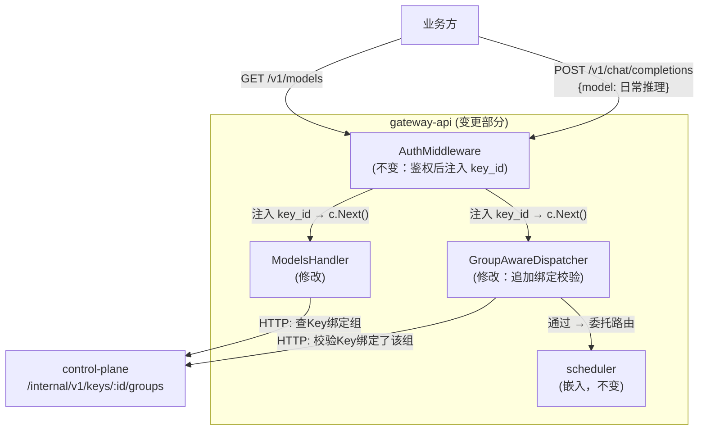
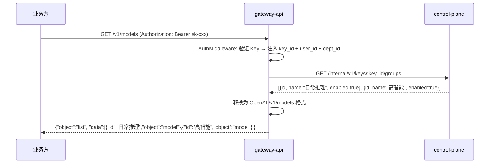
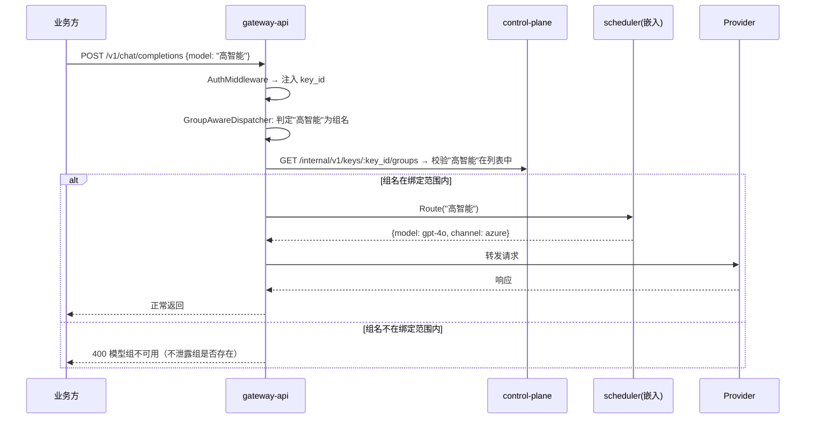

# gateway-api 概要设计变更 — CHG-20260526-001

> 基线：xspec/modules/gateway-api/hld.md (v1.2)

## 变更摘要

修改 `/v1/models` 查询链路：从返回部门维度的个体模型列表 → 改为调用 control-plane `/internal/v1/keys/:id/groups` 返回该 Key 绑定的模型组名称列表。在 GroupAwareDispatcher 中追加 Key 绑定校验：组名调用前先确认该组在 Key 绑定范围内。现有 scheduler 组内路由和故障切换逻辑不变。

## 架构变更

### /v1/models 查询流程

### 组名调用 + 绑定校验流程

## 变更组件

| 组件 | 变更 | 说明 |
| :--- | :--- | :--- |
| ModelsHandler | 修改 | `/v1/models`（原 `/v1/me/models`）从查询部门维度的个体模型 → 改为调 control-plane `/internal/v1/keys/:id/groups` 返回 Key 绑定的模型组列表 |
| GroupAwareDispatcher | 修改 | 组名判定后、委托 scheduler 前，增加一次 control-plane 调用校验该组在 Key 绑定范围内；不在范围则直接返回错误 |

## 变更端点

| 端点 | 变更前 | 变更后 |
| :--- | :--- | :--- |
| GET /v1/me/models | 基于 department_id 返回个体模型列表 | 改为 GET /v1/models，基于 key_id 绑定返回模型组名称列表 |

## 外部服务依赖变更

| 服务 | 调用方式 | 用途 | 超时 | 降级策略 |
| :--- | :--- | :--- | :---: | :--- |
| control-plane /internal/v1/keys/:id/groups | HTTP GET | 查询 Key 绑定的模型组列表 | 500 ms | 超时则 `/v1/models` 返回空列表；组名调用校验超时则拒绝请求（安全优先） |

## 关键决策

| 决策 | 选择 | 理由 |
| :--- | :--- | :--- |
| 绑定校验前置 | 在 GroupAwareDispatcher 内、scheduler 路由之前校验 | 越早拒绝无效请求越省资源；scheduler 不关心 Key 权限 |
| 校验源 | 每次实时调用 control-plane | 绑定变更即时生效；后续可补缓存优化但不影响正确性 |
| 校验失败语义 | 返回"模型组不可用"，不区分组不存在 vs 未绑定 | 不向调用方泄露组配置信息 |
| 绑定缓存 | 本期不做，每次实时查询 | 避免缓存导致绑定变更不即时生效；后续高频场景按需补 |

## 技术选型变更

无变更。沿用 Go + Gin 技术栈，HTTP 调用 control-plane。

## 安全设计补充

| 威胁 | 防御措施 |
| :--- | :--- |
| 调用方枚举组名试探绑定范围 | 绑定校验失败统一返回"模型组不可用"错误，与组不存在返回相同语义 |
| control-plane 绑定查询不可达 | 超时后拒绝请求（不降级为放行），避免绕过绑定校验 |