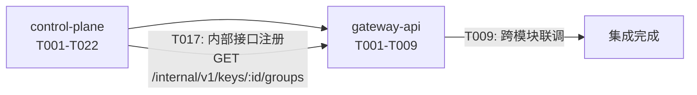

# Key ↔ 模型组绑定与透明暴露 跨模块协调视图

> 本文件是跨模块集成的导航与协调中心，不是任务汇总表。
> 各模块内部任务在对应 `task.delta.md` 中管理，通过下方索引导航。

## 基本信息

| 属性 | 内容 |
| :--- | :--- |
| **变更编号** | CHG-20260526-001 |
| **变更名称** | Key ↔ 模型组绑定与透明暴露 |
| **生成时间** | 2026-05-26 |

---

## 1. 模块任务索引

| 模块 | 类型 | 任务文件 | 任务数 |
| :--- | :--- | :--- | :--- |
| control-plane | web-backend | [`task.delta.md`](./control-plane/task.delta.md) | 22 |
| gateway-api | web-backend | [`task.delta.md`](./gateway-api/task.delta.md) | 9 |

---

## 2. 跨模块执行顺序

推荐实现顺序：
1. **先**完成 control-plane 全部任务（T001-T022）
2. **再**启动 gateway-api（T001-T009），依赖 control-plane 的内部接口

---

## 3. 跨模块集成任务

### 阶段：接口联调

- [ ] I001 P0 control-plane ↔ gateway-api 内部接口联调：验证 `GET /internal/v1/keys/:id/groups` 的 HTTP 调用链路
  depends: T017@control-plane, T001@gateway-api

### 阶段：端到端验证

- [ ] I002 P0 全链路 E2E：创建 Key 绑定组 → gateway-api 查 /v1/models → 以组名调用 → 验证调度成功
  depends: I001
- [ ] I003 P0 全链路 E2E：变更 Key 绑定（解绑组）→ gateway-api 新请求被拒绝 → 进行中请求正常完成
  depends: I002
- [ ] I004 P1 降级验证：control-plane 不可达 → gateway-api /v1/models 返回空列表 → 组名调用返回 model_unavailable
  depends: I001

---

## 4. 质量门禁

- [ ] 所有模块 task.md 任务已完成
- [ ] 跨模块接口联调通过（I001）
- [ ] 验收标准全部覆盖：control-plane AC-KB-01 至 AC-KB-08；gateway-api AC-GM-01 至 AC-GM-05 + AC-MODELS-01/02
- [ ] E2E / 集成测试通过（I002, I003, I004）
- [ ] control-plane Redis 通知验证通过
- [ ] 代码审查完成
- [ ] 部署前检查完成