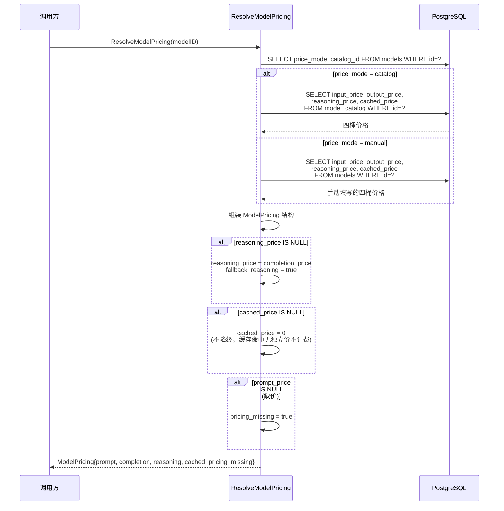
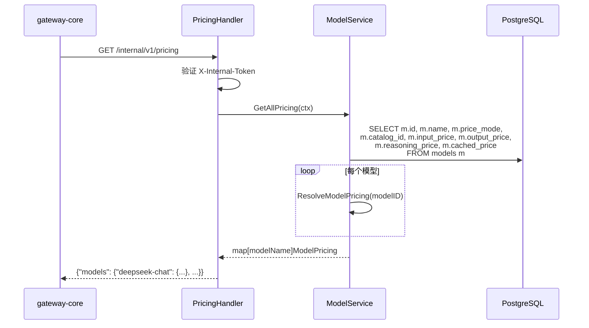

# control-plane 详细设计变更 — CHG-20260603-001

> 基线：xspec/modules/control-plane/spec.md (v1.0)

## 变更摘要

模型定价体系改造：Catalog 同步新增 reasoning/cached 分桶价格字段导入；ResolveModelPricing 从两桶扩展为四桶报价（含降级逻辑）；新增 GET /internal/v1/pricing 价表下发接口；删除 diff/apply-diff 端点及逻辑。

## 架构变更

```mermaid
flowchart TD
    subgraph "control-plane 变更增量"
        SYNC["CatalogSyncService\n(新增字段解析)"]
        RMP["ResolveModelPricing\n(四桶取价 + 降级)"]
        API_P["GET /internal/v1/pricing\n(全量价表下发) NEW"]
        API_DIFF["DELETE: diff/apply-diff 端点"]
    end

    subgraph "已有组件"
        SYNC_EX["CatalogSyncService\n(已有同步逻辑)"]
        MODEL_SVC["ModelService\n(已有)"]
        MODEL_REPO["ModelRepository\n(已有)"]
    end

    LL["LiteLLM JSON"] -->|price_mode=catalog 模型| SYNC
    SYNC -->|写入 output_cost_per_reasoning_token<br>cache_read_input_token_cost| MC[("model_catalog\n+reasoning_price +cached_price")]

    MODEL_SVC -->|price_mode=manual 模型<br>+reasoning_price +cached_price| MD[("models\n+price_mode +reasoning_price +cached_price")]

    MC --> RMP
    MD --> RMP

    RMP -->|ModelPricing{4桶 + fallback}| API_P
    API_P -->|每 5min 拉取| GW["gateway-core\nMemoryPricingCache"]
```

### ResolveModelPricing 取价流程



## CatalogSyncService 变更

### 新增字段解析

在 `internal/controlplane/service/catalog_sync_service.go` 中扩展 LiteLLM JSON 解析：

| LiteLLM 字段 | → | model_catalog 列 | 说明 |
| :--- | :--- | :--- | :--- |
| `output_cost_per_token` | → | `output_price` | 已有，不变 |
| `output_cost_per_reasoning_token` | → | `reasoning_price` | **新增**，可为 null |
| `cache_read_input_token_cost` | → | `cached_price` | **新增**，可为 null |

解析逻辑（伪代码）：

```go
// 在 LiteLLM model data 解析中新增
if v, ok := modelData["output_cost_per_reasoning_token"]; ok && v != nil {
    mc.ReasoningPrice = toNumeric(v)
}
if v, ok := modelData["cache_read_input_token_cost"]; ok && v != nil {
    mc.CachedPrice = toNumeric(v)
}
```

### 移除 diff 逻辑

同步完成后不再触发 `ComputePriceDiff`。删除以下函数调用：
- `catalogSyncService.ComputePriceDiff()`
- `catalogSyncService.ApplyPriceDiff()`

## ResolveModelPricing 变更

### 位置

`internal/controlplane/service/model_service.go`（或独立 `internal/controlplane/service/pricing_service.go`）

### 函数签名

```go
// ResolveModelPricing 根据模型的 price_mode 解析返回四桶报价。
// reasoning_price 缺失时使用 completion_price 降级（标记 fallback）。
// cached_price 缺失时计 0（缓存命中无独立价不额外计费）。
// prompt_price 或 completion_price 缺失时返回 pricing_missing=true。
func (s *ModelService) ResolveModelPricing(ctx context.Context, modelID uuid.UUID) (*ModelPricing, error)
```

### ModelPricing 结构体

```go
type ModelPricing struct {
    PromptPrice      float64 `json:"prompt_price"`       // USD/1M tokens
    CompletionPrice  float64 `json:"completion_price"`    // USD/1M tokens
    ReasoningPrice   *float64 `json:"reasoning_price"`    // USD/1M tokens, null=降级
    CachedPrice      *float64 `json:"cached_price"`       // USD/1M tokens, null=0
    PricingMissing   bool    `json:"pricing_missing"`     // 是否缺价
    FallbackReasoning bool   `json:"fallback_reasoning"`  // reasoning 是否降级到 completion
}
```

### 降级规则

| 场景 | 行为 | 标记 |
| :--- | :--- | :--- |
| `reasoning_price` 为 NULL | 使用 `completion_price` | `fallback_reasoning = true` |
| `cached_price` 为 NULL | 使用 0 | — |
| `prompt_price` 为 NULL | 返回 `pricing_missing = true` | `pricing_missing = true` |
| `completion_price` 为 NULL | 返回 `pricing_missing = true` | `pricing_missing = true` |

## GET /internal/v1/pricing 设计

### 位置

`internal/controlplane/handler/pricing_handler.go`

### 路由注册

在 `internal/controlplane/router/router.go` 中注册：

```go
internal := r.Group("/internal/v1")
internal.Use(middleware.InternalAuth())
{
    internal.GET("/pricing", pricingHandler.GetAllPricing)
}
```

### Handler 逻辑



## ModelService 变更

### 创建模型

在 `Create` 方法中新增 `price_mode` 字段处理：

- `price_mode` 默认值：`"catalog"`
- 当 `price_mode = "manual"` 时，校验 `input_price > 0 && output_price > 0`
- `reasoning_price` 和 `cached_price` 可选（null 允许）
- `price_mode = "catalog"` 时忽略手动价格字段

### 更新模型

在 `Update` 方法中新增校验：

- 从 `catalog` 切换到 `manual`：必须提供 `input_price > 0 && output_price > 0`，否则返回 400
- 从 `manual` 切换到 `catalog`：清除手动价格字段（设为 null），切换后价格跟随 catalog
- `manual` 模式下修改价格：同创建校验

### 校验规则表

| 场景 | 校验 | 失败响应 |
| :--- | :--- | :--- |
| 创建模型，price_mode=manual，input_price=0 | `input_price` 必填 > 0 | 400 "手动模式下 Prompt 单价必须大于 0" |
| 创建模型，price_mode=manual，output_price=0 | `output_price` 必填 > 0 | 400 "手动模式下 Completion 单价必须大于 0" |
| 切换 catalog→manual，未填 input_price | 同上 | 400 |
| manual 模式，reasoning_price 留空 | 允许（降级用 completion） | — |
| manual 模式，cached_price 留空 | 允许（计 0） | — |

## 删除 diff/apply-diff

### 删除的端点

| 方法 | 路径 | 原用途 |
| :--- | :--- | :--- |
| GET | /api/v1/model-catalog/diff | 计算价格差异 |
| POST | /api/v1/model-catalog/apply-diff | 应用价格差异 |

### 删除的代码

- `internal/controlplane/handler/catalog_handler.go`：`ComputePriceDiff`、`ApplyPriceDiff` 方法
- `internal/controlplane/service/catalog_service.go`：`ComputePriceDiff()`、`ApplyPriceDiff()` 方法
- 对应路由注册

### 保留的代码

- `auto-bind` / `batch-bind-catalog`：模型与 catalog 条目关联关系仍然需要
- `sync` / `sync-status` / `search` / `by-source`：目录同步与检索功能不变

## 设计决策记录

### 决策 1：reasoning_price 降级策略

- **问题**：模型未配置 reasoning 独立价格时如何处理
- **候选方案**：A — 降级使用 completion 价格 / B — 计 0（不估算）
- **决策**：选择方案 A
- **理由**：对齐 LiteLLM 定价模型（reasoning token 实际上是 output token 的子集，大多数模型 reasoning 价格 = completion 价格）

### 决策 2：cached_price 降级策略

- **问题**：模型未配置缓存命中价格时如何处理
- **候选方案**：A — 降级使用 input 价格 / B — 计 0
- **决策**：选择方案 B
- **理由**：缓存命中 token 不计费是行业惯例（LiteLLM、OpenAI）；只有明确配置了 `cache_read_input_token_cost` 的模型才应计算缓存成本

### 决策 3：价表下发频率 5 分钟

- **问题**：价表下发间隔
- **候选方案**：A — 1 分钟 / B — 5 分钟 / C — 10 分钟
- **决策**：选择方案 B
- **理由**：价格变更不频繁（通常数天到数周一次），5 分钟足以满足实时性；1 分钟对 control-plane 压力无谓增大；10 分钟可能导致新模型上线后较长空窗期
