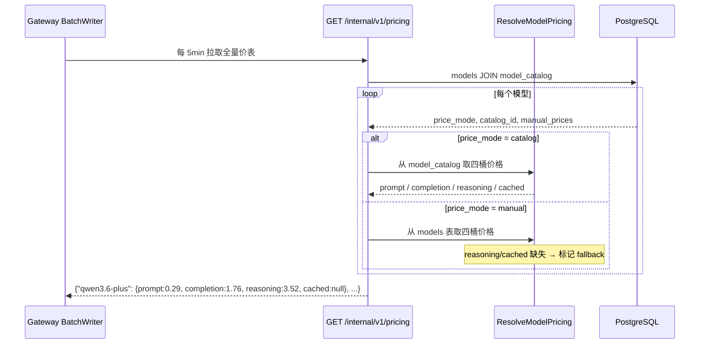

# control-plane 概要设计变更 — CHG-20260603-001

> 基线：xspec/modules/control-plane/spec.md (v1.0) — 无 hld.md 基线，首次增量设计

## 变更摘要

Catalog 同步新增导入 reasoning/cached 分桶价格字段；ResolveModelPricing 从两桶扩展为四桶报价结构；新增 GET /internal/v1/pricing 价表下发接口供 gateway-core 定时拉取。

## 架构变更

```mermaid
flowchart TD
    subgraph "control-plane 变更增量"
        SYNC["CatalogSync\n(新增字段解析)"]
        RMP["ResolveModelPricing\n(四桶取价)"]
        API_P["GET /internal/v1/pricing\n(价表下发) NEW"]
    end
    
    subgraph "已有组件"
        SYNC_EX["CatalogSyncService\n(已有)"]
        MODEL_SVC["ModelService\n(已有)"]
    end
    
    LL["LiteLLM JSON"] -->|price_mode=catalog| SYNC
    SYNC -->|写入 output_cost_per_reasoning_token<br>cache_read_input_token_cost| MC[("model_catalog\n+reasoning_price +cached_price")]
    
    MODEL_SVC -->|price_mode=manual| MD[("models\n+reasoning_price +cached_price")]
    
    MC --> RMP
    MD --> RMP
    
    RMP -->|ModelPricing{4 桶单价 + fallback}| API_P
    API_P -->|每 5min 拉取| GW["gateway-core\nMemoryPricingCache"]
```

### 取价流程



## 技术选型变更

无新增技术选型。所有变更在已有技术栈内：

| 领域 | 选型 | 说明 |
| :--- | :--- | :--- |
| Catalog 同步 | 已有 JSON 解析逻辑扩展 | 新增字段解析，不影响已有同步流程 |
| 数据库变更 | PG 新增 nullable 列 | 已有数据不受影响；GORM AutoMigrate 增量 |
| 价表下发 | 已有 Gin router + InternalAuth | 复用 `/internal/v1/*` 内部 API 鉴权 |

## 新增组件

| 组件 | 位置 | 变更类型 | 职责 |
| :--- | :--- | :--- | :--- |
| `GET /internal/v1/pricing` | `internal/controlplane/handler/` | 新增 | 全量多桶价表下发接口，gateway-core 5min 拉取 |
| `CatalogSyncService` | 已有 | 修改 | 新增解析 `output_cost_per_reasoning_token` / `cache_read_input_token_cost` |
| `ResolveModelPricing` | 已有 | 修改 | 返回结构从 2 桶扩展为 4 桶 + fallback 标记 |
| `model_catalog` 表 | 已有 | 修改 | 新增 `reasoning_price` / `cached_price` 列 |
| `models` 表 | 已有 | 修改 | 新增 `reasoning_price` / `cached_price` 列（manual 模式） |

## 新增列（Migration）

```sql
ALTER TABLE model_catalog ADD COLUMN reasoning_price NUMERIC DEFAULT NULL;
ALTER TABLE model_catalog ADD COLUMN cached_price NUMERIC DEFAULT NULL;
ALTER TABLE models ADD COLUMN reasoning_price NUMERIC DEFAULT NULL;
ALTER TABLE models ADD COLUMN cached_price NUMERIC DEFAULT NULL;
```

## 宪章合规

| 原则 | 检查结果 |
| :--- | :--- |
| 不开倒车 | ✅ 已有 Catalog 同步逻辑增量扩展字段，不修改已有同步语义 |
| 服务稳定 | ✅ 新增列 nullable，已有数据不受影响；价表下发接口独立不影响管理 API |
| 服务快速 | ✅ 内存价表 5min 刷新，BatchWriter 本地查 Map（无远程调用） |
| 架构清晰 | ✅ 定价职责仍在 control-plane，不扩散到 gateway |
