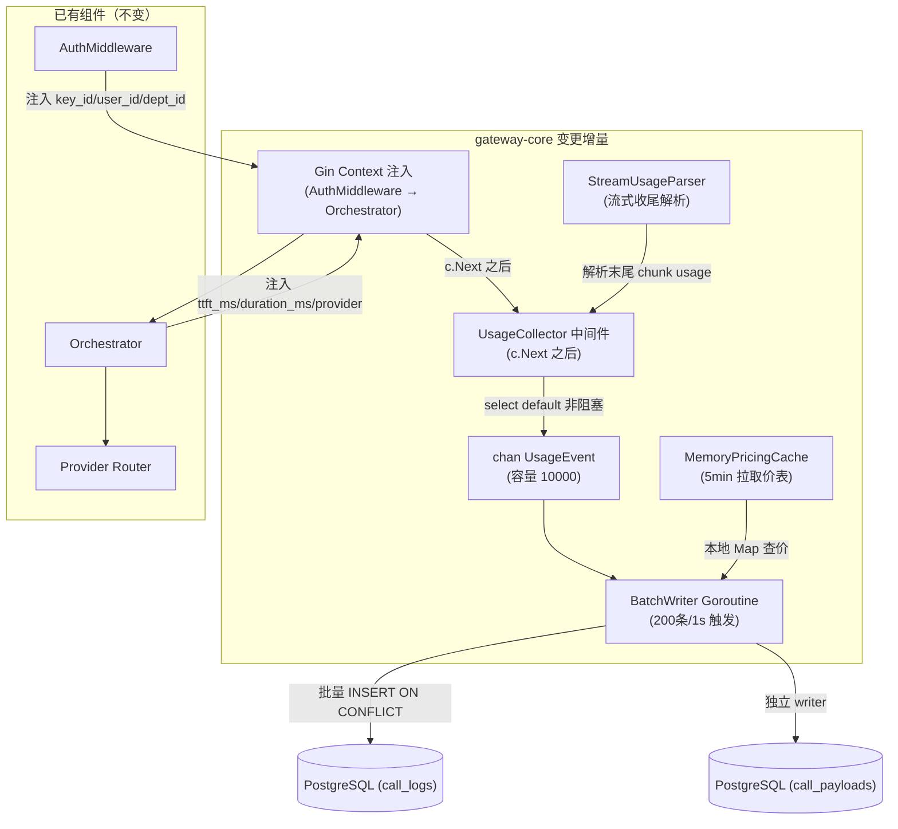
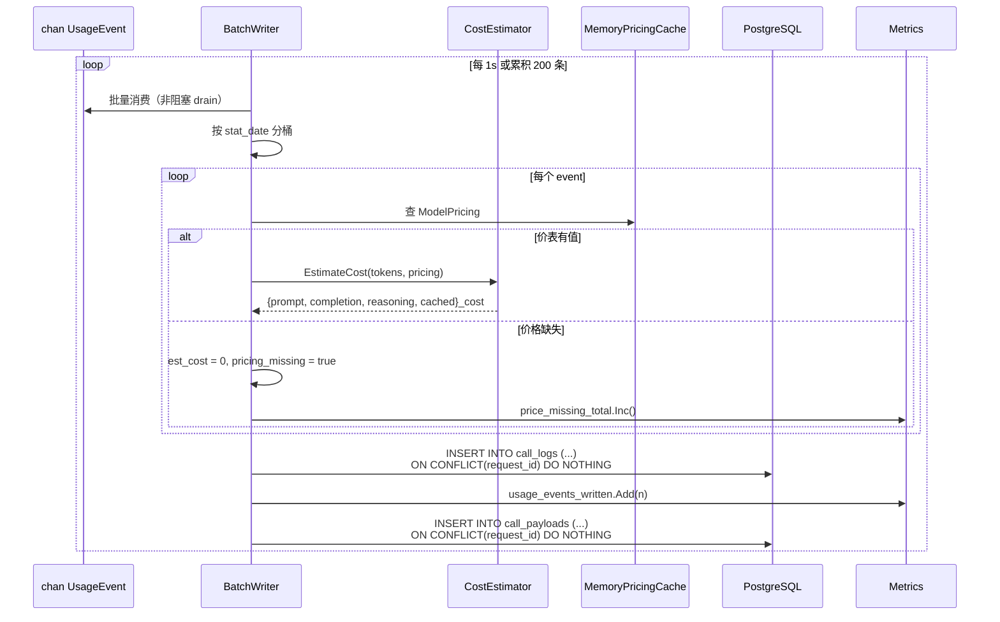

# gateway-core 详细设计变更 — CHG-20260603-001

> 基线：xspec/modules/gateway-core/spec.md (v1.0)

## 变更摘要

在请求热路径末端新增异步用量采集管道：UsageCollector 中间件从 Gin Context 提取 11 维采集字段，经 buffered channel 投递到 BatchWriter 后台 goroutine，离线计算多桶成本后批量幂等写入 call_logs / call_payloads。流式请求通过 StreamUsageParser 解析末尾 chunk 回填 reasoning_tokens。

## 架构变更



### 主线操作时序（纳秒/微秒级）

```mermaid
sequenceDiagram
    participant Client
    participant Main as 主线 Goroutine
    participant Orch as Orchestrator
    participant Ch as chan(10000)
    participant BG as BatchWriter Goroutine
    participant Cache as MemoryPricingCache
    participant PG as PostgreSQL

    Client->>Main: 请求
    Main->>Orch: 转发上游
    Note over Orch: 记录 startTime / ttft / providerDuration

    Orch-->>Main: 响应正文
    Main-->>Client: 响应返回（主线解放）

    Note over Main: c.Next() 返回
    Main->>Main: 从 context 提取 11 字段<br>(&lt; 5μs)
    Main->>Ch: select send (非阻塞, &lt; 1μs)

    Note over BG: 独立 goroutine（离线）
    BG->>Ch: 批量消费 (200条/1s)
    BG->>Cache: 查本地 Map 多桶价格
    Cache-->>BG: ModelPricing{4桶单价}
    BG->>BG: prompt_cost = tokens × prompt_price<br>reasoning_cost = reasoning_tokens × reasoning_price
    BG->>PG: INSERT call_logs (ON CONFLICT DO NOTHING)
    BG->>PG: INSERT call_payloads (ON CONFLICT DO NOTHING)
```

## 新增组件详细设计

### UsageCollector（`internal/gateway/middleware/usage_collector.go`）

**职责**：Gin 中间件，在 `c.Next()` 返回后从 Context 提取 11 维采集字段，构造 `UsageEvent` 结构体，非阻塞投递到 channel。

**注册位置**：在 `internal/gateway/server/router.go` 中，置于 AuthMiddleware 之后、路由 handler 之前。

**Context 字段提取来源**：

| 字段 | Context Key | 写入方 | 写入时机 |
| :--- | :--- | :--- | :--- |
| `request_id` | `RequestIDKey` | 请求入口中间件 | 请求到达 |
| `key_id` | `KeyIDKey` | AuthMiddleware | Key 验证通过后 |
| `user_id` | `UserIDKey` | AuthMiddleware | 身份解析完成后 |
| `dept_id` | `DeptIDKey` | AuthMiddleware | SSO 身份提取 |
| `studio_id` | — | — | 预留，当前置空 |
| `model` | `ModelKey` | Orchestrator | 模型组调度后 |
| `provider_type` | `ProviderTypeKey` | Orchestrator | Provider 选定后 |
| `provider_model_id` | `ProviderModelIDKey` | Orchestrator | Provider 选定后 |
| `is_stream` | `IsStreamKey` | Orchestrator | 请求解析阶段 |
| `session_id` | `SessionIDKey` | 请求解析中间件 | Header 提取 |
| `ttft_ms` | `TTFTKey` | Orchestrator | 首 chunk 到达时 |
| `duration_ms` | `DurationKey` | Orchestrator | 响应完成时 |
| `provider_duration_ms` | `ProviderDurationKey` | Orchestrator | 从响应 Header 提取 |
| `prompt_tokens` | `PromptTokensKey` | Orchestrator / StreamUsageParser | 响应解析 / 流式收尾 |
| `completion_tokens` | `CompletionTokensKey` | Orchestrator / StreamUsageParser | 同上 |
| `reasoning_tokens` | `ReasoningTokensKey` | StreamUsageParser / Orchestrator | 同上 |
| `cached_tokens` | `CachedTokensKey` | StreamUsageParser / Orchestrator | 同上 |

**UsageEvent 结构体**：

```go
type UsageEvent struct {
    RequestID          string    `json:"request_id"`
    KeyID              string    `json:"key_id"`
    UserID             string    `json:"user_id"`
    DeptID             *string   `json:"dept_id"`
    StudioID           *string   `json:"studio_id"`
    Model              string    `json:"model"`
    ProviderType       string    `json:"provider_type"`
    ProviderModelID    *string   `json:"provider_model_id"`
    IsStream           bool      `json:"is_stream"`
    SessionID          *string   `json:"session_id"`
    StatDate           time.Time `json:"stat_date"`
    PromptTokens       int       `json:"prompt_tokens"`
    CompletionTokens   int       `json:"completion_tokens"`
    ReasoningTokens    int       `json:"reasoning_tokens"`
    CachedTokens       int       `json:"cached_tokens"`
    TTFTMs             *int      `json:"ttft_ms"`
    DurationMs         *int      `json:"duration_ms"`
    ProviderDurationMs *int      `json:"provider_duration_ms"`
    Status             string    `json:"status"`
    UsageMissing       bool      `json:"usage_missing"`

    // 请求/响应内容（仅 call_payloads 使用）
    Messages     []Message `json:"messages,omitempty"`
    ResponseText string    `json:"response_text,omitempty"`
    Tools        []Tool    `json:"tools,omitempty"`
    ByteSize     int       `json:"byte_size,omitempty"`
    Truncated    bool      `json:"truncated,omitempty"`
}
```

**非阻塞投递逻辑**：

```go
select {
case collector.ch <- event:
    metrics.UsageEventsEmitted.Inc()
default:
    metrics.UsageEventsDropped.Inc()
}
```

### BatchWriter（`internal/gateway/infra/batch_writer.go`）

**职责**：从 channel 批量消费 UsageEvent，在后台 goroutine 中离线计算多桶成本，批量写入 call_logs 和 call_payloads。

**触发条件**（两者满足其一即触发写入）：
- 累积 ≥ 200 条
- 距上次写入 ≥ 1 秒

**核心循环**：



**幂等保证**：`ON CONFLICT(request_id) DO NOTHING`，确保 failover 重投不产生重复行。

**失败处理**：
- DB 写入失败：记录 error 日志 + `batch_write_errors_total` 指标，丢弃当批（不重试，下批覆盖）
- 写入超时（30s）：同上

### StreamUsageParser（`internal/gateway/orchestrator/stream_usage.go`）

**职责**：流式请求收尾时解析末尾 chunk 的 usage 信息，回填 token 字段到 Context。

**上游格式适配**：

| 上游 | 解析方式 | 提取字段 |
| :--- | :--- | :--- |
| OpenAI 兼容 | 最后 SSE chunk 的 `usage` 对象 | `prompt_tokens`, `completion_tokens`, `prompt_tokens_details.cached_tokens`, `completion_tokens_details.reasoning_tokens` |
| Anthropic | 累计 `message_start` / `message_delta` 事件 | `input_tokens`, `output_tokens`, `cache_read_input_tokens`, `cache_creation_input_tokens`, `thinking_tokens` |

**注入 include_usage**：对 OpenAI 兼容上游，在请求体中注入 `"stream_options": {"include_usage": true}`。

**上游不支持时**：token 字段记 0，`usage_missing = true`。

### MemoryPricingCache（`internal/gateway/infra/pricing_cache.go`）

**职责**：每 5 分钟从 control-plane 拉取全量多桶价表，缓存在本地 `sync.Map` 中供 BatchWriter 查询。

**拉取接口**：`GET /internal/v1/pricing`（InternalAuth: `X-Internal-Token`）

**缓存结构**：`map[string]ModelPricing`（key 为模型名）

**刷新周期**：`time.Ticker(5 * time.Minute)`，启动时立即拉取一次。

**失败处理**：拉取失败时保留上一份缓存，记录 `pricing_cache_refresh_errors_total`。

## 多桶成本估算引擎

### 计价模型

| 桶 | 计算方式 | 降级规则 |
| :--- | :--- | :--- |
| `prompt_cost` | `prompt_tokens × prompt_price / 1_000_000` | 无 price → 0 + 告警 |
| `completion_cost` | `completion_tokens × completion_price / 1_000_000` | 无 price → 0 + 告警 |
| `reasoning_cost` | `reasoning_tokens × reasoning_price / 1_000_000` | reasoning_price 为 null → 用 completion_price 降级 + 标记 fallback |
| `cached_cost` | `cached_tokens × cached_price / 1_000_000` | cached_price 为 null → 0（缓存命中无独立价不计费） |
| `total_cost` | 以上四桶之和 | — |

### 锁价机制

成本在采集时（BatchWriter 写入）锁定——ModelPricing 来自调用时刻的 MemoryPricingCache 快照。事后改模型定价不影响已写入的历史 `call_logs.est_cost`。

## Context 注入设计

| 注入点 | 中间件/组件 | 注入字段 |
| :--- | :--- | :--- |
| 请求入口 | RequestID 中间件 | `request_id` |
| 鉴权 | AuthMiddleware | `key_id`, `user_id`, `dept_id` |
| 请求解析 | 参数解析器 | `is_stream`, `session_id` |
| 模型调度 | Orchestrator | `model`, `provider_type`, `provider_model_id` |
| 首 chunk | Orchestrator（TTFT 计时） | `ttft_ms` |
| 响应完成 | Orchestrator（计时） | `duration_ms`, `provider_duration_ms` |
| 响应解析 | Orchestrator / StreamUsageParser | `prompt_tokens`, `completion_tokens`, `reasoning_tokens`, `cached_tokens` |

## 异常处理链

| 异常场景 | 处理方式 | 指标 |
| :--- | :--- | :--- |
| channel 满 | select default 丢弃 | `usage_events_dropped` |
| DB 写入失败 | 记录日志，丢弃当批 | `batch_write_errors_total` |
| 价格缺失 | cost=0，pricing_missing=true | `price_missing_total` |
| usage 缺失 | token=0，usage_missing=true | `usage_missing_total` |
| 上游不支持 include_usage | token=0，usage_missing=true | `stream_usage_missing_total` |
| 身份信息缺失 | dept_id=null，放行请求 | `identity_missing_total` |

## 指标定义

| 指标 | 类型 | 说明 |
| :--- | :--- | :--- |
| `usage_events_emitted_total` | Counter | 成功投递到 channel 的事件数 |
| `usage_events_dropped_total` | Counter | channel 满丢弃的事件数 |
| `usage_events_written_total` | Counter | 成功写入 call_logs 的事件数 |
| `batch_write_duration_seconds` | Histogram | 批量写入耗时分布 |
| `batch_write_errors_total` | Counter | 批量写入失败次数 |
| `queue_depth` | Gauge | channel 当前积压数 |
| `price_missing_total` | Counter | 价格缺失的调用次数 |
| `usage_missing_total` | Counter | usage 缺失的调用次数 |
| `identity_missing_total` | Counter | 身份信息缺失的调用次数 |
| `pricing_cache_refresh_errors_total` | Counter | 价表刷新失败次数 |

## 设计决策记录

### 决策 1：EstimateCost 在 BatchWriter 离线执行

- **问题**：成本计算在热路径还是后台执行
- **候选方案**：A — 主线 goroutine 计算（延迟 < 1μs）/ B — BatchWriter 后台 goroutine 计算
- **决策**：选择方案 B
- **理由**：宪章要求热路径零阻塞；本地 Map 查价虽快，但放在独立 goroutine 中可将成本计算逻辑与请求生命周期完全解耦，便于后续增加复杂度（如计价策略升级）而不影响热路径

### 决策 2：channel 容量 10000

- **问题**：channel 缓冲大小
- **候选方案**：A — 1000 / B — 5000 / C — 10000
- **决策**：选择方案 C（10000）
- **理由**：按日均 10 万次调用、峰值 10× 均值估算，10000 可缓冲约 12 分钟峰值堆积，远大于 DB 写入恢复所需时间；内存占用约 3MB（每条 300 字节），可接受

### 决策 3：ON CONFLICT DO NOTHING vs DO UPDATE

- **问题**：幂等策略
- **候选方案**：A — DO NOTHING（保留首条）/ B — DO UPDATE（覆盖为最新）
- **决策**：选择方案 A
- **理由**：call_logs 是审计日志，首次写入即为真实数据；failover 重投不应覆盖首条记录。Rollup 侧的幂等策略不同（DO UPDATE 覆盖语义），两者各取所需
