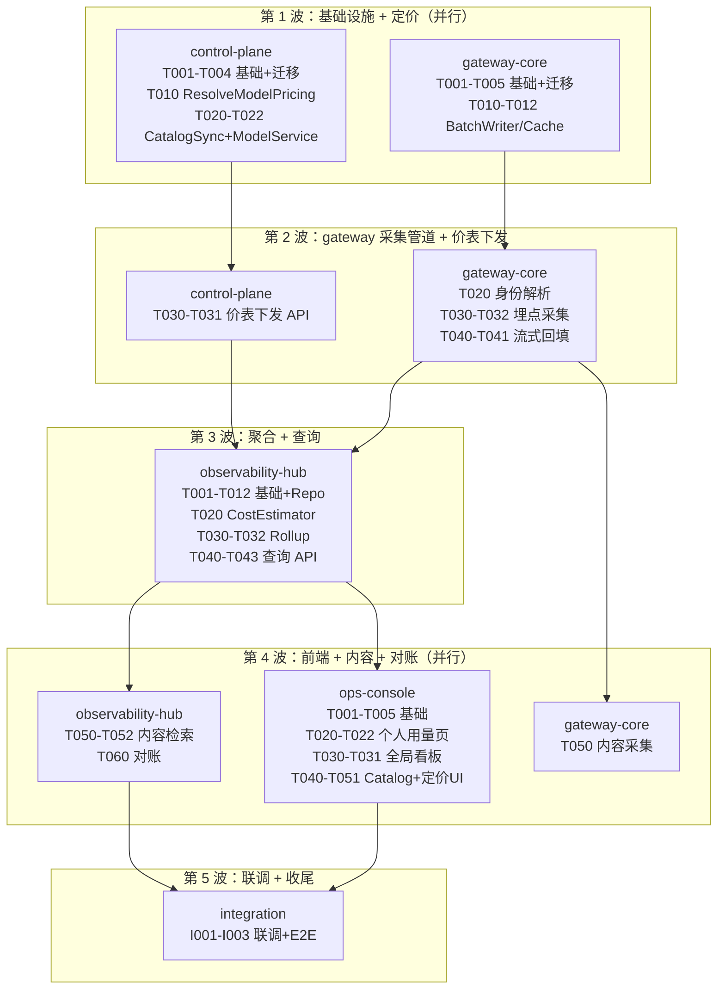

# 用量采集与成本估算 跨模块协调视图

> 本文件是跨模块集成的导航与协调中心，不是任务汇总表。
> 各模块内部任务在对应 `task.md` 中管理，通过下方索引导航。

## 基本信息

| 属性 | 内容 |
| :--- | :--- |
| **变更编号** | CHG-20260603-001 |
| **变更名称** | 用量采集与成本估算 |
| **生成时间** | 2026-06-04 |

---

## 1. 模块任务索引

| 模块 | 类型 | 任务文件 | 任务数 |
| :--- | :--- | :--- | :--- |
| gateway-core | web-backend | [`task.delta.md`](./gateway-core/task.delta.md) | 24（P0:18 / P1:6） |
| control-plane | web-backend | [`task.delta.md`](./control-plane/task.delta.md) | 19（P0:13 / P1:6） |
| ops-console | web-frontend | [`task.delta.md`](./ops-console/task.delta.md) | 21（P0:9 / P1:11 / P2:1） |
| observability-hub | web-backend | [`task.md`](./observability-hub/task.md) | 24（P0:16 / P1:8） |

---

## 2. 跨模块执行顺序

---

## 3. 跨模块集成任务

### 阶段：接口联调

- [ ] I001 P0 gateway-core ↔ control-plane 价表拉取联调（gateway-core MemoryPagingCache 通过 GET /internal/v1/pricing 拉取价表 → BatchWriter 正确计算多桶成本）
  depends: T011@gateway-core, T031@control-plane
- [ ] I002 P0 observability-hub ↔ ops-console 用量查询联调（GET /v1/usage 返回数据格式与前端 UsageItem/UsageSummary 类型一致；三态覆盖正常/loading/empty/error/越权）
  depends: T043@observability-hub, T021@ops-console

### 阶段：端到端验证

- [ ] I003 P0 全链路 E2E 验证（发起一次 LLM 请求 → gateway-core 采集写入 call_logs → observability-hub Rollup 聚合 → ops-console 用量页可查，验证分桶成本/延迟指标正确）
  depends: T032@observability-hub, T021@ops-console, T031@gateway-core
- [ ] I004 P1 流式 E2E 验证（发起流式 LLM 请求含 reasoning → call_logs 中 reasoning_tokens 非零 → usage_daily 聚合 reasoning_cost 正确 → 前端个人用量页展示 reasoning 分桶）
  depends: T041@gateway-core, T032@observability-hub, T021@ops-console

### 阶段：契约验证

- [ ] I005 P0 跨模块接口契约一致性检查（对照 contracts 文档逐接口验证：gateway-core contracts vs control-plane contracts vs observability-hub contracts vs ops-console contracts）
  depends: I001, I002

---

## 4. 质量门禁

- [ ] 所有模块 task.md 任务已完成
- [ ] gateway-core `go build ./cmd/gateway` 通过 + 单元测试通过
- [ ] control-plane `go build ./cmd/control-plane` 通过 + 单元测试通过
- [ ] observability-hub 单元测试 + 集成测试通过
- [ ] ops-console `vue-tsc --noEmit` + `vite build` 通过
- [ ] 跨模块接口联调通过（I001-I002）
- [ ] 全链路 E2E 验证通过（I003）
- [ ] 验收标准全部覆盖（AC-NEW-01 ~ AC-NEW-14、AC-NEW-01~09 control-plane、AC-NEW-01~11 ops-console、AC-01~13 observability-hub）
- [ ] 宪章合规检查：不开倒车（全量测试通过）、服务稳定（无 breaking change）、服务快速（热路径延迟 P99 < 100μs 增量）、架构清晰（gateway 不直连 PG 做配置查询）、交互至上（loading/empty/error 三态）
- [ ] 代码审查完成
- [ ] AI Slop 清理完成
