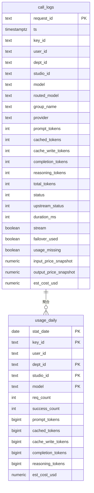

# observability-hub Web 后端数据模型

## 1. 文档概述

本文档描述 observability-hub 模块的数据库模型设计，包括实体结构、关系、索引策略和迁移方案。

| 属性 | 内容 |
| :--- | :--- |
| **数据库类型** | PostgreSQL 15+ |
| **ORM 框架** | GORM |
| **所属变更** | CHG-20260603-001 |
| **创建时间** | 2026-06-03 |

---

## 2. 实体关系总览

## 3. 实体定义

### 3.1 call_logs（调用明细）

| 字段 | 类型 | 约束 | 说明 |
| :--- | :--- | :--- | :--- |
| request_id | TEXT | PRIMARY KEY | 请求唯一标识，幂等 ON CONFLICT DO NOTHING |
| ts | TIMESTAMPTZ | NOT NULL | 调用时间戳 |
| key_id | TEXT | | 调用 Key 标识 |
| user_id | TEXT | | 员工标识 |
| dept_id | TEXT | | 部门标识 |
| studio_id | TEXT | | 预留，当前为空 |
| model | TEXT | NOT NULL | 用户请求的模型 |
| routed_model | TEXT | | 实际路由到的模型 |
| group_name | TEXT | | 模型组名 |
| provider | TEXT | | 厂商（bailian/deepseek/bedrock） |
| prompt_tokens | INT | NOT NULL DEFAULT 0 | 输入 Token 数 |
| cached_tokens | INT | NOT NULL DEFAULT 0 | 缓存命中 Token 数 |
| cache_write_tokens | INT | NOT NULL DEFAULT 0 | 缓存写入 Token 数 |
| completion_tokens | INT | NOT NULL DEFAULT 0 | 输出 Token 数 |
| reasoning_tokens | INT | NOT NULL DEFAULT 0 | 推理 Token 数 |
| total_tokens | INT | NOT NULL DEFAULT 0 | 总 Token 数 |
| status | INT | | HTTP 状态码 |
| upstream_status | INT | | 上游响应状态码 |
| duration_ms | INT | | 调用耗时（毫秒） |
| stream | BOOLEAN | NOT NULL DEFAULT false | 是否流式调用 |
| failover_used | BOOLEAN | NOT NULL DEFAULT false | 是否触发故障切换 |
| usage_missing | BOOLEAN | NOT NULL DEFAULT false | 上游未返回 usage 标记 |
| input_price_snapshot | NUMERIC(14,6) | | 锁价：输入单价（USD/1M） |
| output_price_snapshot | NUMERIC(14,6) | | 锁价：输出单价（USD/1M） |
| est_cost_usd | NUMERIC(18,6) | NOT NULL DEFAULT 0 | 估算成本（USD） |

**索引**：

| 索引名 | 字段 | 用途 |
| :--- | :--- | :--- |
| idx_call_logs_key_ts | (key_id, ts) | 按 Key + 时间范围查询 |
| idx_call_logs_dept_ts | (dept_id, ts) | 按部门 + 时间范围查询 |
| idx_call_logs_model_ts | (model, ts) | 按模型 + 时间范围查询 |
| idx_call_logs_ts | (ts) | 聚合扫描 + 保留清理 |

### 3.2 usage_daily（按天聚合）

| 字段 | 类型 | 约束 | 说明 |
| :--- | :--- | :--- | :--- |
| stat_date | DATE | PRIMARY KEY | 统计日期 |
| key_id | TEXT | PRIMARY KEY | Key 标识 |
| user_id | TEXT | NOT NULL DEFAULT '' | 员工标识 |
| dept_id | TEXT | PRIMARY KEY, NOT NULL DEFAULT '' | 部门标识 |
| studio_id | TEXT | PRIMARY KEY, NOT NULL DEFAULT '' | 预留 |
| model | TEXT | PRIMARY KEY | 模型标识 |
| req_count | INT | NOT NULL DEFAULT 0 | 调用次数 |
| success_count | INT | NOT NULL DEFAULT 0 | 成功次数（status=200） |
| prompt_tokens | BIGINT | NOT NULL DEFAULT 0 | 输入 Token 总数 |
| cached_tokens | BIGINT | NOT NULL DEFAULT 0 | 缓存命中 Token 总数 |
| cache_write_tokens | BIGINT | NOT NULL DEFAULT 0 | 缓存写入 Token 总数 |
| completion_tokens | BIGINT | NOT NULL DEFAULT 0 | 输出 Token 总数 |
| reasoning_tokens | BIGINT | NOT NULL DEFAULT 0 | 推理 Token 总数 |
| est_cost_usd | NUMERIC(18,6) | NOT NULL DEFAULT 0 | 估算成本总额 |

---

## 4. 关系定义

| 关系 | 类型 | 说明 |
| :--- | :--- | :--- |
| call_logs → usage_daily | 聚合 | 明细按天聚合到汇总表，usage_daily 是 call_logs 的物化聚合视图 |

## 5. 索引设计

| 索引名 | 表 | 字段 | 用途 |
| :--- | :--- | :--- | :--- |
| idx_call_logs_key_ts | call_logs | (key_id, ts) | 按 Key + 时间范围查询 |
| idx_call_logs_dept_ts | call_logs | (dept_id, ts) | 按部门 + 时间范围查询 |
| idx_call_logs_model_ts | call_logs | (model, ts) | 按模型 + 时间范围查询 |
| idx_call_logs_ts | call_logs | (ts) | 聚合扫描 + 保留清理 |
| idx_usage_daily_dept | usage_daily | (dept_id, stat_date) | 按部门 + 日期查询 |

## 6. 事务边界

| 操作 | 隔离级别 | 说明 |
| :--- | :--- | :--- |
| call_logs 批量写入 | 默认 | 单条 INSERT ON CONFLICT，幂等，无需事务 |
| usage_daily 聚合 | 默认 | 整日重算 UPSERT，幂等，单条 SQL 原子操作 |

## 7. 迁移策略

### 迁移脚本

| 序号 | 文件 | 内容 |
| :--- | :--- | :--- |
| 032 | 032_create_call_logs.sql | 创建 call_logs 表 + 4 个索引 |
| 033 | 033_create_usage_daily.sql | 创建 usage_daily 表 + 复合主键 + 索引 |
| 034 | 034_call_logs_retention.sql | 明细保留策略（可选，90 天） |

### 回滚策略

- call_logs 和 usage_daily 均为新增表，无历史数据，直接 DROP TABLE 即可回滚

## 8. 数据约束与规则

| 约束 | 表 | 说明 |
| :--- | :--- | :--- |
| PRIMARY KEY | call_logs | request_id，幂等 ON CONFLICT DO NOTHING |
| PRIMARY KEY | usage_daily | (stat_date, key_id, dept_id, studio_id, model) |
| NOT NULL | call_logs | ts, model, total_tokens, stream, failover_used, usage_missing, est_cost_usd |
| 聚合不变量 | — | sum(usage_daily.est_cost_usd) = sum(call_logs.est_cost_usd)（同日） |

---

## 9. 容量估算

| 规模 | 明细年增 | 90 天常驻 | usage_daily 年 |
| :--- | :--- | :--- | :--- |
| 2 万/天 | ~730 万行 | ~180 万行 | 数万~十万行 |
| 5 万/天 | ~1825 万行 | ~450 万行 | ~数十万行 |

PG 单机 + 索引完全胜任；usage_daily 是查询热表，明细仅做明细排查与对账。