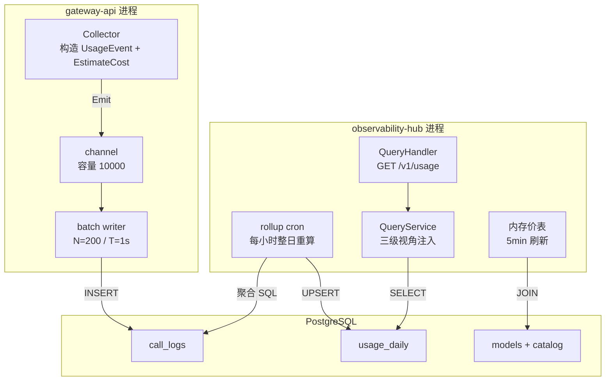
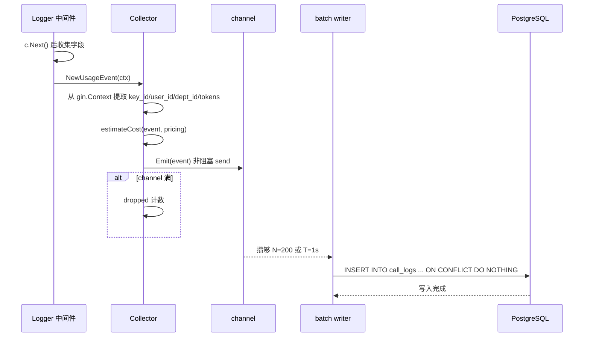
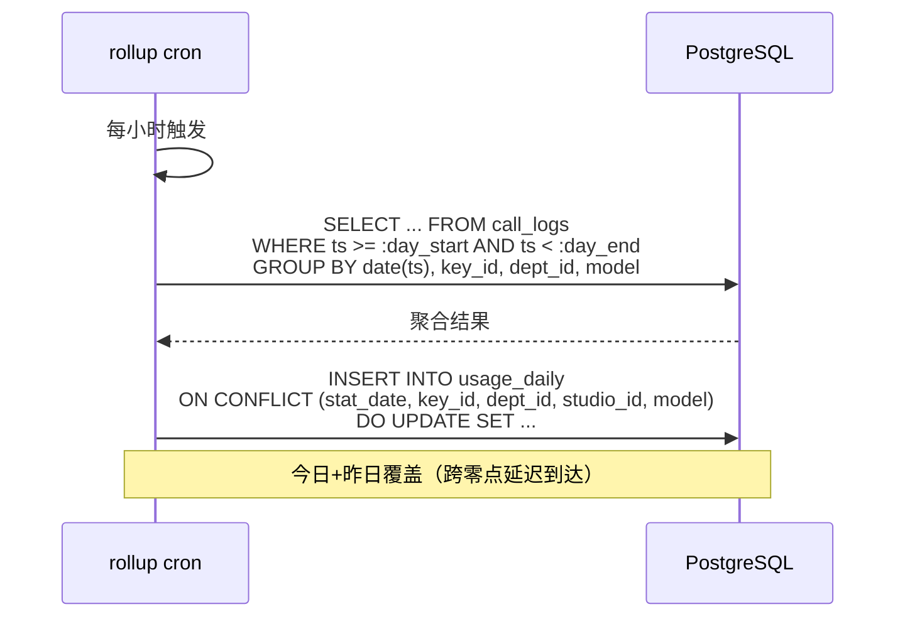
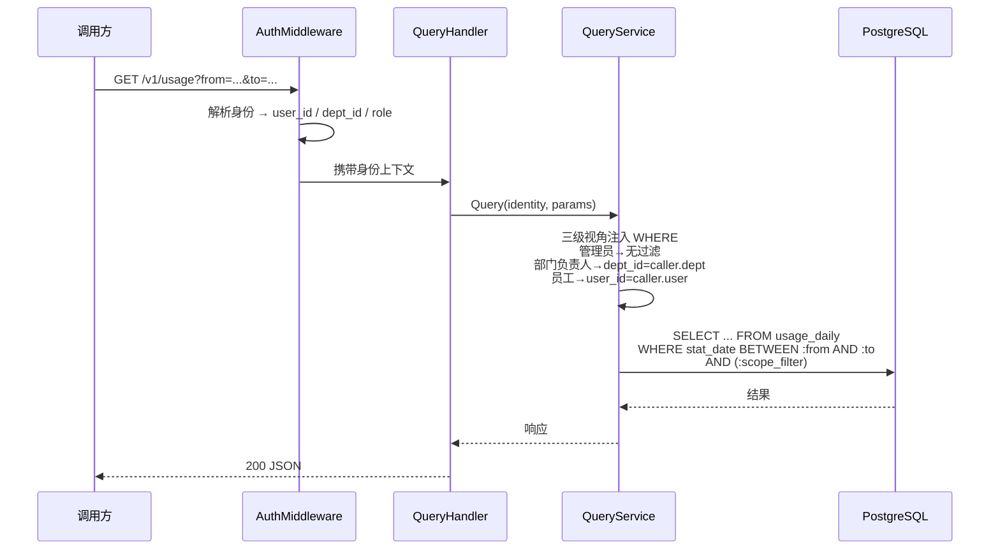
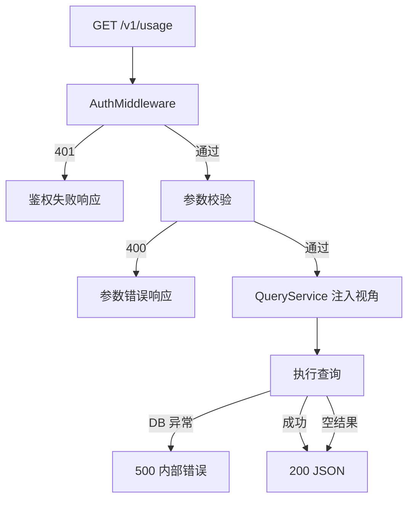

# observability-hub Web 后端技术设计

## 0. 文档信息

| 属性 | 内容 |
| :--- | :--- |
| **所属变更** | CHG-20260603-001 |
| **模块名称** | observability-hub |
| **模块类型** | web-backend |
| **创建时间** | 2026-06-03 |

### 修订记录

| 版本号 | 修改日期 | 修改内容摘要 | 修改人 |
| :--- | :--- | :--- | :--- |
| v1.0 | 2026-06-03 | 初稿创建（基于《实现级详细方案》文档） | OpenCode |

---

## 1. 背景与目标

### 1.1 背景

公司统一大模型网关已具备统一接入、身份鉴权、Key 治理和模型组调度能力，但缺少调用量、Token 消耗和成本数据的系统化记录与查询能力。本次变更在 gateway-api 中新增埋点采集链路，在 observability-hub 中实现消费、聚合、成本估算与查询。

### 1.2 目标

| 维度 | 目标描述 |
| :--- | :--- |
| 数据完整性 | 所有模型调用产出结构化 UsageEvent，含 key/user/dept/studio 维度 |
| 成本可追溯 | 采集时锁价算成本，聚合永不需重算历史 |
| 查询性能 | 走 usage_daily 聚合表，P95 ≤ 500ms |
| 可靠性 | L1 进程内 channel + 批量写，万级/天在途丢失可接受 |

---

## 2. 模块职责边界

### 2.1 本模块负责

- rollup cron：每小时从 call_logs 聚合到 usage_daily（整日重算覆盖，幂等）
- 查询 API：GET /v1/usage 只读查询，三级数据视角（管理员/部门负责人/员工）
- 成本估算引擎：EstimateCost（缓存分桶/阶梯/双字段/LiteLLM 同源算法）

### 2.2 本模块不负责

- 埋点采集与异步写入（由 gateway-api 的 Collector + batch writer 负责）
- 模型定价管理（由 control-plane 管理，observability-hub 只读消费）
- 内容记录（call_payloads 由 gateway-api 独立采集，不在本次范围）

### 2.3 依赖关系

| 依赖方 | 依赖方式 | 说明 |
| :--- | :--- | :--- |
| gateway-api | 共享 PG call_logs 表 | 写入方写 call_logs，observability-hub 读 call_logs 做聚合 |
| control-plane | 内存价表 5min 刷新 | 定价数据从 models JOIN model_catalog 读取 |

---

## 3. 技术选型与研究

| 技术领域 | 选型 | 理由 |
| :--- | :--- | :--- |
| 语言 | Go 1.22+ | 项目技术栈 |
| 聚合调度 | cron 表达式（robfig/cron） | 每小时一次，整日重算覆盖 |
| 成本算法 | Go 移植 LiteLLM cost_per_token | 同源同算法，修正缓存分桶缺陷 |
| 数据存储 | PostgreSQL call_logs + usage_daily | 万级/天，单机+索引完全胜任 |

---

## 4. 架构概述



### 层次说明

| 层次 | 组件 | 职责 |
| :--- | :--- | :--- |
| 采集层 | Collector + batch writer | gateway-api 进程内构造 UsageEvent、锁价算成本、批量写入 |
| 聚合层 | rollup cron | 每小时整日重算，从 call_logs 聚合到 usage_daily |
| 查询层 | QueryHandler + QueryService | 只读查询，三级视角注入，按维度聚合返回 |

---

## 5. 关键流程设计

### 5.1 埋点采集与写入



### 5.2 按天聚合



### 5.3 成本查询



---

## 6. 数据流转

### 6.1 请求数据流

```
gateway-api 调用完成
    ↓ (Logger c.Next())
Collector 构造 UsageEvent
    ↓ (EstimateCost 锁价)
channel 缓冲
    ↓ (N=200 / T=1s)
batch writer 批量 INSERT
    ↓
call_logs（明细）
    ↓ (rollup cron 每小时)
usage_daily（聚合）
    ↓ (QueryService)
GET /v1/usage 响应
```

### 6.2 外部数据消费

| 数据 | 来源 | 消费时机 | 刷新策略 |
| :--- | :--- | :--- | :--- |
| 模型定价 | control-plane models + model_catalog | 成本估算时查内存价表 | 5min cron 刷新 |
| 部门层级 | auth 模块（预留） | 部门汇总查询时 | 当前平级，预留 dept_tree |

---

## 7. 分层职责落实

| 层次 | 组件 | 职责落实 |
| :--- | :--- | :--- |
| Handler 层 | QueryHandler | 参数校验、调用 QueryService、返回 JSON |
| Service 层 | QueryService | 三级视角注入 WHERE、构建查询 SQL、结果聚合 |
| Repository 层 | UsageDailyRepository | 执行聚合 SQL、分页查询 |
| Cron 层 | RollupCron | 定时触发聚合、整日重算覆盖 UPSERT |

## 8. 异常处理链



## 9. 数据库设计要点

- call_logs 以 request_id 为主键，ON CONFLICT DO NOTHING 保证幂等
- usage_daily 复合主键 (stat_date, key_id, dept_id, studio_id, model)，整日重算 UPSERT 覆盖
- 成本在采集时锁价存入 call_logs，聚合永不需重算历史
- 索引覆盖 key_id/ts、dept_id/ts、model/ts 三种查询模式
- 默认不分区，容量增大后可选 PARTITION BY RANGE(ts)

## 10. 接口设计要点

| 接口 | 方法 | 路径 | 说明 |
| :--- | :--- | :--- | :--- |
| 用量成本查询 | GET | /v1/usage | 按维度聚合查询，三级视角注入 |
| 健康检查 | GET | /health | 存活探针 |
| 就绪检查 | GET | /ready | PG 连接可用 |

## 11. 错误处理与容灾

| 场景 | 处理 |
| :--- | :--- |
| channel 满 | 丢弃事件，dropped 计数 + 告警 |
| PostgreSQL 不可用 | write_errors 计数，PG 恢复后自动重试 |
| 模型缺定价 | cost=0，price_missing 计数告警 |
| 流式缺 usage | UsageMissing=true，cost=0，缺失率监控 |
| 重复 request_id | ON CONFLICT DO NOTHING 幂等 |
| 定价数据缺失 | 内存价表缺失该模型 → cost=0 + price_missing |

## 12. 性能设计

| 指标 | 目标值 | 实现方式 |
| :--- | :--- | :--- |
| 埋点落库延迟 | ≤ 5s | 进程内 channel + 批量写 |
| 聚合完成时间 | 次日凌晨 2 点前 | 每小时整日重算，幂等 UPSERT |
| 查询 P95 响应 | ≤ 500ms | 走 usage_daily 聚合表，PG 索引覆盖 |
| 容量 | 万~5 万/天 | PG 单机 + 索引完全胜任 |

## 13. 测试矩阵

| 测试类型 | 覆盖范围 | 关键用例 |
| :--- | :--- | :--- |
| 单元测试 | EstimateCost | golden 向量、缺价、cached>prompt、无缓存、纯缓存、阶梯跨档 |
| 单元测试 | ExtractCostInput | OpenAI vs Anthropic 双字段归一化 |
| 集成测试 | 端到端 | mock 上游带 cached_tokens → 落 call_logs → rollup → 查询断言成本 |
| 集成测试 | 幂等 | 重复 emit 同 request_id 不重复计；rollup 重复执行结果一致 |
| 集成测试 | 流式 | 含 include_usage 的末尾 chunk 解析回填，与非流式同口径 |
| 集成测试 | 视角 | 三级 WHERE 注入越权防护 |

## 14. 设计决策记录

| 决策点 | 选择 | 理由 |
| :--- | :--- | :--- |
| 成本计算时机 | 采集时锁价算好 | 明细行直接存 est_cost，聚合永不需重算历史 |
| 聚合方式 | 整日重算覆盖（UPSERT） | 幂等，跨零点延迟到达覆盖 |
| 缓存分桶 | 始终分桶（即使自定义价） | 修正 LiteLLM 线上版缺陷 |
| 三级视角 | 服务层强制注入 WHERE | 前端参数不可越权 |
| 价格来源 | catalog 默认 + manual override | 管理员心智模型简化 |
| 异步写入 | L1 进程内 channel | 万级/天在途丢失可接受 |