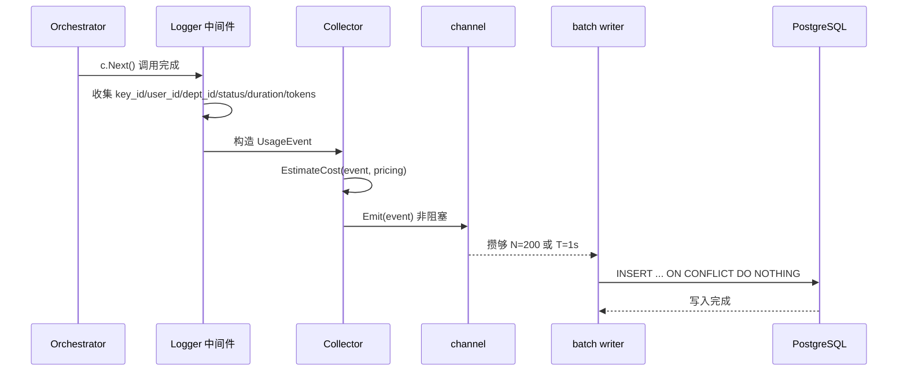
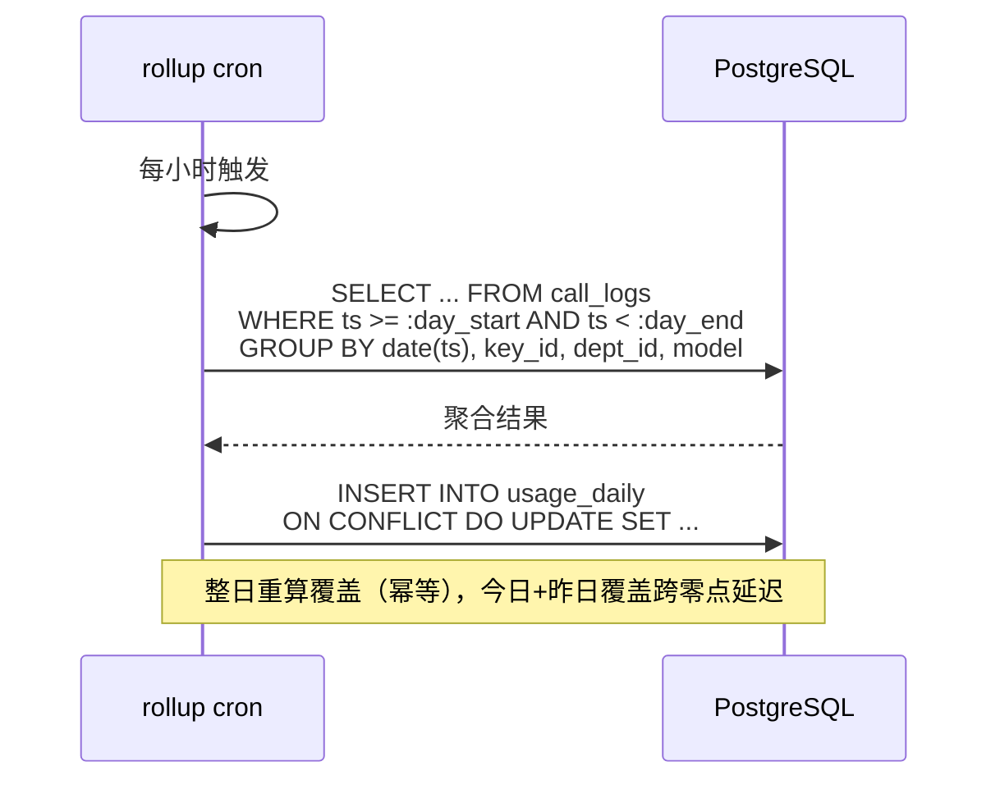
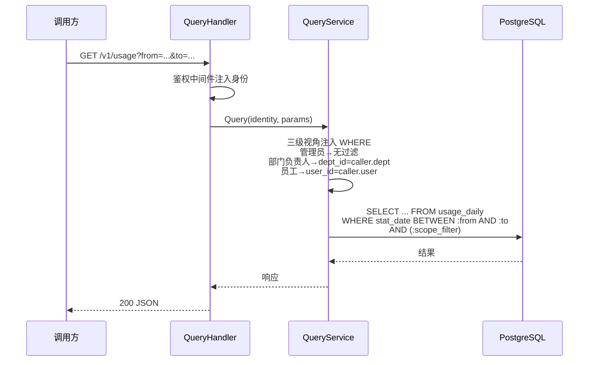

# observability-hub Web 后端概要设计

## 0. 文档信息

| 属性 | 内容 |
| :--- | :--- |
| **所属变更** | CHG-20260603-001 |
| **模块名称** | observability-hub |
| **模块类型** | web-backend |
| **创建时间** | 2026-06-03 |

### 修订记录

| 版本号 | 修改日期 | 修改内容摘要 | 修改人 |
| :--- | :--- | :--- | :--- |
| v1.0 | 2026-06-03 | 初稿创建（基于《调用埋点/用量汇总/成本估算 设计方案》实现级细化文档） | OpenCode |

---

## 1. 技术范围界定

| 维度 | 说明 |
| :--- | :--- |
| **起点** | gateway-api 在每次调用完成后通过进程内 channel 异步投递 UsageEvent |
| **终点** | HTTP GET /v1/usage 只读查询接口，返回按维度聚合的用量与成本数据 |
| **解决的问题** | 建立调用埋点→用量汇总→成本估算的完整数据链路，填补"谁用了多少、花了多少钱"的观测空白 |

### 技术边界

| 方向 | 说明 |
| :--- | :--- |
| 上游 | gateway-api（collector 投递 UsageEvent）、control-plane（模型定价数据） |
| 下游 | ops-console（后续版本消费查询接口展示成本看板） |
| 不涉及 | 实时硬限额拦截、厂商账单对账、ClickHouse/OLAP 基础设施、预算预警 |

---

## 2. 架构方向探索

宪章原则四要求"成本控制覆盖完整链路"，原则十一要求"按天汇总 + 定价配置 + 成本查询"。项目现有技术栈 Go+Gin+PostgreSQL+Redis，日均调用量万级。

**唯一合理方向：Go 服务内嵌批处理 + PG 聚合**。理由：
- 日均万级调用，PG 单机 + 索引完全胜任（毫秒级查询），无需引入 ClickHouse
- 成本算法移植 LiteLLM cost_per_token 并修正缓存分桶缺陷，Go 实现确保一致
- 进程内 channel + 批量写（L1）可靠，万级规模在途丢失可接受

不引入独立消息队列（Kafka/Redis Stream）——当前用 L1 进程内 channel，演进到需不丢账时切 L2 Redis Stream。

---

## 3. 架构方案

### 3.1 整体架构

```mermaid
flowchart TD
    subgraph GW["gateway-api 进程"]
        MID["AuthMiddleware<br/>（解析 key→user→dept）"]
        ORCH["Orchestrator<br/>（调用完成）"]
        COLL["Collector<br/>（构造 UsageEvent + 算成本）"]
        CH["channel 缓冲<br/>容量 10000"]
        BW["batch writer<br/>N=200 / T=1s"]
    end

    subgraph OBS["observability-hub 进程"]
        CRON["rollup cron<br/>每小时整日重算"]
        QH["QueryHandler<br/>GET /v1/usage"]
        QS["QueryService<br/>三级视角注入"]
    end

    subgraph STORE["存储层"]
        CL["call_logs<br/>（明细，request_id PK）"]
        UD["usage_daily<br/>（聚合，复合 PK）"]
        CP["models 定价<br/>（control-plane 管理）"]
    end

    MID --> ORCH
    ORCH -->|c.Next() 后| COLL
    COLL -->|EstimateCost| CP
    COLL -->|非阻塞 send| CH
    CH --> BW
    BW -->|批量 INSERT| CL
    CRON -->|聚合 SQL| CL
    CRON -->|UPSERT| UD
    QH --> QS
    QS -->|SELECT 查询| UD
```

### 3.2 核心流程

#### 埋点采集与写入



#### 按天聚合



#### 成本查询（三级视角）



---

## 4. 技术选型与约束

| 领域 | 选型 | 理由 |
| :--- | :--- | :--- |
| 运行时 | Go 1.22+ | 项目技术栈已确定 |
| 框架 | Gin | 项目已选定，查询接口复用网关鉴权中间件 |
| ORM | GORM | 项目已选定，批量 INSERT + ON CONFLICT 幂等 |
| 数据库 | PostgreSQL 15+ | 万级/天调用，单机+索引完全胜任 |
| 缓存 | 无（不引入新缓存） | 定价读内存价表（5min 刷新），查询走 PG |
| 消息队列 | 进程内 channel（L1） | 万级规模，在途丢失可接受；演进切 L2 Redis Stream |
| 成本算法 | Go 移植 LiteLLM cost_per_token | 同源同算法，修正缓存分桶缺陷 |

### 宪章合规性

- [x] 原则四「核心聚焦」：成本控制覆盖埋点→汇总→定价→估算完整链路
- [x] 原则二「组织感知」：key/user/dept/studio 维度，三级数据视角
- [x] 原则十一「可观测可管控」：结构化指标、按天汇总、定价配置、成本查询
- [x] 原则五「自主可控」：Go 自实现，不引入外部闭源依赖

---

## 5. 中间件链

| 顺序 | 中间件 | 职责 | 失败时 |
| :---: | :--- | :--- | :--- |
| 1 | 请求 ID 注入 | 生成唯一 ID，写入响应头 | — |
| 2 | AuthMiddleware | 解析 JWT/API Key，注入身份上下文（user_id/key_id/dept_id） | 401 |
| 3 | 结构化日志 | 记录请求路径、耗时、状态码 | — |
| 4 | 错误处理 | 捕获异常，统一错误格式 | 5xx |

## 6. 认证与授权

| 字段 | 内容 |
| :--- | :--- |
| 方案 | JWT Bearer Token / API Key（复用网关 AuthMiddleware） |
| 授权模型 | 三级数据视角：管理员全量、部门负责人本部门、员工仅自己 |
| 鉴权时机 | 查询接口入口，服务层强制注入 WHERE 条件 |

## 7. 数据存储与外部依赖

### 7.1 主数据库

| 字段 | 内容 |
| :--- | :--- |
| 数据库 | PostgreSQL 15+ |
| 核心表 | call_logs（明细）、usage_daily（聚合） |
| 读写分离 | 不适用（单机规模） |

### 7.2 外部服务依赖

| 服务 | 用途 | 降级策略 |
| :--- | :--- | :--- |
| control-plane | 定价数据（内存价表 5min 刷新） | 价表缺失返回 cost=0 + price_missing 告警 |

## 8. 安全设计

| 威胁 | 防御措施 |
| :--- | :--- |
| 越权查询 | 服务层强制注入 scope_filter，前端参数不可绕过 |
| 敏感数据泄漏 | 计量表只存 token 计数与维度，不含正文；Key 只存 key_id |
| 异步丢失 | dropped 计数 + 告警；L2 方案预留 |

## 9. 观测与运维

### 9.1 质量目标

| 指标 | 目标值 |
| :--- | :--- |
| 埋点事件落库延迟 | ≤ 5 秒 |
| 按天聚合完成时间 | 次日凌晨 2 点前 |
| 查询接口 P95 响应时间 | ≤ 500 毫秒 |

### 9.2 监控指标

- usage_events_emitted / dropped / written_total
- usage_write_errors_total、usage_queue_depth
- price_missing_total、usage_missing_total
- rollup_duration_seconds、rollup_rows_upserted

## 10. 失败模式与降级策略

| 失败场景 | 影响 | 降级策略 | 恢复方式 |
| :--- | :--- | :--- | :--- |
| channel 满 | 埋点事件丢弃 | dropped 计数 + 告警 | 自动恢复 |
| PostgreSQL 不可用 | 埋点写入失败 | write_errors 计数 + 告警 | PG 恢复后自动重试 |
| 定价数据缺失 | 成本为 0 | price_missing 计数告警，管理员补价 | 补价后下个 rollup 周期生效 |
| 流式缺 usage | Token 计 0 | UsageMissing 打标 + 缺失率监控 | 上游支持 include_usage 后自动恢复 |

## 11. 待研究事项

不适用。

> 成本算法已移植 LiteLLM cost_per_token 并通过 golden test 验证；PG 单机容量已验证（万级/天）；架构方向已唯一确定，无需额外技术研究。

## 12. 风险与对策

| 风险 | 对策 |
| :--- | :--- |
| 缓存 token 未分桶 → 高估 3-5x | EstimateCost 始终分桶（即使自定义价） |
| 流式缺 usage 静默计 0 | UsageMissing 打标 + 缺失率监控 |
| 模型名不匹配价表 | 缺价 missing 计数告警，强制补价 |
| 异步写在途丢失 | L1 批量 + dropped 计数；需不丢账切 L2 |

## 13. 概要设计确认

- [x] 技术范围已界定
- [x] 架构方向已选定
- [x] 架构方案已确认
- [x] 技术选型符合宪章