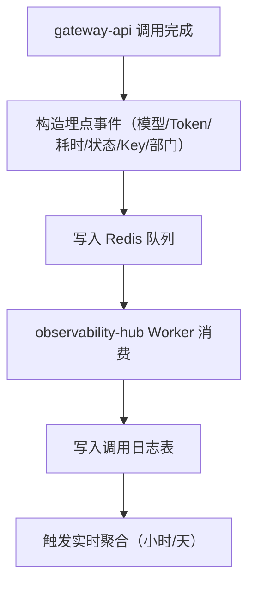
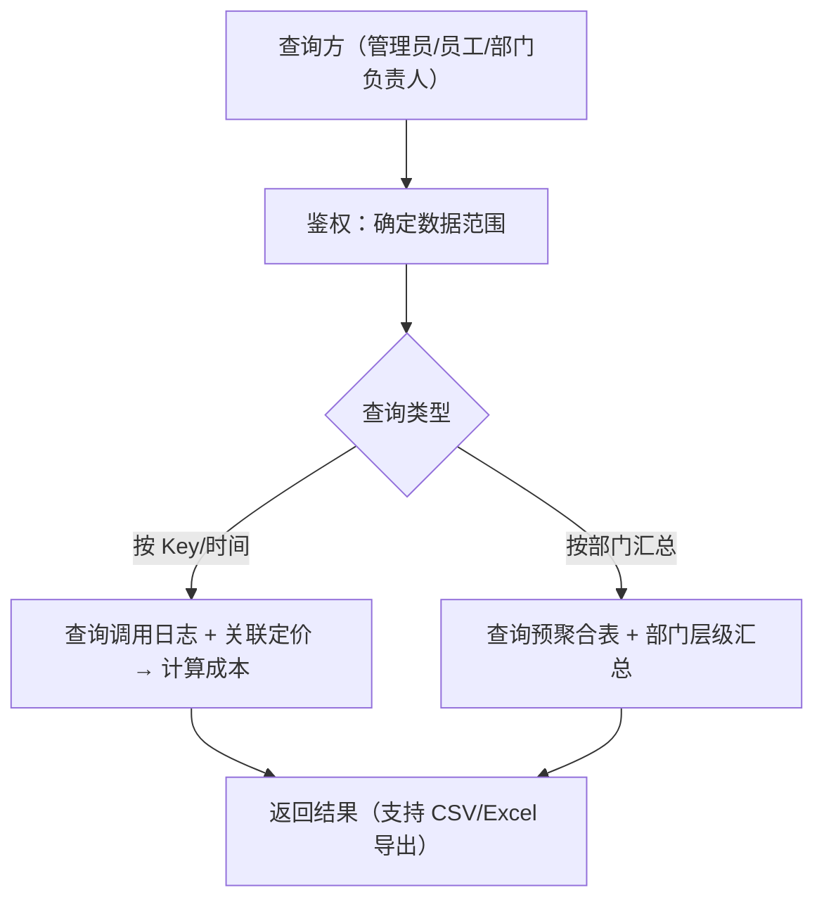

# observability-hub Web 后端需求规范

## 0. 文档信息

| 属性 | 内容 |
| :--- | :--- |
| **所属变更** | CHG-20260603-001 |
| **模块名称** | observability-hub |
| **模块类型** | web-backend |
| **创建时间** | 2026-06-03 |

### 修订记录

| 版本号 | 修改日期 | 修改内容摘要 | 修改人 |
| :--- | :--- | :--- | :--- |
| v1.0 | 2026-06-03 | 初稿创建 | OpenCode |

---

## 1. 业务背景与系统目标

* **业务背景**：公司统一大模型网关已具备统一接入、身份鉴权、Key 治理和模型组调度能力，但缺少调用量、Token 消耗和成本数据的系统化记录与查询能力。当前无法按部门/员工/Key 维度回答"谁用了多少、花了多少钱"的问题，成本控制链路不完整。
* **核心目标**：建立调用埋点→用量汇总→成本估算的完整数据链路，提供三级数据视图（管理员全局、员工自己、部门负责人部门排名），使成本可追溯、可量化、可查询。
* **关键衡量指标**：
  - 埋点事件从 gateway-api 发出到 observability-hub 落库的延迟不超过 5 秒
  - 按天汇总数据在次日凌晨 2 点前完成
  - 成本查询接口 P95 响应时间不超过 500 毫秒

---

## 2. 关键概念

- **埋点事件（Tracking Event）**：gateway-api 每次模型调用完成后产出的结构化记录，包含模型标识、Token 数、耗时、状态码、调用 Key、部门维度。
- **用量汇总（Usage Aggregation）**：按时间维度（小时/天/月）对 Token 数和调用次数进行聚合计算的结果。
- **模型定价（Model Pricing）**：模型输入 Token 和输出 Token 的单价配置，支持阶梯定价规则，历史单价变更时快照锁定。
- **估算成本（Estimated Cost）**：用量 × 对应时段单价计算得出的近似费用，非厂商账单精确值。
- **部门层级（Department Hierarchy）**：员工归属的部门树结构，成本数据支持从叶子节点向上汇总到父部门。

---

## 3. 超出范围

- 不做 ops-console 前端成本看板（后续单独推进）
- 不做预算预警（部门成本超阈值通知）
- 不做厂商账单精确对账
- 不做流式调用中实时累计成本（仅在调用结束时一次性计算）
- 不做定价变更后历史成本重算（历史成本锁定）

---

## 4. 角色与权限控制（RBAC）

| 角色名称 | 角色描述 | 数据权限 |
| :--- | :--- | :--- |
| 平台管理员 | 负责成本控制和运营管理的角色 | 全局所有数据，可按部门/模型/Key 筛选 |
| 员工 | 通过统一入口使用模型能力的内部员工 | 仅自己名下 Key 的用量和成本数据 |
| 部门负责人 | 负责管理本部门模型使用的管理者 | 本部门及下级子部门的汇总数据 |

---

## 5. 业务流程与状态机

### 5.1 埋点事件消费流程

### 5.2 成本查询流程

---

## 6. 详细功能需求

### 6.1 埋点事件消费与存储

**A. 功能说明**

observability-hub 从 Redis 队列消费 gateway-api 发出的埋点事件，解析后写入调用日志表。每条埋点记录包含：模型标识、输入 Token 数、输出 Token 数、调用耗时、HTTP 状态码、调用 Key 标识、部门标识、时间戳。

**B. 用户故事**

#### US-TRACK-01 — 埋点事件消费与存储 (P0)

**作为**系统，**我想要**消费 gateway-api 发出的埋点事件并持久化存储，**以便**后续用量汇总和成本计算有可靠的数据来源。

**功能说明**：
- 从 Redis 队列消费埋点事件，解析 JSON 格式的事件体
- 写入调用日志表，包含模型/Token/耗时/状态/Key/部门维度
- 消费失败时重试，超过重试次数后写入死信队列
- 支持批量写入以提升吞吐

**异常与边界**：
- Redis 队列不可达 → Worker 等待重连，gateway-api 侧事件不丢失（Redis 持久化）
- 事件格式非法 → 记录错误日志并丢弃，不阻塞后续事件消费
- 数据库写入失败 → 重试 3 次，仍失败则写入死信队列

#### US-TRACK-02 — 部门维度关联 (P0)

**作为**系统，**我想要**埋点事件中携带部门信息，**以便**成本数据能按部门层级汇总。

**功能说明**：
- 埋点事件携带 dept_id（发起调用的员工归属部门）
- 部门信息由 gateway-api 在鉴权链路中获取并写入埋点事件
- observability-hub 存储 dept_id，不做部门层级关系的维护（由 auth 模块提供）

**异常与边界**：
- dept_id 为空 → 标记为"未知部门"，正常存储但不参与部门汇总
- 员工部门变更 → 历史埋点保留原 dept_id，新埋点使用新 dept_id

### 6.2 用量汇总

**A. 功能说明**

对埋点数据进行按时间维度的聚合计算，生成小时级、天级、月级汇总表。汇总维度包括：模型、Key、部门、时间。汇总指标包括：调用次数、输入 Token 总数、输出 Token 总数。

**B. 用户故事**

#### US-AGGR-01 — 按天汇总用量 (P0)

**作为**系统，**我想要**每天自动汇总前一日的 Token 用量和调用次数，**以便**成本估算和趋势分析有聚合数据支撑。

**功能说明**：
- 每日凌晨对前一日的调用日志进行聚合，写入 usage_daily 表
- 聚合维度：日期 + 模型 + Key + dept_id + studio_id
- 聚合指标：调用次数、输入 Token 总数、输出 Token 总数
- 预留 studio_id 维度字段，当前可置空

**异常与边界**：
- 前一日无调用数据 → usage_daily 无新记录，不报错
- 聚合任务执行超时 → 重试一次，仍失败记录告警日志
- 聚合任务中途崩溃 → 重启后从断点继续，幂等写入（INSERT ON CONFLICT UPDATE）

#### US-AGGR-02 — 小时/月汇总 (P1)

**作为**平台管理员，**我想要**按小时和按月查看用量数据，**以便**识别短时峰值和长期趋势。

**功能说明**：
- 小时汇总：每小时对过去一小时的调用日志聚合，写入 usage_hourly 表
- 月汇总：每月首日对上一月的 usage_daily 进行二次聚合，写入 usage_monthly 表
- 聚合维度与 usage_daily 一致

**异常与边界**：
- 小时汇总延迟超过 1 小时 → 允许，下一个周期补算
- 月汇总与天汇总数据不一致 → 以天汇总为准，月汇总为二次聚合

### 6.3 成本估算与查询

**A. 功能说明**

基于用量汇总数据和模型定价配置，计算估算成本。提供按 Key、时间、模型、部门维度的查询接口，支持数据导出。

**B. 用户故事**

#### US-COST-01 — 用量按单价换算成本 (P0)

**作为**系统，**我想要**将汇总后的 Token 用量按模型定价换算为估算成本，**以便**查询方直接获取费用数据。

**功能说明**：
- 成本 = 输入 Token 数 × 输入单价 + 输出 Token 数 × 输出单价
- 单价取用量发生时刻的模型定价快照（历史定价锁定）
- 成本计算结果缓存到成本表中，查询接口直接读取
- 支持 OpenAI caching 折扣：cached_tokens 使用独立的 cache_read_input 单价

**异常与边界**：
- 模型无定价配置 → 成本为 0，标记为"定价缺失"
- 模型有阶梯定价 → 按 Token 数量区间匹配对应阶梯单价
- 定价变更 → 历史成本不重算，新用量使用新单价

#### US-COST-02 — 按 Key/时间查询成本 (P0)

**作为**员工，**我想要**查询我名下 Key 在指定时间范围内的调用量和成本，**以便**了解我的使用情况。

**功能说明**：
- 查询参数：Key 标识、时间范围（起止日期）
- 返回字段：日期、模型、调用次数、输入 Token、输出 Token、估算成本
- 支持按天、按月两种粒度
- 仅返回查询方有权查看的 Key 数据

**异常与边界**：
- 时间范围超过 90 天 → 返回错误提示，建议缩小范围
- 指定 Key 不存在或无权访问 → 返回空结果

#### US-COST-03 — 按部门汇总成本 (P0)

**作为**部门负责人，**我想要**查看本部门及下级子部门的模型调用成本汇总，**以便**按部门排名和成本趋势分析。

**功能说明**：
- 查询参数：部门标识、时间范围
- 返回字段：部门、子部门、模型、调用次数、Token 数、估算成本
- 支持部门层级汇总（叶子部门 → 父部门）
- 返回本部门及所有子部门的汇总数据

**异常与边界**：
- 部门无子部门 → 仅返回本部门数据
- 指定部门不存在 → 返回部门不存在错误

#### US-COST-04 — 管理员全局成本视图 (P0)

**作为**平台管理员，**我想要**查看全公司所有部门的模型调用成本总览，**以便**全局成本管控。

**功能说明**：
- 查询参数：时间范围、可选部门/模型筛选
- 返回字段：部门、模型、调用次数、Token 数、估算成本
- 支持按部门排名、按模型排名
- 支持 CSV 和 Excel 格式导出

**异常与边界**：
- 时间范围无数据 → 返回空结果，不报错
- 导出数据量超过 10000 行 → 分批导出或提示缩小范围

#### US-COST-05 — 按模型筛选与导出 (P1)

**作为**平台管理员，**我想要**按模型筛选成本数据并导出为 Excel/CSV，**以便**做成本分析和汇报。

**功能说明**：
- 查询接口支持按模型名称筛选（支持多选）
- 导出接口支持 CSV 和 Excel 两种格式
- 导出文件包含所有查询结果字段
- Excel 导出使用标准 .xlsx 格式

**异常与边界**：
- 筛选的模型不存在 → 返回空结果
- 导出请求超时 → 异步导出，生成后通知下载

---

## 7. 数据流与外部接口

* **数据导入**：从 Redis 队列消费 gateway-api 发出的埋点事件
* **外部 API 对接**：通过 auth 模块内部接口获取部门层级关系（预留）
* **消息/事件**：消费 Redis 队列中的埋点事件，不主动发布事件

---

## 8. 非功能需求

* **安全性**：
  - 成本查询接口必须基于身份鉴权，员工只能看自己、部门负责人只能看本部门、管理员看全局
  - 导出接口与查询接口使用相同的权限控制

* **并发与性能**：
  - 埋点消费 Worker 支持水平扩展，队列消费不重复
  - 成本查询接口 P95 响应时间不超过 500 毫秒
  - 天级聚合任务在 30 分钟内完成

* **可观测性**：
  - 埋点消费延迟、队列积压、聚合任务状态纳入监控
  - Worker 消费失败率、死信队列大小配置告警

---

## 9. 验收标准

| 编号 | 关联 | Given（前置状态） | When（触发动作） | Then（预期结果） | 优先级 |
| :--- | :--- | :--- | :--- | :--- | :--- |
| AC-TRACK-01 | US-TRACK-01 | Given gateway-api 完成一次模型调用并发出埋点事件 | When observability-hub Worker 消费该事件 | Then 调用日志表新增一条记录，包含模型/Token/耗时/状态/Key/部门字段 | P0 |
| AC-TRACK-02 | US-TRACK-01 | Given gateway-api 发出格式非法的埋点事件 | When Worker 消费该事件 | Then 事件被丢弃，错误日志记录原始事件内容，后续正常事件不受影响 | P1 |
| AC-TRACK-03 | US-TRACK-02 | Given 埋点事件中 dept_id 为空 | When Worker 消费该事件 | Then 记录正常写入，dept_id 标记为"未知部门"，不参与部门汇总 | P1 |
| AC-AGGR-01 | US-AGGR-01 | Given 前一日有 100 条调用日志 | When 每日凌晨聚合任务执行 | Then usage_daily 表生成按模型+Key+dept_id 维度的聚合记录，Token 数汇总正确 | P0 |
| AC-AGGR-02 | US-AGGR-01 | Given 前一日无任何调用日志 | When 每日凌晨聚合任务执行 | Then usage_daily 无新记录，任务正常结束不报错 | P1 |
| AC-AGGR-03 | US-AGGR-02 | Given 过去一小时有 50 条调用日志 | When 小时聚合任务执行 | Then usage_hourly 表生成该小时的聚合记录 | P1 |
| AC-COST-01 | US-COST-01 | Given 模型"qwen-plus"输入单价 0.002 元/Ktoken、输出单价 0.006 元/Ktoken，当天用量输入 100000 token、输出 50000 token | When 成本计算 | Then 估算成本 = 100×0.002 + 50×0.006 = 0.5 元 | P0 |
| AC-COST-02 | US-COST-01 | Given 模型定价已从 0.002 变更为 0.003 | When 查询变更前的历史成本 | Then 历史成本仍按 0.002 计算，变更后的新成本按 0.003 计算 | P0 |
| AC-COST-03 | US-COST-02 | Given 员工名下 Key K1 在过去 7 天有 10 次调用 | When 员工查询 K1 最近 7 天的成本 | Then 返回 7 天逐日成本明细，仅包含该员工名下的 Key 数据 | P0 |
| AC-COST-04 | US-COST-03 | Given 部门 X 有子部门 X1 和 X2，各有 50 元成本 | When 部门负责人查询部门 X 成本 | Then 返回部门 X 汇总成本 100 元，含 X1 和 X2 的明细 | P0 |
| AC-COST-05 | US-COST-04 | Given 全公司有 3 个部门各产生了成本 | When 管理员查询全公司成本 | Then 返回 3 个部门的成本数据，可按成本降序排列 | P0 |
| AC-COST-06 | US-COST-05 | Given 管理员查询了最近 30 天的成本数据 | When 导出为 Excel | Then 下载到 .xlsx 文件，包含日期/部门/模型/调用次数/Token/成本等字段 | P1 |

---

## 10. 假设与依赖

- 假设 gateway-api 在每次调用完成后能可靠地发出埋点事件到 Redis 队列
- 假设 auth 模块能提供部门层级关系查询接口（当前版本预留，部门层级汇总先做平级）
- 假设 control-plane 的模型定价配置在 observability-hub 中只读消费，定价变更通过接口同步或配置变更通知
- 依赖 Redis 作为埋点事件队列，依赖 PostgreSQL 作为调用日志和聚合数据的存储
- 风险：若 gateway-api 埋点事件格式变更，observability-hub 的消费逻辑需同步更新