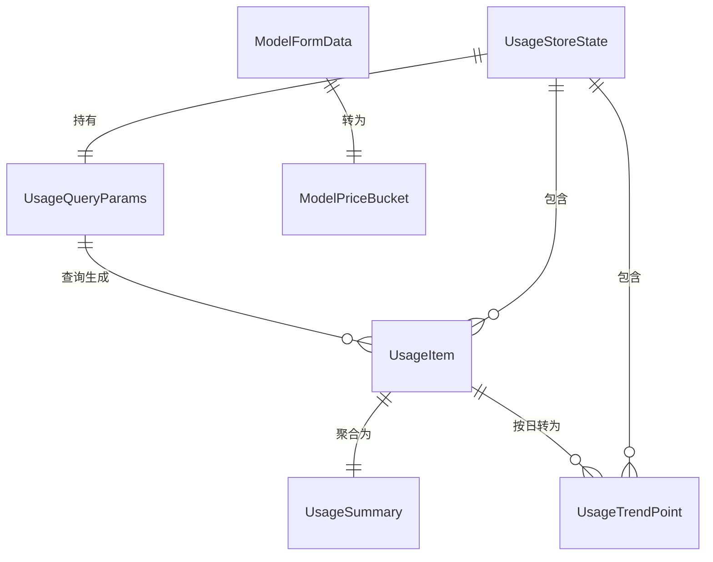

# ops-console 数据模型变更 — CHG-20260603-001

> 基线：xspec/modules/ops-console/spec.md (v1.0)

## 变更摘要

新增用量相关的 TypeScript 接口定义（UsageItem、UsageSummary 等）；新增 Pinia usageStore 状态类型；扩展 ModelFormData 类型（price_mode + 多桶定价字段）。

## 新增类型定义

### 用量数据模型（`web/src/types/usage.ts`）— 新建

```typescript
/** 单条用量聚合项 */
export interface UsageItem {
  stat_date: string           // 统计日期 YYYY-MM-DD
  key_id?: string             // API Key ID (UUID)
  user_id: string             // 用户 ID (UUID)
  dept_id?: string            // 部门 ID (UUID)
  model: string               // 模型名
  provider_type: string       // 厂商类型
  is_stream: boolean          // 是否流式
  request_count: number       // 请求次数
  prompt_tokens: number       // Prompt token
  completion_tokens: number   // Completion token
  reasoning_tokens: number    // Reasoning token
  cached_tokens: number       // Cached token
  avg_ttft_ms: number         // 平均 TTFT (ms)
  p95_ttft_ms: number         // P95 TTFT (ms)
  avg_duration_ms: number     // 平均端到端延迟 (ms)
  p95_duration_ms: number     // P95 延迟 (ms)
  prompt_cost: number         // Prompt 成本 (USD)
  completion_cost: number     // Completion 成本 (USD)
  reasoning_cost: number      // Reasoning 成本 (USD)
  cached_cost: number         // Cached 成本 (USD)
  total_cost: number          // 总成本 (USD)
}

/** 用量汇总 */
export interface UsageSummary {
  total_requests: number
  prompt_tokens: number
  completion_tokens: number
  reasoning_tokens: number
  cached_tokens: number
  total_tokens: number
  prompt_cost: number
  completion_cost: number
  reasoning_cost: number
  cached_cost: number
  total_cost: number
  avg_ttft_ms: number
  p95_ttft_ms: number
  avg_duration_ms: number
  p95_duration_ms: number
}

/** 用量趋势数据点 */
export interface UsageTrendPoint {
  date: string                // 日期 YYYY-MM-DD
  tokens: number              // 当日 Token 总量
  cost: number                // 当日成本 (USD)
  avg_ttft_ms: number         // 当日平均 TTFT
  avg_duration_ms: number     // 当日平均延迟
}

/** 用量查询参数 */
export interface UsageQueryParams {
  from: string                // 开始日期 YYYY-MM-DD (必填)
  to: string                  // 结束日期 YYYY-MM-DD (必填)
  model?: string              // 模型过滤
  provider_type?: string      // 厂商过滤
  is_stream?: boolean         // 流式过滤
  group_by?: 'day' | 'model' | 'dept' | 'studio' | 'key' | 'provider'  // 聚合维度
  key_id?: string             // Key 过滤
  user_id?: string            // 用户过滤
  dept_id?: string            // 部门过滤
  studio_id?: string          // 工作室过滤
}

/** 用量查询 API 响应 */
export interface UsageResponse {
  items: UsageItem[]
  total: UsageSummary
}

/** 调用内容 */
export interface PayloadData {
  request_id: string
  model: string
  messages: ChatMessage[]
  response_text: string
  system_fingerprint?: string
  tools?: any[]
  byte_size: number
  truncated: boolean
  storage_backend: string
  created_at: string
}
```

### 模型定价类型（`web/src/types/model.ts` 扩展）

```typescript
/** 模型四桶定价 */
export interface ModelPriceBucket {
  prompt_price: number         // Prompt 单价 (USD/1M tokens)
  completion_price: number     // Completion 单价 (USD/1M tokens)
  reasoning_price?: number     // Reasoning 单价, 可选
  cached_price?: number        // Cached 单价, 可选
}

/** 模型表单数据 — 扩展字段 */
export interface ModelFormData {
  // ... 已有字段
  price_mode: 'catalog' | 'manual'
  reasoning_price?: number
  cached_price?: number
}
```

## 状态管理类型

### usageStore（`web/src/stores/usage.ts`）— 新建

```typescript
export interface UsageStoreState {
  /** 用量明细列表 */
  items: UsageItem[]
  /** 汇总数据 */
  summary: UsageSummary | null
  /** 趋势数据 */
  trend: UsageTrendPoint[]
  /** 加载状态 */
  loading: boolean
  /** 错误信息 */
  error: string | null
  /** 当前查询参数 */
  filters: UsageQueryParams
}
```

### 组件 Props 类型

```typescript
/** UsageTrendChart 组件 Props */
export interface UsageTrendChartProps {
  data: UsageTrendPoint[]
  metric: 'tokens' | 'cost' | 'ttft' | 'duration'
  granularity: 'day' | 'week' | 'month'
  loading?: boolean
}
```

## 实体关系



## 数据流

```mermaid
flowchart LR
    API["GET /v1/usage"] -->|UsageResponse| Store["usageStore"]
    Store -->|UsageItem[]| Table["模型拆分表格"]
    Store -->|UsageSummary| Cards["概览卡片"]
    Store -->|UsageTrendPoint[]| Chart["UsageTrendChart"]
    API2["GET /v1/usage/payload/:id"] -->|PayloadData| Modal["调用内容弹窗"]
```
