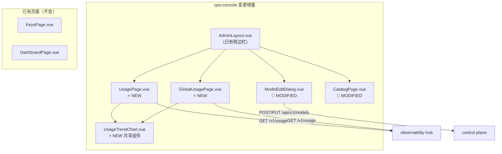
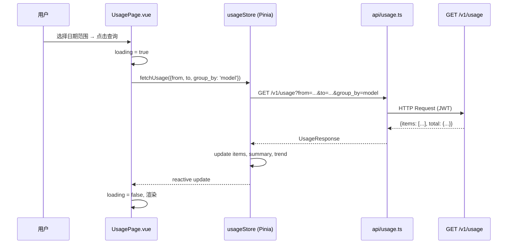

# ops-console 详细设计变更 — CHG-20260603-001

> 基线：xspec/modules/ops-console/spec.md (v1.0)

## 变更摘要

新增个人用量页（UsagePage）和全局用量看板（GlobalUsagePage），包含用量趋势图组件（UsageTrendChart）；简化 Catalog 管理 UI（删除价格差异 Tab）；模型编辑对话框增加 price_mode 开关和多桶定价输入。

## 架构变更



## 路由变更

### 新增路由

```typescript
// web/src/router/index.ts 新增
{
  path: '/admin/usage',
  name: 'Usage',
  component: () => import('@/views/admin/UsagePage.vue'),
  meta: { requiresAuth: true, title: '个人用量' }
},
{
  path: '/admin/usage/global',
  name: 'GlobalUsage',
  component: () => import('@/views/admin/GlobalUsagePage.vue'),
  meta: { requiresAuth: true, roles: ['admin'], title: '全局用量看板' }
}
```

### 路由守卫

`GlobalUsagePage` 通过 `meta.roles: ['admin']` 限制访问。非管理员访问时 `router.beforeEach` 守卫重定向到 `/admin/usage` 并 toast 提示"仅管理员可访问全局看板"。

## 新增页面详细设计

### UsagePage.vue（`web/src/views/admin/UsagePage.vue`）

**布局结构**：

```
┌──────────────────────────────────────────────────────┐
│  日期范围选择器 [2026-06-01] ~ [2026-06-04]  [查询]   │
├──────────────────────────────────────────────────────┤
│  ┌─────────┐  ┌──────────┐  ┌──────────────┐       │
│  │ 总请求数 │  │ 总 Token │  │  总估算成本   │       │
│  │  1,523  │  │ 3.47M   │  │   $2.30      │       │
│  └─────────┘  └──────────┘  └──────────────┘       │
├──────────────────────────────────────────────────────┤
│  ┌─────────────────────┐  ┌─────────────────────┐   │
│  │   按模型拆分表格     │  │    延迟指标卡片      │   │
│  │                     │  │  avg_ttft: 850ms    │   │
│  │  模型 |Token|成本   │  │  p95_ttft: 2100ms   │   │
│  │  ...               │  │  avg_dur:  3200ms   │   │
│  │                     │  │  p95_dur:  8500ms   │   │
│  └─────────────────────┘  └─────────────────────┘   │
├──────────────────────────────────────────────────────┤
│  用量趋势 [日] [周] [月]                             │
│  ┌──────────────────────────────────────────────────┐│
│  │            ECharts 折线/柱状图                    ││
│  │         Token 消耗 / 成本 走势                    ││
│  └──────────────────────────────────────────────────┘│
├──────────────────────────────────────────────────────┤
│  延迟趋势                                            │
│  ┌──────────────────────────────────────────────────┐│
│  │         ECharts 折线图                            ││
│  │         TTFT / 端到端延迟走势                     ││
│  └──────────────────────────────────────────────────┘│
└──────────────────────────────────────────────────────┘
```

**三态处理**：

| 状态 | 组件 | 说明 |
| :--- | :--- | :--- |
| loading | `el-skeleton` | 首次加载时展示骨架屏：3 个卡片 + 1 个表格 + 2 个图表骨架 |
| empty | `el-empty` | 无数据时展示："暂无用量数据，开始调用模型后这里将显示用量统计" |
| error | `el-alert type="error"` | 请求失败时展示错误信息 + 重试按钮 |

**数据流**：



**高消耗定位**：表格中对 `total_cost` 最高的行应用 `highlight-row` CSS class（背景色浅黄 + 加粗）。

### GlobalUsagePage.vue（`web/src/views/admin/GlobalUsagePage.vue`）

**布局结构**：

```
┌──────────────────────────────────────────────────────┐
│  日期范围 [本月] ~ [今天]  [查询]                     │
├──────────────────────────────────────────────────────┤
│  ┌──────────┐  ┌──────────┐  ┌──────────────┐      │
│  │ 总请求数  │  │ 总 Token │  │  总估算成本   │      │
│  │ 45,230   │  │ 89.2M   │  │   $152.30    │      │
│  └──────────┘  └──────────┘  └──────────────┘      │
├─────────────────────────┬────────────────────────────┤
│   按模型消耗排行 (柱状图) │   按部门消耗排行 (柱状图)  │
│                         │                            │
│  deepseek ████████ 45%  │  工程部   ████████ 38%     │
│  qwen     ████     25%  │  产品部   ████     22%     │
│  claude   ███      18%  │  设计部   ███      15%     │
│  ...                    │  ...                       │
├─────────────────────────┴────────────────────────────┤
│  全公司用量趋势                                       │
│  ┌──────────────────────────────────────────────────┐│
│  │         ECharts 折线图                            ││
│  │         按日 Token/成本走势                        ││
│  └──────────────────────────────────────────────────┘│
└──────────────────────────────────────────────────────┘
```

**权限控制**：

```typescript
// 路由守卫
router.beforeEach((to, from, next) => {
  if (to.meta.roles && !to.meta.roles.includes(userStore.role)) {
    ElMessage.warning('仅管理员可访问全局看板')
    next('/admin/usage')
    return
  }
  next()
})
```

### UsageTrendChart.vue（`web/src/components/UsageTrendChart.vue`）

**共享组件**，同时用于 UsagePage 和 GlobalUsagePage。

**Props**：

```typescript
interface UsageTrendChartProps {
  data: UsageTrendPoint[]      // 趋势数据
  metric: 'tokens' | 'cost' | 'ttft' | 'duration'  // 指标类型
  granularity: 'day' | 'week' | 'month'             // 粒度
  loading?: boolean
}
```

**内部实现**：

- 使用 ECharts `line` 或 `bar` 类型（取决于 metric）
- `granularity` 变化时重新请求数据（父组件处理）
- tooltip 显示具体数值 + 日期
- 支持 window resize 自适应

**粒度切换**：`el-radio-group` 三个按钮切换日/周/月，change 事件 emit 到父组件重新 fetch。

## 修改组件详细设计

### ModelEditDialog.vue 修改

**新增 price_mode 选择器**：

```
┌─────────────────────────────────────────────┐
│  定价模式                                    │
│  ○ 跟随目录（推荐）   ○ 手动填写             │
├─────────────────────────────────────────────┤
│  [当 manual 模式时展示]                      │
│  Prompt 单价    [____] USD / 1M tokens  *   │
│  Completion 单价 [____] USD / 1M tokens  *   │
│  Reasoning 单价  [____] USD / 1M tokens      │
│  Cached 单价     [____] USD / 1M tokens      │
│                                              │
│  [当 catalog 模式时展示]                      │
│  Catalog 价格:  Prompt $0.29 | Completion $1.76 │
│                 Reasoning $3.52 | Cached $0.15  │
└─────────────────────────────────────────────┘
```

**实现逻辑**：

```typescript
const priceMode = ref<'catalog' | 'manual'>('catalog')

// 切换时校验
watch(priceMode, (newMode) => {
  if (newMode === 'manual') {
    // 从 catalog 价格预填
    form.input_price = catalogPrice.value?.prompt_price || 0
    form.output_price = catalogPrice.value?.completion_price || 0
  }
})

// 提交前校验
function validate(): boolean {
  if (priceMode.value === 'manual') {
    if (!form.input_price || form.input_price <= 0) {
      ElMessage.error('手动模式下 Prompt 单价必须大于 0')
      return false
    }
    if (!form.output_price || form.output_price <= 0) {
      ElMessage.error('手动模式下 Completion 单价必须大于 0')
      return false
    }
  }
  return true
}
```

### CatalogPage.vue 修改

**删除价格差异 Tab**：

```vue
<!-- 修改前 -->
<el-tabs v-model="activeTab">
  <el-tab-pane label="目录同步" name="sync" />
  <el-tab-pane label="模型对应" name="bind" />
  <el-tab-pane label="价格差异" name="diff" />  <!-- 删除此行 -->
</el-tabs>

<!-- 修改后 -->
<el-tabs v-model="activeTab">
  <el-tab-pane label="目录同步" name="sync" />
  <el-tab-pane label="模型对应" name="bind" />
</el-tabs>
```

**删除相关代码**：
- `PriceDiffPanel.vue` 组件引用
- `ApplyDiffButton.vue` 组件引用
- `fetchPriceDiff()` API 调用
- `applyPriceDiff()` API 调用
- diff 相关状态变量（`diffItems`, `diffLoading`）

## 状态管理

### usageStore（`web/src/stores/usage.ts`）— 新增

```typescript
interface UsageStoreState {
  items: UsageItem[]
  summary: UsageSummary | null
  trend: UsageTrendPoint[]
  loading: boolean
  error: string | null
  filters: UsageQueryParams
}

// Actions
fetchUsage(params: UsageQueryParams): Promise<void>
fetchTrend(params: UsageQueryParams): Promise<void>
fetchPayload(requestId: string): Promise<PayloadData>
resetFilters(): void
```

### modelStore 扩展

已有 `modelStore` 中扩展 `price_mode`、`reasoning_price`、`cached_price` 字段的处理。

## API 层

### web/src/api/usage.ts — 新增

```typescript
import request from '@/utils/request'

export function getUsage(params: UsageQueryParams) {
  return request<UsageResponse>({
    url: '/v1/usage',
    method: 'get',
    params
  })
}

export function getPayload(requestId: string) {
  return request<PayloadData>({
    url: `/v1/usage/payload/${requestId}`,
    method: 'get'
  })
}
```

### web/src/api/model.ts — 修改

在 `createModel` / `updateModel` 的类型定义中新增 `price_mode`、`reasoning_price`、`cached_price` 字段。

## 设计决策记录

### 决策 1：趋势图粒度切换在父组件处理

- **问题**：粒度切换（日/周/月）是重新请求数据还是前端聚合
- **候选方案**：A — 重新请求 API（每次切换发请求）/ B — 前端聚合（一次请求全部数据）
- **决策**：选择方案 A
- **理由**：后端 usage_daily 已聚合好，前端再聚合会引入复杂度（周/月的边界处理）；API 已有 group_by 支持，复用后端能力更简洁

### 决策 2：GlobalUsagePage 路由守卫而非页面内判断

- **问题**：管理员权限校验放在路由层还是页面内
- **候选方案**：A — 路由守卫 `meta.roles` / B — 页面内 `v-if` 判断
- **决策**：选择方案 A
- **理由**：路由守卫在导航阶段拦截，用户不会看到页面闪烁；与现有 admin 路由权限模式一致

### 决策 3：高消耗行高亮而非独立警示区域

- **问题**：高消耗定位如何呈现
- **候选方案**：A — 表格行高亮 / B — 独立警示卡片
- **决策**：选择方案 A
- **理由**：高亮行在上下文中更直观；独立卡片增加页面复杂度；成本数据本身已在表格中，高亮即是最小化展示
