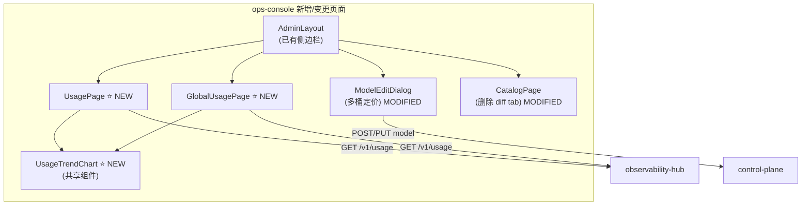
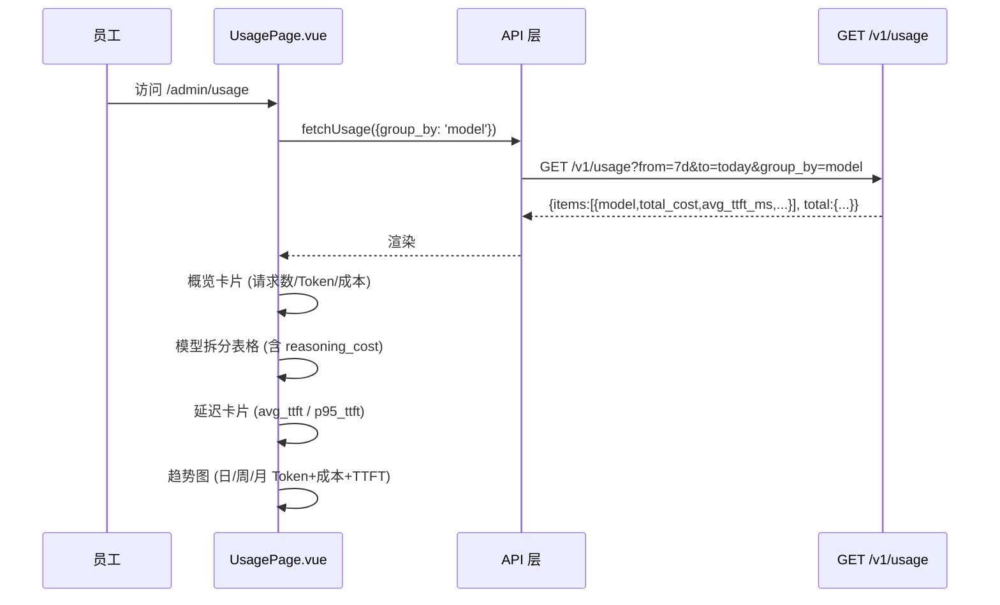

# ops-console 概要设计变更 — CHG-20260603-001

> 基线：xspec/modules/ops-console/spec.md (v1.0) — 无 hld.md 基线，首次增量设计

## 变更摘要

新增个人用量页和全局用量看板，展示分桶成本（含 reasoning_cost）和延迟指标（avg_ttft/p95_ttft）；简化 Catalog UI（删除价格差异 tab）并增加多桶定价手动输入。

## 架构变更

### 个人用量页核心交互

## 路由规划

| 路由 | 页面 | 权限 | 说明 |
| :--- | :--- | :--- | :--- |
| `/admin/usage` | UsagePage | 全员 | 个人用量页 |
| `/admin/usage/global` | GlobalUsagePage | 管理员 | 全局用量看板（路由守卫拦截非管理员） |
| `/admin/models/:id/edit` | ModelEditDialog | 管理员 | 修改：manual 模式展示四桶定价 |

## 技术选型变更

无新增技术选型。图表复用已有 ECharts 依赖。

| 领域 | 选型 | 理由 |
| :--- | :--- | :--- |
| 框架 | Vue 3 + Element Plus + Vite + Tailwind | 宪章约束，不变 |
| 图表 | ECharts（已有依赖） | 不引入新库 |
| 状态管理 | Pinia（已有） | 用量数据跨组件共享 |

## 新增组件

| 组件 | 位置 | 变更类型 | 职责 |
| :--- | :--- | :--- | :--- |
| `UsagePage.vue` | `web/src/views/admin/` | 新增 | 个人用量页：概览卡片 + 模型拆分表格 + 延迟指标 + 趋势图 |
| `GlobalUsagePage.vue` | `web/src/views/admin/` | 新增 | 全局用量看板：全公司总量 + 按模型/部门排行 + 趋势图 |
| `UsageTrendChart.vue` | `web/src/components/` | 新增 | 共享趋势图组件：Token/成本/延迟 日/周/月粒度切换 |
| `ModelEditDialog.vue` | 已有 | 修改 | price_mode=manual 展示四桶定价输入 |
| `CatalogPage.vue` | 已有 | 修改 | 删除价格差异 tab |

## 宪章合规

| 原则 | 检查结果 |
| :--- | :--- | :--- |
| 不开倒车 | ✅ 新增页面，不修改已有页面核心逻辑；趋势图组件可复用 |
| 交互至上 | ✅ 卡片式概览 + loading/error/empty 三态；核心操作 ≤ 3 步 |
| 架构清晰 | ✅ 共享组件复用；路由按权限分组 |
