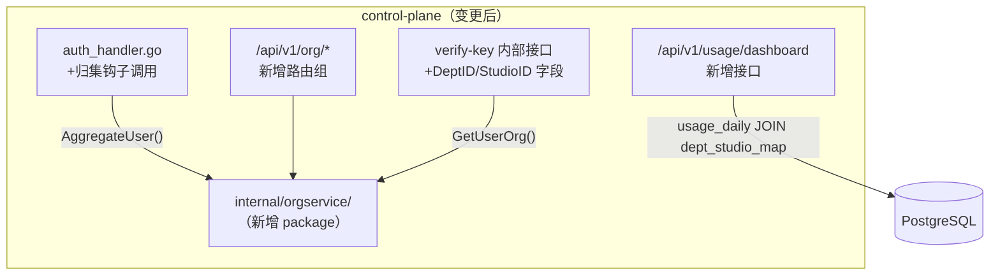

# control-plane 技术设计变更 — CHG-20260609-001

> 基线：xspec/modules/control-plane/spec.md (v1.0)

## 变更摘要

接入 `internal/orgservice/` package，扩展 SSO 归集钩子、新增组织管理路由、扩展 verify-key 响应字段（新增 dept_id/studio_id）、新增分层用量 Dashboard API。

---

## 设计决策变更

| 决策点 | 选择 | 理由 |
| :--- | :--- | :--- |
| org-service 集成方式 | 内嵌 package（internal/orgservice/） | 复用 PG/Redis 连接，无额外进程 |
| 归集失败处理 | 降级（不阻断登录） | 登录是关键路径，org 异常不能影响认证 |
| verify-key 响应扩展 | 向后兼容新增字段 | 不影响现有 gateway-core 行为 |

---

## 架构变更



---

## 新增组件

### 1. auth_handler.go — 归集钩子

在 `OAuthCallback` 处理 JWT 签发前插入：

```go
// 归集（失败降级，不阻断）
aggregateResult, err := orgSvc.AggregateUser(ctx, orgservice.AggregateRequest{
    UserID:   userID,
    Email:    email,
    DeptID:   claims["dept_id"].(string),
    DeptName: claims["dept_name"].(string),
})
if err != nil {
    log.Warn("org aggregate failed, degraded", "user_id", userID, "err", err)
    // 继续，aggregateResult.DeptID 和 StudioID 为空字符串
}
// 写入 JWT claims
jwtClaims["dept_id"] = aggregateResult.DeptID
jwtClaims["studio_id"] = aggregateResult.StudioID
```

### 2. verify-key 内部接口扩展

`internal/controlplane/service/key_auth_service.go` 中 `VerifyKey` 返回结构新增字段：

```go
type VerifyKeyResult struct {
    UserID        string
    AllowedGroups []string
    DeptID        string   // 新增：来自 users.dept_id
    StudioID      string   // 新增：来自 departments.studio_id（可空）
}
```

查询逻辑追加：
```go
// 查 users.dept_id
deptID, studioID := orgRepo.GetUserOrg(ctx, userID)
result.DeptID = deptID
result.StudioID = studioID
```

### 3. /api/v1/usage/dashboard — 分层看板 API

新增 handler：`internal/controlplane/handler/usage_dashboard_handler.go`

```
GET /api/v1/usage/dashboard
  Query: scope=company|studio|dept, id=<scope_id>, start=YYYY-MM-DD, end=YYYY-MM-DD, page, page_size
  
  鉴权注入（中间件）：
    user     → 403 直接拒绝
    dept_admin  → 强制 scope=dept, id=自身 dept_id
    studio_admin→ 强制 scope=studio, id=自身 studio_id
    admin    → 允许任意 scope+id
```

SQL 模式（studio 维度）：
```sql
SELECT
    dm.studio_id,
    SUM(ud.total_tokens) AS total_tokens,
    SUM(ud.cost_estimate) AS cost_estimate,
    COUNT(DISTINCT ud.user_id) AS user_count
FROM usage_daily ud
JOIN departments dep ON ud.dept_id = dep.id
JOIN dept_studio_map dm ON dep.id = dm.dept_id
WHERE dm.studio_id = $1
  AND ud.date BETWEEN $2 AND $3
GROUP BY dm.studio_id
ORDER BY total_tokens DESC
```

---

## 路由注册（router.go 新增）

```go
// internal/controlplane/router/router.go
orgGroup := authorized.Group("/org")
{
    orgGroup.GET("/studios", orgHandler.ListStudios)
    orgGroup.POST("/studios", orgHandler.CreateStudio)
    orgGroup.GET("/studios/:id", orgHandler.GetStudio)
    orgGroup.GET("/departments", orgHandler.ListDepartments)
    orgGroup.GET("/departments/unmapped", orgHandler.ListUnmappedDepts)
    orgGroup.PUT("/departments/:id/studio", orgHandler.SetDeptStudio)
    orgGroup.GET("/dept-studio-map", orgHandler.ListMappings)
    orgGroup.POST("/dept-studio-map/import", orgHandler.ImportMappings)
    orgGroup.POST("/roles/grant", orgHandler.GrantRole)
    orgGroup.POST("/roles/revoke", orgHandler.RevokeRole)
    orgGroup.GET("/roles/:user_id", orgHandler.GetUserRoles)
}

// 内部接口
internalGroup.POST("/org/auth/check-scope", orgHandler.CheckScope)
internalGroup.GET("/org/tree", orgHandler.GetOrgTree)

// 用量看板
authorized.GET("/usage/dashboard", usageDashboardHandler.GetDashboard)
```
