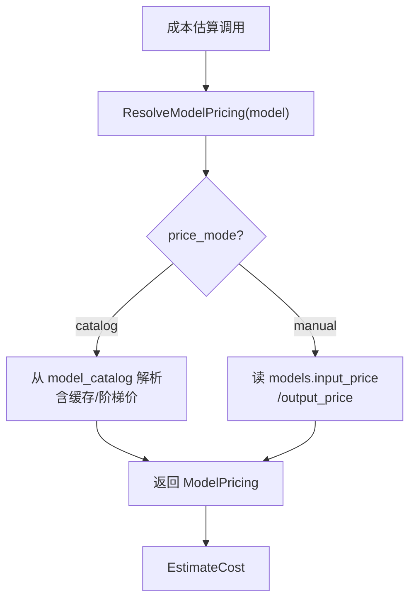
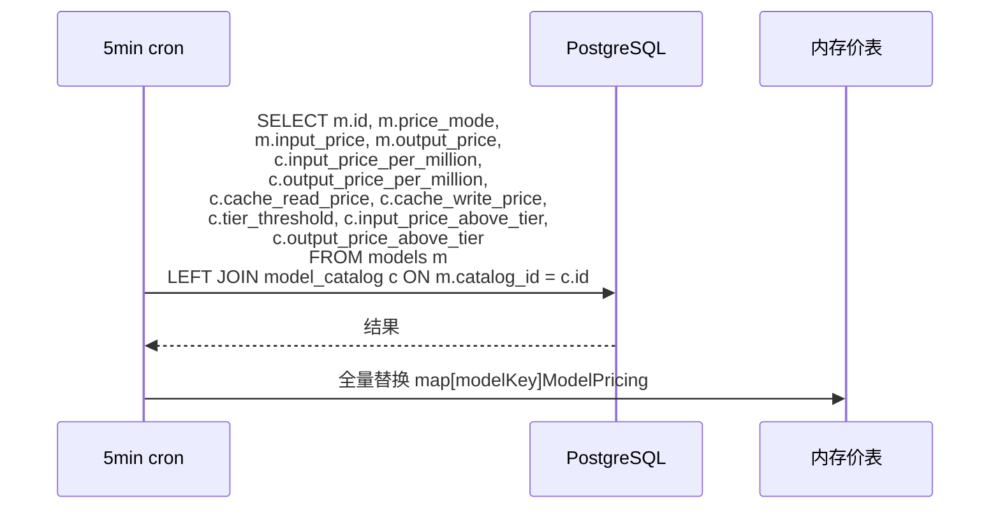

# control-plane 技术设计变更 — CHG-20260603-001

> 基线：xspec/modules/control-plane/design.md (v1.4)

## 变更摘要

定价体系从"手工 apply-diff 闸门"改为"读取时解析"：默认直读 model_catalog（LiteLLM 同步价），个别模型可选 price_mode=manual 手填实付价。新增 ResolveModelPricing 统一取价入口 + 内存价表 5min 刷新。删除 ComputePriceDiff / ApplyPriceDiff 及对应路由。

## 设计决策变更

| 决策点 | 选择 | 理由 |
| :--- | :--- | :--- |
| 价格来源 | catalog 默认 + manual override | 简化管理员心智模型：同步→自动对上→个别手填 |
| 取价时机 | 读取时解析 | 价格跟随 LiteLLM 自动更新，不依赖手工 apply |
| 删除 diff/apply | 是 | 线上路由本就不读价，删除零风险 |
| 缓存分桶 | 始终分桶（即使自定义价） | 修正 LiteLLM 线上版"自定义价时缓存折扣失效"缺陷 |

## 架构变更

### ResolveModelPricing 统一取价



### 内存价表刷新



## 组件详细设计

### ResolveModelPricing

```go
// internal/controlplane/pricing/resolver.go

type PricingTable struct {
    mu   sync.RWMutex
    data map[string]core.ModelPricing // key: modelKey
}

func (t *PricingTable) Resolve(modelKey string) (core.ModelPricing, bool) {
    t.mu.RLock()
    defer t.mu.RUnlock()
    p, ok := t.data[modelKey]
    return p, ok
}

func (t *PricingTable) Refresh(ctx context.Context, db *gorm.DB) error {
    // SELECT models JOIN model_catalog
    // 构建 map[modelKey]ModelPricing
    // 全量替换 atomic swap
}

func resolveModelPricing(m *Model, cat *ModelCatalog) (core.ModelPricing, bool) {
    if m.PriceMode == "manual" {
        if m.InputPrice <= 0 && m.OutputPrice <= 0 {
            return core.ModelPricing{}, true // manual 但未填 → 缺价
        }
        return core.ModelPricing{
            InputPerMtok:  &m.InputPrice,
            OutputPerMtok: &m.OutputPrice,
        }, false
    }
    // catalog 模式：直读 model_catalog
    if cat == nil {
        return core.ModelPricing{}, true
    }
    p := core.ModelPricing{
        InputPerMtok:       &cat.InputPricePerMillion,
        OutputPerMtok:      &cat.OutputPricePerMillion,
        CachedInputPerMtok: cat.CacheReadPrice,
        CacheWritePerMtok:  cat.CacheWritePrice,
    }
    if cat.TierThreshold != nil {
        p.Tiers = []core.ModelPricingTier{{
            UpToTokens:    cat.TierThreshold,
            InputPerMtok:  cat.InputPriceAboveTier,
            OutputPerMtok: cat.OutputPriceAboveTier,
        }}
    }
    return p, false
}
```

### 数据模型变更

models 表新增 `price_mode` 字段：

```sql
ALTER TABLE models
  ADD COLUMN price_mode VARCHAR(10) NOT NULL DEFAULT 'catalog';
```

- `catalog`：读取时按 catalog_id 解析 LiteLLM 价（忽略 input/output_price）
- `manual`：使用本表 input_price/output_price 作为实付价

input_price / output_price 列保留，语义改为"仅 manual 模式生效的实付价"。

### 删除组件

| 组件 | 说明 |
| :--- | :--- |
| ComputePriceDiff | 删除价格差异计算 |
| ApplyPriceDiff | 删除手工 apply 价格差异 |
| GET /model-catalog/diff | 删除路由 |
| POST /model-catalog/apply-diff | 删除路由 |

### 保留组件

| 组件 | 说明 |
| :--- | :--- |
| auto-bind | 价格解析仍需 catalog_id 知道模型对应哪条 LiteLLM 条目 |
| sync / sync-status | 目录本身仍需同步和检索 |

## 错误处理

| 场景 | 处理 |
| :--- | :--- |
| 模型未绑定 catalog | 缺价，price_missing 告警 |
| manual 模式未填价 | 缺价，price_missing 告警 |
| 内存价表缺失 | 返回 cost=0 + price_missing |
| 阶梯价跨档 | applyTier 按 Token 数匹配区间 |