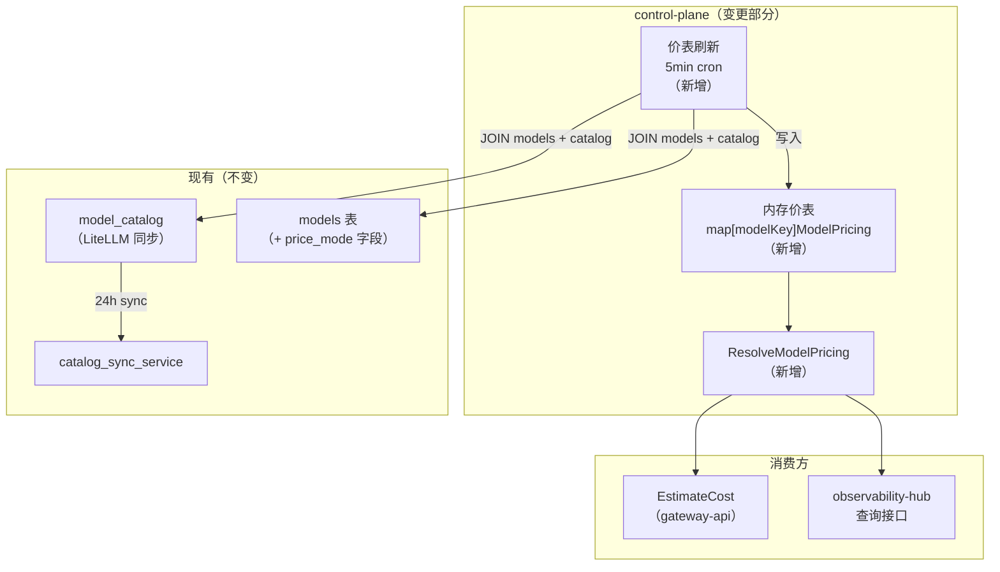

# control-plane 概要设计变更 — CHG-20260603-001

> 基线：xspec/modules/control-plane/hld.md (v1.4)

## 变更摘要

两处架构变更：① 定价体系从"手工 apply-diff 闸门"改为"读取时解析"——默认直读 LiteLLM 同步的 model_catalog 价格，个别模型可选 price_mode=manual 手填实付价；② 新增 ResolveModelPricing 统一取价入口 + 内存价表定时刷新，供成本估算引擎消费。

## 架构变更

## 新增组件

| 组件 | 位置 | 职责 |
| :--- | :--- | :--- |
| ResolveModelPricing | internal/core/cost.go | 统一取价入口：price_mode=catalog 读 model_catalog（含缓存/阶梯价），price_mode=manual 读 models 实付价，缺价返回 missing |
| 内存价表 | internal/controlplane/pricing/table.go | map[modelKey]core.ModelPricing，定时从 models JOIN model_catalog 刷新，供成本估算消费 |

## 变更组件

| 组件 | 变更 | 说明 |
| :--- | :--- | :--- |
| models 表 | 修改 | 新增 price_mode 字段（catalog/manual），input/output_price 保留但语义改为"仅 manual 生效" |
| CatalogSyncService | 修改 | 同步时填充缓存读/写/阶梯价字段到 model_catalog |

## 删除组件

| 组件 | 说明 |
| :--- | :--- |
| ComputePriceDiff / ApplyPriceDiff | 移除手工 apply-diff 闸门，价格改为读取时解析 |
| 路由 GET /model-catalog/diff、POST /model-catalog/apply-diff | 对应删除 |

## 关键决策

| 决策 | 选择 | 理由 |
| :--- | :--- | :--- |
| 价格来源 | 默认 catalog（LiteLLM），可选 manual override | 管理员心智模型简化：同步→自动对上→价格自动跟，个别才手填 |
| 取价时机 | 读取时解析，非写入时固化 | 定价跟随 LiteLLM 自动更新，不依赖手工 apply |
| 缓存分桶 | 始终分桶（即使自定义价） | 修正 LiteLLM 线上版本"自定义价时缓存折扣失效"缺陷 |
| 删除 diff/apply | 是 | 线上路由本就不读价，删除零风险；成本估算不依赖被删端点 |

## 技术选型变更

无。沿用 Go + Gin + GORM + PostgreSQL 技术栈，不引入新依赖。