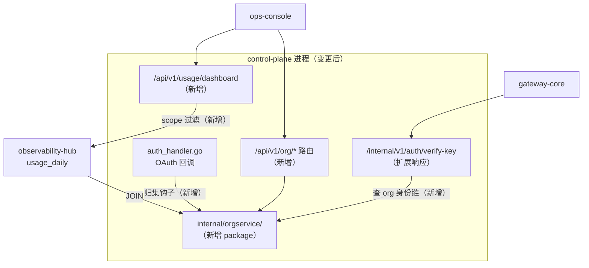

# control-plane 概要设计变更 — CHG-20260609-001

> 基线：xspec/modules/control-plane/spec.md (v1.0)
> 注：control-plane 尚无 hld.md 基线，本 delta 基于 spec.md 描述的现有架构现状撰写。

## 变更摘要

在 control-plane 进程内集成 `internal/orgservice/` package，接入 SSO 归集钩子并扩展路由，同时将 `verify-key` 内部接口的响应扩展为包含组织身份链（dept_id / studio_id），以及新增分层用量 Dashboard API。

---

## 架构变更



### 新增路由清单

| 路由前缀 | 说明 | 鉴权 |
| :--- | :--- | :--- |
| `GET /api/v1/org/tree` | 完整组织树（内部） | InternalToken |
| `GET/POST /api/v1/org/studios` | 工作室列表/创建 | JWTAuth + admin |
| `GET /api/v1/org/studios/:id` | 工作室详情 | JWTAuth + admin/studio_admin |
| `GET /api/v1/org/departments` | 部门列表（含映射状态） | JWTAuth + admin |
| `GET /api/v1/org/departments/unmapped` | 未映射部门清单 | JWTAuth + admin |
| `GET /api/v1/org/dept-studio-map` | 映射列表 | JWTAuth + admin |
| `POST /api/v1/org/dept-studio-map/import` | CSV 批量导入 | JWTAuth + admin |
| `PUT /api/v1/org/departments/:id/studio` | 手工修改映射 | JWTAuth + admin |
| `POST /api/v1/org/roles/grant` | 派发角色 | JWTAuth + admin/studio_admin |
| `POST /api/v1/org/roles/revoke` | 卸任角色 | JWTAuth + admin/studio_admin |
| `GET /api/v1/org/roles/:user_id` | 查询用户角色 | JWTAuth + admin |
| `POST /internal/org/auth/check-scope` | 管辖域鉴权（内部） | InternalToken |
| `GET /api/v1/usage/dashboard` | 分层用量 Dashboard | JWTAuth + 管理角色 |

---

## 技术选型变更

无新增技术选型。全部复用现有 Go + Gin + GORM + PostgreSQL 技术栈。

---

## 新增组件

### 1. SSO 归集钩子

在 `internal/controlplane/handler/auth_handler.go` 的 OAuth callback 末尾追加调用：

```
auth_handler.go
  └── OAuthCallback()
        └── (新增) orgService.AggregateUser(ctx, claims)
              → 成功：JWT claims 写入 dept_id / studio_id
              → 失败：降级（日志告警，不阻断登录）
```

### 2. verify-key 响应扩展

`/internal/v1/auth/verify-key` 现有响应新增两个字段：

```go
// 变更前
type VerifyKeyResponse struct {
    UserID        string
    AllowedGroups []string
}

// 变更后（新增字段）
type VerifyKeyResponse struct {
    UserID        string
    AllowedGroups []string
    DeptID        string   // 新增：用户所属部门 ID（空表示未归集）
    StudioID      string   // 新增：用户所属工作室 ID（空表示 pending_studio）
}
```

gateway-core 的 `AuthClient` 同步更新结构体；字段为空时不影响现有逻辑（向后兼容）。

### 3. 分层用量 Dashboard API

```
GET /api/v1/usage/dashboard?scope=dept|studio|company&id=<scope_id>&start=<date>&end=<date>
```

鉴权逻辑：
- 中间件从 JWT claims 读取 role + scope_id
- `dept_admin` → 强制 scope=dept, id=自身 dept_id（忽略请求参数中的 id）
- `studio_admin` → 强制 scope=studio, id=自身 studio_id
- `admin` → 允许任意 scope + id
- `user` → 403 直接拒绝

数据查询：复用 `observability-hub` 提供的 `usage_daily` 表，按 scope JOIN `dept_studio_map` 做工作室维度聚合。

---

## 数据库变更（新增表）

新增 5 张表（通过 migration 文件追加，不修改现有表）：

| 表名 | 说明 |
| :--- | :--- |
| `studios` | 工作室 |
| `departments` | 部门（含 studio_id FK、status） |
| `dept_studio_map` | 部门↔工作室映射 |
| `user_roles` | RBAC 角色授权 |
| `org_migration_log` | 部门迁移日志 |

同时在现有 `users` 表追加 `dept_id` 字段（nullable FK）。

---

## 宪章合规检查

| 原则 | 检查结果 |
| :--- | :--- |
| 零破坏性变更 | ✅ verify-key 响应新增字段，向后兼容；所有新增 API 为新端点 |
| 架构清晰 | ✅ orgservice 作为独立 package 内嵌，依赖方向单向（handler → service → repo） |
| 服务快速 | ✅ 归集钩子失败降级，不阻塞 OAuth 登录热路径 |
| 交互至上 | ✅ Dashboard API 按角色自动注入 scope 过滤，越权直接 403 + 明确提示 |
