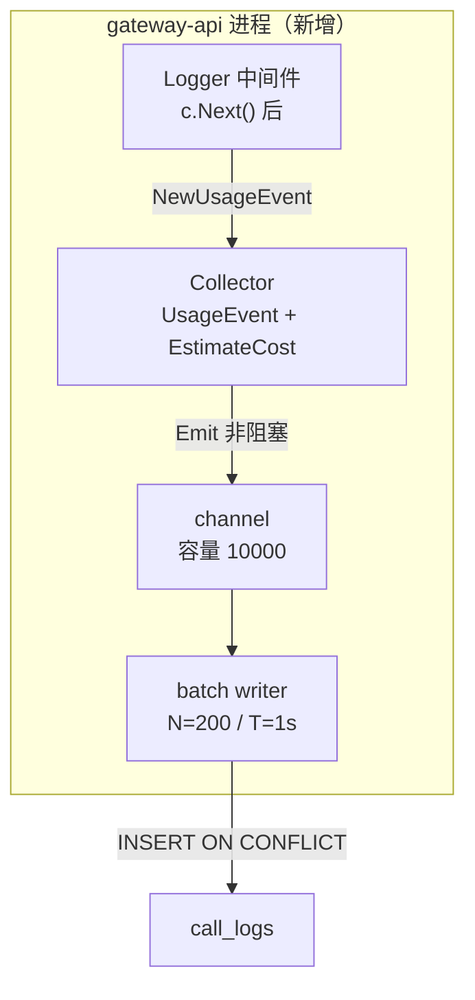
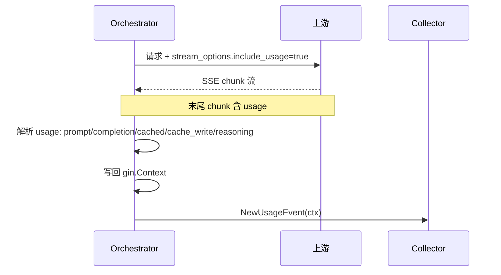

# gateway-api 技术设计变更 — CHG-20260603-001

> 基线：xspec/modules/gateway-api/design.md (v1.3)

## 变更摘要

在 Logger 中间件 c.Next() 后新增埋点采集链路：构造 UsageEvent、调用 EstimateCost 锁价算成本、通过进程内 channel 异步批量写入 call_logs。同时补齐 AuthMiddleware 身份解析（key→user→dept→studio）和流式 usage 回填。

## 设计决策变更

| 决策点 | 选择 | 理由 |
| :--- | :--- | :--- |
| 异步写入方式 | 进程内 channel + 批量写（L1） | 热路径非阻塞，万级/天在途丢失可接受 |
| 流式 usage 采集 | stream_options.include_usage=true | 使上游末尾 chunk 返回 usage，与非流式同口径 |
| 身份解析 | 复用 KeyCache + 回源 control-plane | 已有 infra/key_cache.go |
| 成本计算时机 | 采集时锁价 | 明细行存 est_cost，聚合不重算 |

## 架构变更

### Collector 与 batch writer



### 流式 usage 回填



## 组件详细设计

### Collector

```go
// internal/gateway/observability/collector.go

type Collector struct {
    ch      chan UsageEvent
    pricing *PricingTable
}

func NewCollector(bufSize int, pricing *PricingTable) *Collector

// NewUsageEvent 从 gin.Context 提取字段构造 UsageEvent
func (c *Collector) NewUsageEvent(ctx *gin.Context) UsageEvent {
    // 从 ctx 提取: request_id, key_id, user_id, dept_id, studio_id,
    //   model, routed_model, group_name, provider,
    //   prompt_tokens, cached_tokens, cache_write_tokens,
    //   completion_tokens, reasoning_tokens, total_tokens,
    //   status, upstream_status, duration_ms, stream, failover_used
    // 调用 c.estimateCost(event) 锁价
    return event
}

// Emit 非阻塞投递到 channel
func (c *Collector) Emit(e UsageEvent) {
    select {
    case c.ch <- e:
    default:
        metrics.UsageDropped.Inc()
    }
}
```

### batch writer

```go
// internal/gateway/observability/writer.go

type BatchWriter struct {
    repo *CallLogRepository
}

func (w *BatchWriter) Run(ctx context.Context, ch <-chan UsageEvent) {
    batch := make([]UsageEvent, 0, 200)
    ticker := time.NewTicker(1 * time.Second)
    for {
        select {
        case e := <-ch:
            batch = append(batch, e)
            if len(batch) >= 200 {
                w.flush(ctx, batch)
                batch = batch[:0]
            }
        case <-ticker.C:
            if len(batch) > 0 {
                w.flush(ctx, batch)
                batch = batch[:0]
            }
        }
    }
}

func (w *BatchWriter) flush(ctx context.Context, batch []UsageEvent) {
    err := w.repo.BatchInsert(ctx, batch)
    // INSERT ... ON CONFLICT (request_id) DO NOTHING
    if err != nil {
        metrics.UsageWriteErrors.Add(float64(len(batch)))
    } else {
        metrics.UsageWritten.Add(float64(len(batch)))
    }
}
```

### AuthMiddleware 变更

```go
// middleware/auth.go（修改部分）

func (m *AuthMiddleware) Handle(c *gin.Context) {
    // 原有：提取 Token → 验证
    // 新增：从 KeyCache 或 control-plane 回源解析身份
    identity := m.resolveIdentity(c, token)
    // identity{UserID, KeyID, DepartmentID, StudioID}
    c.Set("identity", identity)
    c.Next()
}
```

### Orchestrator 流式变更

在流式转发收尾点（HandleStreamResponse 完成）解析最后一个含 usage 的 SSE chunk，提取 prompt/completion/cached/cache_creation/reasoning 写回 gin.Context。

## 错误处理

| 场景 | 处理 |
| :--- | :--- |
| channel 满 | 丢弃事件，dropped 计数 + 告警 |
| PostgreSQL 不可用 | write_errors 计数，不阻塞热路径 |
| 流式缺 usage | UsageMissing=true，cost=0 |
| 重复 request_id | ON CONFLICT DO NOTHING 幂等 |
| Key 无效 | 401 不进入 Collector |
| 身份缺失 | 放行，dept_id 记空，identity_missing 告警 |