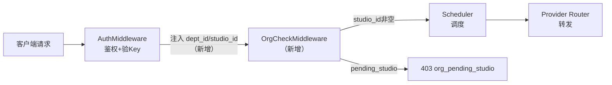
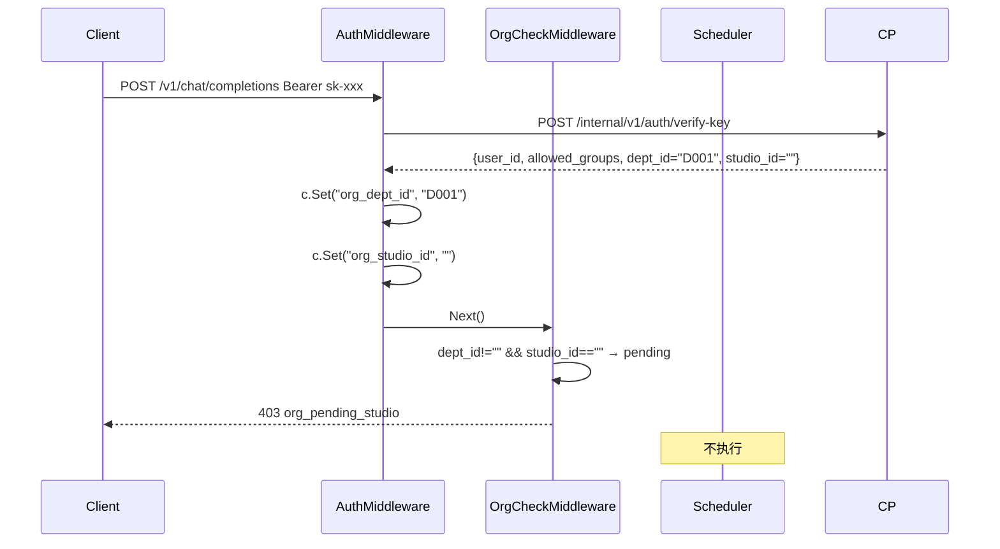

# gateway-core 技术设计变更 — CHG-20260609-001

> 基线：xspec/modules/gateway-core/spec.md (v1.0)

## 变更摘要

在鉴权通过后注入组织身份信息（dept_id/studio_id）到请求上下文，并新增独立的 `OrgCheckMiddleware` 在调度前拦截 pending_studio 状态的员工。

---

## 设计决策变更

| 决策点 | 选择 | 理由 |
| :--- | :--- | :--- |
| 拦截位置 | 独立 OrgCheckMiddleware（Auth 后、Scheduler 前） | 职责清晰，可独立测试，符合宪章「单一职责」 |
| 对热路径影响 | 零（仅内存字段判断，无 IO） | 宪章要求热路径禁止同步 IO 阻塞 |

---

## 架构变更



### 变更文件清单

| 文件 | 变更 |
| :--- | :--- |
| `internal/gateway/infra/auth_client.go` | 修改：`VerifyKeyResponse` 新增 `DeptID`、`StudioID` 字段 |
| `internal/gateway/middleware/auth.go` | 修改：鉴权通过后写入 context key |
| `internal/gateway/middleware/org_check.go` | **新增**：OrgCheckMiddleware |
| `internal/gateway/server/router.go` | 修改：在 `/v1/*` 路由链插入 OrgCheckMiddleware |

---

## 新增组件详细设计

### OrgCheckMiddleware（新文件）

```go
// internal/gateway/middleware/org_check.go

const (
    CtxKeyDeptID   = "org_dept_id"
    CtxKeyStudioID = "org_studio_id"
)

// OrgCheckMiddleware 在 AuthMiddleware 之后执行
// 判定条件：dept_id 非空 且 studio_id 为空 → pending_studio
func OrgCheckMiddleware() gin.HandlerFunc {
    return func(c *gin.Context) {
        deptID   := c.GetString(CtxKeyDeptID)
        studioID := c.GetString(CtxKeyStudioID)

        if deptID != "" && studioID == "" {
            c.AbortWithStatusJSON(403, gin.H{
                "error": gin.H{
                    "code":    "org_pending_studio",
                    "message": "您所在部门尚未配置工作室归属，请联系管理员",
                    "type":    "organization_error",
                },
            })
            return
        }
        c.Next()
    }
}
```

### auth.go 注入扩展

```go
// AuthMiddleware 鉴权通过后追加
c.Set(middleware.CtxKeyDeptID,   resp.DeptID)
c.Set(middleware.CtxKeyStudioID, resp.StudioID)
```

### router.go 路由链变更

```go
// 变更前
v1.Use(authMiddleware.Handle())
// 变更后（在 auth 后追加 org check）
v1.Use(authMiddleware.Handle(), middleware.OrgCheckMiddleware())
```

---

## 关键流程


