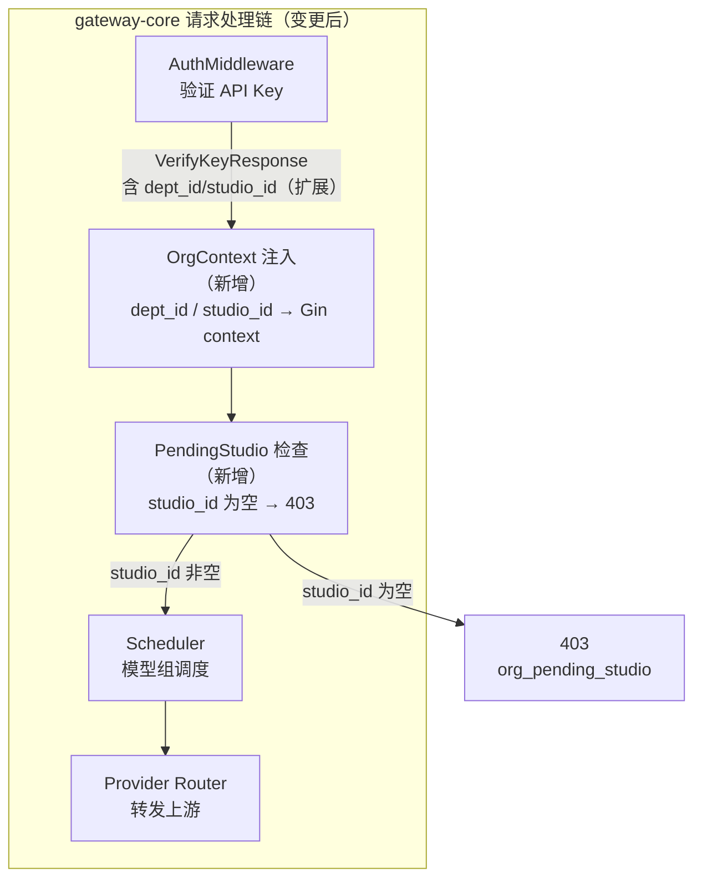
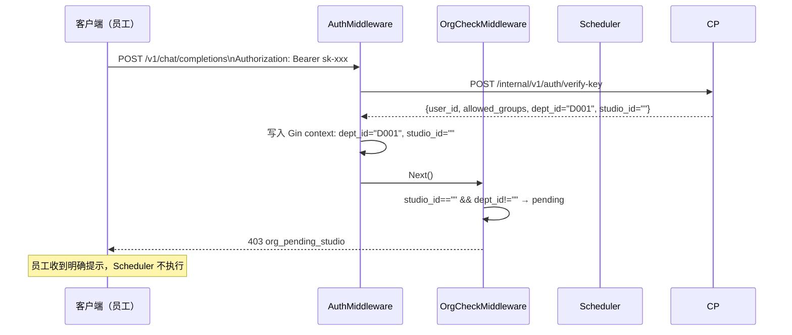

# gateway-core 概要设计变更 — CHG-20260609-001

> 基线：xspec/modules/gateway-core/spec.md (v1.0)
> 注：gateway-core 尚无 hld.md 基线，本 delta 基于 spec.md 描述的现有架构现状撰写。

## 变更摘要

在 gateway-core 的鉴权后置阶段新增两个轻量处理：① 将 verify-key 响应中的 dept_id / studio_id 注入 Gin context 供 observability 埋点使用；② 对 pending_studio 状态的员工在调度前前置拦截返回 403，无需感知 org 领域逻辑。

---

## 架构变更



### 变更位置

| 文件 | 变更类型 | 说明 |
| :--- | :--- | :--- |
| `internal/gateway/infra/auth_client.go` | 修改 | `VerifyKeyResponse` 新增 `DeptID`、`StudioID` 字段 |
| `internal/gateway/middleware/auth.go` | 修改 | 鉴权通过后将 DeptID/StudioID 写入 Gin context key |
| `internal/gateway/middleware/org_check.go` | 新增 | PendingStudio 拦截中间件 |
| `internal/gateway/server/router.go` | 修改 | 在 `/v1/*` 路由链中插入 `OrgCheckMiddleware`（位于 AuthMiddleware 之后） |

---

## 技术选型变更

无新增技术选型，全部复用现有 Go + Gin 技术栈。

---

## 新增组件

### 1. OrgContext 注入（`auth.go` 扩展）

鉴权成功后，将 `VerifyKeyResponse.DeptID` / `StudioID` 写入 Gin context：

```
AuthMiddleware
  └── VerifyKey() → VerifyKeyResponse
        └── (新增) c.Set("dept_id", resp.DeptID)
        └── (新增) c.Set("studio_id", resp.StudioID)
```

context key 定义为常量，供下游 middleware 和 observability 埋点统一读取。

### 2. PendingStudio 拦截中间件（新文件）

```
OrgCheckMiddleware (internal/gateway/middleware/org_check.go)
  读取 c.GetString("studio_id")
  if studio_id == "" && dept_id != "":
      返回 403 JSON:
      {
        "error": {
          "code": "org_pending_studio",
          "message": "您所在部门尚未配置工作室归属，请联系管理员",
          "type": "organization_error"
        }
      }
  else:
      c.Next()
```

**判定逻辑说明**：
- `dept_id` 非空 且 `studio_id` 为空 → 员工已归集到部门，但部门尚未映射工作室（pending_studio）
- `dept_id` 为空 → 员工尚未归集（通常是归集钩子失败降级），不触发此拦截，走正常流程（后续可按需收紧）

---

## 核心流程：pending_studio 拦截



---

## 宪章合规检查

| 原则 | 检查结果 |
| :--- | :--- |
| 零破坏性变更 | ✅ VerifyKeyResponse 新增字段向后兼容；新增 middleware 仅对 pending_studio 用户生效 |
| 服务快速 | ✅ OrgCheckMiddleware 只做内存中的字段判断（O(1)），无 IO；不影响热路径 P99 |
| 架构清晰 | ✅ gateway 不直连 org-service 数据库，组织信息全部通过 verify-key 响应透传 |
| 交互至上 | ✅ 403 响应含结构化错误码 + 人可读提示，符合 API 错误规范 |
