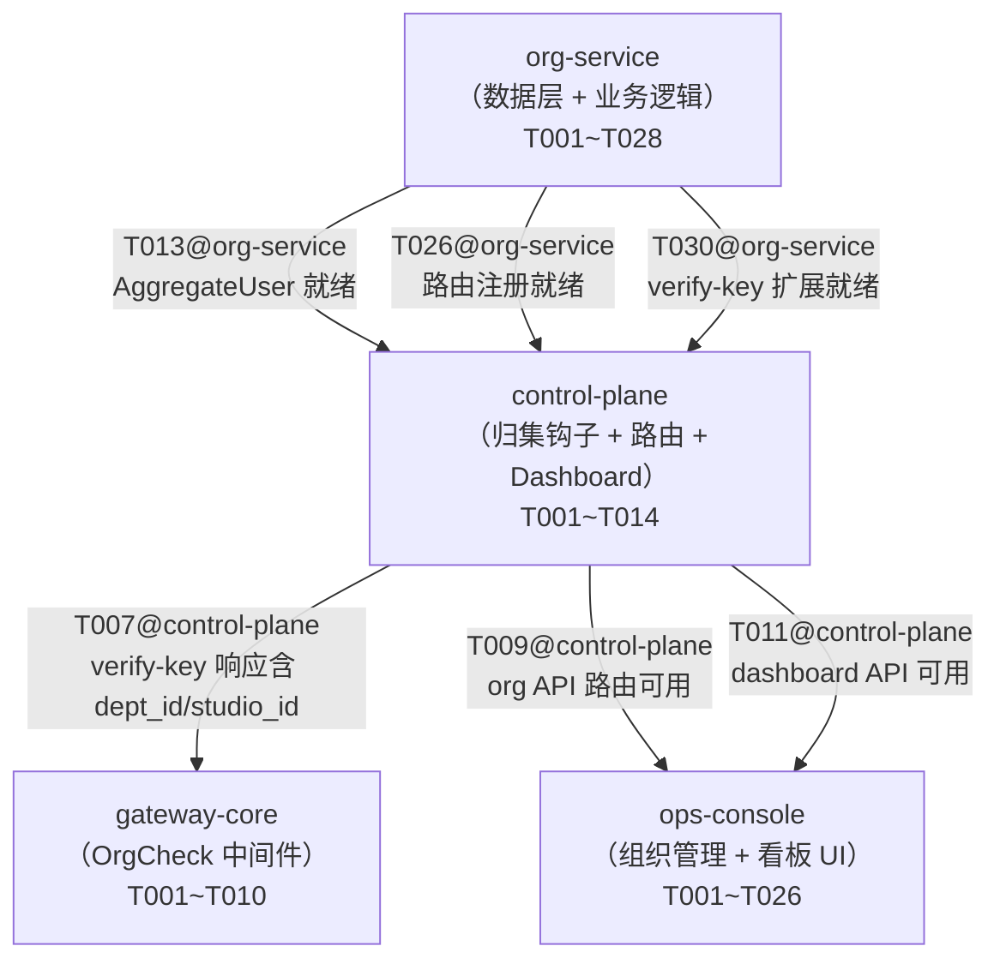

# 组织架构 跨模块协调视图

> 本文件是跨模块集成的导航与协调中心，不是任务汇总表。
> 各模块内部任务在对应 `task.md` 中管理，通过下方索引导航。

## 基本信息

| 属性 | 内容 |
| :--- | :--- |
| **变更编号** | CHG-20260609-001 |
| **变更名称** | 组织架构 |
| **生成时间** | 2026-06-09 |

---

## 1. 模块任务索引

| 模块 | 类型 | 任务文件 | P0 | P1 | P2 |
| :--- | :--- | :--- | :--- | :--- | :--- |
| org-service | web-backend（新增） | [`org-service/task.md`](./org-service/task.md) | 29 | 5 | 0 |
| control-plane | web-backend（变更） | [`control-plane/task.md`](./control-plane/task.md) | 9 | 4 | 0 |
| gateway-core | web-backend（变更） | [`gateway-core/task.md`](./gateway-core/task.md) | 9 | 0 | 0 |
| ops-console | web-frontend（变更） | [`ops-console/task.md`](./ops-console/task.md) | 18 | 8 | 0 |

---

## 2. 跨模块执行顺序

**推荐实现顺序**：
1. **org-service 阶段1+2**（基础结构 + 数据层）
2. **org-service 阶段3**（功能实现）与 **gateway-core 阶段1+2** 可并行
3. **control-plane 阶段3.1+3.2**（归集钩子 + verify-key 扩展）
4. **gateway-core 阶段3**（OrgCheck 中间件，依赖 CP verify-key 扩展完成联调）
5. **control-plane 阶段3.3+3.4**（路由注册 + Dashboard）与 **ops-console 阶段1+2** 可并行
6. **ops-console 阶段3**（UI 功能实现）
7. **集成联调**（I001~I006）

---

## 3. 跨模块集成任务

### 阶段：后端接口联调

- [ ] I001 P0 verify-key 扩展端到端验证（control-plane ↔ gateway-core）：配合真实 PG 数据，验证 verify-key 响应含正确 dept_id/studio_id，pending_studio 时 studio_id 为空字符串
  depends: T007@control-plane, T002@gateway-core

- [ ] I002 P0 pending_studio 拦截完整链路验证（gateway-core ↔ control-plane ↔ org-service）：pending_studio 员工调用 `/v1/chat/completions` 返回 403 + `org_pending_studio`；补映射后调用恢复正常
  depends: T008@gateway-core, T005@control-plane, T022@org-service

- [ ] I003 P0 SSO 归集钩子集成验证（control-plane ↔ org-service）：测试账号完整 SSO OAuth 流程 → JWT claims 含 dept_id → users/departments 表写入正确
  depends: T005@control-plane, T015@org-service

### 阶段：前后端接口联调

- [ ] I004 P0 组织管理 API 前后端联调（ops-console ↔ control-plane/org-service）：组织树、映射导入（dry_run + 确认）、角色派发/卸任完整流程验证
  depends: T022@ops-console, T009@control-plane, T026@org-service

- [ ] I005 P1 用量 Dashboard API 前后端联调（ops-console ↔ control-plane）：dept_admin/studio_admin/admin 三种角色看板数据范围验证；面包屑下钻验证
  depends: T023@ops-console, T011@control-plane

### 阶段：端到端验证

- [ ] I006 P1 E2E 测试（Playwright）：完整组织管理流程（创建工作室→导入映射→指定负责人→员工登录归集→看板展示）
  depends: I004, I005

---

## 4. 质量门禁

在提交合并请求前，所有以下检查必须通过：

| 检查项 | 命令 / 方式 | 负责模块 |
| :--- | :--- | :--- |
| 后端全量测试 | `make test` | org-service / control-plane / gateway-core |
| 前端单元测试 | `npx vitest run` | ops-console |
| TypeScript 编译 | `npx tsc --noEmit` | ops-console |
| 接口契约对齐 | 人工审查 org-service/contracts.md vs ops-console/contracts.delta.md | 全部 |
| verify-key 向后兼容 | T007@control-plane 单元测试（新字段不影响现有 gw 行为） | control-plane |
| pending_studio 拦截 | I002 集成验证 | gateway-core |
| 归集幂等性 | T015@org-service 单元测试 | org-service |
| 越权操作 403 | T027@org-service + T007@gateway-core 单元测试 | org-service / gateway-core |
| E2E 完整流程 | I006 Playwright 测试 | ops-console |
| Code Review | 人工 Review（重点：orgservice 包边界、路由守卫） | 全部 |
