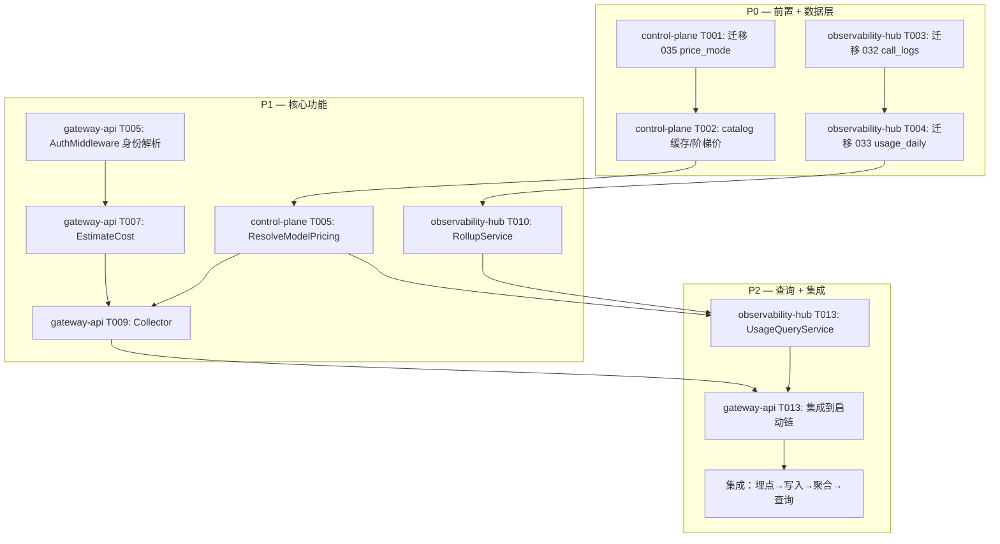

# 跨模块协调视图 — CHG-20260603-001

## 模块任务索引

| 模块 | task.md | 任务数 | 优先级分布 |
| :--- | :--- | :--- | :--- |
| observability-hub | [task.md](observability-hub/task.md) | 22 | P0: 11 / P1: 11 |
| gateway-api | [task.md](gateway-api/task.md) | 16 | P0: 13 / P1: 3 |
| control-plane | [task.md](control-plane/task.md) | 17 | P0: 10 / P1: 7 |

## 跨模块执行顺序

## 跨模块集成任务

| 编号 | 任务 | 依赖 | 说明 |
| :--- | :--- | :--- | :--- |
| I001 | 端到端埋点链路验证 | T016@gateway-api, T015@observability-hub | gateway 埋点 → call_logs 写入 → rollup 聚合 → /v1/usage 查询成本 |
| I002 | 定价数据一致性验证 | T006@control-plane, T012@observability-hub | control-plane 内存价表 ↔ observability-hub 定价表一致性 |
| I003 | 三级视角联调 | T015@observability-hub, T013@gateway-api | 管理员/部门负责人/员工三级视角 + AuthMiddleware 身份解析 |
| I004 | 流式 usage 端到端 | T006@gateway-api, T014@gateway-api | 流式 include_usage → usage 回填 → call_logs 正确 token + cost |
| I005 | 迁移脚本顺序验证 | T001@control-plane, T003@observability-hub | 035_price_mode 在 032_call_logs 之前执行（功能独立，无冲突） |

## 质量门禁

- [ ] 全部 3 个模块 task.md 任务完成度 ≥ 95%
- [ ] 联调 I001~I004 全部通过
- [ ] 验收标准覆盖：observability-hub 14 条 AC + gateway-api 4 条 AC + control-plane 5 条 AC = 23 条全部覆盖
- [ ] 集成测试：E2E 埋点链路 + 三级视角 + 流式 usage
- [ ] 单元测试：EstimateCost golden + Rollup 聚合 + ResolveModelPricing
- [ ] 代码审查：3 个模块全部 Review
- [ ] 部署前检查：迁移脚本 dry-run 通过、回滚脚本验证