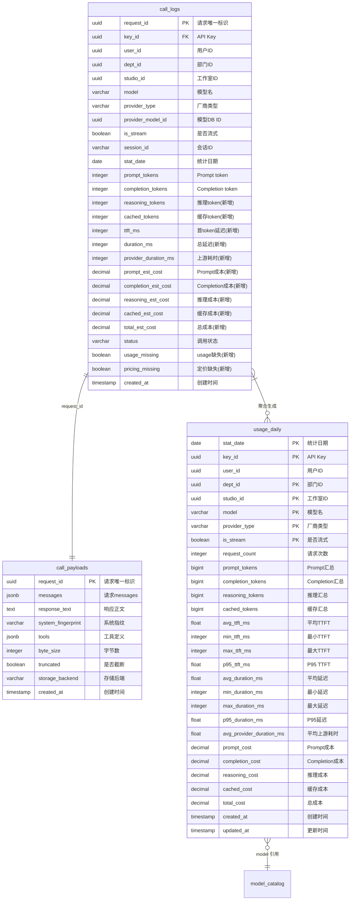

# observability-hub Web 后端数据模型

## 1. 文档概述

本文档描述 observability-hub 模块的数据库模型设计，包括实体结构、关系、索引策略、事务边界和迁移方案。

| 属性 | 内容 |
| :--- | :--- |
| **数据库类型** | PostgreSQL（复用 control-plane 连接） |
| **ORM 框架** | GORM |
| **迁移工具** | SQL 迁移脚本（migrations/ 目录，按序号递增） |
| **核心实体** | call_logs（只读）、usage_daily（读写）、call_payloads（只读） |

---

## 2. 实体关系总览

| 关系 | 类型 | 说明 |
| :--- | :---: | :--- |
| call_logs → call_payloads | 1:1 | 通过 request_id 一一对应 |
| call_logs → usage_daily | N:1（聚合） | 多条 call_logs 聚合为一条 usage_daily |
| usage_daily → model_catalog | 逻辑引用 | 通过 model 名称匹配 |

### ER 图



---

## 3. 实体定义

### 3.1 call_logs（调用明细表 — 只读）

**用途**：记录每次 LLM 调用的完整计量数据。由 gateway-core BatchWriter 写入，observability-hub 只读。本变更新增 16 列。

| 字段 | 逻辑类型 | 约束 | 说明 | 变更类型 |
| :--- | :--- | :--- | :--- | :---: |
| `request_id` | `uuid` | PK, NOT NULL | 请求唯一标识 | 已有 |
| `key_id` | `uuid` | NOT NULL, FK → keys | 使用的 API Key | 已有 |
| `user_id` | `uuid` | NOT NULL | 用户 ID | 已有 |
| `dept_id` | `uuid` | NULLABLE | 部门 ID（来自 SSO） | 已有 |
| `studio_id` | `uuid` | NULLABLE | 工作室 ID（预留） | 已有 |
| `model` | `varchar(100)` | NOT NULL | 模型名称 | 已有 |
| `stat_date` | `date` | NOT NULL | 统计日期（聚合维度） | 已有 |
| `prompt_tokens` | `integer` | NOT NULL, DEFAULT 0 | Prompt token 数 | 已有 |
| `completion_tokens` | `integer` | NOT NULL, DEFAULT 0 | Completion token 数 | 已有 |
| `status` | `varchar(20)` | NOT NULL, DEFAULT 'success' | 调用状态 | 已有 |
| `created_at` | `timestamp` | NOT NULL, DEFAULT NOW() | 创建时间 | 已有 |
| `reasoning_tokens` | `integer` | NOT NULL, DEFAULT 0 | 推理 token 数 | **新增** |
| `cached_tokens` | `integer` | NOT NULL, DEFAULT 0 | 缓存命中 token 数 | **新增** |
| `ttft_ms` | `integer` | NULLABLE | 首 token 延迟（毫秒） | **新增** |
| `duration_ms` | `integer` | NULLABLE | 端到端总延迟（毫秒） | **新增** |
| `provider_duration_ms` | `integer` | NULLABLE | 上游实际耗时（毫秒） | **新增** |
| `provider_type` | `varchar(50)` | NULLABLE | 厂商类型 | **新增** |
| `provider_model_id` | `uuid` | NULLABLE | 实际命中的模型 DB ID | **新增** |
| `is_stream` | `boolean` | NOT NULL, DEFAULT false | 是否流式调用 | **新增** |
| `session_id` | `varchar(128)` | NULLABLE | 会话 ID | **新增** |
| `prompt_est_cost` | `decimal(12,8)` | NOT NULL, DEFAULT 0 | Prompt 估算成本（USD） | **新增** |
| `completion_est_cost` | `decimal(12,8)` | NOT NULL, DEFAULT 0 | Completion 估算成本（USD） | **新增** |
| `reasoning_est_cost` | `decimal(12,8)` | NOT NULL, DEFAULT 0 | Reasoning 估算成本（USD） | **新增** |
| `cached_est_cost` | `decimal(12,8)` | NOT NULL, DEFAULT 0 | Cached 估算成本（USD） | **新增** |
| `total_est_cost` | `decimal(12,8)` | NOT NULL, DEFAULT 0 | 总估算成本（USD） | **新增** |
| `usage_missing` | `boolean` | NOT NULL, DEFAULT false | Usage 数据是否缺失 | **新增** |
| `pricing_missing` | `boolean` | NOT NULL, DEFAULT false | 定价是否缺失 | **新增** |

**保留策略**：90 天（可配置），按 stat_date 清理。

### 3.2 usage_daily（按天聚合表 — 新建）

**用途**：call_logs 的聚合结果，查询 API 的热表。由 RollupCron 写入。

| 字段 | 逻辑类型 | 约束 | 说明 |
| :--- | :--- | :--- | :--- |
| `stat_date` | `date` | PK（组合）, NOT NULL | 统计日期 |
| `key_id` | `uuid` | PK（组合）, NOT NULL | API Key ID |
| `user_id` | `uuid` | NOT NULL | 用户 ID |
| `dept_id` | `uuid` | PK（组合）, NULLABLE | 部门 ID |
| `studio_id` | `uuid` | PK（组合）, NULLABLE | 工作室 ID（预留） |
| `model` | `varchar(100)` | PK（组合）, NOT NULL | 模型名 |
| `provider_type` | `varchar(50)` | PK（组合）, NOT NULL | 厂商类型 |
| `is_stream` | `boolean` | PK（组合）, NOT NULL | 是否流式 |
| `request_count` | `integer` | NOT NULL, DEFAULT 0 | 请求次数 |
| `prompt_tokens` | `bigint` | NOT NULL, DEFAULT 0 | Prompt token 汇总 |
| `completion_tokens` | `bigint` | NOT NULL, DEFAULT 0 | Completion token 汇总 |
| `reasoning_tokens` | `bigint` | NOT NULL, DEFAULT 0 | Reasoning token 汇总 |
| `cached_tokens` | `bigint` | NOT NULL, DEFAULT 0 | Cached token 汇总 |
| `avg_ttft_ms` | `float` | NULLABLE | 平均 TTFT（毫秒） |
| `min_ttft_ms` | `integer` | NULLABLE | 最小 TTFT |
| `max_ttft_ms` | `integer` | NULLABLE | 最大 TTFT |
| `p95_ttft_ms` | `float` | NULLABLE | P95 TTFT（percentile_cont） |
| `avg_duration_ms` | `float` | NULLABLE | 平均端到端延迟 |
| `min_duration_ms` | `integer` | NULLABLE | 最小延迟 |
| `max_duration_ms` | `integer` | NULLABLE | 最大延迟 |
| `p95_duration_ms` | `float` | NULLABLE | P95 延迟 |
| `avg_provider_duration_ms` | `float` | NULLABLE | 平均上游耗时 |
| `prompt_cost` | `decimal(16,8)` | NOT NULL, DEFAULT 0 | Prompt 成本汇总（USD） |
| `completion_cost` | `decimal(16,8)` | NOT NULL, DEFAULT 0 | Completion 成本汇总（USD） |
| `reasoning_cost` | `decimal(16,8)` | NOT NULL, DEFAULT 0 | Reasoning 成本汇总（USD） |
| `cached_cost` | `decimal(16,8)` | NOT NULL, DEFAULT 0 | Cached 成本汇总（USD） |
| `total_cost` | `decimal(16,8)` | NOT NULL, DEFAULT 0 | 总成本汇总（USD） |
| `created_at` | `timestamp` | NOT NULL, DEFAULT NOW() | 首次创建时间 |
| `updated_at` | `timestamp` | NOT NULL, DEFAULT NOW() | 最后更新时间 |

**唯一约束**：`(stat_date, key_id, dept_id, studio_id, model, provider_type, is_stream)`

**保留策略**：无限期保留（聚合数据量小）。

### 3.3 call_payloads（调用内容表 — 只读）

**用途**：记录每次调用的完整请求 messages 和响应正文。由 gateway-core BatchWriter 写入，observability-hub 只读。

| 字段 | 逻辑类型 | 约束 | 说明 |
| :--- | :--- | :--- | :--- |
| `request_id` | `uuid` | PK, NOT NULL | 与 call_logs 一一对应 |
| `messages` | `jsonb` | NOT NULL | 请求 messages 数组（含 system/tool） |
| `response_text` | `text` | NULLABLE | 响应正文（流式已重组） |
| `system_fingerprint` | `varchar(255)` | NULLABLE | 系统指纹 |
| `tools` | `jsonb` | NULLABLE | 工具定义 |
| `byte_size` | `integer` | NOT NULL, DEFAULT 0 | 内容字节数 |
| `truncated` | `boolean` | NOT NULL, DEFAULT false | 是否因超过 256KB 截断 |
| `storage_backend` | `varchar(20)` | NOT NULL, DEFAULT 'pg' | 存储后端（pg / 将来 oss） |
| `created_at` | `timestamp` | NOT NULL, DEFAULT NOW() | 创建时间 |

**保留策略**：暂不自动删除；达到容量阈值（如 10GB）后切换对象存储。

---

## 4. 关系定义

### 外键约束

| 外键字段 | 引用表.字段 | ON DELETE | ON UPDATE | 说明 |
| :--- | :--- | :---: | :---: | :--- |
| `call_logs.key_id` | `keys.id` | RESTRICT | CASCADE | 删除 Key 前需处理关联日志 |
| `usage_daily.key_id` | `keys.id` | NO ACTION | CASCADE | 聚合数据，不级联 |

> usage_daily 与 call_logs 之间**无**外键约束（聚合数据独立）。

---

## 5. 索引设计

| 索引名 | 所在实体 | 覆盖字段 | 访问模式 | 取舍说明 |
| :--- | :--- | :--- | :--- | :--- |
| `idx_call_logs_stat_date` | call_logs | `stat_date` | Rollup 按日期范围查询 | 高频写入，但索引列固定，开销可接受 |
| `idx_call_logs_key_date` | call_logs | `key_id, stat_date` | 按 Key + 日期查询 | 复合索引，最左前缀 |
| `idx_call_logs_dept_date` | call_logs | `dept_id, stat_date` | 按部门 + 日期查询 | NULLABLE 字段，NULL 不入索引 |
| `uniq_call_logs_request_id` | call_logs | `request_id` | 幂等写入防重 | UNIQUE，gateway-core 写入依赖 |
| `idx_usage_daily_date` | usage_daily | `stat_date` | 所有查询的日期过滤 | 必建 |
| `idx_usage_daily_user_date` | usage_daily | `user_id, stat_date` | 个人用量查询（高频） | 复合索引 |
| `idx_usage_daily_dept_date` | usage_daily | `dept_id, stat_date` | 部门用量查询 | NULLABLE，复合索引 |
| `idx_usage_daily_model_date` | usage_daily | `model, stat_date` | 按模型查询 | 最左前缀 |
| `uniq_usage_daily` | usage_daily | `stat_date, key_id, dept_id, studio_id, model, provider_type, is_stream` | UPSERT 冲突检测 | UNIQUE 约束 |
| `idx_call_payloads_req_id` | call_payloads | `request_id` | 按 request_id 查找 | UNIQUE |

---

## 6. 事务边界

| 操作场景 | 涉及实体 | 事务 | 隔离级别 | 说明 |
| :--- | :--- | :---: | :--- | :--- |
| Rollup 聚合 | call_logs（读）+ usage_daily（写） | 否 | Read Committed | 单表 UPSERT，幂等安全，无需事务 |
| 用量查询 | usage_daily（读） | 否 | Read Committed | 只读 |
| 调用内容获取 | call_payloads（读） | 否 | Read Committed | 只读 |
| 对账 | call_logs（读）+ usage_daily（读） | 否 | Read Committed | 只读比对 |

---

## 7. 迁移策略

### 迁移文件

```sql
-- NNN_usage_daily.sql
-- 变更：CHG-20260603-001 — 用量采集与成本估算
-- 描述：新建 usage_daily 聚合表；新建 call_payloads 内容存储表

-- 1. 新建 usage_daily 按天聚合表
CREATE TABLE IF NOT EXISTS usage_daily (
    stat_date                DATE NOT NULL,
    key_id                   UUID NOT NULL,
    user_id                  UUID NOT NULL,
    dept_id                  UUID,
    studio_id                UUID,
    model                    VARCHAR(100) NOT NULL,
    provider_type            VARCHAR(50) NOT NULL,
    is_stream                BOOLEAN NOT NULL DEFAULT false,
    request_count            INTEGER NOT NULL DEFAULT 0,
    prompt_tokens            BIGINT NOT NULL DEFAULT 0,
    completion_tokens        BIGINT NOT NULL DEFAULT 0,
    reasoning_tokens         BIGINT NOT NULL DEFAULT 0,
    cached_tokens            BIGINT NOT NULL DEFAULT 0,
    avg_ttft_ms              FLOAT,
    min_ttft_ms              INTEGER,
    max_ttft_ms              INTEGER,
    p95_ttft_ms              FLOAT,
    avg_duration_ms          FLOAT,
    min_duration_ms          INTEGER,
    max_duration_ms          INTEGER,
    p95_duration_ms          FLOAT,
    avg_provider_duration_ms FLOAT,
    prompt_cost              DECIMAL(16,8) NOT NULL DEFAULT 0,
    completion_cost          DECIMAL(16,8) NOT NULL DEFAULT 0,
    reasoning_cost           DECIMAL(16,8) NOT NULL DEFAULT 0,
    cached_cost              DECIMAL(16,8) NOT NULL DEFAULT 0,
    total_cost               DECIMAL(16,8) NOT NULL DEFAULT 0,
    created_at               TIMESTAMP NOT NULL DEFAULT NOW(),
    updated_at               TIMESTAMP NOT NULL DEFAULT NOW(),
    CONSTRAINT uniq_usage_daily UNIQUE (stat_date, key_id, dept_id, studio_id, model, provider_type, is_stream)
);

CREATE INDEX IF NOT EXISTS idx_usage_daily_date       ON usage_daily(stat_date);
CREATE INDEX IF NOT EXISTS idx_usage_daily_user_date  ON usage_daily(user_id, stat_date);
CREATE INDEX IF NOT EXISTS idx_usage_daily_dept_date  ON usage_daily(dept_id, stat_date);
CREATE INDEX IF NOT EXISTS idx_usage_daily_model_date ON usage_daily(model, stat_date);

-- 2. 新建 call_payloads 调用内容表
CREATE TABLE IF NOT EXISTS call_payloads (
    request_id         UUID PRIMARY KEY,
    messages           JSONB NOT NULL,
    response_text      TEXT,
    system_fingerprint VARCHAR(255),
    tools              JSONB,
    byte_size          INTEGER NOT NULL DEFAULT 0,
    truncated          BOOLEAN NOT NULL DEFAULT false,
    storage_backend    VARCHAR(20) NOT NULL DEFAULT 'pg',
    created_at         TIMESTAMP NOT NULL DEFAULT NOW()
);

CREATE UNIQUE INDEX IF NOT EXISTS idx_call_payloads_req_id ON call_payloads(request_id);
```

### 安全操作表

| 操作 | 做法 |
| :--- | :--- |
| 新建 usage_daily 表 | `CREATE TABLE IF NOT EXISTS`，新建不影响已有数据 |
| 新建 call_payloads 表 | `CREATE TABLE IF NOT EXISTS` |
| call_logs 新增列 | 由 gateway-core 的 migration 负责（`ADD COLUMN IF NOT EXISTS ... DEFAULT`） |

---

## 8. 数据约束与规则

- **审计字段**：`created_at`、`updated_at` 自动维护
- **成本精度**：call_logs 用 `DECIMAL(12,8)`（单次调用），usage_daily 用 `DECIMAL(16,8)`（聚合累积）
- **Token 计数**：call_logs 用 `INTEGER`（单次调用不超 2B），usage_daily 用 `BIGINT`（聚合累积可能超 2B）
- **NULL 语义**：
  - `dept_id` / `studio_id` 允许 NULL（身份信息可能缺失）
  - 延迟字段允许 NULL（非流式请求可能无 TTFT）
  - 价格字段 NOT NULL DEFAULT 0（缺失时计 0 + 标记位）
