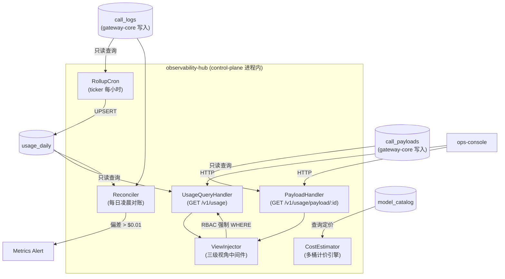
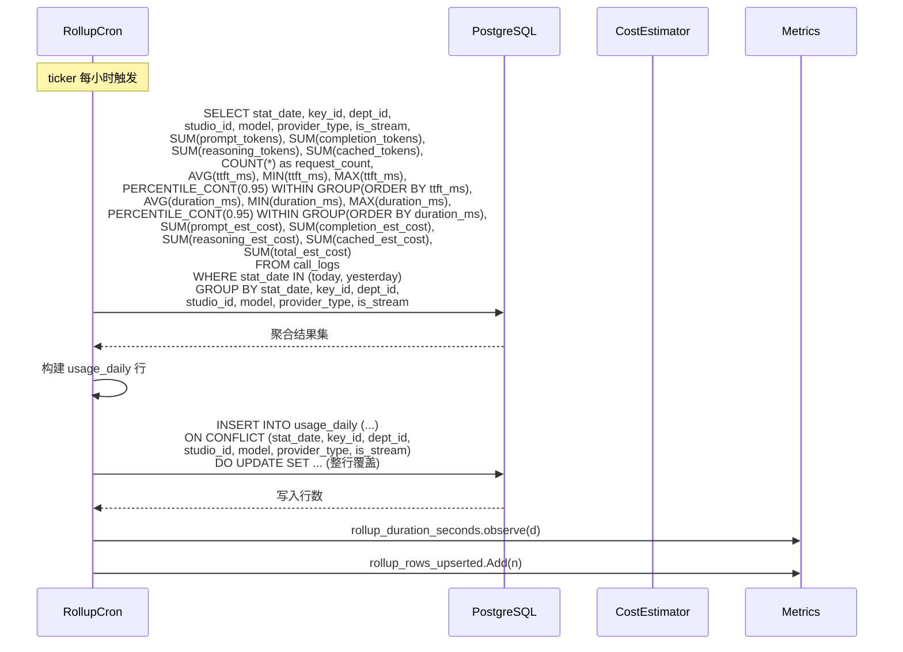
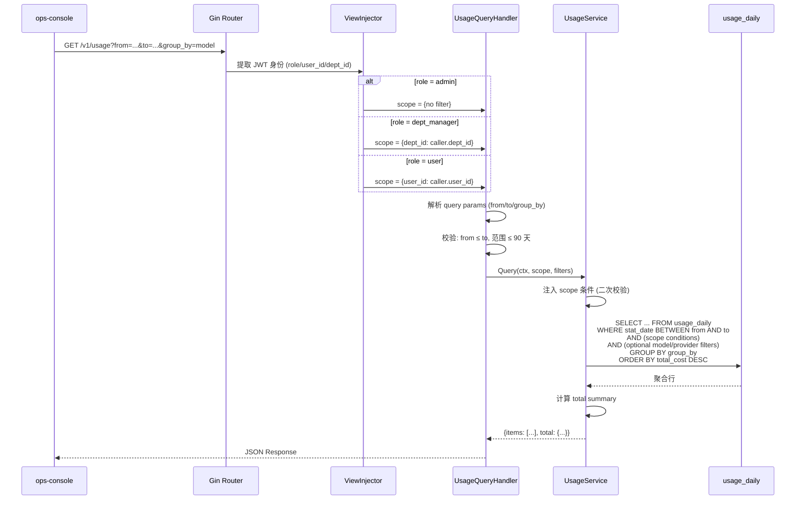
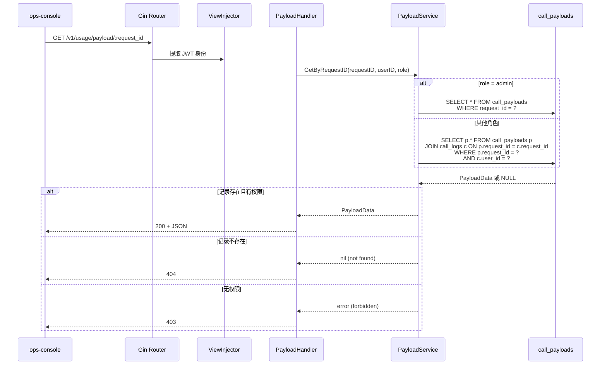
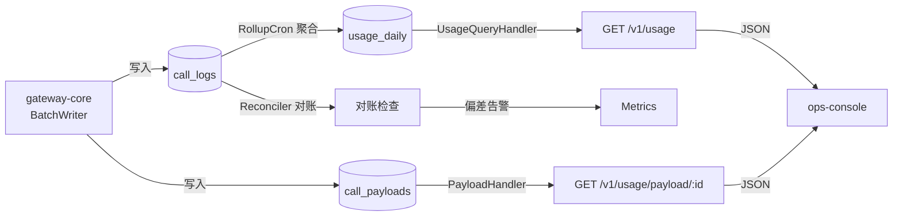

# observability-hub Web 后端技术设计

## 0. 文档信息

| 属性 | 内容 |
| :--- | :--- |
| **所属变更** | CHG-20260603-001 |
| **模块名称** | observability-hub |
| **模块类型** | web-backend |
| **创建时间** | 2026-06-04 |

### 修订记录

| 版本号 | 修改日期 | 修改内容摘要 | 修改人 |
| :--- | :--- | :--- | :--- |
| v1.0 | 2026-06-04 | 初稿创建 | Sisyphus |

---

## 1. 背景与目标

### 技术背景

LLM Gateway 当前缺少用量数据的持久化聚合与查询能力。gateway-core 在本变更中新增了调用埋点采集（call_logs 明细写入），但聚合、成本估算、查询 API 需要一个新的后端模块来承接。

### 技术目标

- 构建定时聚合管道：每小时从 call_logs 聚合到 usage_daily，幂等安全
- 提供多桶成本估算引擎：prompt/completion/reasoning/cached 四桶独立计价
- 暴露只读用量查询 API：GET /v1/usage，支持多维度过滤和三级 RBAC
- 提供调用内容检索 API：GET /v1/usage/payload/:id
- 每日对账 usage_daily ↔ call_logs

---

## 2. 模块职责边界

**负责：**
- RollupCron：每小时从 call_logs 聚合 → usage_daily，幂等 upsert
- CostEstimator：多桶计价引擎（prompt/completion/reasoning/cached）
- UsageQueryHandler：GET /v1/usage 查询 API
- PayloadHandler：GET /v1/usage/payload/:id 内容检索 API
- ViewInjector：三级 RBAC 视角注入中间件
- Reconciler：每日对账 usage_daily ↔ call_logs

**不负责（显式排除）：**
- 埋点数据的采集和写入（→ gateway-core BatchWriter）
- 模型定价的配置和管理（→ control-plane ResolveModelPricing）
- 前端页面的渲染（→ ops-console）
- 实时限额拦截或硬预算管控（→ v0.5.0）

**调用关系：**

| 方向 | 模块 | 方式 |
| :--- | :--- | :--- |
| 被调用 | ops-console | HTTP REST（GET /v1/usage、GET /v1/usage/payload/:id） |
| 被调用 | gateway-core | 无直接调用（gateway-core 从 control-plane 拉价表） |
| 调用 | control-plane | 同进程（复用 JWT 中间件、DB 连接） |
| 读取 | PostgreSQL（call_logs） | GORM 只读查询 |
| 读取 | PostgreSQL（call_payloads） | GORM 只读查询 |
| 写入 | PostgreSQL（usage_daily） | GORM UPSERT |
| 读取 | PostgreSQL（model_catalog） | GORM 查询定价数据 |

---

## 3. 技术选型与研究

### 关键技术问题

| 问题 | 选择方案 | 备选方案 | 选择理由 |
| :--- | :--- | :--- | :--- |
| P95 延迟计算 | `percentile_cont()` PG 原生 | `percentile_disc()` / 应用层排序 | 连续分布更准确，PG 9.4+ 原生支持，无需应用层额外计算 |
| 聚合幂等策略 | 整日重算 + ON CONFLICT DO UPDATE | 增量累加 + 去重 | 整日重算天然幂等，不怕部分失败；增量累加需要复杂的去重逻辑 |
| 定时任务 | `time.Ticker` Go 原生 | robfig/cron 第三方库 | 需求简单（每小时一次），无需引入外部依赖 |
| 视角注入 | 中间件注入 + Service 层二次校验 | 仅 Service 层过滤 | 双重防御更安全；中间件层提前终止非法请求 |
| 对账 | 每日凌晨 SQL 比对 | 实时流式校验 | 聚合场景下每日对账足够，实时校验成本过高 |

### 技术研究总结

无新增技术选型。所有组件均基于已有技术栈（Go 1.22+、Gin、GORM、PostgreSQL）。P95 计算使用 PG 原生 `percentile_cont()` 窗口函数，在单日 10 万行数据量下执行时间 < 2 秒。

---

## 4. 架构概述

### 系统架构



### 目录结构

```
internal/controlplane/
├── observability/
│   ├── rollup_cron.go          # RollupCron: 定时聚合
│   ├── cost_estimator.go       # CostEstimator: 多桶计价
│   ├── reconciler.go           # Reconciler: 每日对账
│   ├── service/
│   │   ├── usage_service.go    # UsageService: 用量查询业务逻辑
│   │   └── payload_service.go  # PayloadService: 调用内容业务逻辑
│   └── repository/
│       ├── usage_daily_repo.go # UsageDailyRepository: usage_daily CRUD
│       ├── call_logs_repo.go   # CallLogsRepository: call_logs 只读聚合查询
│       └── call_payloads_repo.go # CallPayloadsRepository: call_payloads 只读查询
├── handler/
│   ├── usage_handler.go        # UsageQueryHandler: GET /v1/usage
│   └── payload_handler.go      # PayloadHandler: GET /v1/usage/payload/:id
└── middleware/
    └── view_injector.go        # ViewInjector: 三级 RBAC 视角注入
```

---

## 5. 关键流程设计

### Rollup 定时聚合



### 用量查询



### 调用内容获取



---

## 6. 数据流转



### 核心数据流转说明

| 数据 | 入口 | 处理环节 | 出口 | 持久化 |
| :--- | :--- | :--- | :--- | :--- |
| call_logs 明细 | gateway-core BatchWriter 写入 | RollupCron 定时聚合 → UPSERT | usage_daily | usage_daily 表 |
| 用量查询请求 | GET /v1/usage | ViewInjector RBAC → UsageService.Query → GORM | JSON Response | 无（只读） |
| 调用内容请求 | GET /v1/usage/payload/:id | ViewInjector RBAC → PayloadService.Get → GORM | JSON Response | 无（只读） |
| 对账检查 | Reconciler 定时触发 | SQL 比对 usage_daily.total_cost SUM ↔ call_logs.total_est_cost SUM | Metrics Alert | 无 |

---

## 7. 分层职责落实

### Handler 层

> Handler 只做：请求解析、参数校验、调用 Service、响应序列化。不含业务逻辑。

**UsageQueryHandler**（`internal/controlplane/handler/usage_handler.go`）：

| 方法 | 职责 | HTTP 方法 | 路径 |
| :--- | :--- | :--- | :--- |
| `QueryUsage` | 解析 query params → 校验 → 调用 UsageService.Query → 序列化响应 | GET | /v1/usage |

**输入校验：**

| 参数 | 校验规则 | 失败时 |
| :--- | :--- | :--- |
| `from` | 必填，格式 YYYY-MM-DD | 400 `E4001` |
| `to` | 必填，格式 YYYY-MM-DD，>= from | 400 `E4001` |
| 日期范围 | ≤ 90 天 | 400 `E4001` |
| `group_by` | 枚举：day / model / dept / studio / key / provider | 400 `E4001`（无效值时默认 day） |

**PayloadHandler**（`internal/controlplane/handler/payload_handler.go`）：

| 方法 | 职责 | HTTP 方法 | 路径 |
| :--- | :--- | :--- | :--- |
| `GetPayload` | 提取 path param request_id → 调用 PayloadService.GetByRequestID → 序列化或返回 403/404 | GET | /v1/usage/payload/:request_id |

### Service 层

> 包含全部业务逻辑和事务编排，不处理 HTTP 细节。

**UsageService**（`internal/controlplane/observability/service/usage_service.go`）：

| 方法签名 | 职责 | 事务 | 抛出异常 |
| :--- | :--- | :---: | :--- |
| `Query(ctx, scope, filters) → {items, total}` | 按 scope + filters 查询 usage_daily，聚合 total | 否 | InvalidParamsError |
| `GetTrend(ctx, scope, filters) → []TrendPoint` | 按日返回趋势数据点 | 否 | — |

**业务规则：**
- scope 条件在 Service 层强制注入（二次校验），前端传参不可越权放大
- 普通员工指定 `dept_id` 或 `key_id` 非自身时，静默覆盖为自身范围
- 结果按 `total_cost DESC` 排序
- 无数据时返回空数组 + total 全零

**PayloadService**（`internal/controlplane/observability/service/payload_service.go`）：

| 方法签名 | 职责 | 事务 | 抛出异常 |
| :--- | :--- | :---: | :--- |
| `GetByRequestID(ctx, requestID, userID, role) → PayloadData` | 按 request_id 检索调用内容，role 校验权限 | 否 | NotFoundError, ForbiddenError |

**RollupService**（`internal/controlplane/observability/service/rollup_service.go`）：

| 方法签名 | 职责 | 事务 | 抛出异常 |
| :--- | :--- | :---: | :--- |
| `Execute(ctx) → stats` | 聚合 call_logs → UPSERT usage_daily，返回统计 | 否 | InternalError |

### Repository 层

> 封装全部数据库操作，向 Service 屏蔽 ORM 细节。

**UsageDailyRepository**（`internal/controlplane/observability/repository/usage_daily_repo.go`）：

| 方法签名 | 操作 | 说明 |
| :--- | :--- | :--- |
| `UpsertBatch(ctx, rows []UsageDaily) → count` | UPSERT | ON CONFLICT DO UPDATE，覆盖语义 |
| `QueryByScope(ctx, scope, filters, groupBy) → []UsageDaily` | SELECT | 按 scope + filters 条件查询 |
| `GetReconcileData(ctx, date) → ReconcileData` | SELECT | 对账用：SUM(total_cost) GROUP BY date |

**CallLogsRepository**（`internal/controlplane/observability/repository/call_logs_repo.go`）：

| 方法签名 | 操作 | 说明 |
| :--- | :--- | :--- |
| `AggregateByWindow(ctx, dates) → []AggregatedRow` | SELECT | 聚合查询（含 percentile_cont），只读 |
| `GetReconcileData(ctx, date) → ReconcileData` | SELECT | 对账用：SUM(total_est_cost) GROUP BY date |

**CallPayloadsRepository**（`internal/controlplane/observability/repository/call_payloads_repo.go`）：

| 方法签名 | 操作 | 说明 |
| :--- | :--- | :--- |
| `FindByRequestID(ctx, requestID) → *CallPayload` | SELECT | 按 request_id 查找 |
| `FindByRequestIDAndUser(ctx, requestID, userID) → *CallPayload` | SELECT JOIN | JOIN call_logs 校验 user_id |

### DTO 与领域对象映射

| 类型 | 用途 | 转换时机 |
| :--- | :--- | :--- |
| QueryUsageRequest | 接收 GET query params | Handler 入口 |
| UsageResponse | 序列化查询响应 | Handler 出口 |
| UsageItem | 单条聚合行 | Repository → Service → Handler |
| UsageSummary | 汇总统计 | Service 层计算 |
| PayloadResponse | 序列化调用内容 | Handler 出口 |

---

## 8. 异常处理链

### 异常类型

| 异常类 | 抛出层 | 语义 |
| :--- | :--- | :--- |
| InvalidParamsError | Handler / Service | 参数校验失败（from > to，格式错误） |
| UnauthorizedError | Middleware | JWT 无效或缺失 |
| ForbiddenError | Service | 无权访问该数据 |
| NotFoundError | Service / Repository | request_id 不存在 |
| InternalError | Repository | 数据库查询失败等未预期错误 |

### HTTP 状态码映射

| 异常类 | HTTP 状态 | 错误码 | 备注 |
| :--- | :---: | :--- | :--- |
| InvalidParamsError | 400 | E4001 | 包含具体校验失败字段 |
| UnauthorizedError | 401 | E4011 | — |
| ForbiddenError | 403 | E4031 | 无权查看他人调用内容 |
| NotFoundError | 404 | E4041 | request_id 不存在 |
| InternalError | 500 | E5001 | 不暴露内部细节 |

---

## 9. 数据库设计要点

- **分区策略**：call_logs 当前不分区；未来按 stat_date 月分区（预留 ClickHouse 迁移路径）
- **索引设计原则**：rollup 查询按 stat_date 范围 + 多维 GROUP BY；用量查询按 user_id/dept_id + stat_date；详见 data-model.md
- **迁移方案**：call_logs 新增列由 gateway-core 的 migration 负责；usage_daily 和 call_payloads 由本模块 migration 负责

---

## 10. 接口设计要点

- **版本控制**：/api/v1（复用 control-plane 路由前缀）
- **认证鉴权**：JWT Bearer Token（复用 control-plane JWT 中间件）
- **限流策略**：初期不设限流，按需后续追加
- **幂等**：GET 天然幂等；rollup UPSERT 幂等

---

## 11. 错误处理与容灾

| 故障场景 | 检测方式 | 处理策略 | 恢复方案 |
| :--- | :--- | :--- | :--- |
| PostgreSQL 不可用 | 查询超时 / 连接拒绝 | 返回 503 | PG 恢复后自动重连 |
| Rollup 执行超时 | ticker 下一次触发时检查上次完成状态 | 记录告警，下轮重试（幂等安全） | 下次 ticker 触发自动恢复 |
| call_logs 为空 | 聚合结果 0 行 | 跳过当日，不写入空行 | — |
| 对账偏差 > $0.01 | Reconciler SQL 比对 | 触发 Metrics Alert，不自动修复 | 人工排查 |

---

## 12. 性能设计

- **QPS 目标**：管理面低频访问（< 10 QPS），无需高并发优化
- **响应时间**：P95 查询 < 200ms（usage_daily 聚合热表 + 合适索引）
- **缓存策略**：usage_daily 本身已是聚合表，不额外加缓存层
- **异步处理**：rollup 在独立 goroutine 中执行，不阻塞 HTTP 请求处理

---

## 13. 测试矩阵

| 测试目标 | 测试类型 | 通过条件 |
| :--- | :--- | :--- |
| Handler 输入校验 | 单元测试 | 非法 from/to 返回 400 + E4001 |
| ViewInjector RBAC 注入 | 单元测试 | 三种角色正确注入对应 scope |
| UsageService.Query | 单元测试（Mock Repository） | scope 正确传递，total 计算正确 |
| Rollup 幂等 | 集成测试 | 同区间两次执行结果一致 |
| Payload 权限校验 | 单元测试 | admin 可查任意，user 仅可查自身 |
| 对账 | 集成测试 | 模拟偏差触发告警 |

---

## 14. 设计决策记录

### 决策 1：PG 原生聚合 vs ClickHouse

- **问题**：聚合存储方案
- **候选方案**：A — PG 原生 SQL 聚合 / B — ClickHouse OLAP
- **决策**：选择方案 A
- **理由**：宪章明确排除 OLAP 基础设施；当前日均 < 10 万次调用，PG 原生聚合完全可行；预留 ClickHouse 迁移路径（分区表设计）

### 决策 2：整日重算 vs 增量累加

- **问题**：聚合更新策略
- **候选方案**：A — 整日重算覆盖 / B — 增量累加
- **决策**：选择方案 A
- **理由**：整日重算天然幂等，部分失败下一轮自动修复；增量累加需要复杂的去重和回滚逻辑

### 决策 3：ON CONFLICT DO UPDATE vs DO NOTHING

- **问题**：usage_daily 的 UPSERT 语义
- **候选方案**：A — DO UPDATE（覆盖）/ B — DO NOTHING（保留首条）
- **决策**：选择方案 A
- **理由**：整日重算要求最新聚合结果覆盖旧值；与 call_logs 的 DO NOTHING 不同语义（审计日志 vs 聚合快照）

### 决策 4：percentile_cont vs percentile_disc

- **问题**：P95 计算方式
- **候选方案**：A — `percentile_cont()` 连续分布 / B — `percentile_disc()` 离散分布
- **决策**：选择方案 A
- **理由**：连续分布对小样本更平滑，避免跳变；PG 9.4+ 原生支持

### 决策 5：中间件 + Service 双重防御 vs 仅 Service 层

- **问题**：RBAC 视角注入在哪层
- **候选方案**：A — 中间件 + Service 双重 / B — 仅 Service 层
- **决策**：选择方案 A
- **理由**：中间件提前终止非法请求减少无效 DB 查询；Service 层二次校验防止中间件遗漏
