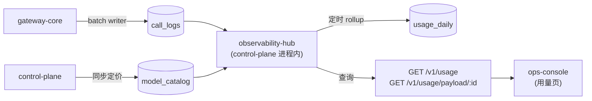
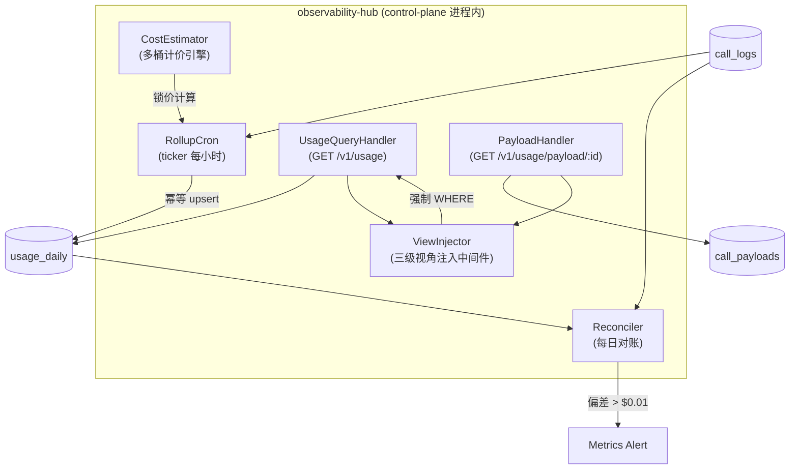
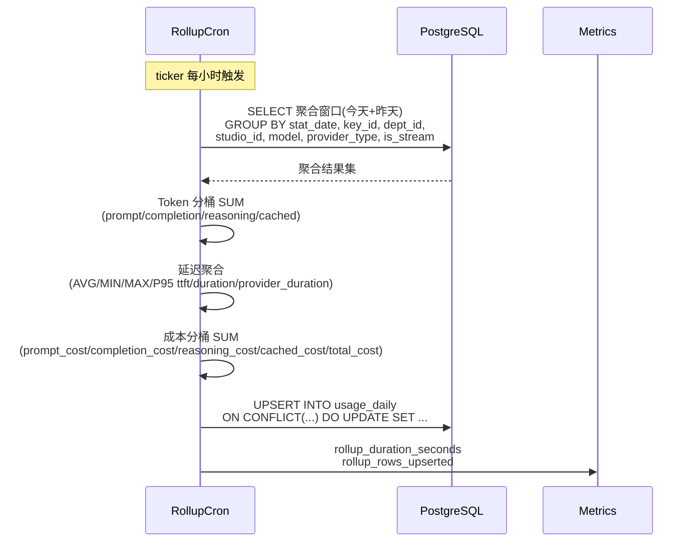
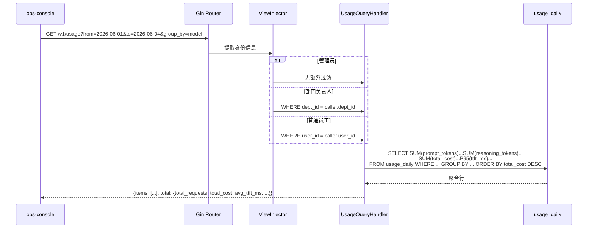

# observability-hub Web 后端概要设计

## 0. 文档信息

| 属性 | 内容 |
| :--- | :--- |
| **所属变更** | CHG-20260603-001 |
| **模块名称** | observability-hub |
| **模块类型** | web-backend |
| **创建时间** | 2026-06-04 |

### 修订记录

| 版本号 | 修改日期 | 修改内容摘要 | 修改人 |
| :--- | :--- | :--- | :--- |
| v1.0 | 2026-06-04 | 初稿创建 | Sisyphus |

---

## 1. 技术范围界定

### 1.1 起点与终点

| 维度 | 说明 |
| :--- | :--- |
| **起点** | call_logs 明细表（gateway-core BatchWriter 写入）、model_catalog（control-plane 同步的定价数据） |
| **终点** | usage_daily 聚合表、GET /v1/usage 查询 API、GET /v1/usage/payload/:request_id 内容检索 API |
| **解决的问题** | 将 gateway-core 采集的调用明细定时聚合为按天汇总，提供分桶成本（prompt/completion/reasoning/cached）和延迟指标（TTFT/P95）的只读查询，支撑个人用量页和全局看板 |

### 1.2 技术边界

- **上游依赖**：call_logs 表（gateway-core 异步写入）、model_catalog 表（control-plane catalog sync 写入）
- **下游依赖**：ops-console（前端通过 REST API 查询用量）
- **不涉及**：埋点数据的采集和写入（gateway-core 负责）、模型定价的配置和管理（control-plane 负责）、前端页面的渲染（ops-console 负责）、实时限额拦截或硬预算管控

---

## 2. 架构方向探索

| 方向 | 核心思路 | 适合场景 | 风险 |
| :--- | :--- | :--- | :--- |
| A（选定） | 进程内定时 cron + PG 原生 SQL 聚合 | 日均量 < 百万级，无 OLAP 需求 | PG 负载随调用量线性增长 |
| B | ClickHouse OLAP + 物化视图 | 亿级日均量，实时聚合 | 宪章排除 OLAP，引入新基础设施 |

**选定方向**：A
**选择理由**：宪章明确排除 OLAP/流式基础设施；当前规模（日均 < 10 万次）下 PG 原生聚合完全可行，无需引入新组件

---

## 3. 架构方案

### 3.1 整体架构

### 3.2 核心流程

#### Rollup 定时聚合

#### 用量查询

### 3.3 组件清单

| 组件 | 位置 | 职责 |
| :--- | :--- | :--- |
| `RollupCron` | `internal/controlplane/observability/` | 每小时从 call_logs 聚合 → usage_daily，幂等 upsert；含分桶 SUM、延迟 P95、成本分桶 |
| `CostEstimator` | `internal/controlplane/observability/` | 多桶计价引擎：接收 token 分桶 + 四桶单价 → 输出分桶成本 |
| `UsageQueryHandler` | `internal/controlplane/handler/` | GET /v1/usage，支持多维度过滤（from/to/model/provider_type/dept/group_by） |
| `PayloadHandler` | `internal/controlplane/handler/` | GET /v1/usage/payload/:id，按 request_id 检索调用内容 |
| `ViewInjector` | `internal/controlplane/middleware/` | 从 JWT 提取身份，注入三级视角 WHERE 条件 |
| `Reconciler` | `internal/controlplane/observability/` | 每日凌晨对账 usage_daily ↔ call_logs，偏差 > $0.01 告警 |

---

## 4. 技术选型与约束

| 领域 | 选型 | 理由 |
| :--- | :--- | :--- |
| 运行时 | Go 1.22+ (Gin) | 宪章约束，复用 control-plane 已有技术栈 |
| 定时任务 | `time.Ticker` (Go 原生) | 需求规模无需第三方调度框架；幂等重算保证安全 |
| 聚合查询 | 原生 SQL (GORM) + `percentile_cont()` | PG 9.4+ 原生支持 P95 计算 |
| 幂等策略 | `ON CONFLICT (...) DO UPDATE` (PG UPSERT) | 整日重算覆盖语义，重复执行安全 |
| API 鉴权 | 复用 control-plane JWT 中间件 | 与已有管理面 API 鉴权方式一致 |
| 视角注入 | 中间件前置 + Service 层二次校验 | 双重防御，前端传参不可越权 |

### 宪章合规性

- [x] 符合 `constitution.md` 的技术栈约束（Go + Gin + PG）
- [x] 符合安全性要求（三级视角强制注入，不泄漏他人数据）
- [x] 符合性能要求（查询走 usage_daily 聚合表，P95 < 200ms）

---

## 5. 中间件链

| 顺序 | 中间件 | 职责 | 失败时 |
| :---: | :--- | :--- | :--- |
| 1 | JWT Auth | 验证 Bearer Token，提取身份（role/user_id/dept_id） | 401 |
| 2 | ViewInjector | 注入三级视角 SQL WHERE 条件 | — |
| 3 | 结构化日志 | 记录请求路径、耗时、状态码 | — |
| 4 | 错误处理 | 捕获未处理异常，统一错误响应格式 | 5xx |

---

## 6. 认证与授权

### 6.1 认证方案

| 字段 | 内容 |
| :--- | :--- |
| 方案 | JWT（复用 control-plane 已有 JWT 中间件） |
| Token 存储 | Authorization: Bearer header |
| Token 有效期 | 与已有管理面 JWT 配置一致 |
| 刷新策略 | 前端静默刷新 |
| 密钥管理 | 环境变量 `JWT_SECRET` |

### 6.2 授权模型

| 字段 | 内容 |
| :--- | :--- |
| 模型 | RBAC（复用已有角色体系） |
| 角色定义 | 系统管理员 / 部门负责人 / 普通员工 |
| 权限粒度 | 数据行级（三级视角强制 WHERE 注入） |
| 鉴权时机 | 中间件统一注入 + Service 层二次校验 |

---

## 7. 数据存储与外部依赖

### 7.1 主数据库

| 字段 | 内容 |
| :--- | :--- |
| 数据库 | PostgreSQL（复用 control-plane 已有 PG 连接） |
| 连接池 | 已有配置（最大连接数 20，超时 30s） |
| 读写分离 | 无 |
| 事务隔离级别 | Read Committed |

### 7.2 缓存策略

| 字段 | 内容 |
| :--- | :--- |
| 缓存引擎 | 无（usage_daily 本身是聚合热表，查询已优化） |
| TTL 策略 | 不适用（call_logs 90 天保留，usage_daily 按需保留） |

### 7.3 外部服务依赖

| 服务 | 用途 | 超时配置 | 降级策略 |
| :--- | :--- | :---: | :--- |
| gateway-core BatchWriter | call_logs / call_payloads 数据写入 | — | 无依赖（只读已落库数据） |
| control-plane CatalogSync | model_catalog 定价数据 | — | 无依赖（同进程内查表） |

---

## 8. 安全设计

| 威胁 | 防御措施 |
| :--- | :--- |
| 数据越权访问 | ViewInjector 强制注入 WHERE；Service 层二次校验 |
| SQL 注入 | GORM 参数化查询 |
| 敏感数据泄漏 | call_payloads 访问记录审计日志 |
| 密钥泄漏 | JWT_SECRET 走环境变量 |

---

## 9. 观测与运维

### 9.1 质量目标

| 指标 | 目标值 | 测试条件 |
| :--- | :---: | :--- |
| P95 查询响应时间 | ≤ 200 ms | usage_daily 单日 10 万行 |
| 聚合延迟 | ≤ 60s 可查 | 调用完成后一小时内聚合完成 |
| 对账偏差 | = 0 | sum(usage_daily.total_cost) ≈ sum(call_logs.total_cost) |

### 9.2 日志与追踪

| 维度 | 方案 |
| :--- | :--- |
| 日志格式 | JSON，必含：request_id、level、timestamp、path、status、duration_ms |
| 分布式追踪 | OpenTelemetry（复用 control-plane tracing） |
| 日志脱敏 | call_payloads 访问日志不记录消息正文 |

### 9.3 监控告警

| 指标 | 告警阈值 | 通知方式 |
| :--- | :--- | :--- |
| rollup_duration_seconds | > 60s | Metrics Alert |
| rollup_rows 突降 | 较昨日下降 > 50% | Metrics Alert |
| 对账偏差 | > $0.01 | Metrics Alert |
| price_missing_total | > 0 | Metrics Alert |

---

## 10. 失败模式与降级策略

| 失败场景 | 影响 | 降级策略 | 恢复方式 |
| :--- | :--- | :--- | :--- |
| PostgreSQL 不可用 | 查询和 rollup 均失败 | 返回 503；rollup 下轮重试 | PG 恢复后自动重连 |
| Rollup 执行超时 | 当日聚合数据缺失 | 记录告警；下轮重试覆盖（幂等安全） | 下次 ticker 触发 |
| call_logs 为空 | 无聚合数据 | 跳过当日 rollup，不生成空行 | — |
| 对账偏差 > 阈值 | 数据管道可能异常 | 触发告警，不自动修复 | 人工排查 |

---

## 11. 待研究事项

无技术不确定项，所有选型均为已有技术栈内的标准方案。

---

## 12. 风险与对策

| 风险 | 概率 | 影响 | 对策 |
| :--- | :--- | :--- | :--- |
| call_logs 数据量超预期导致 PG 聚合变慢 | 中 | 中 | 索引优化 + 分区表（按 stat_date）；预留 ClickHouse 迁移路径 |
| 多桶定价 reasoning 独立价未配置 | 高 | 低 | 降级使用 completion 价格，标记 fallback |
| 部门变更后历史归属问题 | 低 | 低 | 历史数据按采集时 dept_id 冻结，不做回溯修正 |

---

## 13. 概要设计确认

- [x] 技术范围已界定
- [x] 架构方向已探索并选定
- [x] 架构方案已确认
- [x] 技术选型符合宪章
- [x] 待研究事项已识别（无）

👉 确认后进入详细设计阶段（`/xf/detail`）
