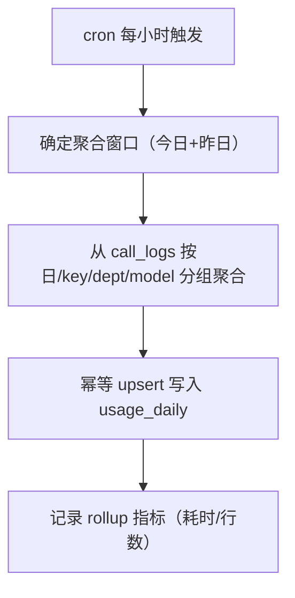
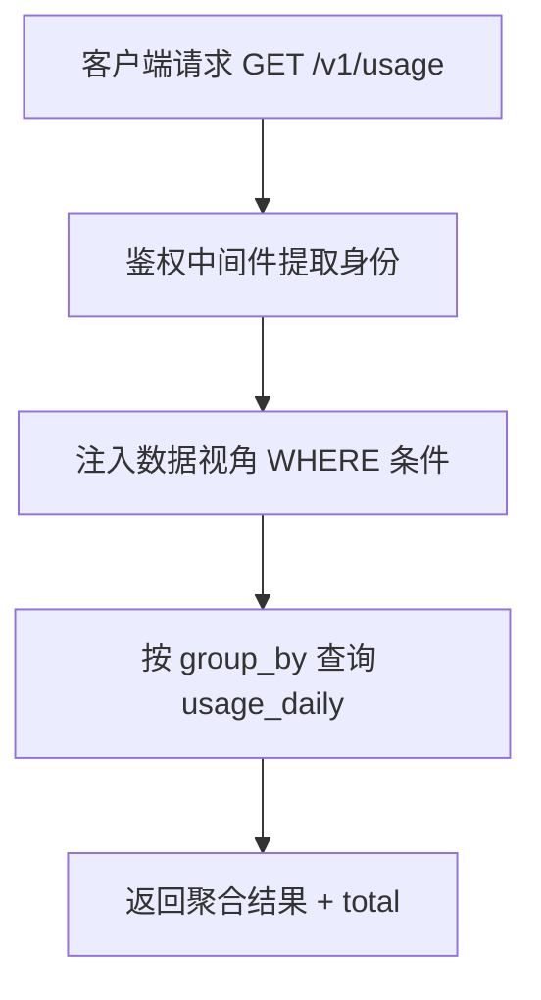

# observability-hub 需求规范

## 0. 文档信息

| 属性 | 内容 |
| :--- | :--- |
| **所属变更** | CHG-20260603-001 |
| **模块名称** | observability-hub |
| **模块类型** | web-backend |
| **创建时间** | 2026-06-03 |

### 修订记录

| 版本号 | 修改日期 | 修改内容摘要 | 修改人 |
| :--- | :--- | :--- | :--- |
| v1.0 | 2026-06-03 | 初稿 | Sisyphus |

---

## 1. 业务背景与系统目标

LLM Gateway 的可观测与计量中枢。负责将 gateway-core 采集的调用明细进行按天聚合、成本估算持久化、只读用量查询，以及调用内容（Prompt/响应正文）的存储与访问控制。

- **业务背景**：员工需要看清自己的模型用量和成本估算；管理员需要全局用量视图；数据合规需要调用内容可审计可回放
- **核心目标**：构建计量数据的聚合、查询与内容记录中枢，独立于管理面和网关转发热路径
- **关键衡量指标**：
  - 调用完成后 ≤60s 持久化聚合可查
  - 用量查询 P95 响应 < 200ms
  - 聚合结果与明细 SUM 对账偏差 = 0

---

## 2. 关键概念

- **call_logs**：调用明细表，由 gateway-core 的 batch writer 写入。记录每次 LLM 调用的 Token 用量（含 reasoning/cached 分桶）、TTFT/延迟细分、provider 路由信息、流式标记、会话 ID、状态及锁价成本
- **usage_daily**：按天聚合表，由 rollup cron 从 call_logs 幂等重算生成，是查询 API 的热表。聚合维度含 reasoning_tokens / cached_tokens 分桶求和
- **call_payloads**：调用内容表，记录请求 messages 和响应正文，与 call_logs 通过 request_id 一一对应
- **Rollup**：定时聚合任务，每小时整日重算覆盖（幂等 upsert），保证最终一致
- **三级数据视角**：管理员（全量）/ 部门负责人（本部门）/ 普通员工（仅自己），查询时强制注入 WHERE 条件
- **多桶计价**：成本估算按分桶单价独立计算（prompt / completion / reasoning / cached），对齐 LiteLLM 的 pricing model，避免思考模型成本偏差 10 倍以上

---

## 3. 超出范围

- 不负责埋点数据的采集和写入（由 gateway-core 的 collector + batch writer 负责）
- 不负责模型定价的配置和管理（由 control-plane 负责）
- 不负责前端页面的渲染（由 ops-console 负责）
- 不做实时限额拦截或硬预算管控
- 不做财务级精度的计费对账
- 不引入 OLAP / 流式基础设施

---

## 4. 角色与权限控制（RBAC）

| 角色名称 | 角色描述 | 操作权限 | 数据范围 |
| :--- | :--- | :--- | :--- |
| 系统管理员 | 平台运维 | 查询全量用量、查看任意调用内容、触发手动聚合 | 全部数据 |
| 部门负责人 | 各部门负责人 | 查询本部门用量 | dept_id 匹配 |
| 普通员工 | 持有 API Key 的用户 | 查询个人用量、查看本人调用内容 | user_id 匹配 |

---

## 5. 业务流程与状态机

### 聚合流程

### 查询流程

---

## 6. 详细功能需求

### 6.1 按天聚合 Rollup

**A. 功能说明**

定时从 call_logs 明细表中按（日期 / key_id / dept_id / studio_id / model）维度聚合 Token 用量与成本，幂等 upsert 写入 usage_daily 表。

**B. 用户故事**

| 编号 | 角色 | 行为 | 目的 | 优先级 |
| :--- | :--- | :--- | :--- | :--- |
| US-01 | 作为系统 | 每小时自动聚合调用明细到按天汇总 | 以便用量查询秒级返回，不依赖全表扫描明细 | P0 |

**C. 业务规则与校验**

- 每小时执行一次，聚合窗口为「今天 + 昨天」（覆盖跨零点延迟到达的明细）
- 聚合维度：(日期 / key_id / dept_id / studio_id / model / provider_type / is_stream)
- Token 分桶聚合：prompt_tokens / completion_tokens / reasoning_tokens / cached_tokens 各自独立 SUM
- 延迟聚合：AVG/MIN/MAX/P95 的 ttft_ms / duration_ms / provider_duration_ms
- 成本聚合：分桶 est_cost（prompt_cost / completion_cost / reasoning_cost / cached_cost / total_cost）
- 采用整日重算覆盖语义（非增量累加），同区间重复执行结果一致
- 成本在明细行已锁价，聚合永远是 SUM，事后改价不影响历史
- 对账不变量：`sum(usage_daily.total_est_cost)` 应等于同日 `sum(call_logs.total_est_cost)`

**D. 异常与边界**

- **明细表为空**：跳过当日聚合，不生成空行
- **聚合执行超时**：记录告警指标，下一轮重试（幂等安全）
- **call_logs 中存在 usage_missing 行**：照常聚合（cost=0 已在明细层标定）

### 6.2 只读用量查询 API

**A. 功能说明**

提供 `GET /v1/usage` 接口，从 usage_daily 按条件查询聚合结果，支持多维度过滤和分组。

**B. 用户故事**

| 编号 | 角色 | 行为 | 目的 | 优先级 |
| :--- | :--- | :--- | :--- | :--- |
| US-02 | 作为员工 | 查询我指定时间范围内的用量和成本 | 以便了解自己的模型使用情况和花费 | P0 |
| US-03 | 作为管理员 | 按部门/模型/Key 维度查看全局用量 | 以便掌握全公司资源消耗情况 | P0 |
| US-04 | 作为部门负责人 | 查看本部门的用量汇总 | 以便管控部门成本 | P1 |

**C. 接口概要**

| 接口 | 方法 | 路径 | 说明 |
| :--- | :--- | :--- | :--- |
| 用量查询 | GET | /v1/usage | 按条件查询聚合用量与成本 |

**E. 查询参数**

| 参数 | 说明 |
| :--- | :--- |
| from / to | 日期范围（必填，按 stat_date） |
| key_id / user_id / dept_id / studio_id | 维度过滤（可选，受视角约束） |
| model / provider_type | 模型/provider 过滤（可选） |
| is_stream | 流式/非流式过滤（可选） |
| group_by | day / model / dept / studio / key / provider（默认 day） |

**E2. 响应结构**

| 字段 | 说明 |
| :--- | :--- |
| total_requests | 总请求数 |
| prompt_tokens / completion_tokens / reasoning_tokens / cached_tokens | 分桶 Token 汇总 |
| total_tokens | 全部 Token 总和（含 reasoning） |
| prompt_cost / completion_cost / reasoning_cost / cached_cost / total_cost | 分桶成本汇总（USD） |
| avg_ttft_ms / p95_ttft_ms | TTFT 平均 / P95（毫秒） |
| avg_duration_ms / p95_duration_ms | 端到端延迟 平均 / P95 |

**E3. 业务规则与校验**

- 三级数据视角强制注入：管理员无过滤、部门负责人注入 dept_id = caller.dept_id、普通员工注入 user_id = caller.user_id
- 视角条件在服务层强制注入，前端传参不能越权放大范围
- 日期范围最大跨度 90 天
- 返回结果按 est_cost_usd DESC 排序

**F. 异常与边界**

- **无数据**：返回空数组 + total 全零，不报错
- **参数非法**：from > to 返回 400 + 明确错误信息
- **越权尝试**：非管理员指定他人 key_id/dept_id 时，强制覆盖为自身范围（静默降级，不报错）

### 6.3 调用内容记录

**A. 功能说明**

全量记录每次 LLM 调用的请求 messages（含 system/tool 定义）和响应正文（流式已重组），存入 call_payloads 表。提供按 request_id 检索内容的能力，访问控制比计量更严格。

**B. 用户故事**

| 编号 | 角色 | 行为 | 目的 | 优先级 |
| :--- | :--- | :--- | :--- | :--- |
| US-05 | 作为管理员 | 查看指定调用的完整 Prompt 和响应 | 以便排查异常调用和质量分析 | P1 |
| US-06 | 作为员工 | 回放自己的历史对话内容 | 以便回顾和排查自己的模型使用 | P1 |

**C. 接口概要**

| 接口 | 方法 | 路径 | 说明 |
| :--- | :--- | :--- | :--- |
| 获取调用内容 | GET | /v1/usage/payload/:request_id | 按 request_id 检索调用正文 |

**D. 业务规则与校验**

- 全量采集，不设 Key 级开关（简化实现，通过访问控制隔离）
- 超大 body（> 256KB）截断，标记 truncated=true
- 流式响应在收尾点重组为完整 response_text
- 记录 byte_size 供容量监控
- 存储演进：当前 storage_backend=pg；达到迁移阈值后新写入切对象存储，读取层按 storage_backend 透明切换

**E. 访问控制**

- 管理员 / 数据合规角色：可查任意 request_id
- 普通员工：仅可查 user_id 匹配的记录
- 所有访问记录审计日志（谁在何时查看了哪条 request_id）

**F. 异常与边界**

- **request_id 不存在**：返回 404
- **正文已迁移到对象存储**：读取层透明处理，对上层无感
- **并发写入同一 request_id**：ON CONFLICT DO NOTHING（幂等）

### 6.4 数据对账

**A. 功能说明**

定时校验 usage_daily 与 call_logs 的一致性，发现偏差时告警。

**B. 用户故事**

| 编号 | 角色 | 行为 | 目的 | 优先级 |
| :--- | :--- | :--- | :--- | :--- |
| US-07 | 作为系统 | 每日自动对账聚合数据与明细数据 | 以便及时发现数据管道异常 | P1 |

**C. 业务规则与校验**

- 每日凌晨对前一日做收口对账
- 校验：`sum(usage_daily.total_est_cost)` ≈ 同日 `sum(call_logs.total_est_cost)`
- 校验分桶对账：`sum(usage_daily.reasoning_cost)` ≈ 同日 `sum(call_logs.reasoning_est_cost)`
- 偏差超过阈值（如 0.01 USD）触发告警

### 6.5 多桶成本估算引擎

**A. 功能说明**

成本估算引擎接收分桶 Token 量和多桶单价，独立计算各桶成本后汇总，确保思考模型的 reasoning_token 和缓存命中的 cached_token 按正确单价计费。

**B. 用户故事**

| 编号 | 角色 | 行为 | 目的 | 优先级 |
| :--- | :--- | :--- | :--- | :--- |
| US-08 | 作为系统 | 在采集时按分桶单价计算成本 | 以便思考模型和缓存命中的成本精准反映实际费用 | P0 |

**C. 计价模型**

| 桶 | 单价来源 | 示例（Qwen3.6-plus） |
| :--- | :--- | :--- |
| prompt_cost | prompt_tokens × input_price_per_token | 2192 × $0.29/M = $0.00064 |
| completion_cost | completion_text_tokens × output_price_per_token | 736 × $1.76/M = $0.00130 |
| reasoning_cost | reasoning_tokens × output_price_per_reasoning_token（若有独立价） | 3412 × $3.52/M = $0.01201 |
| cached_cost | cached_tokens × cache_read_input_token_cost（若有独立价） | 0（本请求未命中） |
| total_cost | 以上各桶之和 | $0.01395 |

**D. 业务规则与校验**

- 某桶无独立价格时降级使用基础单价（如 reasoning_token 未配置独立价则按 completion 价计）
- 某桶 token 为 0 时对应 cost 为 0
- 单价缺失时标记 pricing_missing，该桶 cost 计 0 并告警
- 采集时锁价（调用时快照单价），事后改定价不影响历史记录

---

## 7. 数据流与外部接口

- **数据输入**：从 call_logs 表读取明细（由 gateway-core batch writer 写入）
- **数据输出**：写入 usage_daily（聚合结果）、call_payloads（调用内容）
- **依赖**：gateway-core 的 batch writer 负责写 call_logs 和 call_payloads

---

## 8. 非功能需求

- **性能**：用量查询 P95 < 200ms（查询走 usage_daily 聚合表，非全量明细扫描）
- **可靠性**：rollup 幂等，失败重试安全；call_payloads 写入失败不影响计量链路
- **可观测性**：
  - usage_events_emitted / dropped / written_total
  - rollup_duration_seconds / rollup_rows_upserted
  - price_missing_total / usage_missing_total / reasoning_missing_total
  - queue_depth（gauge）
  - multi_bucket_cost_distribution（reasoning / cached 成本占比）
- **容量**：call_logs 90 天保留期（可配置）；call_payloads 暂不删除，达阈值切对象存储

---

## 9. 验收标准

| 编号 | 关联 | Given（前置状态） | When（触发动作） | Then（预期结果） | 优先级 |
| :--- | :--- | :--- | :--- | :--- | :--- |
| AC-01 | US-01 | Given call_logs 中有当日 100 条明细 | When rollup cron 执行 | Then usage_daily 生成对应聚合行，est_cost_usd 总和与明细 SUM 完全一致 | P0 |
| AC-02 | US-01 | Given rollup 已执行一次 | When 同区间再次执行 | Then usage_daily 数据不变（幂等覆盖） | P0 |
| AC-03 | US-02 | Given 员工有 3 天的调用记录 | When 查询 GET /v1/usage?from=day1&to=day3&group_by=day | Then 返回 3 行按日聚合数据 + total 汇总 | P0 |
| AC-04 | US-03 | Given 管理员查询全局用量 | When GET /v1/usage?from=day1&to=day30&group_by=model | Then 返回所有模型的聚合用量 | P0 |
| AC-05 | US-02 | Given 普通员工 A 尝试指定 dept_id=其他部门 | When 发起查询 | Then 视角强制降级为仅自身数据，不暴露他人用量 | P0 |
| AC-06 | US-05 | Given 管理员请求 GET /v1/usage/payload/:id | When request_id 存在 | Then 返回完整的请求 messages 和响应正文 | P1 |
| AC-07 | US-06 | Given 员工 A 请求他人的 request_id | When 发起获取调用内容 | Then 返回 403 或 404（不泄漏他人数据） | P1 |
| AC-08 | US-07 | Given 聚合偏差超过阈值 | When 对账任务执行 | Then 触发告警通知 | P1 |
| AC-09 | US-08 | Given 一次 Qwen 调用含 3412 reasoning_tokens | When 成本估算执行 | Then reasoning_cost 按 output_price_per_reasoning_token 独立计算，不与 completion 混淆 | P0 |
| AC-10 | US-08 | Given 一次调用含 500 cached_tokens 且模型有独立缓存价格 | When 成本估算执行 | Then cached_cost 按 cache_read_input_token_cost 计算 | P0 |
| AC-11 | US-01 | Given call_logs 中有 reasoning_tokens + cached_tokens | When rollup cron 执行 | Then usage_daily 中对应分桶字段正确聚合 | P0 |
| AC-12 | US-02 | Given 员工查询用量 | When GET /v1/usage?group_by=model | Then 返回含 reasoning_cost / cached_cost / avg_ttft_ms 等分桶和延迟指标 | P0 |
| AC-13 | US-08 | Given 模型未配置 reasoning_token 独立价格 | When 成本估算执行 | Then reasoning_token 按 completion 价降级计算，标记 fallback_reasoning_price | P0 |

---

## 10. 假设与依赖

- 假设 gateway-core 的 batch writer 正确写入 call_logs 和 call_payloads
- 假设 PostgreSQL 稳定运行，是数据一致性的最终保证
- 依赖 gateway-core 模块提供 call_logs / call_payloads 数据
- 依赖 control-plane 模块提供鉴权中间件（复用网关鉴权或管理面 JWT）
- 依赖 SSO 身份信息中包含 dept_id
