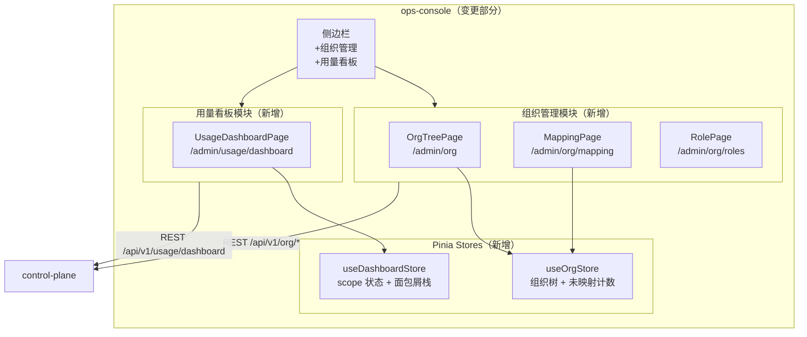
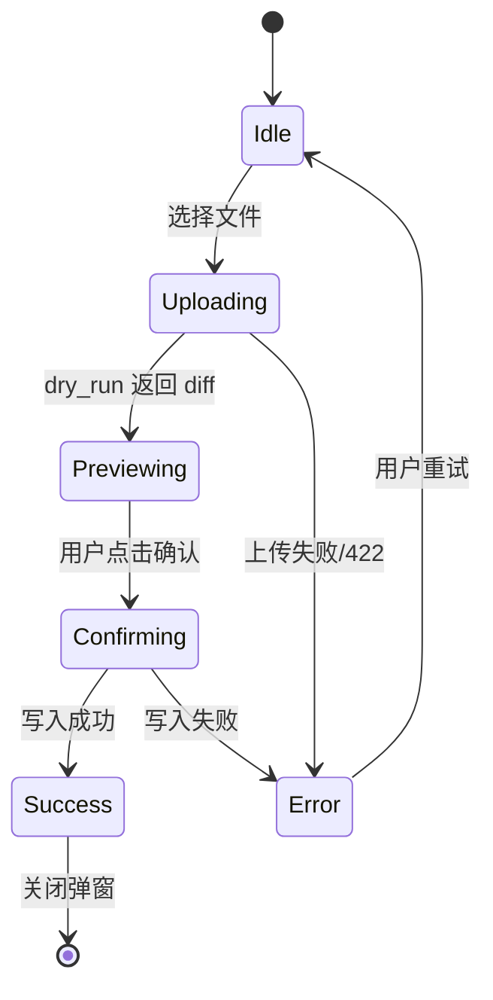

# ops-console 技术设计变更 — CHG-20260609-001

> 基线：xspec/modules/ops-console/design.md (v1.3)

## 变更摘要

新增组织管理模块（OrgTreePage、MappingPage、RolePage）和分层用量看板模块（UsageDashboardPage），扩展侧边栏导航，复用现有 Vue 3 + Element Plus + Pinia 技术栈。

---

## 设计决策变更

| 决策点 | 选择 | 理由 |
| :--- | :--- | :--- |
| 看板数据加载 | 切换 scope 时实时请求，无本地缓存 | 数据时效要求高，管理操作频率低，实现简单 |
| 权限控制层级 | 路由守卫 + API 响应双重保障 | 前端防误导航，后端防越权 |
| 组织树状态管理 | useOrgStore（Pinia） | 树数据跨组件共享，避免重复请求 |

---

## 架构变更



---

## 新增组件详细设计

### 组织管理模块

#### OrgTreePage.vue（`/admin/org`）

```
布局：左侧树（el-tree） + 右侧详情面板
数据流：
  mounted → orgStore.fetchTree() → GET /api/v1/org/tree（内部接口）
  
  实际用前端可访问接口替代：
  mounted → 并行 fetchStudios() + fetchDepartments()
  
节点点击：
  - 工作室节点 → 右侧展示工作室详情（GET /api/v1/org/studios/:id）
  - 部门节点   → 右侧展示部门详情（GET /api/v1/org/departments/:id）
  
状态 badge：
  departments.status === 'pending_studio' → 红色「待映射」badge
```

#### MappingPage.vue（`/admin/org/mapping`）

```
核心交互流程：
  1. 页面加载：GET /api/v1/org/dept-studio-map（分页列表）
  2. 未映射角标：GET /api/v1/org/departments/unmapped → 显示数量
  3. 批量导入流程：
     a. 用户选择文件（el-upload）
     b. 调用 POST .../import?dry_run=true → 渲染 diff 预览
     c. 用户点击确认 → 调用 POST .../import（正式写入）
     d. 刷新列表 + 更新未映射角标
  4. 手工修改：行内操作 → PUT /api/v1/org/departments/:id/studio
     表单：工作室下拉（从 studios 列表获取）
```

ImportDialog.vue 状态机：



#### RolePage.vue（`/admin/org/roles`）

```
页面结构：
  - 搜索栏（按姓名/邮箱）
  - 角色列表表格（用户名 / 邮箱 / 角色 / 管辖域 / 授权时间 / 操作）
  - 卸任操作：确认弹窗 → POST /api/v1/org/roles/revoke
  
GrantDialog.vue 表单字段：
  1. 搜索员工（输入框 + 防抖 500ms，调 GET /api/v1/users?keyword=）
  2. 角色类型（el-radio：工作室负责人 / 部门负责人）
  3. 管辖域选择：
     - 选「工作室负责人」→ 工作室下拉（GET /api/v1/org/studios）
     - 选「部门负责人」  → 部门下拉（GET /api/v1/org/departments）
  4. 确认 → POST /api/v1/org/roles/grant
```

### 分层用量看板模块

#### UsageDashboardPage.vue（`/admin/usage/dashboard`）

```
顶部 Tab：
  - 「个人」Tab → 复用现有 UsagePage 个人看板组件（GET /usage/me）
  - 「管理」Tab → MgmtPanel（仅 dept_admin / studio_admin / admin 可见）

MgmtPanel 布局：
  - 面包屑导航（el-breadcrumb）：公司 / 工作室名 / 部门名 / 成员名
  - 汇总卡片区：total_tokens / cost_estimate / user_count / call_count
  - 排行表格：按 cost_estimate 倒序，支持分页
  - 趋势图：复用现有趋势图组件（日/周/月切换）

面包屑点击逻辑：
  - 点击上级节点 → dashStore.popToLevel(level) → 重新请求
  - 点击排行行 → dashStore.drillDown({id, name, scope}) → 重新请求
```

---

## 路由守卫扩展

```typescript
// router/index.ts 路由守卫补充
const orgRoutes = ['/admin/org', '/admin/org/mapping', '/admin/org/roles']
const dashRoutes = ['/admin/usage/dashboard']

router.beforeEach((to, from, next) => {
  const authStore = useAuthStore()
  
  if (orgRoutes.some(r => to.path.startsWith(r))) {
    if (authStore.role !== 'admin') {
      next('/403')
      return
    }
  }
  
  if (dashRoutes.some(r => to.path.startsWith(r))) {
    if (['user', ''].includes(authStore.role)) {
      next('/403')
      return
    }
  }
  
  next()
})
```
