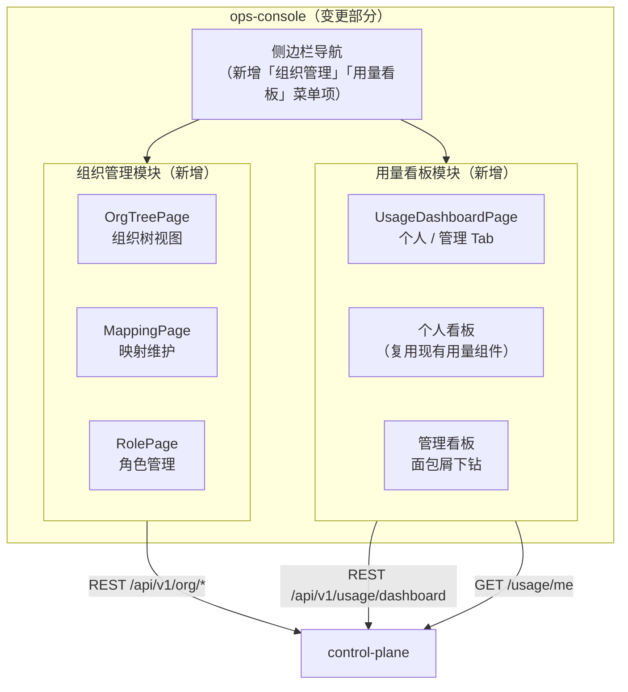
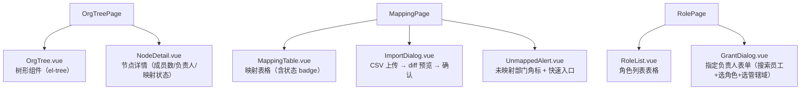
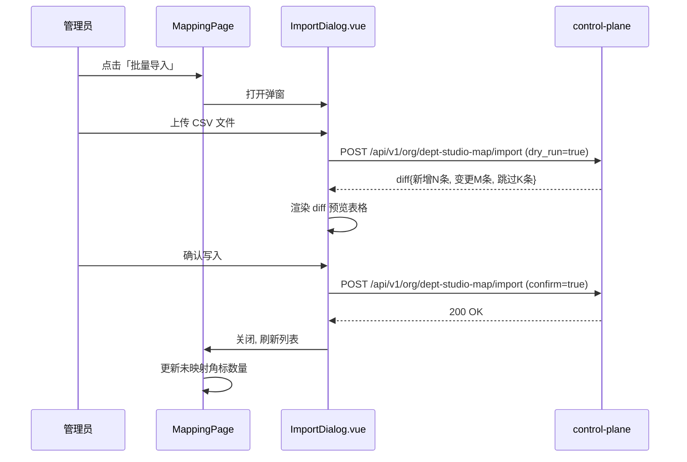
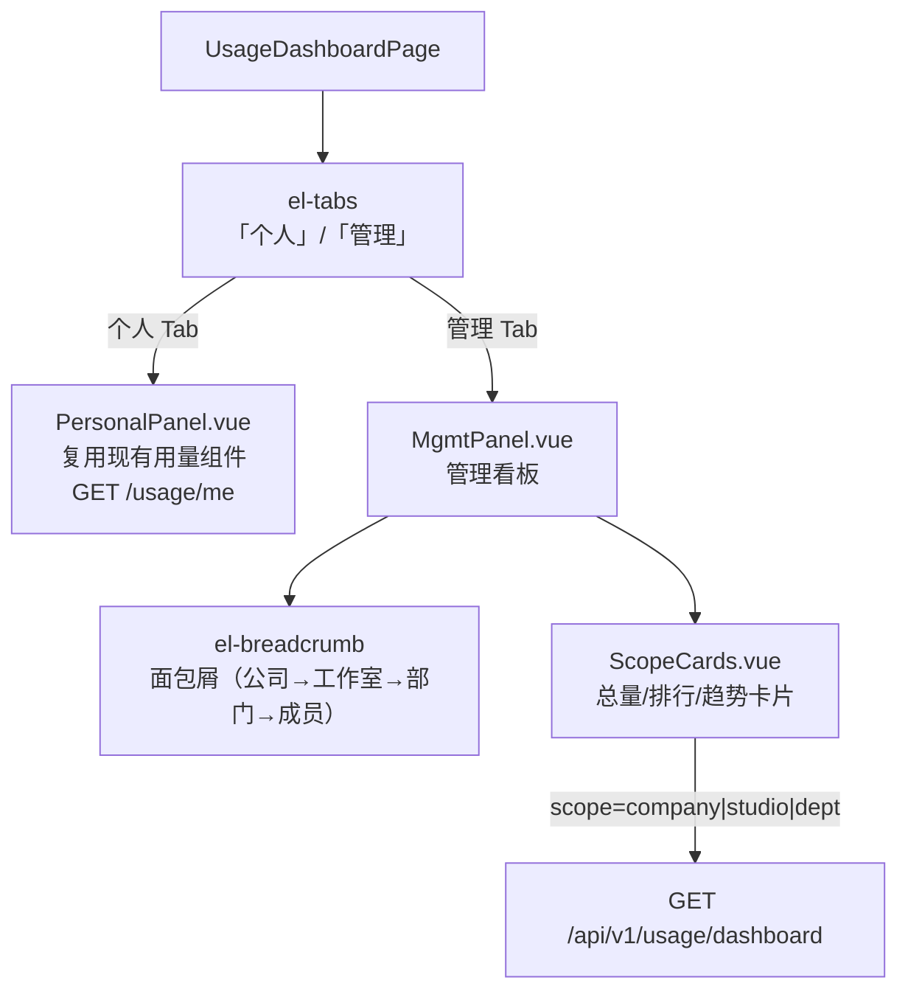
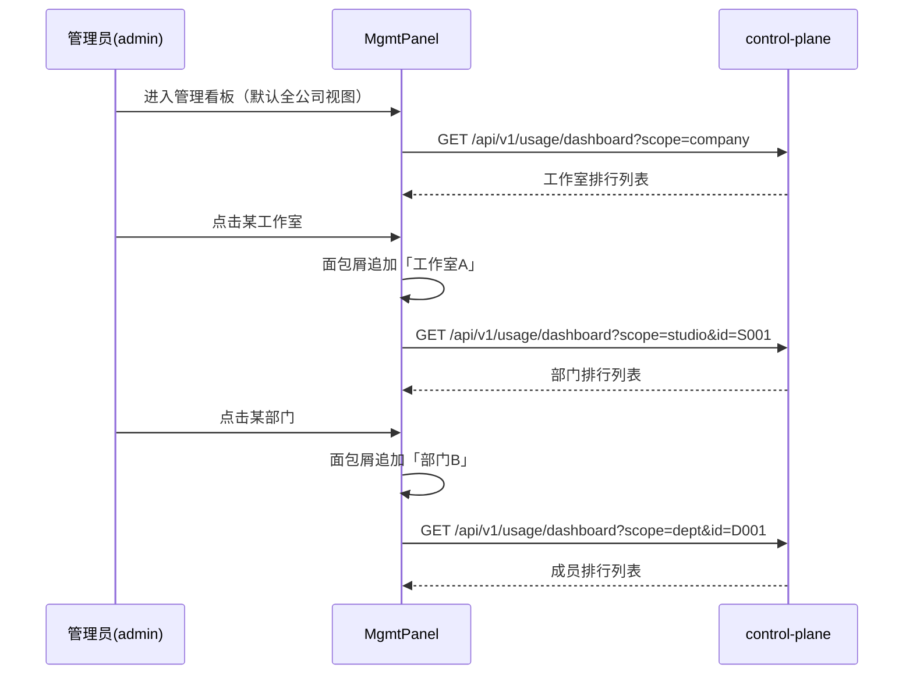

# ops-console 概要设计变更 — CHG-20260609-001

> 基线：xspec/modules/ops-console/hld.md (v1.3)

## 变更摘要

新增两个主功能模块：组织管理（树形视图 + 映射维护 + 角色管理）和分层用量看板（个人/管理两区 Tab + 面包屑下钻），复用现有 Vue 3 + Element Plus + Pinia 技术栈，通过新增路由和组件扩展现有后台导航体系。

---

## 架构变更

### 新增路由

| 路由 | 页面组件 | 权限 | 说明 |
| :--- | :--- | :--- | :--- |
| `/admin/org` | `OrgTreePage.vue` | admin | 组织树视图 |
| `/admin/org/mapping` | `MappingPage.vue` | admin | 映射维护 |
| `/admin/org/roles` | `RolePage.vue` | admin | 角色管理 |
| `/admin/usage/dashboard` | `UsageDashboardPage.vue` | dept_admin / studio_admin / admin | 分层用量看板 |

---

## 技术选型变更

无新增技术选型，全部复用 Vue 3 + Element Plus + Vite + Pinia。

---

## 新增组件

### 组织管理模块

**核心交互流程（映射导入）**：

### 分层用量看板模块

**面包屑下钻流程**：

**角色差异化渲染规则**：

| 用户角色 | 个人 Tab | 管理 Tab | 管理看板默认视图 |
| :--- | :--- | :--- | :--- |
| user | ✅ 可见 | ❌ 不渲染 | — |
| dept_admin | ✅ 可见 | ✅ 可见 | 本部门视图（scope=dept） |
| studio_admin | ✅ 可见 | ✅ 可见 | 本工作室视图（scope=studio） |
| admin | ✅ 可见 | ✅ 可见 | 全公司视图（scope=company） |

---

## 状态管理扩展

新增两个 Pinia store：

| Store | 职责 |
| :--- | :--- |
| `useOrgStore` | 缓存组织树数据、未映射部门计数、当前选中节点 |
| `useDashboardStore` | 缓存当前 scope/id 选择、面包屑路径栈、用量数据 |

---

## 宪章合规检查

| 原则 | 检查结果 |
| :--- | :--- |
| 零破坏性变更 | ✅ 新增路由和组件，不修改现有页面逻辑 |
| 服务快速 | ✅ 页面按需加载（Vue Router 懒加载），Dashboard API 分页请求 |
| 交互至上 | ✅ 核心操作（导入映射、指定负责人）不超过 3 步；越权访问有明确提示 |
| 架构清晰 | ✅ 组织管理和看板作为独立功能模块，不与现有渠道/模型管理混杂 |
