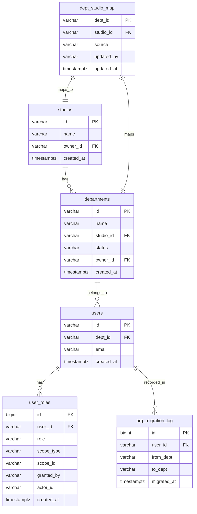

# org-service 数据模型

## 0. 文档信息

| 属性 | 内容 |
| :--- | :--- |
| **所属变更** | CHG-20260609-001 |
| **模块名称** | org-service |
| **创建时间** | 2026-06-09 |

---

## 1. 文档概述

本文档定义 org-service 模块在 PostgreSQL 中新增的所有表结构、索引、ER 关系，以及 Redis 缓存数据结构和 Go 领域模型。

---

## 2. 实体关系总览



---

## 3. 实体定义

### 2.1 studios（工作室）

```sql
CREATE TABLE studios (
    id          VARCHAR(64) PRIMARY KEY,        -- 工作室 ID（来自外部系统或管理员手工指定）
    name        VARCHAR(255) NOT NULL,
    owner_id    VARCHAR(64),                    -- 工作室负责人 user_id（可空，由角色派发维护）
    created_at  TIMESTAMPTZ NOT NULL DEFAULT NOW()
);

CREATE UNIQUE INDEX idx_studios_name ON studios(name);
```

### 2.2 departments（部门）

```sql
CREATE TABLE departments (
    id          VARCHAR(64) PRIMARY KEY,        -- 部门 ID（来自 SSO claims）
    name        VARCHAR(255) NOT NULL,
    studio_id   VARCHAR(64) REFERENCES studios(id),  -- 所属工作室（未映射时为 NULL）
    status      VARCHAR(32) NOT NULL DEFAULT 'pending_studio',  -- active | pending_studio
    owner_id    VARCHAR(64),                    -- 部门负责人 user_id（可空）
    created_at  TIMESTAMPTZ NOT NULL DEFAULT NOW()
);

CREATE INDEX idx_departments_studio_id ON departments(studio_id);
CREATE INDEX idx_departments_status ON departments(status);
```

### 2.3 dept_studio_map（部门↔工作室映射）

```sql
CREATE TABLE dept_studio_map (
    dept_id     VARCHAR(64) PRIMARY KEY REFERENCES departments(id),
    studio_id   VARCHAR(64) NOT NULL REFERENCES studios(id),
    source      VARCHAR(16) NOT NULL DEFAULT 'manual',   -- import | manual
    updated_by  VARCHAR(64) NOT NULL,
    updated_at  TIMESTAMPTZ NOT NULL DEFAULT NOW()
);

CREATE INDEX idx_dept_studio_map_studio_id ON dept_studio_map(studio_id);
```

### 2.4 users 扩展（新增字段）

```sql
-- 在现有 users 表追加（migration 文件执行）
ALTER TABLE users ADD COLUMN dept_id VARCHAR(64) REFERENCES departments(id);
CREATE INDEX idx_users_dept_id ON users(dept_id);
```

### 2.5 user_roles（RBAC 角色授权）

```sql
CREATE TABLE user_roles (
    id          BIGSERIAL PRIMARY KEY,
    user_id     VARCHAR(64) NOT NULL,
    role        VARCHAR(32) NOT NULL,           -- user | dept_admin | studio_admin | admin
    scope_type  VARCHAR(32) NOT NULL,           -- self | dept | studio | company
    scope_id    VARCHAR(64) NOT NULL DEFAULT '',-- 组织节点 ID（company 时为空字符串）
    granted_by  VARCHAR(64) NOT NULL,           -- 派发者 user_id 或 system:bootstrap
    actor_id    VARCHAR(64),                    -- 操作者 ID（v0.8.0 审计预留，当前同 granted_by）
    created_at  TIMESTAMPTZ NOT NULL DEFAULT NOW(),
    CONSTRAINT uq_user_roles UNIQUE (user_id, role, scope_id)
);

CREATE INDEX idx_user_roles_user_id ON user_roles(user_id);
CREATE INDEX idx_user_roles_scope ON user_roles(scope_type, scope_id);
```

### 2.6 org_migration_log（部门迁移日志）

```sql
CREATE TABLE org_migration_log (
    id           BIGSERIAL PRIMARY KEY,
    user_id      VARCHAR(64) NOT NULL,
    from_dept    VARCHAR(64) NOT NULL,
    to_dept      VARCHAR(64) NOT NULL,
    migrated_at  TIMESTAMPTZ NOT NULL DEFAULT NOW()
);

CREATE INDEX idx_migration_log_user_id ON org_migration_log(user_id);
```

---

## 4. 关系定义

| 关系 | 说明 |
| :--- | :--- |
| studios 1→N departments | 一个工作室有多个部门（通过 dept_studio_map 关联） |
| departments 1→N users | 一个部门有多个员工 |
| dept_studio_map 1:1 departments | 每个部门最多一条映射记录 |
| users 1→N user_roles | 一个用户可有多个角色记录（不同组织节点） |
| users 1→N org_migration_log | 用户部门变更历史 |

---

## 5. 索引设计

| 表 | 索引 | 类型 | 覆盖查询 |
| :--- | :--- | :--- | :--- |
| studios | `idx_studios_name` | UNIQUE | 名称唯一性校验 |
| departments | `idx_departments_studio_id` | B-tree | 按工作室查部门 |
| departments | `idx_departments_status` | B-tree | 查 pending_studio 部门 |
| dept_studio_map | `idx_dept_studio_map_studio_id` | B-tree | 查工作室下所有部门映射 |
| users | `idx_users_dept_id` | B-tree | 按部门查成员数 |
| user_roles | `idx_user_roles_user_id` | B-tree | 鉴权主查询 |
| user_roles | `idx_user_roles_scope` | B-tree | 按管辖域查角色 |

---

## 6. 事务边界

| 操作 | 事务范围 | 原因 |
| :--- | :--- | :--- |
| 映射导入 | upsert dept_studio_map + update departments status | 原子性，失败整批回滚 |
| 归集 | upsert department + upsert user | 同一归集操作原子执行 |
| 角色派发 | insert user_roles | 单行，自然原子 |

---

## 7. 迁移策略

新增一个迁移文件（编号跟随现有最大序号+1）：

```
migrations/NNN_add_org_tables.sql
```

内容顺序：
1. CREATE TABLE studios
2. CREATE TABLE departments
3. CREATE TABLE dept_studio_map
4. ALTER TABLE users ADD COLUMN dept_id
5. CREATE TABLE user_roles
6. CREATE TABLE org_migration_log
7. 相关索引

**注意**：`users` 表的 `dept_id` 列设为 nullable，存量用户不受影响。

---

## 8. Redis 数据结构

| Key 格式 | 类型 | TTL | 说明 |
| :--- | :--- | :--- | :--- |
| `org:role:<userID>` | String（JSON） | 60s | 用户角色列表缓存，格式见下方 |

```json
// org:role:<userID> 值格式
[
  {"role": "studio_admin", "scope_type": "studio", "scope_id": "S001"},
  {"role": "user", "scope_type": "self", "scope_id": ""}
]
```

**主动失效时机**：
- `RoleService.Grant(userID, ...)` → `DEL org:role:<userID>`
- `RoleService.Revoke(userID, ...)` → `DEL org:role:<userID>`

---

## 8. 数据约束与规则

| 约束 | 说明 |
| :--- | :--- |
| departments.status | 只允许 `active` / `pending_studio` |
| user_roles.role | 只允许 `user` / `dept_admin` / `studio_admin` / `admin` |
| user_roles (user_id, role, scope_id) | UNIQUE，防止重复授权 |
| dept_studio_map.source | 只允许 `import` / `manual` |
| studios.name | UNIQUE，防止重名 |

---

## 9. Go 领域模型

```go
// internal/orgservice/model/org_models.go

type Studio struct {
    ID        string
    Name      string
    OwnerID   string
    CreatedAt time.Time
}

type Department struct {
    ID        string
    Name      string
    StudioID  string   // 空表示 pending_studio
    Status    DeptStatus
    OwnerID   string
    CreatedAt time.Time
}

type DeptStatus string
const (
    DeptStatusActive        DeptStatus = "active"
    DeptStatusPendingStudio DeptStatus = "pending_studio"
)

type DeptStudioMap struct {
    DeptID    string
    StudioID  string
    Source    string    // "import" | "manual"
    UpdatedBy string
    UpdatedAt time.Time
}

type UserRole struct {
    ID        int64
    UserID    string
    Role      RoleType
    ScopeType ScopeType
    ScopeID   string
    GrantedBy string
    ActorID   string
    CreatedAt time.Time
}

type RoleType  string
const (
    RoleUser         RoleType = "user"
    RoleDeptAdmin    RoleType = "dept_admin"
    RoleStudioAdmin  RoleType = "studio_admin"
    RoleAdmin        RoleType = "admin"
)

type ScopeType string
const (
    ScopeSelf    ScopeType = "self"
    ScopeDept    ScopeType = "dept"
    ScopeStudio  ScopeType = "studio"
    ScopeCompany ScopeType = "company"
)

type TargetScope struct {
    DeptID   string
    StudioID string
}

type AggregateRequest struct {
    UserID   string
    Email    string
    DeptID   string
    DeptName string
}

type AggregateResult struct {
    DeptID    string
    StudioID  string
    IsPending bool
}
```
