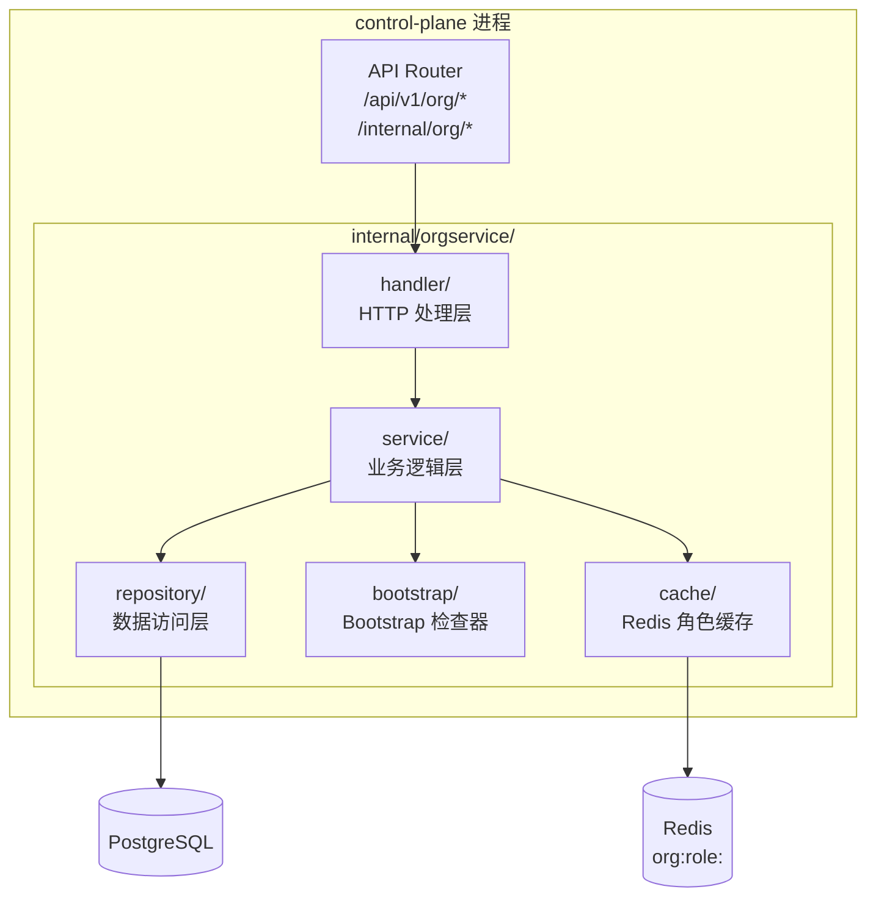
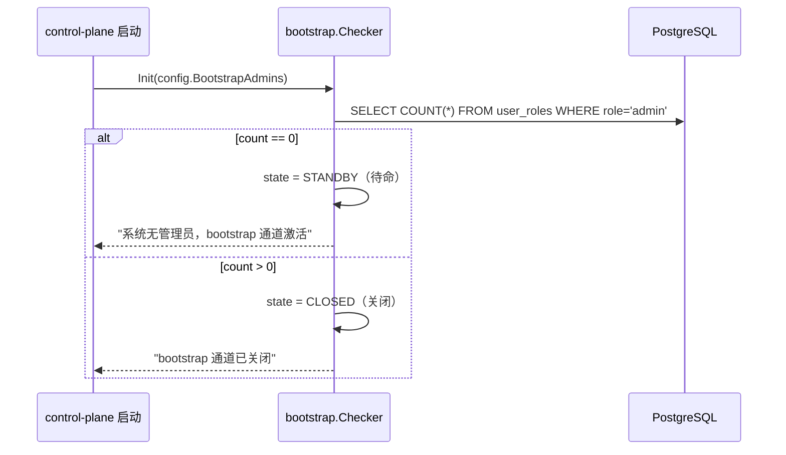
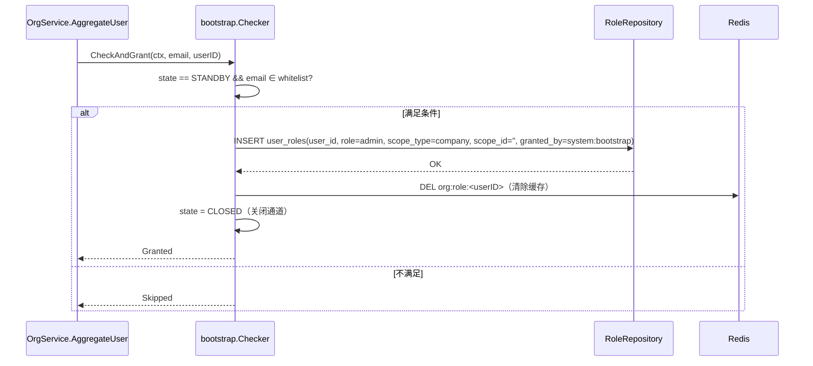
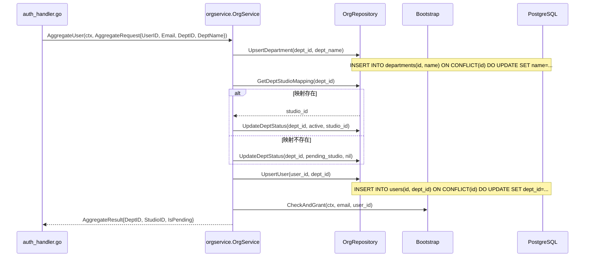
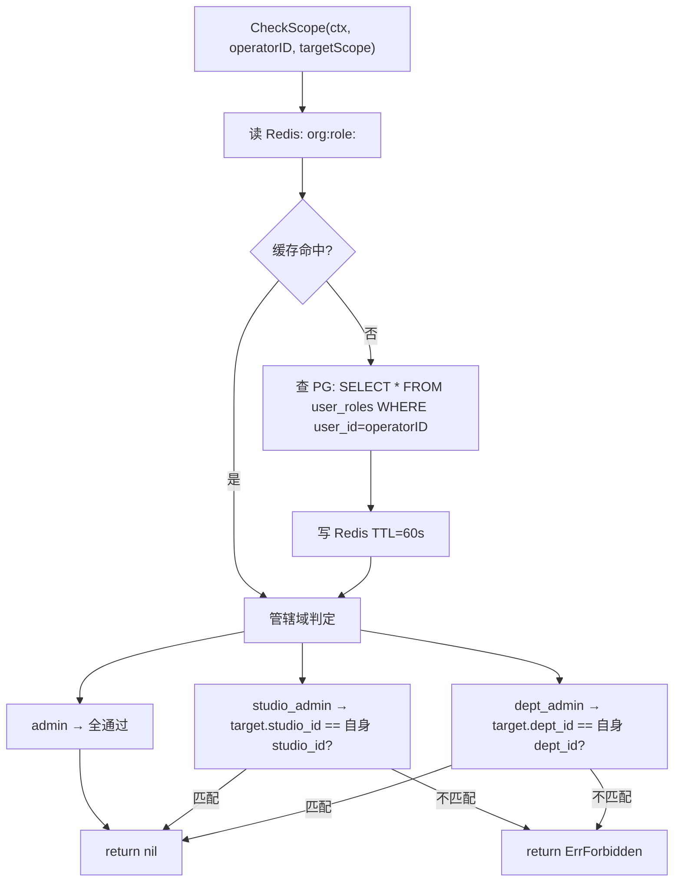
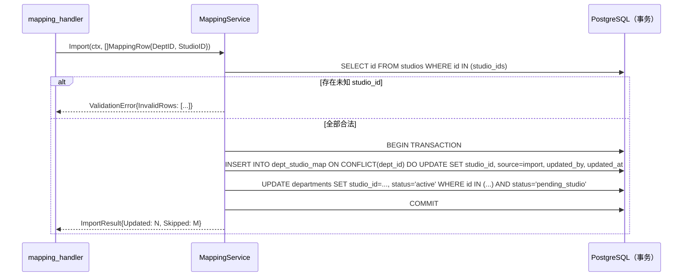

# org-service 详细设计

## 0. 文档信息

| 属性 | 内容 |
| :--- | :--- |
| **所属变更** | CHG-20260609-001 |
| **模块名称** | org-service |
| **模块类型** | web-backend |
| **创建时间** | 2026-06-09 |

### 修订记录

| 版本号 | 修改日期 | 修改内容摘要 | 修改人 |
| :--- | :--- | :--- | :--- |
| v1.0 | 2026-06-09 | 初稿，组织架构篇首次建立 | TBD |

---

## 1. 背景与目标

### 1.1 业务背景

LLM Gateway 需要与公司组织结构绑定，实现按组织层级的用量观测与权限管控。org-service 作为 control-plane 进程内的独立 package，提供四级组织实体管理、部门↔工作室映射维护和 RBAC 鉴权服务。

### 1.2 设计目标

- 员工 SSO 登录后 2s 内完成组织归集（upsert）
- 角色鉴权 P95 < 10ms（Redis 缓存命中路径）
- 映射导入（500 条）< 5s，事务原子执行

### 1.3 非目标

- 不负责用量数据、JWT 签发、模型调用拦截

---

## 2. 模块职责边界

| 维度 | 范围 |
| :--- | :--- |
| 所属进程 | control-plane（内嵌 package） |
| package 路径 | `internal/orgservice/` |
| 核心职责 | 四级组织实体 CRUD、dept↔studio 映射维护、Bootstrap 初始管理员、RBAC 角色派发/鉴权 |
| 数据存储 | PostgreSQL（与 control-plane 共用连接池）|
| 缓存 | Redis（与 control-plane 共用，键前缀 `org:`）|
| 不负责 | 用量数据、JWT 签发、模型调用拦截 |

---

## 3. 技术选型与研究

| 领域 | 选型 | 理由 |
| :--- | :--- | :--- |
| 语言/框架 | Go 1.26 + Gin（复用 control-plane） | 宪章约束，零额外引入 |
| ORM | GORM（复用 control-plane） | 与现有 repository 模式一致 |
| 数据库 | PostgreSQL（复用连接池） | 宪章约束；org 表与 control-plane 同库，事务边界清晰 |
| 缓存 | Redis（复用连接，键前缀 `org:`） | 用户指定；复用现有连接，零额外部署 |
| CSV 解析 | Go 标准库 `encoding/csv` | 简单场景无需第三方库 |

技术研究：无（全部为项目已有技术栈）

---

## 4. 架构概述
| :--- | :--- | :--- | :--- |
| 角色鉴权缓存 | Redis 缓存（TTL=60s） | 复用 control-plane 现有 Redis；管理操作频率低，60s 内的短暂延迟可接受；角色吊销时主动失效 | 直查 PG（强一致，无延迟） |
| 映射导入事务边界 | 单一 DB 事务 | upsert map + 回填 dept status 原子执行，失败整批回滚，无脏状态 | 分步操作（实现简单，但可能半更新） |
| org-service 集成方式 | 内嵌 control-plane 的 `internal/orgservice/` package | 复用 PG/Redis 连接池，无额外进程；边界通过 package 隔离 | 独立微服务（运维复杂度高） |

---

## 2. 模块职责边界

| 维度 | 范围 |
| :--- | :--- |
| 所属进程 | control-plane（内嵌 package） |
| package 路径 | `internal/orgservice/` |
| 核心职责 | 四级组织实体 CRUD、dept↔studio 映射维护、Bootstrap 初始管理员、RBAC 角色派发/鉴权 |
| 数据存储 | PostgreSQL（与 control-plane 共用连接池）|
| 缓存 | Redis（与 control-plane 共用，键前缀 `org:`）|
| 不负责 | 用量数据、JWT 签发、模型调用拦截 |

---

## 4. 架构概述



---

## 5. 关键流程设计

### 4.1 Bootstrap 初始管理员

**启动检查流程**：



**登录触发检查**（插入 OAuth 回调后置钩子）：



**并发安全**：`INSERT user_roles ... ON CONFLICT DO NOTHING` 保证幂等；多个白名单账号并发登录可各自获得 admin（预期行为）。

---

### 4.2 SSO 登录归集



**部门迁移检测**：

```go
// 在 UpsertUser 时检测部门变更
prev, _ := repo.GetUserDeptID(ctx, userID)
if prev != "" && prev != newDeptID {
    repo.InsertMigrationLog(ctx, userID, prev, newDeptID)
}
```

---

### 4.3 角色鉴权（Redis 缓存）

**缓存键设计**：
```
org:role:<userID>   →  JSON: []RoleRecord
TTL: 60s
主动失效触发：grant/revoke 操作后 DEL org:role:<userID>
```

**CheckScope 逻辑**：



---

### 4.4 映射导入（事务设计）



---

### 5. 错误处理

| 场景 | 错误码 | HTTP | 处理方式 |
| :--- | :--- | :--- | :--- |
| 越权操作 | `org.forbidden` | 403 | CheckScope 返回 ErrForbidden，handler 统一处理 |
| 导入含非法 studio_id | `org.import.invalid_studio` | 422 | 整批拒绝，响应体含问题行列表 |
| 删除有关联部门的工作室 | `org.studio.has_departments` | 409 | 列出关联部门名 |
| 重名工作室/部门 | `org.duplicate_name` | 422 | 提示已存在 |
| Redis 不可用（降级） | — | — | 角色缓存 miss 时直查 PG，记录告警日志 |

---

## 6. 数据流转

归集数据流：SSO claims → OrgService.AggregateUser → upsert departments/users → query dept_studio_map → 返回 AggregateResult（含 DeptID/StudioID/IsPending）→ JWT claims 写入。

鉴权数据流：handler 调用 → RoleService.CheckScope → Redis 读缓存（命中直接返回）/ 未命中查 PG user_roles → 判定管辖域 → 返回 nil 或 ErrForbidden。

---

## 7. 分层职责落实

| 层 | package | 职责 |
| :--- | :--- | :--- |
| Handler | `handler/` | HTTP 请求解析、参数校验、响应序列化 |
| Service | `service/` | 业务逻辑、事务协调、缓存操作 |
| Repository | `repository/` | GORM 数据访问，封装所有 SQL |
| Bootstrap | `bootstrap/` | 冷启动管理员检查，独立状态机 |
| Cache | 在 service 层内联 | Redis GET/SET/DEL，不独立 package |

---

## 8. 异常处理链

| 异常来源 | 处理方式 |
| :--- | :--- |
| PG 连接失败 | 返回 503；不影响已有 JWT 鉴权 |
| Redis 不可用 | 降级直查 PG；记录告警日志 |
| 归集失败（SSO 回调内） | 降级（不阻断登录）；JWT dept_id 为空 |
| CSV 导入含非法 studio_id | 事务回滚；422 + 问题行列表 |
| 越权操作 | 403 + `org.forbidden` 错误码 |

---

## 9. 数据库设计要点

- 所有表通过 migration 文件追加，不修改现有表（users 除外追加一列）
- 幂等操作全部使用 `ON CONFLICT DO UPDATE/NOTHING`
- 索引覆盖高频查询路径：`user_roles(user_id)`、`departments(status)`、`dept_studio_map(studio_id)`
- 详细表结构见 `data-model.md`

---

## 10. 接口设计要点

- 管理接口：`JWTAuth` + handler 层调用 `CheckScope`（双保险）
- 内部接口：`InternalToken`（`X-Internal-Token` header）
- 分页统一：`?page=1&page_size=20`，最大 100
- 详细接口定义见 `contracts.md`

---

## 11. 错误处理与容灾

- Redis 不可用时降级直查 PG（角色鉴权延迟增加但不中断）
- PG 不可用时返回 503（不影响已缓存的 JWT 鉴权）
- 归集失败不阻断 SSO 登录，记录 WARN 日志

---

## 12. 性能设计

| 指标 | 目标 | 实现方式 |
| :--- | :--- | :--- |
| 鉴权延迟 P95 | < 10ms | Redis 缓存命中；PG 查询走 `user_id` 索引 |
| 归集延迟 P95 | < 500ms | `ON CONFLICT` upsert；单次事务 |
| 映射导入（500 条） | < 5s | 单事务批量 upsert；校验前置（先查 studios IN 列表） |

---

## 13. 测试矩阵

| 场景 | 测试类型 | 覆盖点 |
| :--- | :--- | :--- |
| Bootstrap 冷启动授予 | 单元测试 | 双条件触发、幂等 |
| 归集幂等 | 单元测试 | 重复登录不重复建节点 |
| 鉴权越权 | 单元测试 | 各角色越权返回 ErrForbidden |
| 映射导入事务回滚 | 集成测试 | 含非法 studio_id 时整批回滚 |
| Redis 降级 | 单元测试（mock Redis 不可用） | 降级直查 PG |

---

## 14. 设计决策记录

| 决策点 | 选择 | 理由 | 备选方案 |
| :--- | :--- | :--- | :--- |
| 角色鉴权缓存 | Redis TTL=60s | 复用现有 Redis，60s 延迟可接受，主动失效 | 直查 PG（强一致） |
| 映射导入事务 | 单一 DB 事务 | upsert+回填原子，失败整批回滚 | 分步操作 |
| org 集成方式 | 内嵌 package | 复用 PG/Redis 连接，无额外进程 | 独立微服务 |

## 15. 并发与幂等

| 操作 | 幂等保证 |
| :--- | :--- |
| 归集 UpsertDepartment | `ON CONFLICT(id) DO UPDATE` |
| 归集 UpsertUser | `ON CONFLICT(id) DO UPDATE` |
| Bootstrap Grant | `ON CONFLICT(user_id,role,scope_id) DO NOTHING` |
| 映射导入 | `ON CONFLICT(dept_id) DO UPDATE` + 事务 |
| 角色派发 | `ON CONFLICT(user_id,role,scope_id) DO NOTHING` |
