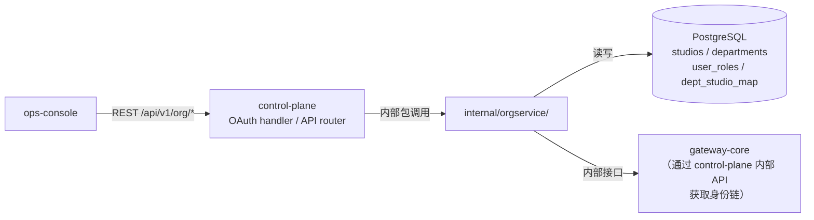
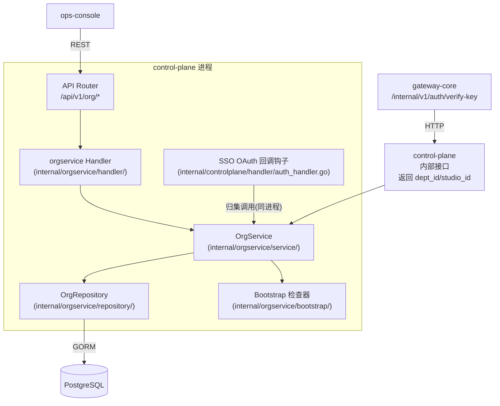
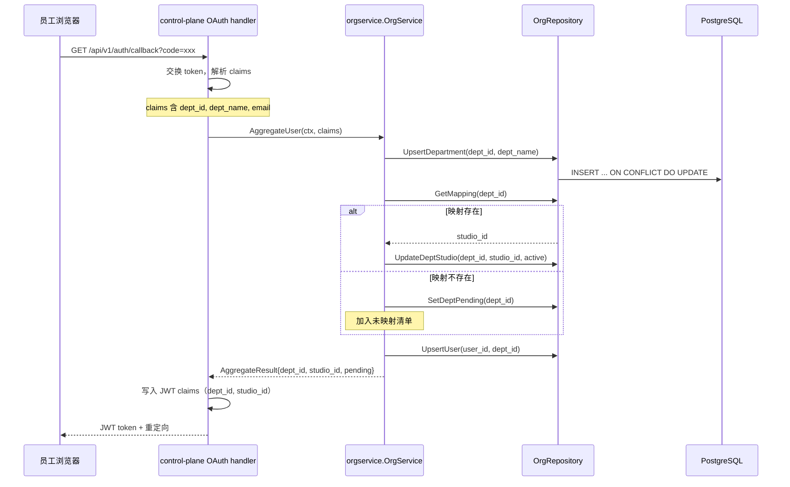
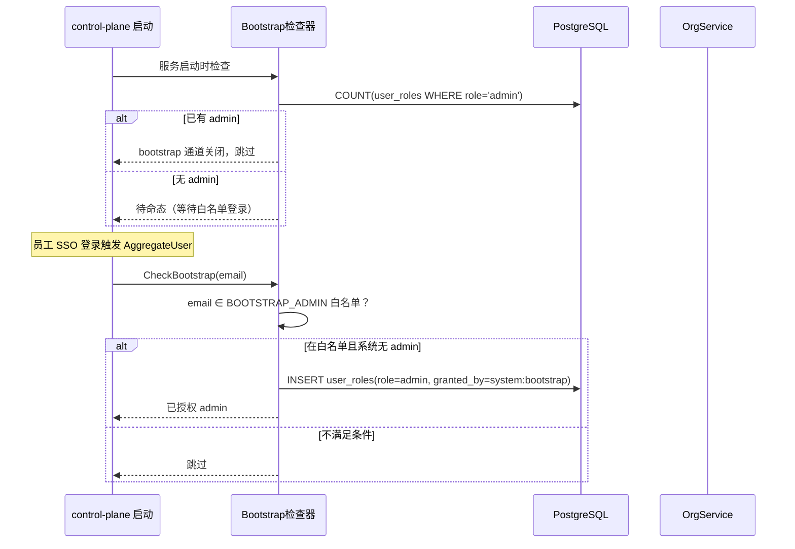
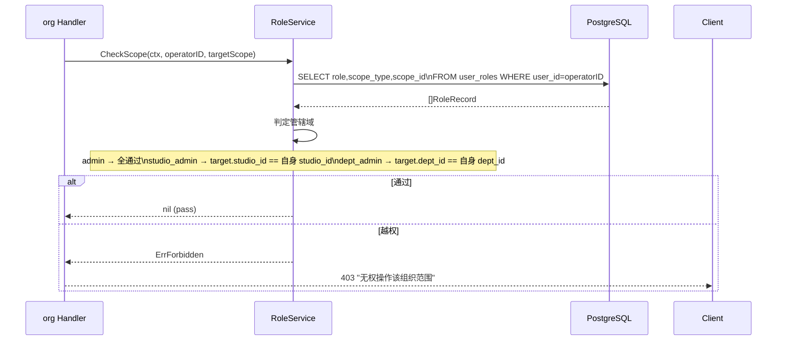
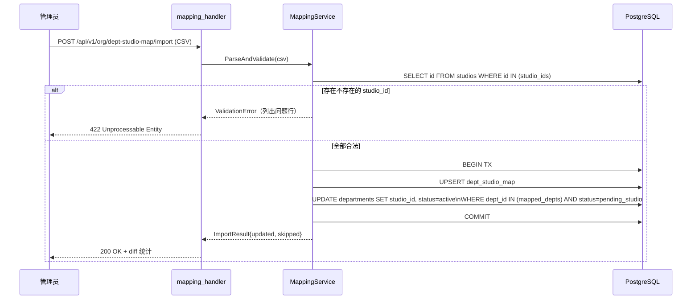

# org-service Web 后端概要设计

## 0. 文档信息

| 属性 | 内容 |
| :--- | :--- |
| **所属变更** | CHG-20260609-001 |
| **模块名称** | org-service |
| **模块类型** | web-backend |
| **创建时间** | 2026-06-09 |

### 修订记录

| 版本号 | 修改日期 | 修改内容摘要 | 修改人 |
| :--- | :--- | :--- | :--- |
| v1.0 | 2026-06-09 | 初稿，组织架构篇首次建立 | TBD |

---

## 1. 技术范围界定

### 1.1 起点与终点

| 维度 | 说明 |
| :--- | :--- |
| **起点** | SSO OAuth 回调后 control-plane 发起的归集调用；管理员通过 `/api/v1/org/*` 发起的组织/角色管理操作 |
| **终点** | 组织树与角色授权记录持久化到 PostgreSQL；鉴权校验结果（pass/403）返回给调用方 |
| **解决的问题** | 在 control-plane 进程内提供四级组织实体管理、部门↔工作室映射维护、RBAC 四角色派发与管辖域鉴权的完整领域能力 |

### 1.2 技术边界



- **上游依赖**：control-plane OAuth handler（触发归集）；ops-console（通过 control-plane 路由的管理 API）
- **下游依赖**：PostgreSQL（所有组织数据持久化）
- **不涉及**：用量数据读写（observability-hub）；模型调用拦截（gateway-core）；JWT 签发（control-plane auth 层）

---

## 2. 架构方向探索

| 方向 | 核心思路 | 适合场景 | 风险 |
| :--- | :--- | :--- | :--- |
| 内嵌 control-plane 独立 package | `internal/orgservice/` 内嵌 control-plane 进程，共享 PG 连接，通过 control-plane 路由对外暴露 | 项目规模适中，避免多进程部署复杂度 | package 边界需严格维护，避免职责蔓延 |
| 独立微服务 | 单独部署进程，独立 schema，内部 HTTP 通信 | 大规模多团队协作 | 运维复杂度高，当前规模不值得 |
| 直接扩展 control-plane handler 层 | 不建新 package，直接在 handler 层加逻辑 | 极简场景 | 职责混杂，长期维护成本高 |

**选定方向**：内嵌 control-plane 的 `internal/orgservice/` 独立 package
**选择理由**：宪章要求「单一职责、禁止 God Object」，独立 package 保持领域边界清晰；同时复用 control-plane 的 PG 连接与路由基础设施，无需额外进程部署，符合「架构清晰、简洁优先」原则。

---

## 3. 架构方案

### 3.1 整体架构图



### 3.2 内部分层

```
internal/orgservice/
├── handler/          # HTTP handler，绑定到 control-plane router
│   ├── org_handler.go        # 工作室/部门查询、组织树
│   ├── mapping_handler.go    # 映射维护（导入/手工）
│   └── role_handler.go       # 角色派发/卸任
├── service/          # 业务逻辑层
│   ├── org_service.go        # 归集、组织树查询
│   ├── mapping_service.go    # 映射导入/回填
│   └── role_service.go       # 角色派发/鉴权
├── repository/       # 数据访问层（GORM）
│   ├── studio_repo.go
│   ├── department_repo.go
│   ├── mapping_repo.go
│   └── role_repo.go
├── bootstrap/        # Bootstrap 初始管理员
│   └── bootstrap.go
└── model/            # 领域模型（与 controlplane/model 分开）
    └── org_models.go
```

### 3.3 核心流程：SSO 登录归集



### 3.4 核心流程：Bootstrap 初始管理员



### 3.5 核心流程：管辖域鉴权



### 3.6 核心流程：部门↔工作室映射导入



---

## 4. 技术选型与约束

| 领域 | 选型 | 理由 |
| :--- | :--- | :--- |
| 语言/框架 | Go 1.26 + Gin（复用 control-plane） | 宪章约束，零额外引入 |
| ORM | GORM（复用 control-plane） | 项目已选定，与现有 repository 模式一致 |
| 数据库 | PostgreSQL（复用 control-plane 连接池） | 宪章约束；org 表与 control-plane 其他表同库，事务边界清晰 |
| CSV 解析 | Go 标准库 `encoding/csv` | 简单场景无需第三方库 |
| 测试 | Go test + testify（复用项目规范） | 宪章要求全量测试通过 |

### 宪章合规检查

| 原则 | 检查结果 |
| :--- | :--- |
| 不开倒车 | ✅ 新增表结构，不修改现有表 |
| 零破坏性变更 | ✅ 新增 `/api/v1/org/*` 端点，不改现有接口语义 |
| 服务快速 | ✅ 鉴权校验走本地 PG 查询，P95 < 10ms；归集异步降级不阻塞登录 |
| 架构清晰 | ✅ 独立 package 单一职责；gateway 不直连 org-service，经 control-plane 内部接口透传 |
| 交互至上 | ✅ 越权操作返回 403 + 人可读描述；未映射员工有明确提示 |

---

## 5. 中间件链

org-service 本身不定义独立中间件链，复用 control-plane 的：
- `JWTAuth`：所有 `/api/v1/org/*` 路由的身份验证
- `InternalAuth`（`X-Internal-Token`）：`/internal/org/*` 路由的服务间认证
- `OrgScopeCheck`：由 orgservice handler 层在写操作前调用 `RoleService.CheckScope`，不作为独立 Gin 中间件注册

## 6. 认证与授权

org-service 本身不处理认证，复用 control-plane 的：
- `JWTAuth` 中间件：管理面 `/api/v1/org/*` 路由的身份验证
- `InternalAuth` 中间件：`/internal/v1/*` 接口的服务间认证

角色信息从 JWT claims 中读取（`dept_id`、`studio_id`、`role`），服务端以 `user_roles` 表为权威源做二次校验。

---

## 7. 安全设计

| 威胁 | 防御措施 |
| :--- | :--- |
| 越权操作（跨管辖域） | 每个写操作调用 `RoleService.CheckScope`，失败返回 403 |
| Bootstrap 滥用 | 双重条件（无 admin + 在白名单）同时满足才触发；系统有 admin 后永久失活 |
| CSV 注入 | 使用标准库解析，不执行 CSV 内容；studio_id 存在性校验 |
| 并发映射导入 | 使用数据库事务 + `ON CONFLICT DO UPDATE` 保证幂等 |
| 所有写操作预留 actor_id | 为 v0.8.0 审计预留字段，当前写入但不强制使用 |

---

## 8. 数据存储与外部依赖

- **PostgreSQL**：所有组织实体持久化，复用 control-plane 连接池（GORM）
- **Redis**：角色授权缓存（`org:role:<userID>`，TTL=60s），复用 control-plane Redis 客户端
- **外部系统**：无直接外部依赖；SSO claims 由 control-plane OAuth handler 解析后传入

| 指标 | 说明 |
| :--- | :--- |
| 归集成功率 | `org_aggregate_total` / `org_aggregate_errors` 计数器 |
| 未映射部门数 | `org_pending_studio_depts` Gauge，启动时初始化 |
| 鉴权延迟 | `org_authz_duration_seconds` Histogram，P95 目标 < 10ms |
| 映射导入耗时 | `org_import_duration_seconds` |

---

## 9. 观测与运维

| 指标 | 说明 |
| :--- | :--- |
| `org_aggregate_total` / `org_aggregate_errors` | 归集成功/失败计数器 |
| `org_pending_studio_depts` | 未映射部门数量 Gauge |
| `org_authz_duration_seconds` | 鉴权延迟 Histogram，P95 目标 < 10ms |
| `org_import_duration_seconds` | 映射导入耗时 Histogram |

---

## 10. 失败模式与降级策略

| 失败场景 | 影响 | 降级策略 |
| :--- | :--- | :--- |
| org-service 归集调用失败 | JWT 中 dept_id 为空 | 登录不阻断；日志告警；用户调用模型时被 gateway-core 以「组织未就绪」拒绝 |
| PostgreSQL 不可用 | 组织查询全失败 | 返回 503；不影响已有 JWT 鉴权（gateway 走 KeyCache） |
| 映射导入部分失败 | 整批回滚 | 返回 422 + 问题行列表，运营重新上传修正后的 CSV |

---

## 11. 待研究事项

无需研究。技术栈（Go + GORM + PostgreSQL）在项目中均已使用，无新引入组件。CSV 批量导入（≤500条）使用标准库即可满足性能要求，无需 benchmark。

---

## 12. 风险与对策

| 风险 | 概率 | 影响 | 对策 |
| :--- | :--- | :--- | :--- |
| SSO claims 不携带 dept_id | 低 | 高 | 归集时记录 claims 缺失告警；在对接 SSO 前先在配置中验证 claims 字段 |
| org package 边界蔓延（与 control-plane 耦合） | 中 | 中 | 代码 Review 检查 orgservice 只被 control-plane router/handler 调用，不允许反向依赖 |
| 大量员工同时首次登录（批量归集压力） | 低 | 低 | UpsertDepartment 加数据库 ON CONFLICT，幂等写入；PG 连接池复用 |

---

## 13. 概要设计确认

- [x] 技术范围已界定
- [x] 架构方向已探索并选定（内嵌 control-plane 独立 package）
- [x] 架构方案已确认（分层 handler/service/repository）
- [x] 技术选型符合宪章（Go + GORM + PG + Redis，均为项目已有技术栈）
- [x] 中间件链已说明（复用 JWTAuth / InternalAuth）
- [x] 认证与授权已说明（JWT + 服务端 user_roles 双保险）
- [x] 数据存储与外部依赖已说明
- [x] 待研究事项已识别（无需研究）

👉 确认后进入详细设计阶段（`/xf/detail`）
