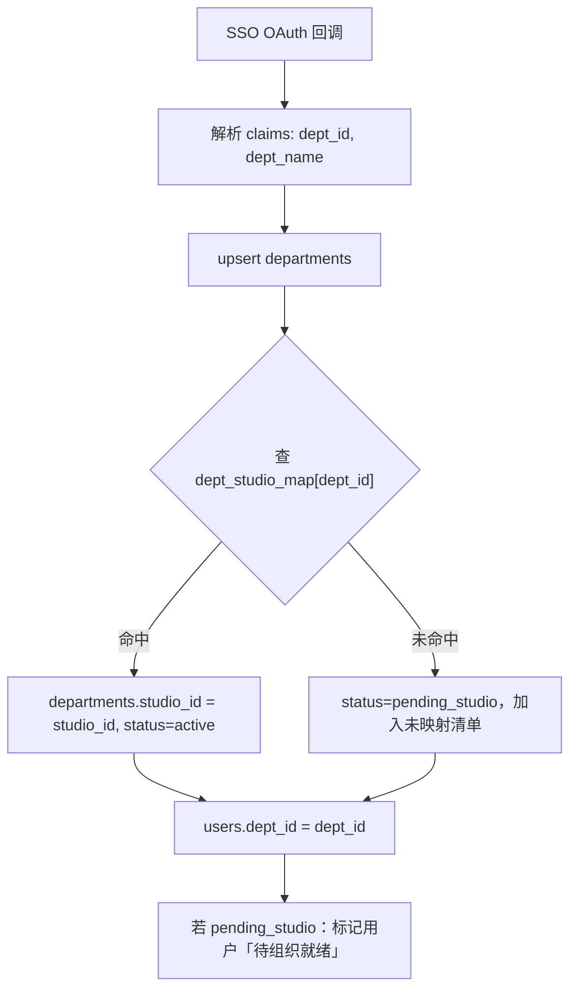
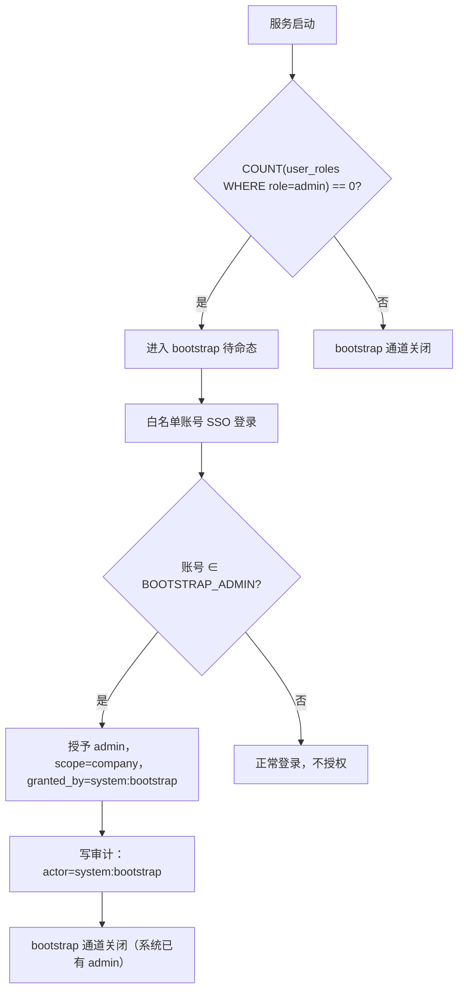
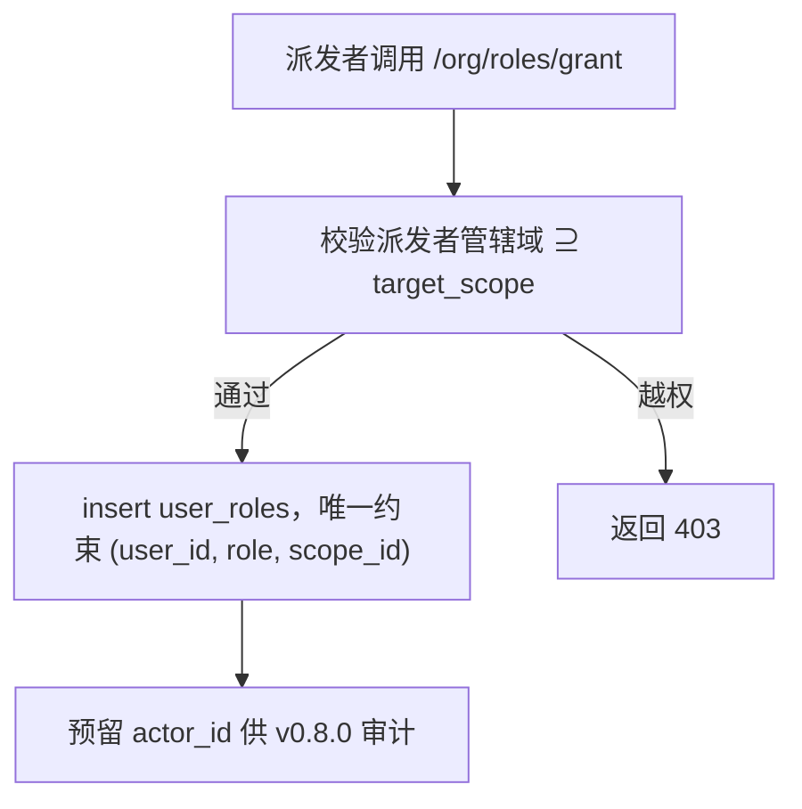

# org-service 需求规范

## 0. 文档信息

| 属性 | 内容 |
| :--- | :--- |
| **所属变更** | CHG-20260609-001 |
| **模块名称** | org-service |
| **模块类型** | web-backend |
| **创建时间** | 2026-06-09 |

### 修订记录

| 版本号 | 修改日期 | 修改内容摘要 | 修改人 |
| :--- | :--- | :--- | :--- |
| v1.0 | 2026-06-09 | 初稿，组织架构篇首次建立 | TBD |

---

## 1. 业务背景与系统目标

LLM Gateway 作为公司 AI 基座，需要与公司组织结构绑定，实现按组织层级的用量观测与权限管控。org-service 是这一能力的核心领域服务，负责维护「公司→工作室→部门→员工」四级组织树、部门与工作室的归属映射、以及 RBAC 四角色的派发与鉴权。

- **业务背景**：SSO 只携带部门信息，不携带工作室信息；工作室归属需独立维护映射表。员工登录后自动归集到部门，但需要管理员预先建立部门↔工作室映射才能完整挂载组织树
- **核心目标**：
  1. 提供稳定的组织实体存储与查询服务，作为权限管控与用量聚合的数据基础
  2. 自动化员工登录归集，减少管理员手工维护成本
  3. 通过 RBAC 管辖域约束确保数据隔离，下级只能看/管自己管辖范围内的数据
- **关键衡量指标**：
  - 员工登录后 2s 内完成归集（组织节点 upsert）
  - 角色鉴权 P95 < 10ms（本地 user_roles 查询）
  - 映射导入支持批量（≥ 500 条/次）无超时

---

## 2. 关键概念

- **组织树**：公司（唯一根）→ 工作室 → 部门 → 员工，四级固定层级，本期不支持更深层级
- **dept_studio_map**：部门与工作室的归属映射表，是工作室层级聚合的唯一来源；SSO 不携带此信息，需独立维护
- **pending_studio**：部门尚未完成映射时的状态；处于此状态的部门下的员工调用模型会被前置拒绝
- **归集（Aggregation）**：员工 SSO 登录时将其挂载到对应部门节点的过程；幂等，重复登录不重复建节点
- **Bootstrap 管理员**：系统冷启动时通过环境变量预置的初始管理员账号，解决"角色派发需要上级"的先有鸡先有蛋问题
- **RBAC 管辖域**：每个管理角色只能操作自己组织子树内的资源；`admin` 无限制，`studio_admin` 限本工作室，`dept_admin` 限本部门
- **user_roles**：角色授权记录表；一条记录 = 一个用户在一个组织节点上的一个管理角色

---

## 3. 超出范围

- 不负责请求转发和流式处理（由 gateway-core 负责）
- 不负责用量数据的采集与存储（由 observability-hub 负责）
- 不负责预算/额度管控（见额度权限篇，v0.7.0）
- 不负责模型组授权（见额度权限篇）
- 不支持一人多部门、任意深度组织树（v1.x）
- 不做完整审计日志（v0.8.0），仅预留 `actor_id` 字段
- 不做自定义角色、细粒度权限点（v1.x）

---

## 4. 角色与权限控制（RBAC）

| 角色 | 代码 | 管辖域 | 本模块能做什么 |
| :--- | :--- | :--- | :--- |
| 员工 | `user` | 自身 | 登录后自动归集到部门；pending_studio 时调用被拒，可查看提示 |
| 部门负责人 | `dept_admin` | 本部门 | 查看/管理本部门成员与用量 |
| 工作室负责人 | `studio_admin` | 本工作室 | 查看/管理工作室及下属各部门；可为部门指定负责人 |
| 平台管理员 | `admin` | 公司（全局） | 全量组织管理、映射维护、角色派发/卸任 |

派发规则：上级才能指定下级（admin → studio_admin/dept_admin；studio_admin → 本工作室内 dept_admin）

---

## 5. 业务流程

### 5.1 员工登录归集流程

### 5.2 Bootstrap 初始管理员流程

### 5.3 角色派发流程

---

## 6. 详细功能需求

### 6.1 Bootstrap 初始管理员

**A. 功能说明**

解决全新系统无管理员的冷启动问题。通过部署配置预置白名单账号，首次登录时自动授予 admin 身份。

**D. 业务规则与校验**

- 触发条件：系统当前 `user_roles` 中无任何 `role=admin` 记录 **且** 当前登录账号在 `BOOTSTRAP_ADMIN` 白名单（邮箱或工号，逗号分隔）中
- 两个条件缺一不可，防止系统有 admin 时白名单账号重复获权
- 授予操作幂等：同一账号重复登录不重复授予
- 授予后写入一条 `user_roles`：`role=admin, scope_type=company, granted_by=system:bootstrap`
- 系统已存在任意 admin 后，bootstrap 通道永久失效（不再检查白名单）

**E. 异常与边界**

- 白名单配置为空且系统无 admin：服务启动时日志/健康检查告警「系统无管理员且未配置 BOOTSTRAP_ADMIN」
- 白名单账号长期不登录：系统持续处于「无 admin」状态，需运维介入配置
- bootstrap 完成后建议清空 `BOOTSTRAP_ADMIN` 配置，降低长期安全风险

**F. 验收标准**

| 编号 | Given | When | Then | 优先级 |
| :--- | :--- | :--- | :--- | :--- |
| AC-BS-01 | 全新系统，已配置 BOOTSTRAP_ADMIN，白名单账号首次 SSO 登录 | 完成 OAuth 回调归集 | 自动授予 admin（scope=company）+ 审计记录 granted_by=system:bootstrap | P0 |
| AC-BS-02 | 系统已存在至少 1 个 admin | 白名单账号 SSO 登录 | 不再授予 admin，bootstrap 通道不触发 | P0 |
| AC-BS-03 | 全新系统，未配置 BOOTSTRAP_ADMIN | 服务启动 | 健康检查或日志中出现「系统无管理员」告警 | P0 |
| AC-BS-04 | 已授予 admin 的白名单账号重复登录 | 重复 SSO 登录 | 不重复插入 user_roles 记录（幂等） | P0 |

### 6.2 组织实体管理

**A. 功能说明**

提供工作室（studios）、部门（departments）的查询与管理接口。员工归属关系通过 SSO 归集自动维护，无需手工录入员工。

**C. 接口概要**

| 接口 | 方法 | 路径 | 说明 | 权限 |
| :--- | :--- | :--- | :--- | :--- |
| 组织树 | GET | /internal/org/tree | 返回完整组织树（含成员数） | InternalToken |
| 工作室列表 | GET | /api/v1/org/studios | 分页查询工作室 | admin |
| 创建工作室 | POST | /api/v1/org/studios | 新建工作室 | admin |
| 工作室详情 | GET | /api/v1/org/studios/:id | 查询工作室及下属部门 | admin / 对应 studio_admin |
| 部门列表 | GET | /api/v1/org/departments | 分页查询部门（含映射状态） | admin |
| 部门详情 | GET | /api/v1/org/departments/:id | 查询部门及成员列表 | admin / 对应 dept_admin |
| 未映射部门 | GET | /api/v1/org/departments/unmapped | 返回 status=pending_studio 的部门列表 | admin |

**D. 业务规则与校验**

- 工作室由管理员手工创建；部门由 SSO 归集自动 upsert，不需手工创建
- 删除工作室前需确认无关联部门
- 组织树接口仅供内部服务消费，不对外暴露

**E. 异常与边界**

- 删除有关联部门的工作室：返回 409 Conflict，列出关联部门名称
- 工作室/部门名称重复：返回 422，提示已存在

**F. 验收标准**

| 编号 | Given | When | Then | 优先级 |
| :--- | :--- | :--- | :--- | :--- |
| AC-ORG-01 | 部门已在映射表，员工 SSO 首次登录 | OAuth 回调执行归集 | 员工挂到正确工作室，departments.status=active | P0 |
| AC-ORG-02 | 部门不在映射表，员工 SSO 登录 | OAuth 回调执行归集 | departments.status=pending_studio，员工标记「待组织就绪」，进入未映射清单 | P0 |
| AC-ORG-03 | 同一员工重复 SSO 登录 | 重复触发归集 | 不重复创建组织节点（幂等） | P0 |
| AC-ORG-04 | 员工 SSO claims 中 dept_id 发生变更 | 下次 SSO 登录 | 员工归属迁移到新部门，写 org_migration_log | P1 |

### 6.3 部门↔工作室映射维护

**A. 功能说明**

维护部门与工作室的归属映射，是工作室层级数据聚合的唯一来源。提供 CSV 批量导入和后台手工两种维护方式。

**C. 接口概要**

| 接口 | 方法 | 路径 | 说明 | 权限 |
| :--- | :--- | :--- | :--- | :--- |
| 映射列表 | GET | /api/v1/org/dept-studio-map | 查询所有部门映射状态 | admin |
| 批量导入映射 | POST | /api/v1/org/dept-studio-map/import | 上传 CSV，预览 diff 后确认写入 | admin |
| 手工修改映射 | PUT | /api/v1/org/departments/:id/studio | 为指定部门设置工作室归属 | admin |

**D. 业务规则与校验**

- CSV 格式：`dept_id,studio_id`，首行为 header，支持 UTF-8
- 导入前校验：`studio_id` 必须存在，否则报错（不自动创建工作室）
- 导入操作幂等（upsert），相同 `dept_id` 后导入的覆盖前值
- 导入/手工设置映射后，批量回填该部门下 `pending_studio` 状态为 `active`，对应用户解除「待组织就绪」限制
- 导入文件大小上限：1MB；单次最多 500 条映射

**E. 异常与边界**

- CSV 中 `studio_id` 不存在：整批报错，不写入任何数据（原子性）
- `dept_id` 指向不存在的部门：跳过该行，在响应中列出跳过行
- 并发导入：使用事务保证原子性

**F. 验收标准**

| 编号 | Given | When | Then | 优先级 |
| :--- | :--- | :--- | :--- | :--- |
| AC-MAP-01 | 管理员上传合法 CSV（dept_id, studio_id 均存在） | 导入确认 | 映射写入 dept_studio_map，存量 pending_studio 部门回填为 active | P0 |
| AC-MAP-02 | CSV 中含不存在的 studio_id | 导入提交 | 返回 422，整批不写入，错误中列出问题行 | P0 |
| AC-MAP-03 | 管理员手工修改某部门归属工作室 | PUT 接口调用 | 映射更新，该部门下 pending_studio 员工恢复可用 | P0 |
| AC-MAP-04 | 重复导入相同 dept_id 的映射 | 再次导入 | upsert 覆盖，不产生重复记录 | P0 |
| AC-MAP-05 | CSV 中 studio_id 不存在 | 导入提交 | 返回校验错误，不写入脏映射 | P0 |

### 6.4 角色派发与鉴权

**A. 功能说明**

提供 RBAC 四角色的派发、卸任与管辖域鉴权服务。角色挂载在组织节点上，派发遵循"上级才能指定下级"规则，卸任后立即回退为 `user`。

**C. 接口概要**

| 接口 | 方法 | 路径 | 说明 | 权限 |
| :--- | :--- | :--- | :--- | :--- |
| 派发角色 | POST | /api/v1/org/roles/grant | 授予目标用户角色+管辖域 | admin / studio_admin（仅限本工作室内） |
| 卸任角色 | POST | /api/v1/org/roles/revoke | 卸任目标用户角色，回退为 user | admin / studio_admin（仅限本工作室内） |
| 查询用户角色 | GET | /api/v1/org/roles/:user_id | 查询指定用户的所有角色 | admin |
| 鉴权校验（内部） | POST | /internal/org/auth/check-scope | 校验操作者对 target_scope 是否有权限 | InternalToken |

**D. 业务规则与校验**

- 角色必须绑定组织节点：`dept_admin` 绑 `dept_id`，`studio_admin` 绑 `studio_id`，`admin` 的 `scope_id` 为空
- 唯一约束：`(user_id, role, scope_id)` — 同一用户在同一节点上不能有重复角色记录
- 管辖域判定规则：
  - `admin`：所有 target_scope 均通过
  - `studio_admin`：target_scope 的 `studio_id` 必须等于自身 `studio_id`
  - `dept_admin`：target_scope 的 `dept_id` 必须等于自身 `dept_id`
- 角色变更即时生效（下次请求按新角色鉴权）
- 所有写操作预留 `actor_id` 字段（为 v0.8.0 审计准备）

**E. 异常与边界**

- 越权派发（派发者管辖域不包含 target_scope）：返回 403，错误描述「无权操作该组织范围」
- 对已有相同角色的用户再次派发：幂等，返回 200 不报错
- 卸任不存在的角色记录：返回 404

**F. 验收标准**

| 编号 | Given | When | Then | 优先级 |
| :--- | :--- | :--- | :--- | :--- |
| AC-ROLE-01 | 平台管理员操作 | 为某员工授予 dept_admin（指定部门） | 该员工获 dept_admin，可管理该部门；user_roles 记录正确写入 | P0 |
| AC-ROLE-02 | dept_admin 用户 | 尝试修改其他部门资源 | 鉴权返回 403 | P0 |
| AC-ROLE-03 | studio_admin 用户 | 尝试操作其他工作室下的部门 | 鉴权返回 403 | P0 |
| AC-ROLE-04 | 部门负责人被卸任 | revoke 接口调用成功 | 用户回退为 user，立即失去部门管理权 | P0 |
| AC-ROLE-05 | 对已有角色的用户重复 grant | grant 接口调用 | 幂等，不重复插入，返回 200 | P1 |
| AC-ROLE-06 | 任意写操作 | 角色派发/卸任 | actor_id 字段被记录（v0.8.0 审计预留） | P1 |

---

## 7. 数据结构（概念层）

> 详细字段定义见 `data-model.md`（设计阶段产出）

- `studios`：工作室表（id, name, owner_id, created_at）
- `departments`：部门表（id, name, studio_id FK, status[active/pending_studio], owner_id, created_at）
- `dept_studio_map`：映射表（dept_id PK, studio_id, source[import/manual], updated_by, updated_at）
- `users`：用户表，新增 `dept_id` FK
- `user_roles`：角色授权表（id, user_id, role, scope_type, scope_id, granted_by, created_at）
- `org_migration_log`：部门迁移日志（user_id, from_dept, to_dept, at）

---

## 8. 外部接口

- **SSO / OIDC 回调**：由 control-plane OAuth handler 触发归集钩子，org-service 执行归集逻辑
- **gateway-core 身份链查询**：通过 control-plane 内部 API 获取 user→dept→studio 映射（gateway 不直连 org-service）
- **observability-hub 聚合查询**：通过 dept_studio_map 关联将 dept 维度聚合到 studio 维度

---

## 9. 非功能需求

- **性能**：归集操作（upsert）P95 < 500ms；鉴权校验 P95 < 10ms；批量映射导入（500条）< 5s
- **幂等性**：所有 upsert 操作保证幂等，重复触发不产生脏数据
- **数据一致性**：映射导入使用事务，要么全部成功要么全部回滚
- **安全性**：所有写操作记录 `actor_id`；内部接口走 `X-Internal-Token` 认证
- **可观测性**：归集成功/失败计数器；未映射部门数量指标

---

## 10. 验收标准汇总

见各功能模块 F 节（AC-BS-xx、AC-ORG-xx、AC-MAP-xx、AC-ROLE-xx）。

系统级验收：

| 编号 | Given | When | Then | 优先级 |
| :--- | :--- | :--- | :--- | :--- |
| AC-SYS-01 | pending_studio 员工 | 调用 /v1/chat/completions | 网关返回 403 + 提示「您所在部门尚未配置工作室归属，请联系管理员」 | P0 |
| AC-SYS-02 | 管理员导入映射，回填 pending_studio 部门 | 导入完成 | 该部门下员工下次请求不再被拒 | P0 |
| AC-SYS-03 | 各级负责人查看管理看板 | 请求管理看板 API | 数据范围严格限于自身管辖域，越权请求 403 | P0 |

---

## 11. 假设与依赖

- 假设 SSO OAuth 回调中稳定携带 `dept_id` 和 `dept_name` claims
- 假设 control-plane 的 OAuth handler 会调用 org-service 的归集接口（内部调用）
- 依赖 observability-hub 模块的 `usage_daily` 表已按 `dept_id` 分组记录
- 假设 PostgreSQL 稳定运行，是组织数据一致性的保证
