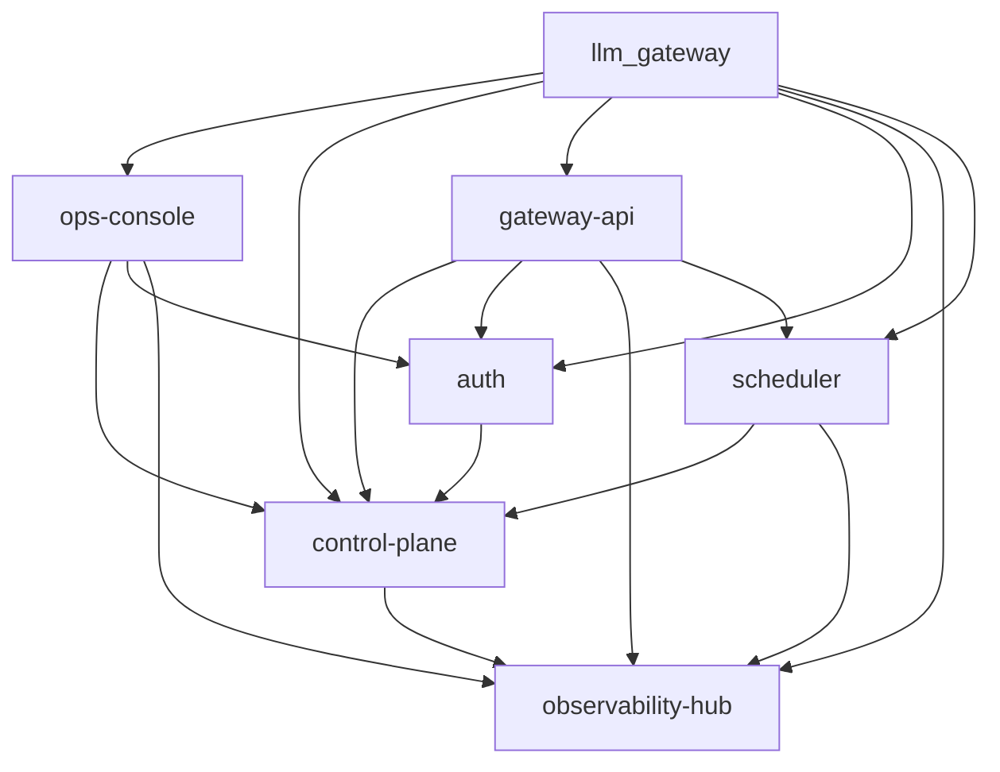

# llm_gateway 产品定位

## 产品概述

llm_gateway 是面向公司内部的统一大模型网关与智能调度底座，目标是为全员提供唯一、稳定、安全、可观测的模型调用入口，并在低迁移成本前提下逐步替换现有 LiteLLM 方案。

产品聚焦两大核心能力线：
- **统一接入治理**：多厂商模型接入、组织身份与 Key 治理、成本与限额控制、日志与服务质量观测，构建"身份 → Key → 调用追溯"闭环。
- **智能调度**：模型智力等级分层抽象、多维度智能路由、多渠道负载均衡、实时健康探测与秒级故障切换，为 Agent 开发、智能对话、代码自主开发、业务推理等上层场景提供高可用模型调用底座。

## 目标用户

| 用户角色 | 描述 | 核心诉求 |
| :--- | :--- | :--- |
| 全公司员工 | 通过统一入口使用公司提供的大模型能力的内部员工 | 一处登录、一处自助创建与管理 Key（创建时明文仅返回一次、列表脱敏展示、可禁用/启用/删除）、一处调用模型，Key 与员工身份强绑定，并能看到自己的可用模型和用量情况 |
| 业务开发团队 | 将模型能力集成进业务系统或工具链的研发团队 | 通过稳定协议和模型等级抽象解耦底层厂商变化，无需关心具体模型名称、渠道选择或故障切换，降低接入、迁移和切换成本 |
| 平台管理员 | 负责平台治理、成本控制和服务运营的管理角色 | 按组织维度管理身份、权限、限额、审计、模型可见性；配置模型等级分层、渠道健康阈值、负载均衡策略；监控服务健康状态与故障事件 |

## 模块结构

### 模块列表

| 模块 | 类型 | 职责描述 | 状态 |
| :--- | :--- | :--- | :--- |
| `gateway-api` | web-backend | 对外提供统一 OpenAI 兼容入口，负责请求接入、协议适配与 LiteLLM 替换主链路 | 已实现 |
| `scheduler` | web-backend | 负责模型智力等级分层、多维度智能路由决策、多渠道负载均衡、实时健康探测、秒级故障切换与自动降级 | 规划中 |
| `control-plane` | web-backend | 负责渠道配置、模型注册与等级管理、Key CRUD（创建/列表/禁用/启用/删除）、Key 与 user_id 强绑定、模型组、权限、限额、审计与配置治理 | 已实现 |
| `auth` | web-backend | 负责公司 SSO（OIDC）对接、内部 JWT 签发、API Key 鉴权中间件、用户与部门数据写入，实现身份 → Key → 调用追溯闭环 | 规划中 |
| `ops-console` | web-frontend | 提供管理员后台与员工自服务界面，承载 Key 管理、模型可见性、用量查询、调度策略配置和运营配置 | 已实现 |
| `observability-hub` | web-backend | 负责调用日志、用量聚合、服务质量指标、渠道健康度数据与故障事件回溯出口 | 规划中 |

### 模块依赖关系

| 模块 | 依赖 | 依赖类型 | 说明 |
| :--- | :--- | :--- | :--- |
| `ops-console` | `control-plane` | 接口调用 | 后台与自服务界面调用治理接口（渠道、模型、等级、Key 管理） |
| `ops-console` | `auth` | 接口调用 | OIDC 登录回调与登录态管理 |
| `ops-console` | `observability-hub` | 接口调用 | 展示日志、用量、健康度和故障事件数据 |
| `gateway-api` | `control-plane` | 接口调用 | 读取渠道、模型、权限、模型组和限额策略 |
| `gateway-api` | `auth` | 接口调用 | 调用时鉴权链路：API Key → User → 部门 |
| `gateway-api` | `observability-hub` | 接口调用 | 上报调用日志、用量和链路指标 |
| `gateway-api` | `scheduler` | 接口调用 | 将模型调用请求委托给调度层进行路由决策与渠道选择 |
| `auth` | `control-plane` | 接口调用 | 鉴权中间件读取 Key 与权限策略 |
| `control-plane` | `observability-hub` | 接口调用 | 读取聚合统计结果用于治理与运营展示 |
| `scheduler` | `control-plane` | 接口调用 | 读取模型等级配置、渠道健康阈值、负载策略参数 |
| `scheduler` | `observability-hub` | 接口调用 | 上报路由决策日志、健康检查结果与故障切换事件 |

## 产品边界

### 做什么
- 提供 OpenAI 兼容的统一模型调用入口，承接多厂商模型转发与抽象。
- 提供 AI 模型智力等级标准化分层，实现模型能力可度量、可替换、业务透明。
- 提供多维度智能路由（场景 + 模型等级 + 渠道状态 + 负载），自动匹配最优模型渠道。
- 提供多渠道负载均衡（至少轮询、加权、最少连接数两种策略），动态分配流量。
- 提供实时健康探测与秒级故障切换，每条模型调用链路配备降级路径，杜绝单点故障。
- 提供基于 SSO 或组织身份的 Key 自助生命周期管理（创建、脱敏查看、禁用/启用/删除），Key 与员工身份强绑定，实现身份 → Key → 调用追溯闭环。
- 提供模型组、权限策略、限额控制和成本治理能力，支持业务与底层厂商解耦。
- 提供围绕员工、部门、模型维度的结构化调用指标、故障日志、用量统计和服务质量观测能力。
- 提供配置热更新能力（模型列表、渠道配置、调度策略），无需重启服务。
- 提供逐步替换 LiteLLM 的现实落地路径，支持并行运行、灰度切换和持续演进。

### 不做什么
- 不做 Prompt 管理、Prompt 版本控制等上层内容平台能力。
- 不做 Agent 编排、工作流引擎、MCP 服务托管等泛 AI 平台能力。
- 不做向量数据库托管、RAG 知识库托管等独立基础设施能力。
- 不做训练、微调任务调度或独立模型评测平台。
- 不为了表面完整性引入与统一模型网关目标无直接关系的后台复杂能力。

## 版本信息

| 属性 | 内容 |
| :--- | :--- |
| 版本 | 1.4.1 |
| 创建日期 | 2026-05-21 |
| 最后更新 | 2026-05-25 |