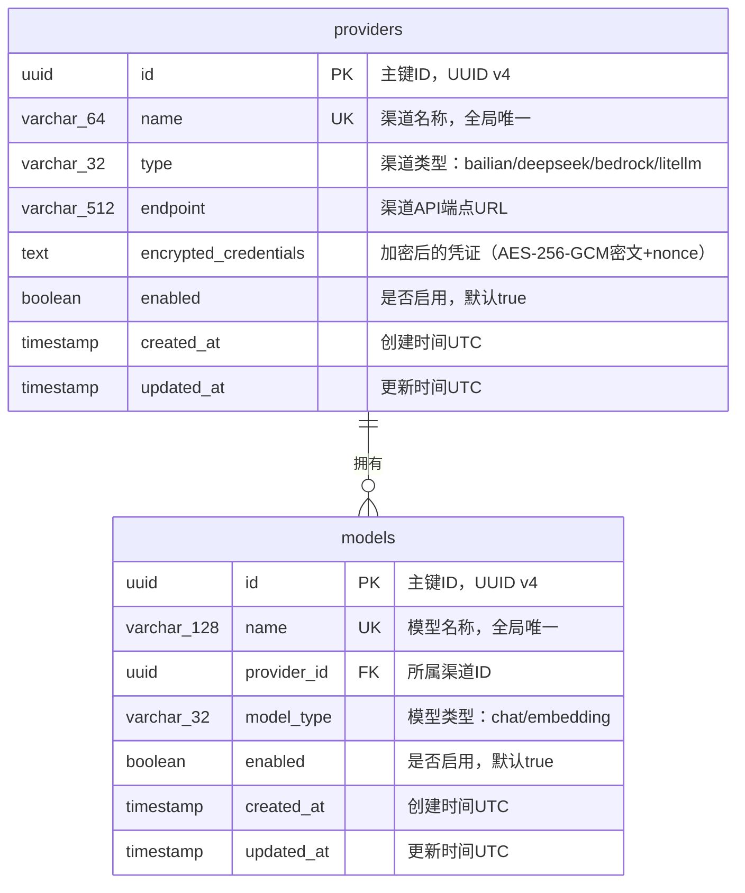
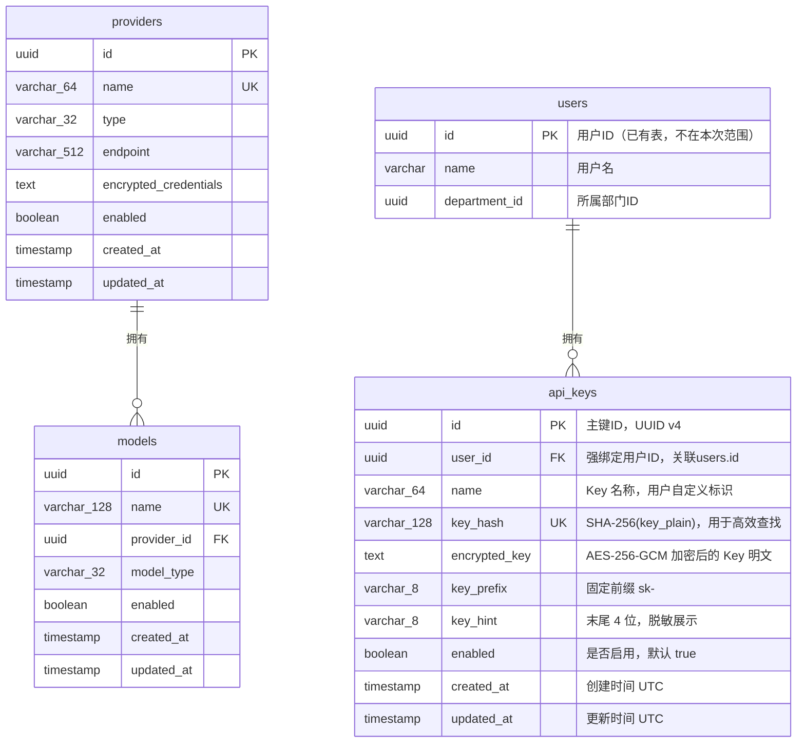
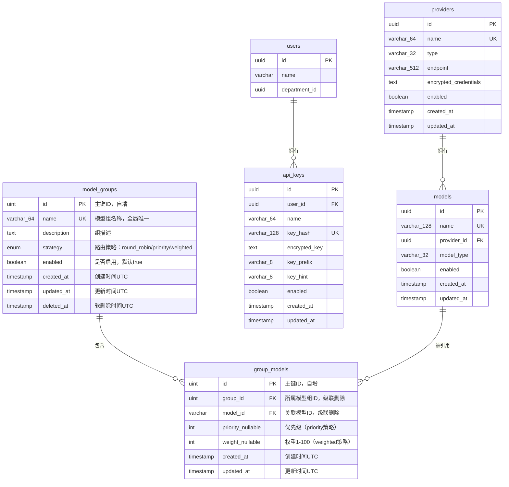

# control-plane Web 后端数据模型

## 1. 文档概述

本文档描述 control-plane 模块的数据库模型设计，包括实体结构、关系、索引策略、事务边界和迁移方案。

| 属性 | 内容 |
| :--- | :--- |
| **所属变更** | CHG-20260521-001 |
| **数据库类型** | PostgreSQL 15+ |
| **ORM 框架** | GORM v2 |
| **迁移工具** | golang-migrate |
| **核心实体** | providers（渠道表）、models（模型注册表） |
| **创建时间** | 2026-05-21 |
| **修改人** | OpenCode |

### 修订记录

| 版本号 | 修改日期 | 修改内容摘要 | 修改人 |
| :--- | :--- | :--- | :--- |
| v1.2 | 2026-05-25 | 新增 api_keys 表 — CHG-20260523-001 | OpenCode |
| v1.3 | 2026-05-26 | 新增 model_groups 和 group_models 表 — CHG-20260525-001 | OpenCode |

---

## 2. 实体关系总览

> providers 与 models 为一对多关系：一个渠道下可注册多个模型，一个模型只属于一个渠道。

| 关系 | 类型 | 说明 |
| :--- | :---: | :--- |
| providers → models | 1:N | 一个渠道下可注册多个模型，通过 models.provider_id 外键关联 |

### ER 图



---

## 3. 实体定义

> 字段类型使用逻辑类型标注，括号内为建议长度限制。

### 3.1 providers（渠道表）

**用途**：存储 LLM 渠道的配置信息，包括渠道名称、类型、API 端点和加密后的访问凭证。

| 字段 | 逻辑类型 | 约束 | 说明 |
| :--- | :--- | :--- | :--- |
| `id` | `uuid` | PK，非空 | 主键，应用层生成 UUID v4 |
| `name` | `string(64)` | 非空，唯一 | 渠道名称，仅允许字母数字下划线连字符，如 `bailian-main` |
| `type` | `string(32)` | 非空 | 渠道类型枚举：`bailian` / `deepseek` / `bedrock` / `litellm` |
| `endpoint` | `string(512)` | 非空 | 渠道 API 端点 URL，如 `https://dashscope.aliyuncs.com/compatible-mode/v1` |
| `encrypted_credentials` | `text` | 非空 | AES-256-GCM 加密后的凭证 JSON，Base64 编码存储（含 nonce 前缀） |
| `enabled` | `boolean` | 非空，默认 `true` | 渠道是否启用；禁用后其下模型不可用 |
| `created_at` | `timestamp` | 非空，自动填充 | UTC 时间戳，记录创建时刻 |
| `updated_at` | `timestamp` | 非空，自动更新 | UTC 时间戳，每次更新自动刷新 |

**删除策略**：物理删除。管理面低频操作，数据量小，无需软删除机制。删除前强制检查无关联模型。

**凭证存储格式说明**：
- 原始凭证为 JSON 对象，如 `{"api_key": "sk-xxx", "secret_key": "yyy"}`
- 加密流程：JSON 序列化 → AES-256-GCM 加密（随机 12 字节 nonce）→ nonce + ciphertext 拼接 → Base64 编码
- 解密流程：Base64 解码 → 前 12 字节为 nonce，剩余为 ciphertext → AES-256-GCM 解密 → JSON 反序列化

---

### 3.2 models（模型注册表）

**用途**：存储注册到各渠道下的模型信息，model name 作为 gateway-api 路由的唯一标识。

| 字段 | 逻辑类型 | 约束 | 说明 |
| :--- | :--- | :--- | :--- |
| `id` | `uuid` | PK，非空 | 主键，应用层生成 UUID v4 |
| `name` | `string(128)` | 非空，唯一 | 模型名称，全局唯一，如 `qwen-turbo`、`deepseek-chat` |
| `provider_id` | `uuid` | FK → providers.id，非空 | 所属渠道 ID |
| `model_type` | `string(32)` | 非空 | 模型类型枚举：`chat` / `embedding` |
| `enabled` | `boolean` | 非空，默认 `true` | 模型是否启用；渠道禁用时级联设为 false |
| `created_at` | `timestamp` | 非空，自动填充 | UTC 时间戳 |
| `updated_at` | `timestamp` | 非空，自动更新 | UTC 时间戳 |

**删除策略**：物理删除。模型注册为纯配置数据，无需保留历史。

---

## 4. 关系定义

### 4.1 外键约束

| 外键字段 | 引用表.字段 | ON DELETE | ON UPDATE | 说明 |
| :--- | :--- | :---: | :---: | :--- |
| `models.provider_id` | `providers.id` | RESTRICT | CASCADE | 删除渠道前必须先清空其下所有模型（应用层阻断）；RESTRICT 作为数据库级兜底 |

### 4.2 关联表

不适用。providers 与 models 为简单 1:N 关系，无需中间关联表。

---

## 5. 索引设计

| 索引名 | 所在实体 | 覆盖字段 | 访问模式 | 取舍说明 |
| :--- | :--- | :--- | :--- | :--- |
| `uniq_providers_name` | providers | `name` | 创建/更新时唯一性检查 | 唯一索引，保证渠道名称不重复 |
| `idx_providers_enabled` | providers | `enabled` | 内部接口查询启用渠道 | 过滤条件索引，数据量小时效果有限但无写入负担 |
| `uniq_models_name` | models | `name` | 创建/更新时唯一性检查；gateway-api 按模型名路由 | 唯一索引，保证模型名称全局不重复 |
| `idx_models_provider_id` | models | `provider_id` | 按渠道过滤模型列表；级联禁用时批量更新 | 外键关联查询高频使用 |
| `idx_models_enabled` | models | `enabled` | 内部接口查询启用模型 | 配合 provider_id 过滤 |
| `idx_models_provider_enabled` | models | `provider_id, enabled` | 复合查询：查询某渠道下启用的模型 | 复合索引，覆盖两个常用过滤条件 |

**索引维护注意：**
- 使用物理删除策略，无需考虑软删除与唯一索引的冲突
- 数据量预估较小（providers < 100, models < 1000），索引数量对写入性能影响可忽略

---

## 6. 事务边界

| 操作场景 | 涉及实体 | 事务 | 隔离级别 | 说明 |
| :--- | :--- | :---: | :--- | :--- |
| 创建渠道 | providers | 是 | Read Committed | 唯一性检查 + 插入在同一事务中 |
| 更新渠道 | providers | 是 | Read Committed | 存在性检查 + 更新在同一事务中 |
| 禁用渠道（级联） | providers + models | 是 | Read Committed | 更新渠道状态 + 批量禁用模型必须原子完成 |
| 删除渠道 | providers | 是 | Read Committed | 检查关联模型数量 + 删除在同一事务中（防止并发创建模型） |
| 创建模型 | models | 是 | Read Committed | 检查渠道存在且启用 + 模型名唯一性检查 + 插入在同一事务中 |
| 更新模型 | models | 是 | Read Committed | 存在性检查 + 更新在同一事务中 |
| 删除模型 | models | 是 | Read Committed | 存在性检查 + 删除在同一事务中 |
| 查询列表 | providers / models | 否 | — | 只读查询，无需事务 |
| 查询可用模型（内部接口） | models + providers (JOIN) | 否 | — | 只读聚合查询 |

**锁策略：**

| 场景 | 策略 | 实现方式 |
| :--- | :--- | :--- |
| 删除渠道时防止并发创建模型 | 行级锁 | `SELECT ... FROM providers WHERE id=? FOR UPDATE`，锁定目标渠道行后再检查模型数 |
| 禁用渠道级联 | 事务原子性 | 同一事务内先更新 providers 再批量更新 models，依赖事务隔离保证一致性 |

**Redis 通知与事务的关系：**
- Redis PUBLISH 在事务提交成功后执行（事务外）
- 如果 PUBLISH 失败，数据已持久化，不回滚主事务
- gateway-api 侧定时轮询（30s）作为兜底机制

---

## 7. 迁移策略

### 7.1 迁移规则

- 所有结构变更通过 golang-migrate 迁移脚本完成，禁止手动修改生产库 Schema
- 每次迁移只做一件事（加列 / 加索引 / 建表单独成脚本）
- 迁移脚本必须同时提供 up 和 down 文件

### 7.2 初始迁移脚本（001_init_schema）

**UP：**

```sql
-- 001_init_schema.up.sql

CREATE EXTENSION IF NOT EXISTS "uuid-ossp";

CREATE TABLE providers (
    id UUID PRIMARY KEY DEFAULT uuid_generate_v4(),
    name VARCHAR(64) NOT NULL,
    type VARCHAR(32) NOT NULL,
    endpoint VARCHAR(512) NOT NULL,
    encrypted_credentials TEXT NOT NULL,
    enabled BOOLEAN NOT NULL DEFAULT true,
    created_at TIMESTAMP WITH TIME ZONE NOT NULL DEFAULT NOW(),
    updated_at TIMESTAMP WITH TIME ZONE NOT NULL DEFAULT NOW(),
    CONSTRAINT uniq_providers_name UNIQUE (name),
    CONSTRAINT chk_providers_type CHECK (type IN ('bailian', 'deepseek', 'bedrock', 'litellm'))
);

CREATE INDEX idx_providers_enabled ON providers (enabled);

CREATE TABLE models (
    id UUID PRIMARY KEY DEFAULT uuid_generate_v4(),
    name VARCHAR(128) NOT NULL,
    provider_id UUID NOT NULL,
    model_type VARCHAR(32) NOT NULL,
    enabled BOOLEAN NOT NULL DEFAULT true,
    created_at TIMESTAMP WITH TIME ZONE NOT NULL DEFAULT NOW(),
    updated_at TIMESTAMP WITH TIME ZONE NOT NULL DEFAULT NOW(),
    CONSTRAINT uniq_models_name UNIQUE (name),
    CONSTRAINT fk_models_provider FOREIGN KEY (provider_id) REFERENCES providers(id) ON DELETE RESTRICT ON UPDATE CASCADE,
    CONSTRAINT chk_models_type CHECK (model_type IN ('chat', 'embedding'))
);

CREATE INDEX idx_models_provider_id ON models (provider_id);
CREATE INDEX idx_models_enabled ON models (enabled);
CREATE INDEX idx_models_provider_enabled ON models (provider_id, enabled);
```

**DOWN：**

```sql
-- 001_init_schema.down.sql

DROP TABLE IF EXISTS models;
DROP TABLE IF EXISTS providers;
```

### 7.3 安全操作表

| 操作 | 安全做法 | 禁止做法 |
| :--- | :--- | :--- |
| 新增字段 | `ADD COLUMN`，设置默认值或允许 NULL | 直接加非空无默认值列（会锁表） |
| 删除字段 | 先在应用层停止使用 → 发布 → 再删除列 | 直接删除仍在使用的列 |
| 修改字段类型 | 新建列 → 迁移数据 → 切换引用 → 删除旧列 | 直接 ALTER COLUMN TYPE |
| 新增唯一索引 | 先检查数据无重复 → `CREATE UNIQUE INDEX CONCURRENTLY` | 普通 CREATE UNIQUE INDEX（锁表） |
| 新增枚举值 | 扩展 CHECK 约束（DROP + ADD）或改用应用层校验 | 修改 PostgreSQL enum 类型（不可删除值） |

### 7.4 版本追踪

| 字段 | 内容 |
| :--- | :--- |
| 版本命名规范 | `{三位序号}_{描述}.up.sql` / `{三位序号}_{描述}.down.sql`，如 `001_init_schema.up.sql` |
| 回滚策略 | 每个 up 文件必须配套 down 文件；不可逆操作（如删除列含数据）在 down 中标注为 `-- IRREVERSIBLE` 并抛出错误 |

---

## 8. 数据约束与规则

* **审计字段**：`created_at` 在插入时自动填充当前 UTC 时间；`updated_at` 在每次更新时自动刷新为当前 UTC 时间（GORM AutoUpdateTime）
* **主键生成**：应用层使用 Go `github.com/google/uuid` 生成 UUID v4，不依赖数据库序列
* **时间精度**：所有时间字段使用 `TIMESTAMP WITH TIME ZONE`，存储精度到微秒
* **字符编码**：数据库和连接均使用 UTF-8 编码
* **空值规则**：除明确标注"可空"的字段外，所有字段均为 NOT NULL
* **枚举约束**：`providers.type` 和 `models.model_type` 使用 CHECK 约束在数据库级别保证值合法
* **外键约束**：`models.provider_id` 的 RESTRICT 策略确保不会出现孤儿模型记录
* **凭证安全**：`encrypted_credentials` 存储的是 Base64 编码的密文，永远不存储明文；数据库级别无法解密，必须通过应用层持有的密钥解密
* **名称格式**：`providers.name` 仅允许 `[a-zA-Z0-9_-]`，长度 2-64；`models.name` 允许更宽松的字符集（含 `.` 和 `/`），长度 2-128，由应用层校验

---

## 9. 同步功能数据操作说明

> CHG-20260521-002 新增模型同步功能，不引入新表或新字段，复用现有 `models` 表。

同步功能对 `models` 表的操作：

| 操作场景 | SQL 操作 | 说明 |
| :--- | :--- | :--- |
| 批量注册（确认同步） | `INSERT INTO models (name, provider_id, model_type, enabled) VALUES ...` | 所有新注册模型 `enabled=false`，逐条插入，已存在的跳过 |
| 下架禁用（同步检测） | `UPDATE models SET enabled=false WHERE name IN (...) AND provider_id=?` | 仅在上游返回非空列表时执行，防止网络故障导致全量误禁用 |

无需新增字段、索引或迁移脚本。

---

## 10. 变更记录 — CHG-20260523-001

## 变更摘要

新增 `api_keys` 表，用于存储员工自助创建的 API Key。Key 以 `sk-` 为前缀、SHA-256 hash 用于快速查找、AES-256-GCM 加密密文存储完整 Key、强绑定 `user_id` 构成鉴权链路 API Key → User → Department。新增唯一索引 `uniq_key_hash`、普通索引 `idx_user_id` 和 `idx_enabled`。不修改现有 `providers` 和 `models` 表结构。

---

## 1. 实体关系变更

> 新增 `api_keys` 表，与 `users` 表为 N:1 关系（多个 Key 归属一个用户）。`users` 表为已有认证系统表，不在本次变更范围内。

| 关系 | 类型 | 说明 |
| :--- | :---: | :--- |
| api_keys → users | N:1 | 一个用户可创建多个 Key，通过 `user_id` 关联 `users.id` |

### 更新 ER 图



---

## 2. 新增实体定义

### 2.1 api_keys（API Key 表）

**用途**：存储员工自助创建的 API Key，支持创建、脱敏查询、禁用/启用、删除操作，以及 Key 验证时的高效查找。

| 字段 | 逻辑类型 | 约束 | 说明 |
| :--- | :--- | :--- | :--- |
| `id` | `uuid` | PK，非空 | 主键，应用层生成 UUID v4 |
| `user_id` | `uuid` | FK → users.id，非空 | 强绑定用户 ID，不可更改，Key 创建时从 JWT 提取 |
| `name` | `string(64)` | 非空 | Key 名称，用户自定义标识，长度 2–64，仅允许字母数字下划线连字符 |
| `key_hash` | `string(128)` | 非空，唯一 | SHA-256(Key 明文) 的十六进制字符串，用于 Key 验证时快速定位（O(1) 唯一索引查找） |
| `encrypted_key` | `text` | 非空 | AES-256-GCM 加密后的 Key 明文，Base64 编码存储（含 nonce 前缀），加密方案复用已有 CryptoService |
| `key_prefix` | `string(8)` | 非空，默认 `'sk-'` | Key 前缀，系统固定，用于格式校验 |
| `key_hint` | `string(8)` | 非空 | Key 明文末尾 4 位字符，用于脱敏展示（如 `"XY12"` → 展示为 `"****XY12"`） |
| `enabled` | `boolean` | 非空，默认 `true` | Key 启用状态；禁用后验证接口返回 disabled，gateway-api 拒绝请求 |
| `created_at` | `timestamp` | 非空，自动填充 | UTC 时间戳，记录创建时刻 |
| `updated_at` | `timestamp` | 非空，自动更新 | UTC 时间戳，每次更新自动刷新 |

**删除策略**：物理删除。Key 删除后 `key_hash` 和 `encrypted_key` 均不可恢复，通过该 Key 的后续调用返回 not_found。

**Key 存储与验证流程说明**：

```
创建流程：
  Key 明文 (sk- + 32位随机字符) ──SHA-256──▶ key_hash (128位hex) ──▶ 唯一索引查找
  Key 明文 ──AES-256-GCM──▶ Base64编码 ──▶ encrypted_key 存储

验证流程：
  请求 Key 明文 ──SHA-256──▶ key_hash ──▶ SELECT * FROM api_keys WHERE key_hash = ?
    ├── 不存在 → 返回 "not_found"
    ├── enabled=false → 返回 "disabled"
    └── enabled=true → 查 users 表 → 返回 key_id, user{user_id, name, department_id}
```

> **设计要点**：`key_hash` 保证高效 O(1) 查找且不会暴露 Key 原文（SHA-256 单向不可逆）；`encrypted_key` 保留完整 Key 密文，未来可支持 Key 轮转、审计等需求。验证流程不需要解密 `encrypted_key`，直接比对 `key_hash`。

### 2.2 Key 响应 DTO 约定

为保持 control-plane 契约与数据模型一致，Key 管理接口响应中的列表/详情 DTO 显式区分 `masked_key` 与 `key_hint`：

| 字段 | 类型 | 说明 |
| :--- | :--- | :--- |
| `masked_key` | `string` | 用于直接展示的脱敏值，格式固定为 `"****" + key_hint` |
| `key_hint` | `string(4)` | Key 明文末尾 4 位，供前端定位与二次拼装 |

内部验证 DTO 的 `status` 枚举仅包含 `active`、`disabled`、`not_found`；物理删除后的 Key 统一表现为 `not_found`，不再单独暴露 `deleted` 状态。

---

## 3. 索引设计

### 3.1 新增索引

| 索引名 | 所在实体 | 覆盖字段 | 访问模式 | 取舍说明 |
| :--- | :--- | :--- | :--- | :--- |
| `uniq_key_hash` | api_keys | `key_hash` | Key 验证时按哈希查找 | 唯一索引，验证为最高频读操作，单条精确匹配 |
| `idx_user_id` | api_keys | `user_id` | Key 列表查询时按 `user_id` 过滤 | 每个用户查自己的 Key，按用户过滤是主要查询模式 |
| `idx_enabled` | api_keys | `enabled` | 审计/统计查询按启用状态过滤 | 选择性一般但写入负担几乎为零 |

**索引维护注意：**
- `uniq_key_hash` 唯一索引保证 SHA-256 哈希全表唯一，极低概率碰撞时由应用层重试生成新 Key 明文
- `idx_user_id` 配合 `ORDER BY created_at DESC` 使用，列表查询热点为用户维度
- 物理删除策略不影响唯一索引
- 预估数据量：单用户 < 10 个 Key，全公司用户 < 5000 人，总行数 < 50000，索引维护开销可忽略

### 3.2 已有索引（不变更）

`providers` 和 `models` 表的所有现有索引保持不变。

---

## 4. 外键约束

| 外键字段 | 引用表.字段 | ON DELETE | ON UPDATE | 说明 |
| :--- | :--- | :---: | :---: | :--- |
| `api_keys.user_id` | `users.id` | RESTRICT | CASCADE | 保护 Key 不被级联删除；用户注销时需先处理其名下 Key |

> **注意**：`users` 表由认证系统管理，不在 control-plane 管理的表中。RESTRICT 确保 users 表删除操作会被数据库层面阻断，需先清理 Key。另外需在应用层补充逻辑：用户被注销时由管理后台批量禁用其名下所有 Key。

---

## 5. 事务边界

### 5.1 新增事务场景

| 操作场景 | 涉及实体 | 事务 | 隔离级别 | 说明 |
| :--- | :--- | :---: | :--- | :--- |
| 创建 Key | api_keys | 是 | Read Committed | 数量上限检查 + INSERT 在同一事务中，防并发超限 |
| 禁用/启用 Key | api_keys | 是 | Read Committed | 归属校验(FOR UPDATE) + 状态更新在同一事务中 |
| 删除 Key | api_keys | 是 | Read Committed | 归属校验 + DELETE 在同一事务中 |
| Key 列表查询 | api_keys | 否 | — | 只读查询，无需事务 |
| Key 验证 | api_keys + users | 否 | — | 只读查询，查 api_keys + users（外部表） |

### 5.2 锁策略

| 场景 | 策略 | 实现方式 |
| :--- | :--- | :--- |
| 创建 Key 时数量上限检查 | 行级锁 | `SELECT COUNT(*) FROM api_keys WHERE user_id=? AND enabled=true FOR UPDATE`，锁定该用户行防止并发创建超限 |
| 禁用/启用/删除 Key | 归属校验锁 | `SELECT * FROM api_keys WHERE id=? FOR UPDATE`，锁定目标行后校验 user_id |

### 5.3 已有事务场景（不变更）

现有 `providers` 和 `models` 表的所有事务边界保持不变，Key 操作与渠道/模型操作无事务交叉。

---

## 6. 迁移脚本

### 6.1 迁移编号

| 字段 | 内容 |
| :--- | :--- |
| 迁移序号 | `002` |
| 迁移名称 | `add_api_keys` |

### 6.2 UP 脚本

```sql
-- 002_add_api_keys.up.sql

CREATE TABLE api_keys (
    id UUID PRIMARY KEY DEFAULT uuid_generate_v4(),
    user_id UUID NOT NULL,
    name VARCHAR(64) NOT NULL,
    key_hash VARCHAR(128) NOT NULL,
    encrypted_key TEXT NOT NULL,
    key_prefix VARCHAR(8) NOT NULL DEFAULT 'sk-',
    key_hint VARCHAR(8) NOT NULL,
    enabled BOOLEAN NOT NULL DEFAULT true,
    created_at TIMESTAMP WITH TIME ZONE NOT NULL DEFAULT NOW(),
    updated_at TIMESTAMP WITH TIME ZONE NOT NULL DEFAULT NOW(),
    CONSTRAINT uniq_key_hash UNIQUE (key_hash),
    CONSTRAINT fk_api_keys_user FOREIGN KEY (user_id) REFERENCES users(id) ON DELETE RESTRICT ON UPDATE CASCADE,
    CONSTRAINT chk_key_prefix CHECK (key_prefix = 'sk-'),
    CONSTRAINT chk_key_hint_length CHECK (char_length(key_hint) = 4)
);

CREATE INDEX idx_api_keys_user_id ON api_keys (user_id);
CREATE INDEX idx_api_keys_enabled ON api_keys (enabled);
```

### 6.3 DOWN 脚本

```sql
-- 002_add_api_keys.down.sql

DROP TABLE IF EXISTS api_keys;
```

---

## 7. 数据约束与规则

**新增约束：**

- `key_hash` 唯一约束，SHA-256 输出 256 位（64 十六进制字符），字段预留 128 字符以兼容未来哈希算法
- `key_prefix` CHECK 约束固定为 `'sk-'`，Key 前缀不可自定义
- `key_hint` CHECK 约束长度必须为 4 字符（Key 明文末尾 4 位）
- `name` 长度 2–64，同用户下不重名（应用层校验，不做数据库唯一约束以允许不同用户使用相同名称）
- `user_id` 不可为 NULL，Key 必须有归属用户
- `fk_api_keys_user` 外键 RESTRICT 策略防止用户误删

**已有约束（不变更）：**

`providers` 和 `models` 表的所有现有约束保持不变。

---

## 8. 变更历史

| 版本号 | 更新时间 | 变更类型 | 变更描述 | 变更人 |
| :--- | :--- | :---: | :--- | :--- |
| v1.2 | 2026-05-23 | 新增 | 新增 api_keys 表及索引，迁移脚本 002_add_api_keys | OpenCode |

---

## 11. 变更记录 — CHG-20260525-001

## 变更摘要

新增 `model_groups`（模型组主表）和 `group_models`（组内模型关联表）两张表，支持模型组创建、多模型关联和三种路由策略参数存储。现有 `providers`、`models`、`api_keys` 表结构不变，无需数据迁移。

---

## 1. 实体关系变更

> 新增 model_groups 与 models 的 M:N 关系（通过 group_models 关联表）。一个模型组可包含多个模型，一个模型可同时属于多个模型组。

| 关系 | 类型 | 说明 |
| :--- | :---: | :--- |
| model_groups → group_models | 1:N | 一个组下有多个模型关联记录 |
| models → group_models | 1:N | 一个模型可被多个组引用 |
| group_models | — | M:N 关联表，含策略参数属性 |

### 更新 ER 图



---

## 2. 新增实体定义

### 2.1 model_groups（模型组主表）

**用途**：存储模型组的基本信息，包括名称、路由策略类型和启用状态。模型组是 scheduler 路由决策的基础配置单元。

| 字段 | 逻辑类型 | 约束 | 说明 |
| :--- | :--- | :--- | :--- |
| `id` | `uint` | PK，非空，自增 | 主键，自增整数 |
| `name` | `string(64)` | 非空，唯一 | 模型组名称，全局唯一，如 `"日常推理"`、`"高智能"` |
| `description` | `text` | 可空 | 模型组描述，用于管理后台展示，长度 ≤ 512 |
| `strategy` | `enum` | 非空 | 路由策略枚举：`round_robin`（轮询）、`priority`（优先级）、`weighted`（加权） |
| `enabled` | `boolean` | 非空，默认 `true` | 是否启用；禁用后 scheduler 配置读取跳过该组 |
| `created_at` | `timestamp` | 非空，自动填充 | UTC 时间戳，记录创建时刻 |
| `updated_at` | `timestamp` | 非空，自动更新 | UTC 时间戳，每次更新自动刷新 |
| `deleted_at` | `timestamp` | 可空 | 软删除时间戳，非空表示已删除（GORM Soft Delete） |

**删除策略**：软删除（GORM DeletedAt）。模型组是调度基础设施，误删影响面大。软删除后 group_models 关联表保留不清理，scheduler 读取配置时过滤 `deleted_at IS NOT NULL` 的记录。管理员可手动恢复（清除 deleted_at + 设 enabled=true）。

**策略枚举约束：**

| 策略值 | 说明 | group_models 参数要求 |
| :--- | :--- | :--- |
| `round_robin` | 轮询：按顺序均匀分配请求到组内所有模型 | priority / weight 均可为 NULL |
| `priority` | 优先级：数字越小越优先，同优先级模型内部轮询 | priority 必填，weight 可为 NULL |
| `weighted` | 加权：按权重比例分配请求，1–100 | weight 必填，priority 可为 NULL |

---

### 2.2 group_models（组内模型关联表）

**用途**：存储模型组与模型的 M:N 关联关系，同时承载策略相关参数（priority / weight），这些参数是关联边的属性，属于 group_models 表而非 models 表。

| 字段 | 逻辑类型 | 约束 | 说明 |
| :--- | :--- | :--- | :--- |
| `id` | `uint` | PK，非空，自增 | 主键，自增整数 |
| `group_id` | `uint` | FK → model_groups.id，非空 | 所属模型组 ID；组被删除时级联删除关联记录 |
| `model_id` | `varchar(255)` | FK → models.id，非空 | 关联模型 ID（models 表使用 UUID 字符串主键）；模型被删除时级联删除关联记录 |
| `priority` | `int` | 可空 | 优先级数值（正整数），越小越优先；仅 strategy=priority 时有效 |
| `weight` | `int` | 可空 | 权重值，范围 1–100；仅 strategy=weighted 时有效，scheduler 端做归一化处理 |
| `created_at` | `timestamp` | 非空，自动填充 | UTC 时间戳，记录模型加入组的时刻 |
| `updated_at` | `timestamp` | 非空，自动更新 | UTC 时间戳，每次更新自动刷新 |

**删除策略**：物理删除。模型从组内移除即时生效，无需保留历史记录。组被软删除时关联记录保留不清除，组恢复后关联关系完整保留。

**跨组约束**：一组内同一模型不可重复添加（`uniq_group_model` 唯一约束保证），但同一模型可同时存在于不同组中（跨组允许）。

---

## 3. 索引设计

### 3.1 新增索引

| 索引名 | 所在实体 | 覆盖字段 | 访问模式 | 取舍说明 |
| :--- | :--- | :--- | :--- | :--- |
| `uniq_group_name` | model_groups | `name` | 创建/更新时唯一性检查 | 唯一索引，保证组名称全局不重复；同时排除软删除记录（需应用层或部分索引配合） |
| `uniq_group_model` | group_models | `group_id, model_id` | 向组内添加模型时检查重复 | 联合唯一索引，防止同一模型在同一组内重复添加 |
| `idx_group_models_model_id` | group_models | `model_id` | 模型被删除时级联查找关联记录 | 外键关联查询，模型删除时遍历所有包含该模型的组 |
| `idx_model_groups_enabled` | model_groups | `enabled` | 内部接口查询启用的组 | 过滤条件索引，scheduler 配置读取为高频读操作 |

**索引维护注意：**
- `uniq_group_name` 在软删除场景下需注意：GORM 默认查询自动附加 `deleted_at IS NULL` 条件，唯一性检查在应用层无问题；如需数据库层面保证，可建 PostgreSQL 部分索引 `CREATE UNIQUE INDEX ON model_groups (name) WHERE deleted_at IS NULL`
- `uniq_group_model` 联合唯一索引覆盖添加模型的主要校验路径
- 预估数据量：模型组 < 50，每组模型数 < 20，总关联记录数 < 1000，索引开销可忽略

### 3.2 已有索引（不变更）

`providers`、`models`、`api_keys` 表的所有现有索引保持不变。

---

## 4. 外键约束

| 外键字段 | 引用表.字段 | ON DELETE | ON UPDATE | 说明 |
| :--- | :--- | :---: | :---: | :--- |
| `group_models.group_id` | `model_groups.id` | CASCADE | CASCADE | 组被物理删除时级联清除所有组内模型关联；组 ID 变更时级联更新 |
| `group_models.model_id` | `models.id` | CASCADE | CASCADE | 模型被删除时级联清除所有包含该模型的组关联；模型 ID 变更时级联更新 |

> **注意**：`model_groups` 采用软删除（`deleted_at`），物理上不从数据库移除。外键 CASCADE 仅在应用层执行物理删除（如强制清理历史数据）时生效。日常操作中组软删除不触发外键级联。

---

## 5. 事务边界

### 5.1 新增事务场景

| 操作场景 | 涉及实体 | 事务 | 隔离级别 | 说明 |
| :--- | :--- | :---: | :--- | :--- |
| 创建模型组 | model_groups | 是 | Read Committed | 唯一性检查 + INSERT 在同一事务中 |
| 更新模型组 | model_groups | 是 | Read Committed | 存在性检查 + 更新在同一事务中 |
| 软删除模型组 | model_groups | 是 | Read Committed | 存在性检查 + UPDATE enabled/deleted_at 在同一事务中 |
| 添加模型到组 | group_models | 是 | Read Committed | 检查组存在 + 检查模型存在 + 重复检查 + INSERT 在同一事务中 |
| 从组移除模型 | group_models | 是 | Read Committed | 存在性检查 + DELETE 在同一事务中 |
| 查询组详情 | model_groups + group_models + models | 否 | — | 只读 JOIN 查询 |
| 内部接口读取全部启用组 | model_groups + group_models + models + providers | 否 | — | 只读 JOIN 查询 |

### 5.2 已有事务场景（不变更）

现有 `providers`、`models`、`api_keys` 表的所有事务边界保持不变。模型组操作与渠道/模型/Key 操作无事务交叉。

---

## 6. 迁移脚本

### 6.1 迁移编号

| 字段 | 内容 |
| :--- | :--- |
| 迁移序号 | `003` |
| 迁移名称 | `add_model_groups` |

### 6.2 UP 脚本

```sql
-- 003_add_model_groups.up.sql

CREATE TABLE model_groups (
    id SERIAL PRIMARY KEY,
    name VARCHAR(64) NOT NULL,
    description TEXT,
    strategy VARCHAR(32) NOT NULL DEFAULT 'round_robin',
    enabled BOOLEAN NOT NULL DEFAULT true,
    created_at TIMESTAMP WITH TIME ZONE NOT NULL DEFAULT NOW(),
    updated_at TIMESTAMP WITH TIME ZONE NOT NULL DEFAULT NOW(),
    deleted_at TIMESTAMP WITH TIME ZONE,
    CONSTRAINT uniq_group_name UNIQUE (name),
    CONSTRAINT chk_group_strategy CHECK (strategy IN ('round_robin', 'priority', 'weighted'))
);

CREATE INDEX idx_model_groups_enabled ON model_groups (enabled) WHERE deleted_at IS NULL;

CREATE TABLE group_models (
    id SERIAL PRIMARY KEY,
    group_id INTEGER NOT NULL,
    model_id VARCHAR(255) NOT NULL,
    priority INTEGER,
    weight INTEGER,
    created_at TIMESTAMP WITH TIME ZONE NOT NULL DEFAULT NOW(),
    updated_at TIMESTAMP WITH TIME ZONE NOT NULL DEFAULT NOW(),
    CONSTRAINT uniq_group_model UNIQUE (group_id, model_id),
    CONSTRAINT fk_group_models_group FOREIGN KEY (group_id) REFERENCES model_groups(id) ON DELETE CASCADE ON UPDATE CASCADE,
    CONSTRAINT fk_group_models_model FOREIGN KEY (model_id) REFERENCES models(id) ON DELETE CASCADE ON UPDATE CASCADE,
    CONSTRAINT chk_group_weight_range CHECK (weight IS NULL OR (weight >= 1 AND weight <= 100)),
    CONSTRAINT chk_group_priority_positive CHECK (priority IS NULL OR priority > 0)
);

CREATE INDEX idx_group_models_model_id ON group_models (model_id);
```

### 6.3 DOWN 脚本

```sql
-- 003_add_model_groups.down.sql

DROP TABLE IF EXISTS group_models;
DROP TABLE IF EXISTS model_groups;
```

---

## 7. 数据约束与规则

**新增约束：**

- `model_groups.name` 全局唯一，长度 2–64，仅允许字母数字下划线连字符
- `model_groups.strategy` CHECK 约束限制为 `round_robin` / `priority` / `weighted`
- `model_groups.deleted_at` 软删除字段，GORM 自动管理，查询默认排除已删除记录
- `group_models` 的 `(group_id, model_id)` 联合唯一约束，防止组内重复添加同一模型
- `group_models.weight` CHECK 约束范围 1–100（仅 weighted 策略使用）
- `group_models.priority` CHECK 约束正整数（仅 priority 策略使用）
- `group_models.group_id` 外键 CASCADE：组物理删除时自动清理关联
- `group_models.model_id` 外键 CASCADE：模型删除时自动清理关联

**已有约束（不变更）：**

`providers`、`models`、`api_keys` 表的所有现有约束保持不变。

---

## 8. 迁移注意事项

- 现有 `providers`、`models`、`api_keys` 表结构完全不变，无需任何数据迁移
- 模型组为全新功能，无历史数据需要转换或导入
- `model_groups` 主键使用自增 INTEGER 而非 UUID（与 provider/model 的 UUID 主键不同），原因是模型组为内部配置单元，无需外部引用或跨系统唯一标识，自增主键更简洁高效
- `group_models.model_id` 使用 VARCHAR(255) 以兼容现有 `models.id` 的 UUID 字符串格式
- 迁移脚本 `003` 应在 `001_init_schema` 和 `002_add_api_keys` 之后执行
- 建议在生产发布前在 staging 环境验证迁移脚本的 up/down 完整流程

---

## 9. 变更历史

| 版本号 | 更新时间 | 变更类型 | 变更描述 | 变更人 |
| :--- | :--- | :---: | :--- | :--- |
| v1.3-delta | 2026-05-25 | 新增 | 新增 model_groups 表和 group_models 关联表，迁移脚本 003_add_model_groups | OpenCode |
