# control-plane Web 后端技术设计

## 0. 文档信息

| 属性 | 内容 |
| :--- | :--- |
| **所属变更** | CHG-20260521-001 |
| **模块名称** | control-plane |
| **模块类型** | web-backend |
| **创建时间** | 2026-05-21 |
| **修改人** | OpenCode |

### 修订记录

| 版本号 | 修改日期 | 修改内容摘要 | 修改人 |
| :--- | :--- | :--- | :--- |
| v1.0 | 2026-05-21 | 初稿创建 | OpenCode |
| v1.1 | 2026-05-23 | 新增模型同步功能（SyncHandler + SyncService，两步接口设计） | OpenCode |
| v1.2 | 2026-05-25 | 新增 Key CRUD 功能详细设计 — CHG-20260523-001 | OpenCode |
| v1.3 | 2026-05-26 | 新增模型组详细设计 + 故障切换配置 — CHG-20260525-001 | OpenCode |

---

## 1. 背景与目标

* **技术背景**：公司统一大模型网关需要集中管理多个 LLM 渠道（百炼、DeepSeek、Bedrock、litellm 等）的配置信息及其下属模型注册。当前 gateway-api 缺乏动态配置源，渠道信息硬编码或散落在各处配置文件中，难以统一管理和实时变更。
* **技术目标**：构建 control-plane 管理面服务，提供渠道配置 CRUD 和模型注册 CRUD 的 RESTful API，实现凭证安全存储、配置变更实时通知，为 gateway-api 路由分发和 ops-console 管理界面提供可靠的数据源。

---

## 2. 模块职责边界

**负责：**
- 渠道（Provider）的创建、查询、更新、启用/禁用、删除操作
- 模型（Model）的注册、查询、更新、删除操作
- 模型同步（从厂商拉取模型列表、对比去重、批量注册、下架禁用）
- 渠道凭证的加密存储与查询脱敏
- 禁用渠道时级联禁用其下模型
- 配置变更时通过 Redis pub/sub 通知 gateway-api

**不负责（显式排除）：**
- 权限配置管理（不在本次范围）
- 限额策略与 Key 管理（不在本次范围）
- 用量统计（不在本次范围）
- 模型组抽象（不在本次范围）
- 实际 LLM 请求路由与转发（gateway-api 职责）
- 数据库 Schema 定义与迁移脚本细节（见 data-model.md）
- 接口契约完整定义（见 contracts.md）

**调用关系：**

| 方向 | 模块 | 方式 |
| :--- | :--- | :--- |
| 被调用 | ops-console | HTTP RESTful API（管理员 JWT 认证） |
| 被调用 | gateway-api | HTTP 内部 API（预共享 Token 认证） |
| 调用 | PostgreSQL | GORM ORM 操作 |
| 调用 | Redis | pub/sub 发布配置变更消息 |

---

## 3. 技术选型与研究

### 3.1 关键技术问题

| 问题 | 选择方案 | 备选方案 | 选择理由 |
| :--- | :--- | :--- | :--- |
| 凭证加密算法 | AES-256-GCM（Go 标准库） | Vault Transit Engine | 无外部依赖，Go 标准库原生支持，GCM 提供认证加密防篡改 |
| ORM 选型 | GORM v2 | sqlx + 手写 SQL | GORM 自动迁移、钩子机制和事务管理便捷，满足 CRUD 场景 |
| 变更通知机制 | Redis pub/sub | Kafka / PostgreSQL LISTEN/NOTIFY | Redis 已在技术栈中；pub/sub 轻量级，适合低频通知场景；配合轮询兜底可接受消息丢失 |
| 认证方案 | JWT RS256 验签（管理接口）+ 预共享 Token（内部接口） | OAuth2 Client Credentials | 管理接口复用公司统一身份平台的 JWT；内部接口场景简单，预共享 Token 足够 |

### 3.2 技术研究总结

所有关键技术问题均已有明确选型，无需额外调研。AES-256-GCM 加密方案在 Go 标准库中实现成熟；Redis pub/sub 结合 gateway-api 侧定时轮询，能在保证实时性的同时提供可靠性兜底。

---

## 4. 架构概述

### 4.1 系统架构

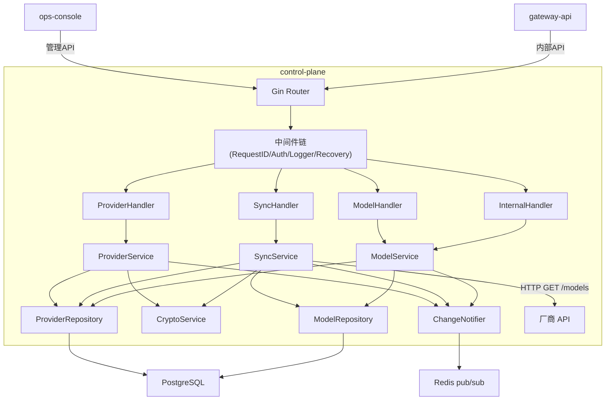

### 4.2 目录结构

```
control-plane/
├── cmd/
│   └── server/
│       └── main.go              # 启动入口
├── internal/
│   ├── config/
│   │   └── config.go            # 配置加载（Viper）
│   ├── handler/
│   │   ├── provider.go          # 渠道管理 Handler
│   │   ├── model.go             # 模型管理 Handler
│   │   ├── sync.go              # 同步模型 Handler
│   │   └── internal.go          # 内部接口 Handler
│   ├── middleware/
│   │   ├── auth.go              # JWT / Token 认证
│   │   ├── requestid.go         # 请求 ID 注入
│   │   ├── logger.go            # 结构化日志
│   │   └── ratelimit.go         # 限流
│   ├── service/
│   │   ├── provider.go          # 渠道业务逻辑
│   │   ├── model.go             # 模型业务逻辑
│   │   ├── sync.go              # 同步模型业务逻辑
│   │   ├── crypto.go            # 凭证加解密
│   │   └── notifier.go          # Redis 变更通知
│   ├── repository/
│   │   ├── provider.go          # 渠道数据访问
│   │   └── model.go             # 模型数据访问
│   ├── model/
│   │   ├── provider.go          # 渠道实体定义
│   │   └── model.go             # 模型实体定义
│   ├── dto/
│   │   ├── provider.go          # 渠道请求/响应 DTO
│   │   ├── model.go             # 模型请求/响应 DTO
│   │   └── sync.go              # 同步请求/响应 DTO
│   └── errors/
│       └── errors.go            # 业务错误定义
├── migrations/
│   └── 001_init_schema.sql      # 数据库迁移脚本
├── go.mod
├── go.sum
└── Dockerfile
```

---

## 5. 关键流程设计

### 5.1 创建渠道

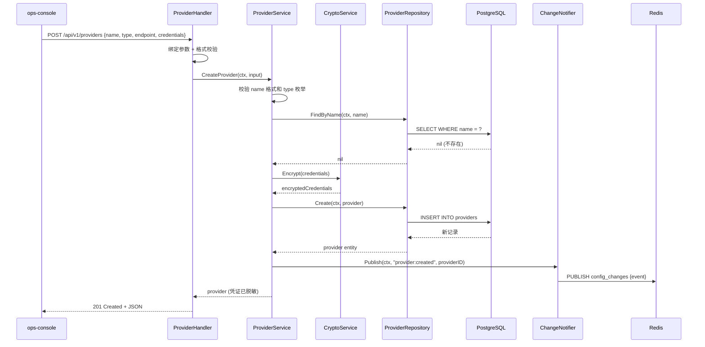

### 5.2 注册模型

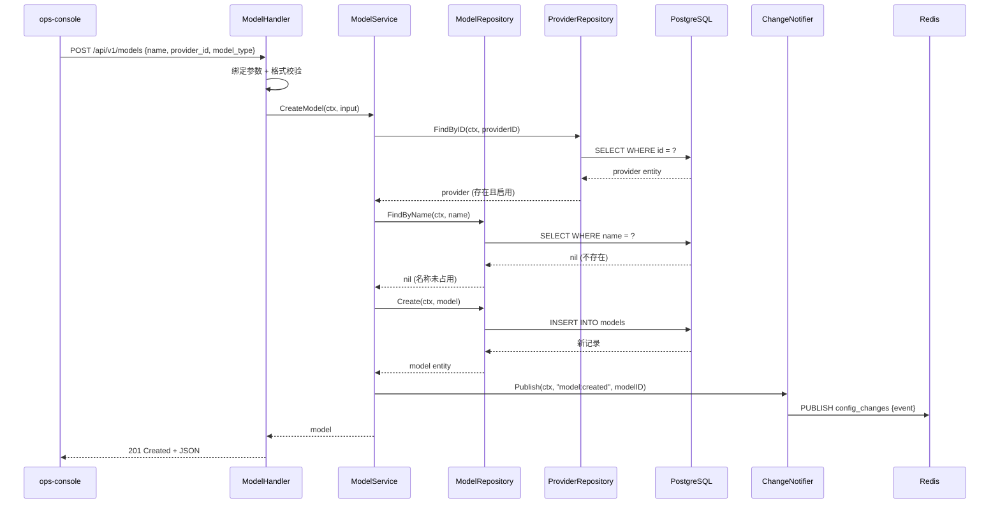

### 5.3 禁用渠道级联

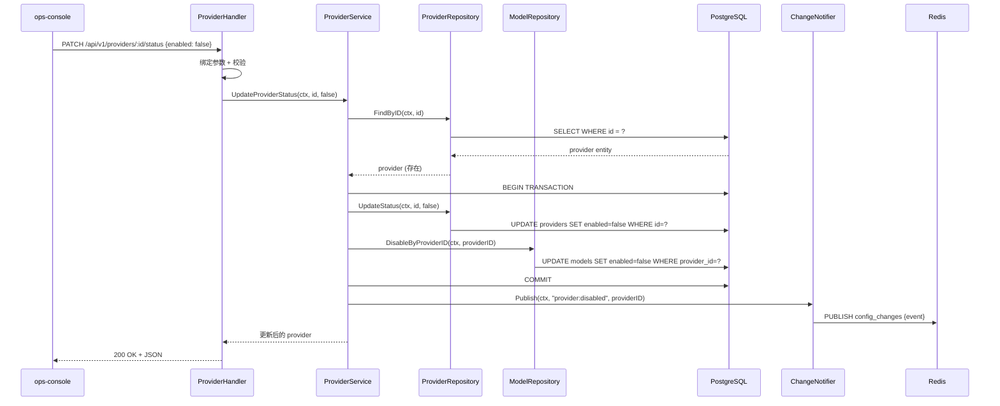

### 5.4 同步模型（拉取对比）

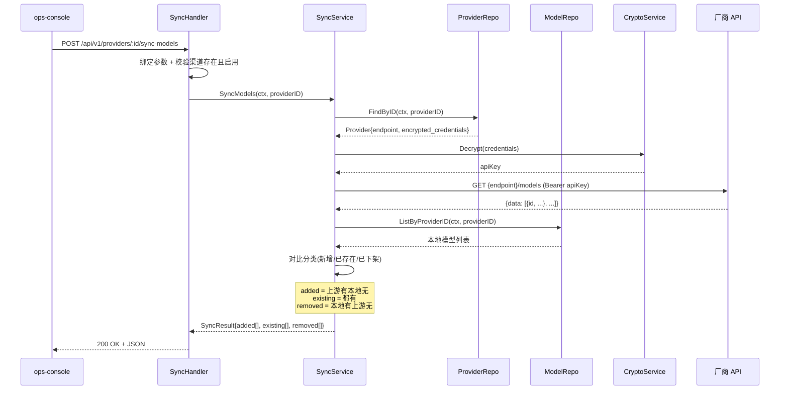

### 5.5 确认同步（批量注册+禁用）

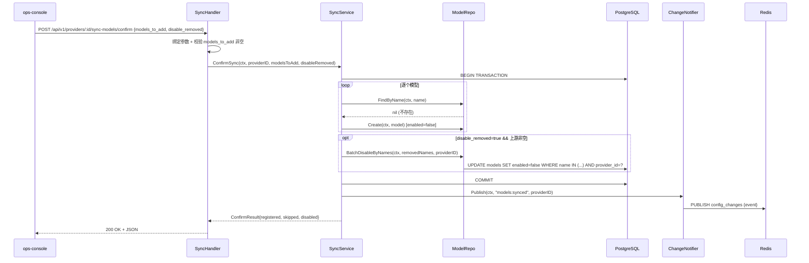

---

## 6. 数据流转

### 6.1 系统数据流

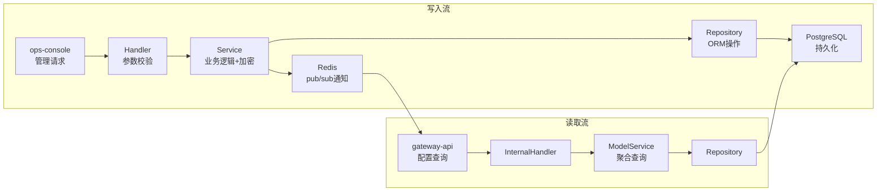

### 6.2 核心数据流转说明

| 数据 | 入口 | 处理环节 | 出口 | 持久化 |
| :--- | :--- | :--- | :--- | :--- |
| 渠道配置 | POST /api/v1/providers | 参数校验 → 唯一性检查 → 凭证加密 → 持久化 → 通知 | 201 JSON 响应（凭证脱敏） | providers 表 |
| 模型注册 | POST /api/v1/models | 参数校验 → 渠道存在性检查 → 名称唯一性 → 持久化 → 通知 | 201 JSON 响应 | models 表 |
| 可用模型配置 | GET /internal/v1/models/available | 聚合查询启用的模型+渠道信息 | 200 JSON 列表（含解密后凭证） | 只读查询 |
| 渠道状态变更 | PATCH /api/v1/providers/:id/status | 状态更新 → 级联更新模型 → 通知 | 200 JSON 响应 | providers + models 表 |

### 6.3 变更通知数据流

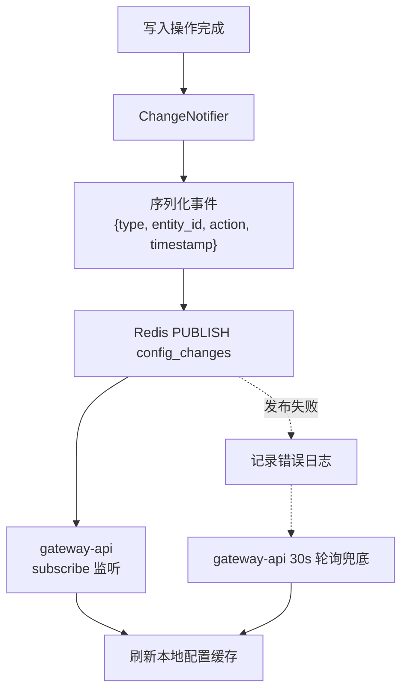

---

## 7. 分层职责落实

### 7.1 Handler 层

> Handler 只做：请求解析、参数绑定与格式校验、调用 Service、响应序列化。不含业务逻辑。

**ProviderHandler 输入校验：**

| 字段 / 参数 | 校验规则 | 失败时 |
| :--- | :--- | :--- |
| `name` | 非空，长度 2–64，仅允许字母数字下划线连字符 | 400 |
| `type` | 枚举值：bailian / deepseek / bedrock / litellm | 400 |
| `endpoint` | 非空，合法 URL 格式 | 400 |
| `credentials` | 非空，JSON 对象 | 400 |
| `enabled`（状态变更） | 布尔值 | 400 |

**ModelHandler 输入校验：**

| 字段 / 参数 | 校验规则 | 失败时 |
| :--- | :--- | :--- |
| `name` | 非空，长度 2–128，全局唯一 | 400 |
| `provider_id` | 非空，合法 UUID 格式 | 400 |
| `model_type` | 枚举值：chat / embedding | 400 |

**SyncHandler 输入校验：**

| 字段 / 参数 | 校验规则 | 失败时 |
| :--- | :--- | :--- |
| `:id`（path） | 非空，合法 UUID 格式，渠道必须存在且启用 | 404 / 400 |
| `models_to_add`（confirm body） | 非空数组，每个元素长度 2–128 | 400 |
| `disable_removed`（confirm body） | 布尔值，可选，默认 true | 400 |

### 7.2 Service 层

> 包含全部业务逻辑和事务编排，不处理 HTTP 细节。

**ProviderService 公开方法：**

| 方法签名 | 职责 | 事务 | 抛出异常 |
| :--- | :--- | :---: | :--- |
| `Create(ctx, input CreateProviderInput) (*Provider, error)` | 校验唯一性，加密凭证，创建渠道，发布通知 | 是 | ConflictError, CryptoError |
| `List(ctx, query ListQuery) (*PageResult, error)` | 分页查询渠道列表，凭证脱敏 | 否 | — |
| `GetByID(ctx, id string) (*Provider, error)` | 查询单个渠道详情，凭证脱敏 | 否 | NotFoundError |
| `Update(ctx, id string, input UpdateProviderInput) (*Provider, error)` | 更新渠道信息，如有凭证则重新加密，发布通知 | 是 | NotFoundError, ConflictError |
| `UpdateStatus(ctx, id string, enabled bool) (*Provider, error)` | 更新渠道状态，禁用时级联禁用模型，发布通知 | 是 | NotFoundError |
| `Delete(ctx, id string) error` | 检查是否有关联模型，有则阻断，无则删除，发布通知 | 是 | NotFoundError, HasModelsError |

**ModelService 公开方法：**

| 方法签名 | 职责 | 事务 | 抛出异常 |
| :--- | :--- | :---: | :--- |
| `Create(ctx, input CreateModelInput) (*Model, error)` | 校验渠道存在且启用，校验名称唯一，创建模型，发布通知 | 是 | NotFoundError, ConflictError, ProviderDisabledError |
| `List(ctx, query ModelListQuery) (*PageResult, error)` | 分页查询模型列表，支持按 provider_id 过滤 | 否 | — |
| `Update(ctx, id string, input UpdateModelInput) (*Model, error)` | 更新模型信息，发布通知 | 是 | NotFoundError, ConflictError |
| `Delete(ctx, id string) error` | 删除模型，发布通知 | 是 | NotFoundError |
| `ListAvailable(ctx) ([]*ModelWithProvider, error)` | 查询所有启用的模型及其渠道信息（含解密凭证），供 gateway-api 使用 | 否 | — |

**SyncService 公开方法：**

| 方法签名 | 职责 | 事务 | 抛出异常 |
| :--- | :--- | :---: | :--- |
| `SyncModels(ctx, providerID string) (*SyncResult, error)` | 查询渠道信息，解密凭证，调厂商 API 拉取模型列表，与本地对比分类 | 否 | NotFoundError, ProviderDisabledError, SyncNotSupportedError, UpstreamError |
| `ConfirmSync(ctx, providerID string, modelsToAdd []string, disableRemoved bool) (*ConfirmResult, error)` | 批量注册新模型（enabled=false），禁用已下架模型，发布通知 | 是 | NotFoundError |

**业务规则：**
- 渠道名称全局唯一，不允许重复创建同名渠道
- 模型名称全局唯一（跨渠道），不允许重复注册同名模型
- 一个模型只能注册在一个渠道下（1:N 关系）
- 禁用渠道时其下所有模型自动标记为 disabled
- 删除渠道前必须先移除所有模型注册，否则返回 409
- 不允许在已禁用的渠道下注册新模型

**跨模块调用：**

| 依赖模块 | 调用时机 | 失败处理 |
| :--- | :--- | :--- |
| Redis（ChangeNotifier） | 创建/更新/删除/状态变更操作完成后 | 通知失败不回滚主事务，仅记录错误日志 |

### 7.3 Repository 层

> 封装全部数据库操作，向 Service 屏蔽 GORM 细节。

**ProviderRepository：**

| 方法签名 | 操作 | 说明 |
| :--- | :--- | :--- |
| `Create(ctx, *Provider) error` | INSERT | 唯一约束冲突返回 ConflictError |
| `FindByID(ctx, id string) (*Provider, error)` | SELECT | 不存在返回 nil, nil |
| `FindByName(ctx, name string) (*Provider, error)` | SELECT | 用于唯一性检查 |
| `List(ctx, query ListQuery) ([]*Provider, int64, error)` | SELECT + COUNT | 支持分页、排序 |
| `Update(ctx, id string, updates map[string]interface{}) error` | UPDATE | 不存在返回 NotFoundError |
| `UpdateStatus(ctx, id string, enabled bool) error` | UPDATE | 更新 enabled 字段 |
| `Delete(ctx, id string) error` | DELETE | 物理删除 |

**ModelRepository：**

| 方法签名 | 操作 | 说明 |
| :--- | :--- | :--- |
| `Create(ctx, *Model) error` | INSERT | 唯一约束冲突返回 ConflictError |
| `FindByID(ctx, id string) (*Model, error)` | SELECT | 不存在返回 nil, nil |
| `FindByName(ctx, name string) (*Model, error)` | SELECT | 用于唯一性检查 |
| `List(ctx, query ModelListQuery) ([]*Model, int64, error)` | SELECT + COUNT | 支持按 provider_id 过滤、分页 |
| `CountByProviderID(ctx, providerID string) (int64, error)` | COUNT | 删除渠道前检查 |
| `Update(ctx, id string, updates map[string]interface{}) error` | UPDATE | 不存在返回 NotFoundError |
| `DisableByProviderID(ctx, providerID string) error` | UPDATE | 批量禁用渠道下所有模型 |
| `Delete(ctx, id string) error` | DELETE | 物理删除 |
| `ListAvailableWithProvider(ctx) ([]*ModelWithProvider, error)` | SELECT + JOIN | 查询 enabled=true 的模型及其渠道信息 |

### 7.4 DTO 与领域对象映射

| 类型 | 用途 | 转换时机 |
| :--- | :--- | :--- |
| CreateProviderRequest | 接收 POST /api/v1/providers 请求体 | Handler 入口绑定 |
| UpdateProviderRequest | 接收 PUT /api/v1/providers/:id 请求体 | Handler 入口绑定 |
| ProviderResponse | 序列化渠道响应体（凭证脱敏） | Handler 出口 |
| CreateModelRequest | 接收 POST /api/v1/models 请求体 | Handler 入口绑定 |
| UpdateModelRequest | 接收 PUT /api/v1/models/:id 请求体 | Handler 入口绑定 |
| ModelResponse | 序列化模型响应体 | Handler 出口 |
| ModelAvailableResponse | 序列化内部接口模型+渠道响应 | InternalHandler 出口 |
| SyncModelsResponse | 序列化同步拉取对比响应 | SyncHandler 出口 |
| ConfirmSyncRequest | 接收 POST /providers/:id/sync-models/confirm 请求体 | SyncHandler 入口绑定 |
| ConfirmSyncResponse | 序列化确认同步响应 | SyncHandler 出口 |
| Provider (entity) | 数据库持久化对象 | Repository ↔ Service |
| Model (entity) | 数据库持久化对象 | Repository ↔ Service |

> **安全规则**：以下字段禁止序列化到 ProviderResponse：`encrypted_credentials`（原始密文）。凭证仅返回脱敏格式 `credential_hint`（尾 4 位）。内部接口 `ListAvailable` 返回解密后的完整凭证供 gateway-api 使用。

---

## 8. 异常处理链

### 8.1 异常类型

| 异常类 | 抛出层 | 语义 |
| :--- | :--- | :--- |
| NotFoundError | Repository / Service | 资源不存在 |
| ConflictError | Repository / Service | 资源名称冲突或唯一约束违反 |
| HasModelsError | Service | 渠道下存在模型，不允许删除 |
| ProviderDisabledError | Service | 渠道已禁用，不允许注册模型 |
| SyncNotSupportedError | Service | 渠道类型不支持模型列表同步 |
| UpstreamError | Service | 厂商 API 调用失败或超时 |
| ValidationError | Handler | 请求参数格式校验失败 |
| UnauthorizedError | Middleware | 认证失败（Token 无效或过期） |
| InternalError | 任意层 | 未预期的系统错误 |

### 8.2 HTTP 状态码映射

| 异常类 | HTTP 状态 | 错误码 | 备注 |
| :--- | :---: | :--- | :--- |
| ValidationError | 400 | E4001 | 请求参数校验失败 |
| UnauthorizedError | 401 | E4011 | 认证失败 |
| NotFoundError | 404 | E4041 | 资源不存在 |
| ConflictError | 409 | E4091 | 名称冲突 |
| HasModelsError | 409 | E4092 | 渠道下有模型，不可删除 |
| ProviderDisabledError | 422 | E4221 | 渠道已禁用 |
| SyncNotSupportedError | 400 | E4222 | 渠道类型不支持自动同步 |
| UpstreamError | 502 | E5021 | 厂商 API 调用失败 |
| InternalError | 500 | E5001 | 不暴露内部细节 |

---

## 9. 数据库设计要点

* **分库分表策略**：不需要。管理面数据量小（预估渠道 < 100，模型 < 1000），单表即可满足。
* **索引设计原则**：providers 表对 name 建唯一索引；models 表对 name 建唯一索引，对 provider_id 建普通索引（高频按渠道过滤查询）。
* **迁移方案**：使用 golang-migrate 管理 SQL 迁移脚本，版本号格式 `{序号}_{描述}.up.sql / .down.sql`，CI 中自动执行迁移。

---

## 10. 接口设计要点

* **版本控制**：URL 路径前缀 `/api/v1`（管理接口）和 `/internal/v1`（内部接口），Breaking Change 时升级为 v2。
* **认证鉴权**：管理接口使用 JWT Bearer Token（RS256 验签），要求 token 中含 `role: admin`；内部接口使用预共享 Token 验证。
* **限流策略**：管理接口按客户端 IP 限制 60 次/分钟；内部接口不限流（信任的内部服务）。

---

## 11. 错误处理与容灾

| 故障场景 | 检测方式 | 处理策略 | 恢复方案 |
| :--- | :--- | :--- | :--- |
| PostgreSQL 不可用 | GORM 连接错误 + 就绪探针失败 | 返回 503 Service Unavailable；K8s 停止分发流量 | GORM 连接池自动重连 |
| Redis 不可用 | Publish 返回错误 | 主操作正常完成，通知失败仅记录 error 日志 | 自动重连；gateway-api 轮询兜底 |
| 加密密钥不可用 | 启动时校验 / Encrypt 调用失败 | 启动时缺失则服务拒绝启动；运行时失败返回 500 | 修复密钥配置后重启 |
| 并发唯一约束冲突 | DB 返回 duplicate key 错误 | 转换为 409 Conflict 返回客户端 | 客户端换名重试 |

---

## 12. 性能设计

* **QPS 目标**：管理接口写入 < 10 QPS；内部接口读取 < 100 QPS（gateway-api 启动时全量拉取 + 变更时增量刷新）
* **响应时间**：P95 ≤ 50 ms（简单 CRUD + 单表查询）；P99 ≤ 100 ms
* **缓存策略**：control-plane 本身不做缓存（作为配置源，直接读 DB 保证一致性）；gateway-api 侧缓存配置数据
* **异步处理**：Redis pub/sub 通知为异步发送（goroutine 内执行），不阻塞主请求响应

---

## 13. 测试矩阵

| 测试目标 | 测试类型 | 通过条件 |
| :--- | :--- | :--- |
| Handler 参数校验 | 单元测试 | 非法输入返回 400 + 对应错误码；合法输入正确调用 Service |
| Service 业务规则 | 单元测试（Mock Repository） | 唯一性冲突返回 ConflictError；级联禁用正确执行；删除前检查正确阻断 |
| Service 事务完整性 | 集成测试 | 禁用渠道时 provider + models 状态在同一事务中更新 |
| Repository CRUD | 集成测试（测试库） | 增删改查结果与预期一致；唯一约束生效 |
| 凭证加解密 | 单元测试 | 加密后密文不等于明文；解密后还原一致；密钥错误解密失败 |
| 凭证脱敏 | 单元测试 | 管理接口响应中不包含完整凭证，只含尾 4 位 |
| 认证中间件 | 单元测试 | 无 Token 返回 401；无效 Token 返回 401；有效 Token 放行 |
| Redis 通知 | 集成测试 | 写入操作后 Redis channel 收到正确格式的消息 |
| 内部接口 | 集成测试 | 返回所有启用模型+渠道信息；禁用的模型/渠道不出现 |
| 异常映射 | 单元测试 | 每种业务异常正确映射到 HTTP 状态码和错误码 |

---

## 14. 设计决策记录

### 决策 1：渠道凭证存储方案

* **问题**：渠道凭证（API Key、Secret 等）如何安全存储？
* **候选方案**：
  * A — 明文存储 + 数据库级加密（TDE）：运维简单 / 应用层无法控制访问粒度，备份和日志可能泄露明文
  * B — 应用层 AES-256-GCM 加密存储：控制粒度精细，解密仅在需要时发生 / 需管理加密密钥
  * C — 外部密钥管理服务（Vault）：安全等级最高 / 引入外部依赖，增加复杂度和延迟
* **决策**：选择方案 B
* **理由**：在当前阶段提供足够的安全保障且无需引入外部服务依赖；Go 标准库原生支持 AES-GCM；密钥通过环境变量注入，未来可平滑迁移到 Vault。

### 决策 2：模型与渠道关联模型

* **问题**：模型和渠道的关联关系如何设计？
* **候选方案**：
  * A — 1:N 关系（一个模型只属于一个渠道）：简单直接，model name 可做全局唯一 / 同一模型名不能在多个渠道注册
  * B — M:N 关系（一个模型可注册多个渠道做负载均衡）：灵活 / 增加复杂度，路由策略需要额外设计
* **决策**：选择方案 A
* **理由**：当前需求明确一个模型名称对应唯一的渠道后端，全局唯一的 model name 使得 gateway-api 路由逻辑最简化；未来如需多渠道负载均衡可通过模型组抽象扩展（不在本次范围）。

### 决策 3：配置变更通知机制

* **问题**：control-plane 配置变更后如何通知 gateway-api 刷新缓存？
* **候选方案**：
  * A — 轮询：gateway-api 定时拉取配置 / 实时性差（取决于轮询间隔）
  * B — Redis pub/sub：实时推送 + 轮询兜底 / pub/sub 消息不持久化，订阅方断线期间消息丢失
  * C — 消息队列（Kafka）：消息持久化，保证投递 / 过度设计，引入重依赖
* **决策**：选择方案 B
* **理由**：Redis 已在技术栈中，pub/sub 实现简单且实时性好；配合 gateway-api 侧 30s 定时轮询作为兜底，可覆盖网络闪断导致的消息丢失场景。配置变更频率极低，偶尔延迟 30s 可接受。

### 决策 4：删除渠道的级联处理

* **问题**：删除渠道时其下模型如何处理？
* **候选方案**：
  * A — 级联删除：删除渠道时自动删除其下所有模型 / 操作不可逆，误操作风险高
  * B — 阻断删除：存在关联模型时拒绝删除 / 需要管理员手动逐个清理模型
  * C — 软删除 + 恢复：标记删除，保留恢复能力 / 增加复杂度
* **决策**：选择方案 B
* **理由**：管理面操作应当谨慎，阻断删除能有效防止误操作导致大面积服务中断；操作频率极低，手动清理模型的额外步骤在可接受范围内。

### 决策 5：同步接口拆为两步

* **问题**：模型同步是一次性完成还是分步？
* **候选方案**：
  * A — 一步完成：全量导入后管理员逐个禁用不需要的模型
  * B — 两步接口：先拉取对比展示结果 → 管理员勾选后再确认注册
* **决策**：选择方案 B
* **理由**：管理员需要在中间环节勾选确认，不能全量盲导入。两步设计允许管理员对新增模型做筛选，避免引入不需要的模型。第一步结果可在前端缓存，确认时直接提交勾选列表即可。

### 决策 6：下架检测防误禁用

* **问题**：上游返回空列表时是否禁用本地所有模型？
* **候选方案**：
  * A — 无论如何都执行禁用：逻辑一致但风险大
  * B — 空列表时不执行禁用，仅提示
* **决策**：选择方案 B
* **理由**：网络故障可能导致厂商 API 返回空结果而非真实空列表，全量禁用影响严重。空列表时跳过下架检测是更安全的策略，管理员可手动处理。

---

## 15. 变更记录 — CHG-20260523-001

## 变更摘要

新增 Key CRUD 功能：在现有 Handler → Service → Repository 分层架构中引入 KeyHandler / KeyService / KeyRepository 三层组件，提供 API Key 的自助创建（`sk-` 前缀、明文仅返回一次、AES-256-GCM 加密存储）、脱敏列表查询、禁用/启用/删除管理，Key 强绑定 `user_id` 构成鉴权链路 API Key → User → Department；新增内部 Key 验证接口供 gateway-api 实时校验。

---

## 1. 模块职责边界变更

**新增负责：**

- 员工自助创建 API Key（`sk-` 前缀，明文仅创建响应返回一次）
- 自有 Key 列表脱敏查询（仅展示末尾 4 位）
- 自有 Key 的禁用、启用、删除操作
- Key 与 `user_id` 强绑定，不可转让
- Key 内部验证接口（供 gateway-api 鉴权消费）

**不负责（仍排除）：**

- 基于 Key 的实际请求路由与转发（gateway-api 职责）
- Key 的用量统计与计费

**调用关系新增：**

| 方向 | 模块 | 方式 |
| :--- | :--- | :--- |
| 被调用 | gateway-api | POST `/internal/v1/keys/verify`（预共享 Token 认证） |

---

## 2. 架构变更

### 2.1 系统架构

> 在现有 ProviderHandler / ModelHandler / SyncHandler / InternalHandler 基础上新增 KeyHandler，在 ProviderService / ModelService / SyncService 基础上新增 KeyService，在 ProviderRepository / ModelRepository 基础上新增 KeyRepository。

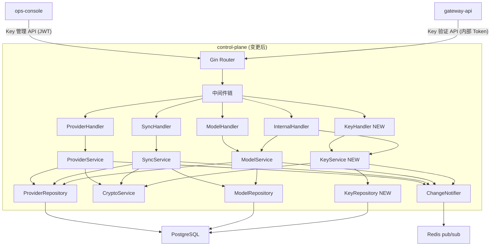

### 2.2 目录新增

```
control-plane/
├── internal/
│   ├── handler/
│   │   └── key_handler.go           # NEW - Key CRUD Handler
│   ├── service/
│   │   └── key_service.go           # NEW - Key 业务逻辑 Service
│   ├── repository/
│   │   └── key_repository.go        # NEW - Key 数据访问 Repository
│   ├── model/
│   │   └── key.go                   # NEW - Key 实体定义
│   └── dto/
│       └── key.go                   # NEW - Key 请求/响应 DTO
```

---

## 3. 关键流程设计

### 3.1 Key 创建流程

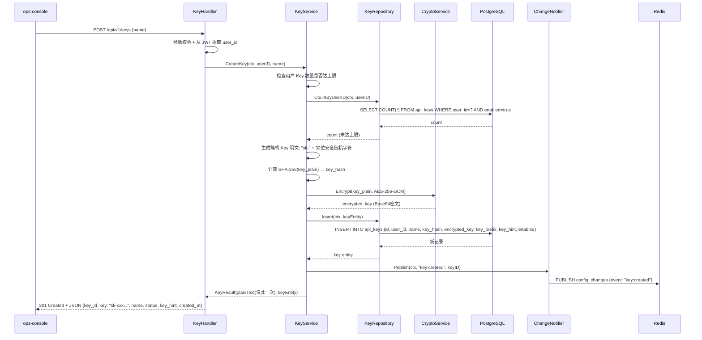

### 3.2 Key 列表查询

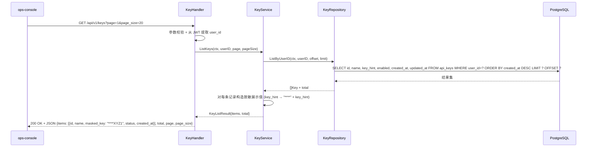

### 3.3 Key 禁用/启用

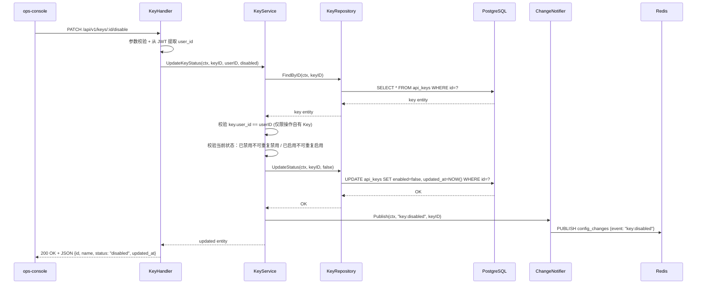

### 3.4 Key 验证（内部接口，供 gateway-api 消费）

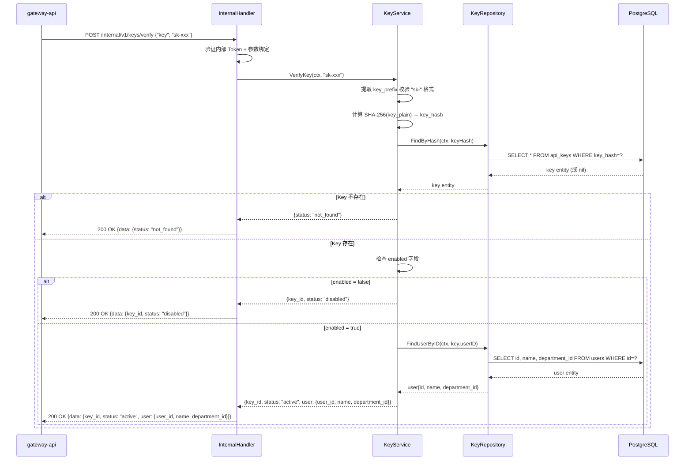

### 3.5 Key 删除

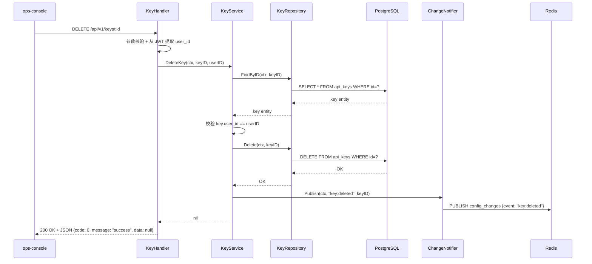

---

## 4. 分层职责落实

### 4.1 KeyHandler 层

> Handler 只做：请求解析、参数绑定与格式校验、从 JWT 提取 `user_id`、调用 Service、响应序列化。不含业务逻辑。

**KeyHandler 输入校验：**

| 字段 / 参数 | 校验规则 | 失败时 |
| :--- | :--- | :--- |
| `name`（创建 body） | 非空，长度 2–64，仅允许字母数字下划线连字符，不可含 `sk-` 开头 | 400 |
| `:id`（path） | 非空，合法 UUID v4 格式 | 400 |
| JWT `user_id` | 必须存在且非空 | 401 |
| `page`（query） | 正整数，默认 1 | 400 |
| `page_size`（query） | 正整数，默认 20，最大 100 | 400 |

### 4.2 KeyService 层

> 包含全部 Key 业务逻辑和事务编排，不处理 HTTP 细节。

**KeyService 公开方法：**

| 方法签名 | 职责 | 事务 | 抛出异常 |
| :--- | :--- | :---: | :--- |
| `CreateKey(ctx, userID, name string) (*KeyResult, error)` | 检查数量上限，生成 sk- Key 明文，SHA-256 哈希，AES-256-GCM 加密，持久化，返回明文（仅一次） | 是 | LimitExceededError, CryptoError |
| `ListKeys(ctx, userID string, page, pageSize int) (*KeyListResult, error)` | 按 user_id 分页查询，构造脱敏 Key 值（仅末尾 4 位） | 否 | — |
| `UpdateKeyStatus(ctx, keyID, userID string, enabled bool) (*Key, error)` | 校验归属权，检查状态幂等性（已禁用不可再禁用），更新启用/禁用状态，发布通知 | 是 | NotFoundError, ForbiddenError, ConflictError |
| `DeleteKey(ctx, keyID, userID string) error` | 校验归属权，物理删除 Key 记录，发布通知 | 是 | NotFoundError, ForbiddenError |
| `VerifyKey(ctx, keyPlain string) (*VerifyKeyResult, error)` | 校验 Key 格式（sk- 前缀），计算 SHA-256 查找，返回 key 状态及 user_id/dept_id 身份链路 | 否 | — |

**业务规则：**

- Key 明文格式：`sk-` + 32 位安全随机字符（大小写字母 + 数字），总长度 35
- 单用户启用 Key 数量上限：10 个（可配置），达上限返回 `LimitExceededError`
- Key 强绑定 `user_id`，不可更改绑定；操作他人 Key 返回 `ForbiddenError`
- Key 明文仅在 CreateKey 返回中提供一次，后续任何接口不返回明文
- `ListKeys` 中 Key 值以 `****` + 末尾 4 位展示
- `key_hash` 使用 SHA-256 计算：`hex(sha256("sk-xxxxxx"))`，用于唯一查找
- Key 验证：先查 `key_hash` 定位 → 判断 `enabled` → 查询 `users` 表获取 `user_id`、`name`、`department_id`
- 禁用操作幂等：对已禁用 Key 再次禁用返回 200 且提示"Key 已处于禁用状态"
- 删除为物理删除，不可恢复

**跨模块调用：**

| 依赖模块 | 调用时机 | 失败处理 |
| :--- | :--- | :--- |
| CryptoService | CreateKey 加密 Key 明文 | 加密失败返回 500 内部错误 |
| ChangeNotifier（Redis） | 创建/禁用/启用/删除操作完成后 | 通知失败不回滚主事务，仅记录 error 日志 |
| users 表查询 | VerifyKey 查 user_id + department_id | 用户不存在返回 status "not_found" |

### 4.3 KeyRepository 层

> 封装全部 api_keys 表操作，向 Service 屏蔽 GORM 细节。

**KeyRepository 方法：**

| 方法签名 | 操作 | 说明 |
| :--- | :--- | :--- |
| `Insert(ctx, *Key) error` | INSERT | `key_hash` 唯一约束冲突返回 ConflictError |
| `FindByID(ctx, id string) (*Key, error)` | SELECT | 不存在返回 nil, nil |
| `FindByHash(ctx, hash string) (*Key, error)` | SELECT | 按 `key_hash` 唯一索引查找，用于 VerifyKey |
| `ListByUserID(ctx, userID string, offset, limit int) ([]*Key, int64, error)` | SELECT + COUNT | 按 `user_id` 过滤 + 分页，按 `created_at DESC` 排序 |
| `CountByUserID(ctx, userID string, enabledOnly bool) (int64, error)` | COUNT | 检查用户 Key 数量上限，支持仅统计启用 Key |
| `UpdateStatus(ctx, id string, enabled bool) error` | UPDATE | 更新 `enabled` 和 `updated_at` |
| `Delete(ctx, id string) error` | DELETE | 物理删除，不存在返回 NotFoundError |
| `FindUserByID(ctx, userID string) (*User, error)` | SELECT | 查询 users 表（只读），返回 user_id, name, department_id |

### 4.4 DTO 与领域对象映射

| 类型 | 用途 | 转换时机 |
| :--- | :--- | :--- |
| `CreateKeyRequest` | 接收 POST /api/v1/keys 请求体 | KeyHandler 入口绑定 |
| `CreateKeyResponse` | 序列化 Key 创建响应（含唯一明文） | KeyHandler 出口 |
| `KeyListResponse` | 序列化 Key 列表响应（Key 值脱敏） | KeyHandler 出口 |
| `UpdateKeyStatusRequest` | 接收 PATCH /api/v1/keys/:id/disable 或 .../enable 请求体 | KeyHandler 入口绑定 |
| `VerifyKeyRequest` | 接收 POST /internal/v1/keys/verify 请求体 | InternalHandler 入口绑定 |
| `VerifyKeyResponse` | 序列化 Key 验证响应 | InternalHandler 出口 |
| `Key` (entity) | 数据库持久化对象 | Repository ↔ Service |
| `User` (entity) | users 表只读查询对象 | Repository ↔ Service |
| `KeyResult` | Service 层返回创建结果（含明文） | Service → Handler |
| `KeyListResult` | Service 层返回分页列表结果 | Service → Handler |
| `VerifyKeyResult` | Service 层返回验证结果 | Service → Handler |

> **安全规则**：`key_hash`、`encrypted_key` 字段禁止序列化到任何外部响应。`CreateKeyResponse.key` 包含明文 Key，创建后服务端不保留明文，后续任何接口不再返回。`KeyListResponse.masked_key` 仅包含 `"****"` + 末尾 4 位。

---

## 5. 异常处理链

### 5.1 新增异常类型

| 异常类 | 抛出层 | 语义 |
| :--- | :--- | :--- |
| `KeyNameConflictError` | Repository | Key 名称在同一 user_id 下重复 |
| `KeyNotFoundError` | Repository / Service | Key 不存在或已被删除 |
| `KeyForbiddenError` | Service | 尝试操作非自有 Key |
| `KeyLimitExceededError` | Service | 用户启用 Key 数量已达上限 |
| `KeyAlreadyDisabledError` | Service | Key 已处于禁用状态，重复操作 |
| `KeyAlreadyEnabledError` | Service | Key 已处于启用状态，重复操作 |

### 5.2 新增 HTTP 状态码映射

| 异常类 | HTTP 状态 | 错误码 | 备注 |
| :--- | :---: | :--- | :--- |
| `KeyLimitExceededError` | 422 | E4223 | 启用 Key 数量已达上限 |
| `KeyNotFoundError` | 404 | E4042 | Key 不存在 |
| `KeyNameConflictError` | 409 | E4093 | 同用户下 Key 名称冲突 |
| `KeyForbiddenError` | 403 | E4031 | 无权操作他人 Key |
| `KeyAlreadyDisabledError` | 409 | E4094 | Key 已处于禁用状态 |
| `KeyAlreadyEnabledError` | 409 | E4095 | Key 已处于启用状态 |

### 5.3 错误场景说明

| 场景 | 触发条件 | 错误码 | message 示例 |
| :--- | :--- | :--- | :--- |
| 创建 Key 名称冲突 | 同 user_id 下已存在同名 Key | E4093 | `"Key 名称 'my-key' 已存在"` |
| Key 不存在 | 对不存在的 Key 执行操作 | E4042 | `"Key 不存在或已被删除"` |
| 操作他人 Key | user_id 不匹配 | E4031 | `"无权操作该 Key"` |
| Key 数量达上限 | 用户启用 Key 数 > 10 | E4223 | `"已达最大 Key 数量限制（10），请先禁用或删除不再使用的 Key"` |
| 重复禁用 | 对已禁用的 Key 执行禁用 | E4094 | `"Key 已处于禁用状态"` |
| 重复启用 | 对已启用的 Key 执行启用 | E4095 | `"Key 已处于启用状态"` |

---

## 6. 设计决策记录

### 决策 7：Key 存储方案 — hash + 密文双字段

* **问题**：API Key 如何安全存储同时支持高效验证？
* **候选方案**：
  * A — 仅存储密文：需要时解密比对 / 验证需遍历全表解密每条记录，性能不可接受
  * B — 存储 hash + 密文：hash 用于快速唯一查找，密文用于未来可能需要解密场景 / 冗余存储，hash 碰撞极低概率（SHA-256）
  * C — 仅存储 hash，不保留密文：最安全，Key 完全不可恢复 / 未来无法支持 Key 轮转、审计回溯等需求
* **决策**：选择方案 B
* **理由**：SHA-256 加盐 hash 提供 O(1) 查找性能，避免全表扫描；AES-256-GCM 加密密文保留完整的 Key 信息，为未来 Key 轮转、审计、导出提供可能。两个字段各司其职：hash 用于高频验证读，密文用于低频管理写。加密方案复用已有 CryptoService（AES-256-GCM，与渠道凭证方案一致）。

### 决策 8：Key 验证接口设计 — 内部 POST + 实时查库

* **问题**：gateway-api 如何验证 API Key？
* **候选方案**：
  * A — JWT Token 发放：用户在 ops-console 创建 Key 时签发 JWT / JWT 无法撤消（需维护黑名单），过期时间管理复杂
  * B — 内部 HTTP 接口实时查库：gateway-api 每次调用验证 / 增加一次网络 RTT，但对接口延迟影响可接受（内网 < 5ms）
  * C — Redis 缓存验证结果：gateway-api 本地缓存 / 缓存更新延迟导致禁用 Key 在窗口期内仍可通过
* **决策**：选择方案 B
* **理由**：需求明确"禁用 Key 立即失效"，实时查库是最简单可靠的保证。内网 RTT 可控制在 5ms 以内，对 LLM 调用总延迟（通常 1s+）影响可忽略。key_hash 唯一索引保证查询效率。如未来 QPS 升高，可在 gateway-api 侧添加短 TTL 缓存（如 1s），配合 Redis pub/sub 失效通知。

### 决策 9：禁用/启用端点设计 — 独立语义端点

* **问题**：状态变更是用单一 `PATCH /status` 端点还是独立端点？
* **候选方案**：
  * A — 单一端点 `PATCH /api/v1/keys/:id/status`，body 传 `{enabled: bool}` / 简单统一，但与 rbac 审计日志联动不便
  * B — 独立语义端点 `PATCH /api/v1/keys/:id/disable` 和 `.../enable` / URL 自描述操作语义，审计日志自动捕获操作类型
* **决策**：选择方案 B
* **理由**：独立端点语义更清晰，URL 直接表达操作意图，便于审计日志、监控告警和限流策略区分 disable 和 enable 操作。操作审计是安全合规的基础。

---

## 7. 错误处理与容灾

| 故障场景 | 检测方式 | 处理策略 | 恢复方案 |
| :--- | :--- | :--- | :--- |
| `key_hash` 哈希碰撞 | INSERT 时唯一约束冲突 | 重新生成 Key 明文（极低概率） | 自动重试，最多 3 次 |
| Key 数量上限检查并发 | 唯一约束未覆盖计数 | 查询时使用 `FOR UPDATE` 锁用户行 | 重试或返回上限错误 |
| 禁用 Key 与并发调用的窗口期 | 数据库更新未同步至 gateway-api 缓存 | 实时查库保证一致性，窗口期 < 1s | 可接受边界 |
| 用户被注销后 Key 验证 | users 表无对应记录 | 返回 status "not_found"，gateway-api 拒绝请求 | 管理员手动清理 Key |

---

## 8. 测试矩阵

| 测试目标 | 测试类型 | 通过条件 |
| :--- | :--- | :--- |
| KeyHandler 参数校验 | 单元测试 | 非法 name 返回 400；无 JWT user_id 返回 401 |
| KeyService 创建流程 | 单元测试（Mock Repository） | 数量未超限时成功返回明文；超限返回 LimitExceededError；同名冲突返回 ConflictError |
| KeyService 归属校验 | 单元测试 | 操作他人 Key 返回 ForbiddenError；操作自己 Key 成功 |
| KeyService 状态幂等 | 单元测试 | 重复禁用返回 KeyAlreadyDisabledError；重复启用返回 KeyAlreadyEnabledError |
| KeyService VerifyKey | 单元测试（Mock Repository） | 有效 Key 返回 active + user info；禁用 Key 返回 disabled；不存在 Key 返回 not_found |
| KeyService 脱敏条目 | 单元测试 | ListKeys 返回的 masked_key 仅包含末尾 4 位，其余为 `****` |
| KeyRepository CRUD | 集成测试（测试库） | Insert/FindByID/FindByHash/ListByUserID/UpdateStatus/Delete 结果与预期一致 |
| 密钥加密存储 | 单元测试 | 加密后密文不等于明文；key_hash 一致可查找到记录 |
| 内部接口认证 | 单元测试 | 无内部 Token 返回 401；无效 Token 返回 401 |
| Redis 通知 | 集成测试 | 创建/禁用/启用/删除操作后 Redis channel 收到正确事件 |
| 用户注销场景 | 集成测试 | 无对应用户记录时 VerifyKey 返回 not_found |

---

## 9. 变更历史

| 版本号 | 修改日期 | 修改内容摘要 | 修改人 |
| :--- | :--- | :--- | :--- |
| v1.2 | 2026-05-23 | 新增 Key CRUD 功能（KeyHandler / KeyService / KeyRepository）；新增内部 Key 验证接口；新增 api_keys 表 | OpenCode |

---

## 16. 变更记录 — CHG-20260525-001

## 变更摘要

在现有 Handler→Service→Repository 分层架构中新增模型组管理层（GroupHandler、GroupService、GroupRepository）及组内模型关联管理层（GroupModelHandler、GroupModelService），新增 Scheduler 内部配置读取端点。现有渠道、模型和 Key 管理不受影响。

---

## 1. 设计决策

### 决策 10：模型组存储方案 — model_groups + group_models 双表

- **问题**：模型组及其路由策略如何存储？
- **候选方案**：
  - A — 单表存储，group 内嵌 model 列表 JSON 字段：简单 / JSON 字段无法建立外键约束和索引，查询效率低
  - B — model_groups 主表 + group_models 关联表：标准化关系模型，支持外键级联和索引 / 多一次 JOIN
  - C — 在 models 表加 group_id 字段：实现最简单 / 一个模型只能属于一个组，无法满足跨组需求
- **决策**：选择方案 B
- **理由**：需求明确"一个模型可同时属于多个组"，必须使用 M:N 关联表。标准化设计支持外键约束保证数据一致性、独立索引优化关联查询。策略参数（priority/weight）天然属于关联边属性，放在 group_models 表中语义清晰。

### 决策 11：组删除策略 — 软删除 + 禁用而非级联清理

- **问题**：删除模型组时组内关联模型如何处理？
- **候选方案**：
  - A — 级联删除 group_models 关联后删除 group：简单直接 / 操作不可逆，group 重新创建需重新配置所有模型关联
  - B — 先禁用 group，要求管理员清空组内模型后方可物理删除：安全 / 操作步骤多
  - C — 软删除 group，关联表保留，scheduler 自动跳过 disabled 的 group：恢复方便 / group 记录保留
- **决策**：选择方案 C
- **理由**：模型组是调度基础设施，误删影响面大。软删除保留恢复能力，scheduler 读取配置时过滤 `enabled=false` 的组即可。group_models 关联表在组禁用后无需清理，组恢复后策略配置完整保留。

### 决策 12：Scheduler 配置读取 — 内部端点 + 预共享 Token

- **问题**：scheduler 如何获取模型组配置？
- **候选方案**：
  - A — scheduler 直接读 PostgreSQL：减少一跳 / 数据库耦合，schema 变更影响 scheduler
  - B — 内部 HTTP 接口 GET /api/v1/internal/groups：通过 control-plane API 层读取，schema 变更对 scheduler 透明 / 增加一次 HTTP 调用
  - C — Redis 缓存 + pub/sub 推送：实时性好 / 缓存一致性维护复杂，pub/sub 消息可能丢失
- **决策**：选择方案 B
- **理由**：与现有 `/internal/v1/models/available` 内部接口模式一致，scheduler 通过 API 读取配置，不直接依赖数据库 schema。预共享 Token 认证复用已有内部接口安全机制。group 配置变更频率极低，HTTP 读取延迟可接受（内网 < 5ms）。

---

## 2. 新增组件详细设计

### 2.1 GroupHandler

> HTTP 入口层，只做：请求解析、参数绑定与格式校验、调用 Service、响应序列化。不含业务逻辑。

**注册端点：**

| 端点 | 方法 | 路径 | 用途 |
| :--- | :---: | :--- | :--- |
| 创建模型组 | POST | `/api/v1/groups` | 创建新的模型组 |
| 模型组列表 | GET | `/api/v1/groups` | 分页查询模型组列表 |
| 模型组详情 | GET | `/api/v1/groups/:id` | 查询单个组详情（含模型列表） |
| 更新模型组 | PUT | `/api/v1/groups/:id` | 更新组名称、描述、策略 |
| 删除模型组 | DELETE | `/api/v1/groups/:id` | 软删除模型组 |

**输入校验：**

| 字段 / 参数 | 校验规则 | 失败时 |
| :--- | :--- | :--- |
| `name`（创建/更新 body） | 非空，长度 2–64，仅允许字母数字下划线连字符 | 400 |
| `description`（创建 body） | 可选，长度 ≤ 512 | 400 |
| `strategy`（创建/更新 body） | 枚举值：`round_robin` / `priority` / `weighted` | 400 |
| `:id`（path） | 非空，合法 UUID 格式 | 400 |
| `page`（query） | 正整数，默认 1 | 400 |
| `page_size`（query） | 正整数，默认 20，最大 100 | 400 |
| `search`（query） | 可选，按名称模糊搜索，长度 ≤ 64 | 400 |

**请求/响应结构：**

```json
// POST /api/v1/groups — Request
{
  "name": "日常推理",
  "description": "用于日常对话推理任务的模型组",
  "strategy": "round_robin"
}

// POST /api/v1/groups — Response (201)
{
  "code": 0,
  "message": "success",
  "data": {
    "id": "550e8400-e29b-41d4-a716-446655440010",
    "name": "日常推理",
    "description": "用于日常对话推理任务的模型组",
    "strategy": "round_robin",
    "enabled": true,
    "model_count": 0,
    "created_at": "2026-05-25T10:00:00Z",
    "updated_at": "2026-05-25T10:00:00Z"
  },
  "request_id": "req-uuid"
}

// GET /api/v1/groups/:id — Response (200, 含模型列表)
{
  "code": 0,
  "message": "success",
  "data": {
    "id": "550e8400-e29b-41d4-a716-446655440010",
    "name": "日常推理",
    "description": "用于日常对话推理任务的模型组",
    "strategy": "round_robin",
    "enabled": true,
    "model_count": 2,
    "models": [
      {
        "model_id": "660e8400-e29b-41d4-a716-446655440001",
        "model_name": "qwen-turbo",
        "model_type": "chat",
        "priority": null,
        "weight": null
      },
      {
        "model_id": "660e8400-e29b-41d4-a716-446655440002",
        "model_name": "deepseek-chat",
        "model_type": "chat",
        "priority": null,
        "weight": null
      }
    ],
    "created_at": "2026-05-25T10:00:00Z",
    "updated_at": "2026-05-25T10:00:00Z"
  },
  "request_id": "req-uuid"
}
```

---

### 2.2 GroupService

> 包含全部模型组业务逻辑和事务编排，不处理 HTTP 细节。

**公开方法：**

| 方法签名 | 职责 | 事务 | 抛出异常 |
| :--- | :--- | :---: | :--- |
| `Create(ctx, input CreateGroupInput) (*Group, error)` | 校验组名称全局唯一，创建模型组（默认 enabled=true） | 是 | ConflictError(E4096) |
| `List(ctx, query GroupListQuery) (*PageResult, error)` | 分页查询组列表，支持 search 模糊搜索 | 否 | — |
| `GetByID(ctx, id string) (*GroupWithModels, error)` | 查询组详情及组内模型列表（含 model_name, model_type, priority, weight） | 否 | NotFoundError(E4043) |
| `Update(ctx, id string, input UpdateGroupInput) (*Group, error)` | 更新组名称/描述/策略；策略切换时如新策略参数不兼容旧参数，触发 strategy_switch_warning | 是 | NotFoundError(E4043), ConflictError(E4096) |
| `Delete(ctx, id string) error` | 软删除组（设 enabled=false + deleted_at），group_models 关联保留不清除 | 是 | NotFoundError(E4043) |

**业务规则：**

- 组名称全局唯一（跨所有 model_groups 记录）
- 策略枚举严格校验，非法值拒绝创建
- 策略变更时检测旧策略参数兼容性：
  - 切换到 `round_robin`：priority 和 weight 参数无意义，旧参数保留不清理
  - 切换到 `priority`：此前 weight 参数无意义，优先使用 priority
  - 切换到 `weighted`：此前 priority 参数无意义，优先使用 weight
  - 策略切换不自动清除旧参数，仅触发 E4225 警告通知调用方"策略变更后旧参数可能不兼容，请重新配置组内模型"
- 组删除（软删除）后 scheduler 配置读取自动跳过 disabled 组，不影响现有路由
- 组删除不等同于物理删除，管理员可手动恢复（PUT 更新 enabled=true）

**跨模块调用：**

| 依赖模块 | 调用时机 | 失败处理 |
| :--- | :--- | :--- |
| GroupRepository | 创建/查询/更新/删除操作 | 数据库错误返回 InternalError |

---

### 2.3 GroupRepository

> 封装 model_groups 和 group_models 表的全部数据库操作，向 Service 屏蔽 GORM 细节。

**方法：**

| 方法签名 | 操作 | 说明 |
| :--- | :--- | :--- |
| `Create(ctx, *Group) error` | INSERT into model_groups | 名称唯一约束冲突返回 ConflictError(E4096) |
| `FindByID(ctx, id string) (*Group, error)` | SELECT from model_groups | 不存在返回 nil, nil；不包含软删除记录 |
| `FindByName(ctx, name string) (*Group, error)` | SELECT from model_groups | 用于唯一性检查，不包含软删除记录 |
| `List(ctx, query GroupListQuery) ([]*Group, int64, error)` | SELECT + COUNT from model_groups | 支持 search 模糊匹配、分页；排除软删除记录 |
| `Update(ctx, id string, updates map) error` | UPDATE model_groups | 不存在返回 NotFoundError(E4043) |
| `SoftDelete(ctx, id string) error` | UPDATE model_groups SET enabled=false, deleted_at=now() | 不存在返回 NotFoundError(E4043) |
| `FindGroupWithModels(ctx, groupID string) (*GroupWithModels, error)` | SELECT from model_groups JOIN group_models JOIN models | 返回组信息 + 关联模型列表（含 model_name, model_type, priority, weight） |
| `ListEnabledGroupsWithModels(ctx) ([]*GroupWithModels, error)` | SELECT from model_groups JOIN group_models JOIN models WHERE enabled=true | 内部接口用，返回所有启用组的完整配置 |
| `AddModelToGroup(ctx, groupID, modelID string, priority *int, weight *int) error` | INSERT into group_models | (group_id, model_id) 唯一约束冲突返回 ConflictError |
| `RemoveModelFromGroup(ctx, groupID, modelID string) error` | DELETE from group_models | 不存在返回 NotFoundError |
| `ListGroupModels(ctx, groupID string) ([]*GroupModel, error)` | SELECT from group_models JOIN models | 返回组内模型列表 |
| `FindGroupModel(ctx, groupID, modelID string) (*GroupModel, error)` | SELECT from group_models | 检查模型是否已在组内 |

---

### 2.4 GroupModelHandler

> HTTP 入口层，只做：请求解析、参数绑定与格式校验、调用 GroupModelService、响应序列化。

**注册端点：**

| 端点 | 方法 | 路径 | 用途 |
| :--- | :---: | :--- | :--- |
| 添加模型到组 | POST | `/api/v1/groups/:id/models` | 将模型添加到模型组 |
| 组内模型列表 | GET | `/api/v1/groups/:id/models` | 查询组内模型列表 |
| 从组移除模型 | DELETE | `/api/v1/groups/:id/models/:model_id` | 从模型组移除模型 |

**输入校验：**

| 字段 / 参数 | 校验规则 | 失败时 |
| :--- | :--- | :--- |
| `:id`（path - group ID） | 非空，合法 UUID 格式，组必须存在且未删除 | 404 |
| `model_id`（body） | 非空，合法 UUID 格式 | 400 |
| `priority`（body） | 可选，正整数；strategy=priority 时必填 | 400 |
| `weight`（body） | 可选，整数 1–100；strategy=weighted 时必填 | 400 |
| `:model_id`（path） | 非空，合法 UUID 格式 | 400 |

**请求/响应结构：**

```json
// POST /api/v1/groups/:id/models — Request (priority 策略)
{
  "model_id": "660e8400-e29b-41d4-a716-446655440001",
  "priority": 1
}

// POST /api/v1/groups/:id/models — Request (weighted 策略)
{
  "model_id": "660e8400-e29b-41d4-a716-446655440001",
  "weight": 50
}

// POST /api/v1/groups/:id/models — Request (round_robin 策略)
{
  "model_id": "660e8400-e29b-41d4-a716-446655440001"
}

// POST /api/v1/groups/:id/models — Response (201)
{
  "code": 0,
  "message": "success",
  "data": {
    "group_id": "550e8400-e29b-41d4-a716-446655440010",
    "model_id": "660e8400-e29b-41d4-a716-446655440001",
    "model_name": "qwen-turbo",
    "model_type": "chat",
    "priority": 1,
    "weight": null,
    "created_at": "2026-05-25T10:05:00Z"
  },
  "request_id": "req-uuid"
}

// GET /api/v1/groups/:id/models — Response (200)
{
  "code": 0,
  "message": "success",
  "data": {
    "items": [
      {
        "group_id": "550e8400-e29b-41d4-a716-446655440010",
        "model_id": "660e8400-e29b-41d4-a716-446655440001",
        "model_name": "qwen-turbo",
        "model_type": "chat",
        "priority": 1,
        "weight": null,
        "created_at": "2026-05-25T10:05:00Z"
      }
    ],
    "total": 1
  },
  "request_id": "req-uuid"
}
```

---

### 2.5 GroupModelService

> 包含组内模型关联的全部业务逻辑和事务编排。

**公开方法：**

| 方法签名 | 职责 | 事务 | 抛出异常 |
| :--- | :--- | :---: | :--- |
| `AddModel(ctx, groupID, modelID string, priority *int, weight *int) (*GroupModel, error)` | 校验组存在且未删除，校验模型存在，检查重复添加，插入 group_models | 是 | NotFoundError, ConflictError |
| `ListModels(ctx, groupID string) ([]*GroupModel, error)` | 查询组内所有模型（含 model_name, model_type） | 否 | NotFoundError(E4043) |
| `RemoveModel(ctx, groupID, modelID string) error` | 从组内移除模型关联 | 是 | NotFoundError |

**业务规则：**

- 添加模型前校验 model_id 对应模型存在且未删除
- 同组内同一模型不可重复添加（group_id + model_id 联合唯一约束）
- 一个模型可同时属于多个组（跨组允许）
- strategy=priority 时 priority 字段必填，正整数；strategy=weighted 时 weight 字段必填，1–100；strategy=round_robin 时两个字段均可省略
- 模型从组内移除后，该模型在该组中不再参与路由，但不影响该模型在其他组的路由

---

### 2.6 SchedulerConfigEndpoint（内部配置端点）

> 提供 scheduler 读取所有启用模型组完整配置的 HTTP 端点，复用已有 InternalHandler 注册。

- **端点**：`GET /api/v1/internal/groups`
- **认证**：预共享 Token（`Authorization: Bearer {internal_token}`）
- **用途**：scheduler 启动时全量拉取或定期刷新
- **数据范围**：仅返回 `enabled=true` 且未软删除的模型组

**响应结构：**

```json
{
  "code": 0,
  "message": "success",
  "data": {
    "groups": [
      {
        "id": "550e8400-e29b-41d4-a716-446655440010",
        "name": "日常推理",
        "strategy": "round_robin",
        "models": [
          {
            "model_name": "qwen-turbo",
            "model_type": "chat",
            "provider": {
              "name": "bailian-main",
              "type": "bailian",
              "endpoint": "https://dashscope.aliyuncs.com/compatible-mode/v1",
              "credentials": {
                "api_key": "sk-abcdefghijklmnop"
              }
            },
            "priority": null,
            "weight": null
          }
        ]
      },
      {
        "id": "550e8400-e29b-41d4-a716-446655440011",
        "name": "高智能",
        "strategy": "priority",
        "models": [
          {
            "model_name": "qwen-max",
            "model_type": "chat",
            "provider": {
              "name": "bailian-main",
              "type": "bailian",
              "endpoint": "https://dashscope.aliyuncs.com/compatible-mode/v1",
              "credentials": {
                "api_key": "sk-abcdefghijklmnop"
              }
            },
            "priority": 1,
            "weight": null
          },
          {
            "model_name": "deepseek-r1",
            "model_type": "chat",
            "provider": {
              "name": "deepseek-main",
              "type": "deepseek",
              "endpoint": "https://api.deepseek.com/v1",
              "credentials": {
                "api_key": "sk-deepseekkey1234"
              }
            },
            "priority": 2,
            "weight": null
          }
        ]
      }
    ],
    "updated_at": "2026-05-25T12:00:00Z"
  },
  "request_id": "req-uuid"
}
```

> **安全说明**：此接口返回解密后的 credential 明文（复用现有 ModelService 凭证解密逻辑），仅供内部可信服务调用，通过预共享 Token 认证 + 网络隔离保护。

---

## 3. 关键流程

### 3.1 模型组创建流程

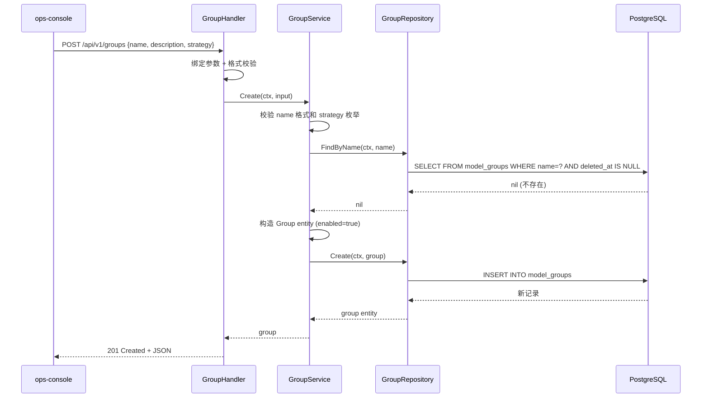

### 3.2 Scheduler 配置读取流程

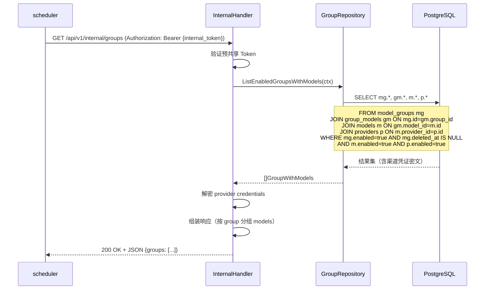

---

## 4. 错误码新增

| 异常类 | 抛出层 | 语义 | HTTP 状态 | 错误码 |
| :--- | :--- | :--- | :---: | :--- |
| GroupNameConflictError | Repository / Service | 模型组名称与已有组重复 | 409 | E4096 |
| GroupNotFoundError | Repository / Service | 模型组不存在或已被软删除 | 404 | E4043 |
| InvalidStrategyError | Service | 策略类型枚举值非法 | 422 | E4224 |
| StrategySwitchWarning | Service | 策略切换后旧参数可能不兼容（非阻断，仅提示） | 422 | E4225 |

**错误场景说明：**

| 场景 | 触发条件 | 错误码 | message 示例 |
| :--- | :--- | :--- | :--- |
| 组名称冲突 | 创建或更新时名称与已有组重复 | E4096 | `"模型组名称 '日常推理' 已存在"` |
| 组不存在 | 对不存在的组执行操作 | E4043 | `"模型组不存在或已被删除"` |
| 非法策略 | strategy 字段不属于枚举值 | E4224 | `"无效的策略类型 'xxx'，支持：round_robin, priority, weighted"` |
| 策略切换警告 | 更新策略类型后旧参数不兼容 | E4225 | `"策略已变更为 'round_robin'，原有 priority/weight 参数可能不兼容，请重新配置组内模型"` |

> **错误码分配说明**：E4091–E4095 已被 Key CRUD 功能占用（key_name_conflict / key_already_disabled / key_already_enabled），故模型组名称冲突使用 E4096。

---

## 5. 目录变更

在 `control-plane/internal/` 下新增：

```
control-plane/
├── internal/
│   ├── handler/
│   │   ├── group.go            # NEW — GroupHandler
│   │   └── group_model.go      # NEW — GroupModelHandler
│   ├── service/
│   │   ├── group.go            # NEW — GroupService
│   │   └── group_model.go      # NEW — GroupModelService
│   ├── repository/
│   │   ├── group.go            # NEW — GroupRepository (含 group_models 操作)
│   ├── model/
│   │   ├── group.go            # NEW — Group / GroupModel 实体定义
│   ├── dto/
│   │   ├── group.go            # NEW — Group 请求/响应 DTO
│   └── errors/
│       └── errors.go           # MODIFY — 新增 GroupNameConflictError 等
```

---

## 6. 变更历史

| 版本号 | 修改日期 | 修改内容摘要 | 修改人 |
| :--- | :--- | :--- | :--- |
| v1.3-delta | 2026-05-25 | 新增模型组管理功能（GroupHandler/Service/Repository + GroupModelHandler/Service）；新增内部配置端点 GET /api/v1/internal/groups | OpenCode |
