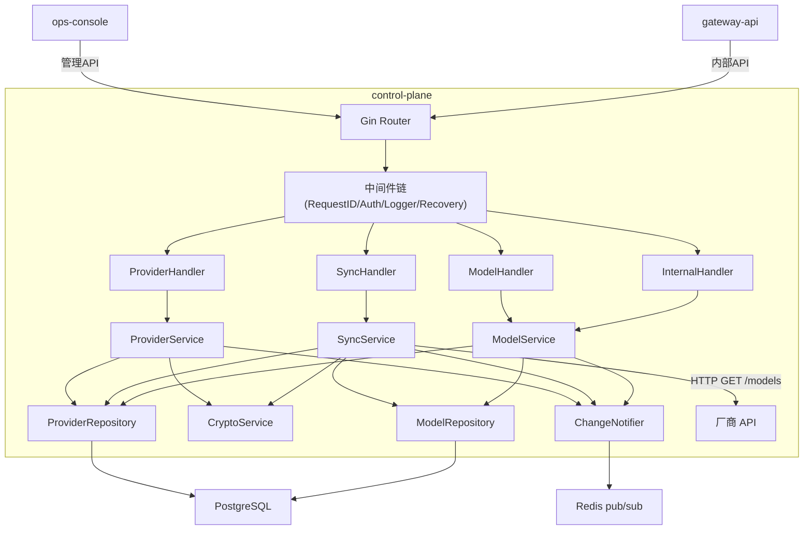
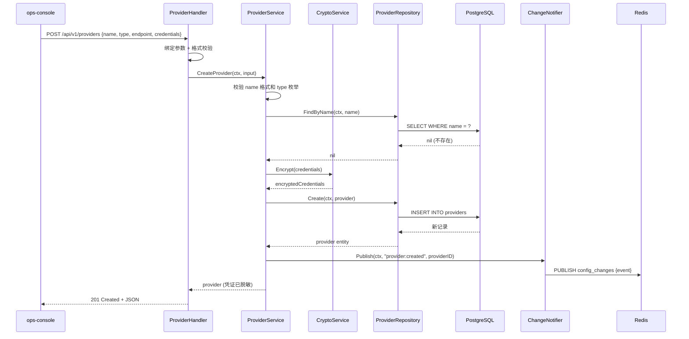
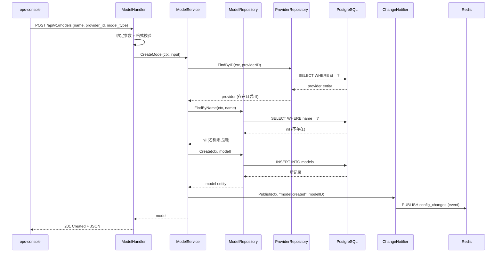
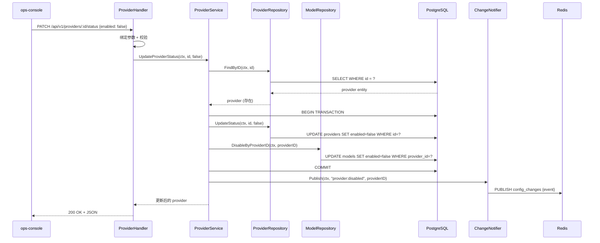
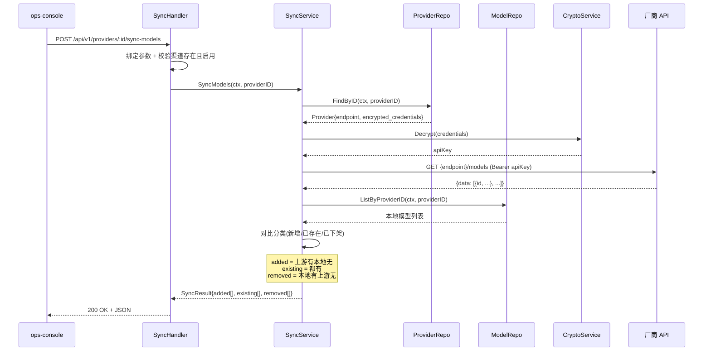
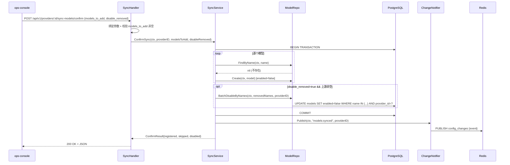
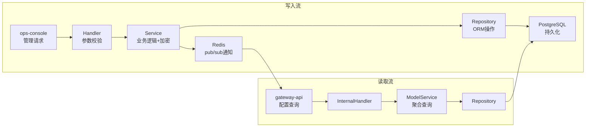
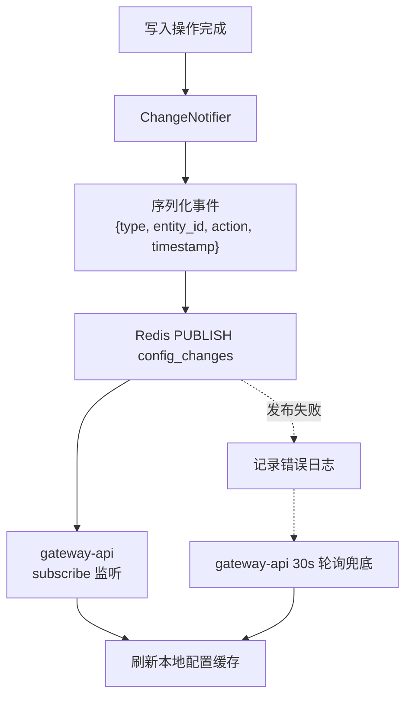

# control-plane Web 后端技术设计

## 0. 文档信息

| 属性 | 内容 |
| :--- | :--- |
| **所属变更** | CHG-20260521-001 |
| **模块名称** | control-plane |
| **模块类型** | web-backend |
| **创建时间** | 2026-05-21 |
| **修改人** | OpenCode |

### 修订记录

| 版本号 | 修改日期 | 修改内容摘要 | 修改人 |
| :--- | :--- | :--- | :--- |
| v1.0 | 2026-05-21 | 初稿创建 | OpenCode |
| v1.1 | 2026-05-23 | 新增模型同步功能（SyncHandler + SyncService，两步接口设计） | OpenCode |

---

## 1. 背景与目标

* **技术背景**：公司统一大模型网关需要集中管理多个 LLM 渠道（百炼、DeepSeek、Bedrock、litellm 等）的配置信息及其下属模型注册。当前 gateway-api 缺乏动态配置源，渠道信息硬编码或散落在各处配置文件中，难以统一管理和实时变更。
* **技术目标**：构建 control-plane 管理面服务，提供渠道配置 CRUD 和模型注册 CRUD 的 RESTful API，实现凭证安全存储、配置变更实时通知，为 gateway-api 路由分发和 ops-console 管理界面提供可靠的数据源。

---

## 2. 模块职责边界

**负责：**
- 渠道（Provider）的创建、查询、更新、启用/禁用、删除操作
- 模型（Model）的注册、查询、更新、删除操作
- 模型同步（从厂商拉取模型列表、对比去重、批量注册、下架禁用）
- 渠道凭证的加密存储与查询脱敏
- 禁用渠道时级联禁用其下模型
- 配置变更时通过 Redis pub/sub 通知 gateway-api

**不负责（显式排除）：**
- 权限配置管理（不在本次范围）
- 限额策略与 Key 管理（不在本次范围）
- 用量统计（不在本次范围）
- 模型组抽象（不在本次范围）
- 实际 LLM 请求路由与转发（gateway-api 职责）
- 数据库 Schema 定义与迁移脚本细节（见 data-model.md）
- 接口契约完整定义（见 contracts.md）

**调用关系：**

| 方向 | 模块 | 方式 |
| :--- | :--- | :--- |
| 被调用 | ops-console | HTTP RESTful API（管理员 JWT 认证） |
| 被调用 | gateway-api | HTTP 内部 API（预共享 Token 认证） |
| 调用 | PostgreSQL | GORM ORM 操作 |
| 调用 | Redis | pub/sub 发布配置变更消息 |

---

## 3. 技术选型与研究

### 3.1 关键技术问题

| 问题 | 选择方案 | 备选方案 | 选择理由 |
| :--- | :--- | :--- | :--- |
| 凭证加密算法 | AES-256-GCM（Go 标准库） | Vault Transit Engine | 无外部依赖，Go 标准库原生支持，GCM 提供认证加密防篡改 |
| ORM 选型 | GORM v2 | sqlx + 手写 SQL | GORM 自动迁移、钩子机制和事务管理便捷，满足 CRUD 场景 |
| 变更通知机制 | Redis pub/sub | Kafka / PostgreSQL LISTEN/NOTIFY | Redis 已在技术栈中；pub/sub 轻量级，适合低频通知场景；配合轮询兜底可接受消息丢失 |
| 认证方案 | JWT RS256 验签（管理接口）+ 预共享 Token（内部接口） | OAuth2 Client Credentials | 管理接口复用公司统一身份平台的 JWT；内部接口场景简单，预共享 Token 足够 |

### 3.2 技术研究总结

所有关键技术问题均已有明确选型，无需额外调研。AES-256-GCM 加密方案在 Go 标准库中实现成熟；Redis pub/sub 结合 gateway-api 侧定时轮询，能在保证实时性的同时提供可靠性兜底。

---

## 4. 架构概述

### 4.1 系统架构



### 4.2 目录结构

```
control-plane/
├── cmd/
│   └── server/
│       └── main.go              # 启动入口
├── internal/
│   ├── config/
│   │   └── config.go            # 配置加载（Viper）
│   ├── handler/
│   │   ├── provider.go          # 渠道管理 Handler
│   │   ├── model.go             # 模型管理 Handler
│   │   ├── sync.go              # 同步模型 Handler
│   │   └── internal.go          # 内部接口 Handler
│   ├── middleware/
│   │   ├── auth.go              # JWT / Token 认证
│   │   ├── requestid.go         # 请求 ID 注入
│   │   ├── logger.go            # 结构化日志
│   │   └── ratelimit.go         # 限流
│   ├── service/
│   │   ├── provider.go          # 渠道业务逻辑
│   │   ├── model.go             # 模型业务逻辑
│   │   ├── sync.go              # 同步模型业务逻辑
│   │   ├── crypto.go            # 凭证加解密
│   │   └── notifier.go          # Redis 变更通知
│   ├── repository/
│   │   ├── provider.go          # 渠道数据访问
│   │   └── model.go             # 模型数据访问
│   ├── model/
│   │   ├── provider.go          # 渠道实体定义
│   │   └── model.go             # 模型实体定义
│   ├── dto/
│   │   ├── provider.go          # 渠道请求/响应 DTO
│   │   ├── model.go             # 模型请求/响应 DTO
│   │   └── sync.go              # 同步请求/响应 DTO
│   └── errors/
│       └── errors.go            # 业务错误定义
├── migrations/
│   └── 001_init_schema.sql      # 数据库迁移脚本
├── go.mod
├── go.sum
└── Dockerfile
```

---

## 5. 关键流程设计

### 5.1 创建渠道



### 5.2 注册模型



### 5.3 禁用渠道级联



### 5.4 同步模型（拉取对比）



### 5.5 确认同步（批量注册+禁用）



---

## 6. 数据流转

### 6.1 系统数据流



### 6.2 核心数据流转说明

| 数据 | 入口 | 处理环节 | 出口 | 持久化 |
| :--- | :--- | :--- | :--- | :--- |
| 渠道配置 | POST /api/v1/providers | 参数校验 → 唯一性检查 → 凭证加密 → 持久化 → 通知 | 201 JSON 响应（凭证脱敏） | providers 表 |
| 模型注册 | POST /api/v1/models | 参数校验 → 渠道存在性检查 → 名称唯一性 → 持久化 → 通知 | 201 JSON 响应 | models 表 |
| 可用模型配置 | GET /internal/v1/models/available | 聚合查询启用的模型+渠道信息 | 200 JSON 列表（含解密后凭证） | 只读查询 |
| 渠道状态变更 | PATCH /api/v1/providers/:id/status | 状态更新 → 级联更新模型 → 通知 | 200 JSON 响应 | providers + models 表 |

### 6.3 变更通知数据流



---

## 7. 分层职责落实

### 7.1 Handler 层

> Handler 只做：请求解析、参数绑定与格式校验、调用 Service、响应序列化。不含业务逻辑。

**ProviderHandler 输入校验：**

| 字段 / 参数 | 校验规则 | 失败时 |
| :--- | :--- | :--- |
| `name` | 非空，长度 2–64，仅允许字母数字下划线连字符 | 400 |
| `type` | 枚举值：bailian / deepseek / bedrock / litellm | 400 |
| `endpoint` | 非空，合法 URL 格式 | 400 |
| `credentials` | 非空，JSON 对象 | 400 |
| `enabled`（状态变更） | 布尔值 | 400 |

**ModelHandler 输入校验：**

| 字段 / 参数 | 校验规则 | 失败时 |
| :--- | :--- | :--- |
| `name` | 非空，长度 2–128，全局唯一 | 400 |
| `provider_id` | 非空，合法 UUID 格式 | 400 |
| `model_type` | 枚举值：chat / embedding | 400 |

**SyncHandler 输入校验：**

| 字段 / 参数 | 校验规则 | 失败时 |
| :--- | :--- | :--- |
| `:id`（path） | 非空，合法 UUID 格式，渠道必须存在且启用 | 404 / 400 |
| `models_to_add`（confirm body） | 非空数组，每个元素长度 2–128 | 400 |
| `disable_removed`（confirm body） | 布尔值，可选，默认 true | 400 |

### 7.2 Service 层

> 包含全部业务逻辑和事务编排，不处理 HTTP 细节。

**ProviderService 公开方法：**

| 方法签名 | 职责 | 事务 | 抛出异常 |
| :--- | :--- | :---: | :--- |
| `Create(ctx, input CreateProviderInput) (*Provider, error)` | 校验唯一性，加密凭证，创建渠道，发布通知 | 是 | ConflictError, CryptoError |
| `List(ctx, query ListQuery) (*PageResult, error)` | 分页查询渠道列表，凭证脱敏 | 否 | — |
| `GetByID(ctx, id string) (*Provider, error)` | 查询单个渠道详情，凭证脱敏 | 否 | NotFoundError |
| `Update(ctx, id string, input UpdateProviderInput) (*Provider, error)` | 更新渠道信息，如有凭证则重新加密，发布通知 | 是 | NotFoundError, ConflictError |
| `UpdateStatus(ctx, id string, enabled bool) (*Provider, error)` | 更新渠道状态，禁用时级联禁用模型，发布通知 | 是 | NotFoundError |
| `Delete(ctx, id string) error` | 检查是否有关联模型，有则阻断，无则删除，发布通知 | 是 | NotFoundError, HasModelsError |

**ModelService 公开方法：**

| 方法签名 | 职责 | 事务 | 抛出异常 |
| :--- | :--- | :---: | :--- |
| `Create(ctx, input CreateModelInput) (*Model, error)` | 校验渠道存在且启用，校验名称唯一，创建模型，发布通知 | 是 | NotFoundError, ConflictError, ProviderDisabledError |
| `List(ctx, query ModelListQuery) (*PageResult, error)` | 分页查询模型列表，支持按 provider_id 过滤 | 否 | — |
| `Update(ctx, id string, input UpdateModelInput) (*Model, error)` | 更新模型信息，发布通知 | 是 | NotFoundError, ConflictError |
| `Delete(ctx, id string) error` | 删除模型，发布通知 | 是 | NotFoundError |
| `ListAvailable(ctx) ([]*ModelWithProvider, error)` | 查询所有启用的模型及其渠道信息（含解密凭证），供 gateway-api 使用 | 否 | — |

**SyncService 公开方法：**

| 方法签名 | 职责 | 事务 | 抛出异常 |
| :--- | :--- | :---: | :--- |
| `SyncModels(ctx, providerID string) (*SyncResult, error)` | 查询渠道信息，解密凭证，调厂商 API 拉取模型列表，与本地对比分类 | 否 | NotFoundError, ProviderDisabledError, SyncNotSupportedError, UpstreamError |
| `ConfirmSync(ctx, providerID string, modelsToAdd []string, disableRemoved bool) (*ConfirmResult, error)` | 批量注册新模型（enabled=false），禁用已下架模型，发布通知 | 是 | NotFoundError |

**业务规则：**
- 渠道名称全局唯一，不允许重复创建同名渠道
- 模型名称全局唯一（跨渠道），不允许重复注册同名模型
- 一个模型只能注册在一个渠道下（1:N 关系）
- 禁用渠道时其下所有模型自动标记为 disabled
- 删除渠道前必须先移除所有模型注册，否则返回 409
- 不允许在已禁用的渠道下注册新模型

**跨模块调用：**

| 依赖模块 | 调用时机 | 失败处理 |
| :--- | :--- | :--- |
| Redis（ChangeNotifier） | 创建/更新/删除/状态变更操作完成后 | 通知失败不回滚主事务，仅记录错误日志 |

### 7.3 Repository 层

> 封装全部数据库操作，向 Service 屏蔽 GORM 细节。

**ProviderRepository：**

| 方法签名 | 操作 | 说明 |
| :--- | :--- | :--- |
| `Create(ctx, *Provider) error` | INSERT | 唯一约束冲突返回 ConflictError |
| `FindByID(ctx, id string) (*Provider, error)` | SELECT | 不存在返回 nil, nil |
| `FindByName(ctx, name string) (*Provider, error)` | SELECT | 用于唯一性检查 |
| `List(ctx, query ListQuery) ([]*Provider, int64, error)` | SELECT + COUNT | 支持分页、排序 |
| `Update(ctx, id string, updates map[string]interface{}) error` | UPDATE | 不存在返回 NotFoundError |
| `UpdateStatus(ctx, id string, enabled bool) error` | UPDATE | 更新 enabled 字段 |
| `Delete(ctx, id string) error` | DELETE | 物理删除 |

**ModelRepository：**

| 方法签名 | 操作 | 说明 |
| :--- | :--- | :--- |
| `Create(ctx, *Model) error` | INSERT | 唯一约束冲突返回 ConflictError |
| `FindByID(ctx, id string) (*Model, error)` | SELECT | 不存在返回 nil, nil |
| `FindByName(ctx, name string) (*Model, error)` | SELECT | 用于唯一性检查 |
| `List(ctx, query ModelListQuery) ([]*Model, int64, error)` | SELECT + COUNT | 支持按 provider_id 过滤、分页 |
| `CountByProviderID(ctx, providerID string) (int64, error)` | COUNT | 删除渠道前检查 |
| `Update(ctx, id string, updates map[string]interface{}) error` | UPDATE | 不存在返回 NotFoundError |
| `DisableByProviderID(ctx, providerID string) error` | UPDATE | 批量禁用渠道下所有模型 |
| `Delete(ctx, id string) error` | DELETE | 物理删除 |
| `ListAvailableWithProvider(ctx) ([]*ModelWithProvider, error)` | SELECT + JOIN | 查询 enabled=true 的模型及其渠道信息 |

### 7.4 DTO 与领域对象映射

| 类型 | 用途 | 转换时机 |
| :--- | :--- | :--- |
| CreateProviderRequest | 接收 POST /api/v1/providers 请求体 | Handler 入口绑定 |
| UpdateProviderRequest | 接收 PUT /api/v1/providers/:id 请求体 | Handler 入口绑定 |
| ProviderResponse | 序列化渠道响应体（凭证脱敏） | Handler 出口 |
| CreateModelRequest | 接收 POST /api/v1/models 请求体 | Handler 入口绑定 |
| UpdateModelRequest | 接收 PUT /api/v1/models/:id 请求体 | Handler 入口绑定 |
| ModelResponse | 序列化模型响应体 | Handler 出口 |
| ModelAvailableResponse | 序列化内部接口模型+渠道响应 | InternalHandler 出口 |
| SyncModelsResponse | 序列化同步拉取对比响应 | SyncHandler 出口 |
| ConfirmSyncRequest | 接收 POST /providers/:id/sync-models/confirm 请求体 | SyncHandler 入口绑定 |
| ConfirmSyncResponse | 序列化确认同步响应 | SyncHandler 出口 |
| Provider (entity) | 数据库持久化对象 | Repository ↔ Service |
| Model (entity) | 数据库持久化对象 | Repository ↔ Service |

> **安全规则**：以下字段禁止序列化到 ProviderResponse：`encrypted_credentials`（原始密文）。凭证仅返回脱敏格式 `credential_hint`（尾 4 位）。内部接口 `ListAvailable` 返回解密后的完整凭证供 gateway-api 使用。

---

## 8. 异常处理链

### 8.1 异常类型

| 异常类 | 抛出层 | 语义 |
| :--- | :--- | :--- |
| NotFoundError | Repository / Service | 资源不存在 |
| ConflictError | Repository / Service | 资源名称冲突或唯一约束违反 |
| HasModelsError | Service | 渠道下存在模型，不允许删除 |
| ProviderDisabledError | Service | 渠道已禁用，不允许注册模型 |
| SyncNotSupportedError | Service | 渠道类型不支持模型列表同步 |
| UpstreamError | Service | 厂商 API 调用失败或超时 |
| ValidationError | Handler | 请求参数格式校验失败 |
| UnauthorizedError | Middleware | 认证失败（Token 无效或过期） |
| InternalError | 任意层 | 未预期的系统错误 |

### 8.2 HTTP 状态码映射

| 异常类 | HTTP 状态 | 错误码 | 备注 |
| :--- | :---: | :--- | :--- |
| ValidationError | 400 | E4001 | 请求参数校验失败 |
| UnauthorizedError | 401 | E4011 | 认证失败 |
| NotFoundError | 404 | E4041 | 资源不存在 |
| ConflictError | 409 | E4091 | 名称冲突 |
| HasModelsError | 409 | E4092 | 渠道下有模型，不可删除 |
| ProviderDisabledError | 422 | E4221 | 渠道已禁用 |
| SyncNotSupportedError | 400 | E4222 | 渠道类型不支持自动同步 |
| UpstreamError | 502 | E5021 | 厂商 API 调用失败 |
| InternalError | 500 | E5001 | 不暴露内部细节 |

---

## 9. 数据库设计要点

* **分库分表策略**：不需要。管理面数据量小（预估渠道 < 100，模型 < 1000），单表即可满足。
* **索引设计原则**：providers 表对 name 建唯一索引；models 表对 name 建唯一索引，对 provider_id 建普通索引（高频按渠道过滤查询）。
* **迁移方案**：使用 golang-migrate 管理 SQL 迁移脚本，版本号格式 `{序号}_{描述}.up.sql / .down.sql`，CI 中自动执行迁移。

---

## 10. 接口设计要点

* **版本控制**：URL 路径前缀 `/api/v1`（管理接口）和 `/internal/v1`（内部接口），Breaking Change 时升级为 v2。
* **认证鉴权**：管理接口使用 JWT Bearer Token（RS256 验签），要求 token 中含 `role: admin`；内部接口使用预共享 Token 验证。
* **限流策略**：管理接口按客户端 IP 限制 60 次/分钟；内部接口不限流（信任的内部服务）。

---

## 11. 错误处理与容灾

| 故障场景 | 检测方式 | 处理策略 | 恢复方案 |
| :--- | :--- | :--- | :--- |
| PostgreSQL 不可用 | GORM 连接错误 + 就绪探针失败 | 返回 503 Service Unavailable；K8s 停止分发流量 | GORM 连接池自动重连 |
| Redis 不可用 | Publish 返回错误 | 主操作正常完成，通知失败仅记录 error 日志 | 自动重连；gateway-api 轮询兜底 |
| 加密密钥不可用 | 启动时校验 / Encrypt 调用失败 | 启动时缺失则服务拒绝启动；运行时失败返回 500 | 修复密钥配置后重启 |
| 并发唯一约束冲突 | DB 返回 duplicate key 错误 | 转换为 409 Conflict 返回客户端 | 客户端换名重试 |

---

## 12. 性能设计

* **QPS 目标**：管理接口写入 < 10 QPS；内部接口读取 < 100 QPS（gateway-api 启动时全量拉取 + 变更时增量刷新）
* **响应时间**：P95 ≤ 50 ms（简单 CRUD + 单表查询）；P99 ≤ 100 ms
* **缓存策略**：control-plane 本身不做缓存（作为配置源，直接读 DB 保证一致性）；gateway-api 侧缓存配置数据
* **异步处理**：Redis pub/sub 通知为异步发送（goroutine 内执行），不阻塞主请求响应

---

## 13. 测试矩阵

| 测试目标 | 测试类型 | 通过条件 |
| :--- | :--- | :--- |
| Handler 参数校验 | 单元测试 | 非法输入返回 400 + 对应错误码；合法输入正确调用 Service |
| Service 业务规则 | 单元测试（Mock Repository） | 唯一性冲突返回 ConflictError；级联禁用正确执行；删除前检查正确阻断 |
| Service 事务完整性 | 集成测试 | 禁用渠道时 provider + models 状态在同一事务中更新 |
| Repository CRUD | 集成测试（测试库） | 增删改查结果与预期一致；唯一约束生效 |
| 凭证加解密 | 单元测试 | 加密后密文不等于明文；解密后还原一致；密钥错误解密失败 |
| 凭证脱敏 | 单元测试 | 管理接口响应中不包含完整凭证，只含尾 4 位 |
| 认证中间件 | 单元测试 | 无 Token 返回 401；无效 Token 返回 401；有效 Token 放行 |
| Redis 通知 | 集成测试 | 写入操作后 Redis channel 收到正确格式的消息 |
| 内部接口 | 集成测试 | 返回所有启用模型+渠道信息；禁用的模型/渠道不出现 |
| 异常映射 | 单元测试 | 每种业务异常正确映射到 HTTP 状态码和错误码 |

---

## 14. 设计决策记录

### 决策 1：渠道凭证存储方案

* **问题**：渠道凭证（API Key、Secret 等）如何安全存储？
* **候选方案**：
  * A — 明文存储 + 数据库级加密（TDE）：运维简单 / 应用层无法控制访问粒度，备份和日志可能泄露明文
  * B — 应用层 AES-256-GCM 加密存储：控制粒度精细，解密仅在需要时发生 / 需管理加密密钥
  * C — 外部密钥管理服务（Vault）：安全等级最高 / 引入外部依赖，增加复杂度和延迟
* **决策**：选择方案 B
* **理由**：在当前阶段提供足够的安全保障且无需引入外部服务依赖；Go 标准库原生支持 AES-GCM；密钥通过环境变量注入，未来可平滑迁移到 Vault。

### 决策 2：模型与渠道关联模型

* **问题**：模型和渠道的关联关系如何设计？
* **候选方案**：
  * A — 1:N 关系（一个模型只属于一个渠道）：简单直接，model name 可做全局唯一 / 同一模型名不能在多个渠道注册
  * B — M:N 关系（一个模型可注册多个渠道做负载均衡）：灵活 / 增加复杂度，路由策略需要额外设计
* **决策**：选择方案 A
* **理由**：当前需求明确一个模型名称对应唯一的渠道后端，全局唯一的 model name 使得 gateway-api 路由逻辑最简化；未来如需多渠道负载均衡可通过模型组抽象扩展（不在本次范围）。

### 决策 3：配置变更通知机制

* **问题**：control-plane 配置变更后如何通知 gateway-api 刷新缓存？
* **候选方案**：
  * A — 轮询：gateway-api 定时拉取配置 / 实时性差（取决于轮询间隔）
  * B — Redis pub/sub：实时推送 + 轮询兜底 / pub/sub 消息不持久化，订阅方断线期间消息丢失
  * C — 消息队列（Kafka）：消息持久化，保证投递 / 过度设计，引入重依赖
* **决策**：选择方案 B
* **理由**：Redis 已在技术栈中，pub/sub 实现简单且实时性好；配合 gateway-api 侧 30s 定时轮询作为兜底，可覆盖网络闪断导致的消息丢失场景。配置变更频率极低，偶尔延迟 30s 可接受。

### 决策 4：删除渠道的级联处理

* **问题**：删除渠道时其下模型如何处理？
* **候选方案**：
  * A — 级联删除：删除渠道时自动删除其下所有模型 / 操作不可逆，误操作风险高
  * B — 阻断删除：存在关联模型时拒绝删除 / 需要管理员手动逐个清理模型
  * C — 软删除 + 恢复：标记删除，保留恢复能力 / 增加复杂度
* **决策**：选择方案 B
* **理由**：管理面操作应当谨慎，阻断删除能有效防止误操作导致大面积服务中断；操作频率极低，手动清理模型的额外步骤在可接受范围内。

### 决策 5：同步接口拆为两步

* **问题**：模型同步是一次性完成还是分步？
* **候选方案**：
  * A — 一步完成：全量导入后管理员逐个禁用不需要的模型
  * B — 两步接口：先拉取对比展示结果 → 管理员勾选后再确认注册
* **决策**：选择方案 B
* **理由**：管理员需要在中间环节勾选确认，不能全量盲导入。两步设计允许管理员对新增模型做筛选，避免引入不需要的模型。第一步结果可在前端缓存，确认时直接提交勾选列表即可。

### 决策 6：下架检测防误禁用

* **问题**：上游返回空列表时是否禁用本地所有模型？
* **候选方案**：
  * A — 无论如何都执行禁用：逻辑一致但风险大
  * B — 空列表时不执行禁用，仅提示
* **决策**：选择方案 B
* **理由**：网络故障可能导致厂商 API 返回空结果而非真实空列表，全量禁用影响严重。空列表时跳过下架检测是更安全的策略，管理员可手动处理。
