# control-plane Web 后端概要设计

## 0. 文档信息

| 属性 | 内容 |
| :--- | :--- |
| **所属变更** | CHG-20260521-001 |
| **模块名称** | control-plane |
| **模块类型** | web-backend |
| **创建时间** | 2026-05-21 |

### 修订记录

| 版本号 | 修改日期 | 修改内容摘要 | 修改人 |
| :--- | :--- | :--- | :--- |
| v1.0 | 2026-05-21 | 初稿创建 | OpenCode |
| v1.1 | 2026-05-23 | 新增模型同步接口架构（SyncHandler + SyncService） | OpenCode |
| v1.2 | 2026-05-25 | 新增 Key CRUD 架构（KeyHandler/KeyService/KeyRepository）— CHG-20260523-001 | OpenCode |
| v1.3 | 2026-05-26 | 新增模型组管理架构（GroupHandler/Service/Repository）— CHG-20260525-001 | OpenCode |

---

## 1. 技术范围界定

### 1.1 起点与终点

| 维度 | 说明 |
| :--- | :--- |
| **起点** | ops-console 发起的渠道/模型管理 HTTP 请求；gateway-api 发起的配置读取 HTTP 请求 |
| **终点** | PostgreSQL 持久化存储；Redis pub/sub 变更通知；HTTP JSON 响应返回调用方 |
| **解决的问题** | 为公司统一大模型网关提供渠道配置和模型注册的集中管理能力，使 gateway-api 能够动态获取路由分发所需的渠道与模型配置 |

### 1.2 技术边界

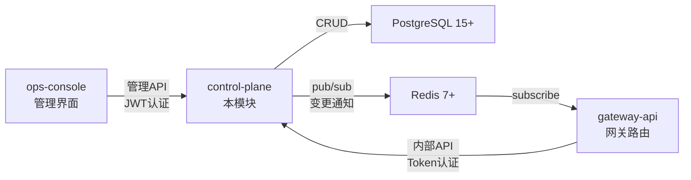

- **上游依赖**：ops-console（管理操作）、gateway-api（配置读取）
- **下游依赖**：PostgreSQL（数据持久化）、Redis（变更通知广播）
- **不涉及**：权限配置、限额策略、Key 管理、用量统计、模型组抽象、实际的 LLM 请求转发

---

## 2. 架构方向探索

| 方向 | 核心思路 | 适合场景 | 风险 |
| :--- | :--- | :--- | :--- |
| 标准分层 REST 服务 | Handler → Service → Repository 三层分离，单进程部署 | 管理类 CRUD 服务，写入 QPS 低，业务逻辑明确 | 单点故障需部署多副本；大规模写入时需考虑连接池压力 |
| 事件驱动微服务 | 接收命令后写入事件存储，下游异步消费 | 高并发写入、复杂事件溯源场景 | 过度设计；CRUD 管理场景引入不必要的复杂度 |

**选定方向**：标准分层 REST 服务

**选择理由**：control-plane 本质是低频管理面 CRUD 服务（预估写入 QPS < 10），业务逻辑简单直接，标准分层架构既满足需求又保持代码可维护性，无需引入事件溯源等复杂机制。

---

## 3. 架构方案

### 3.1 整体架构

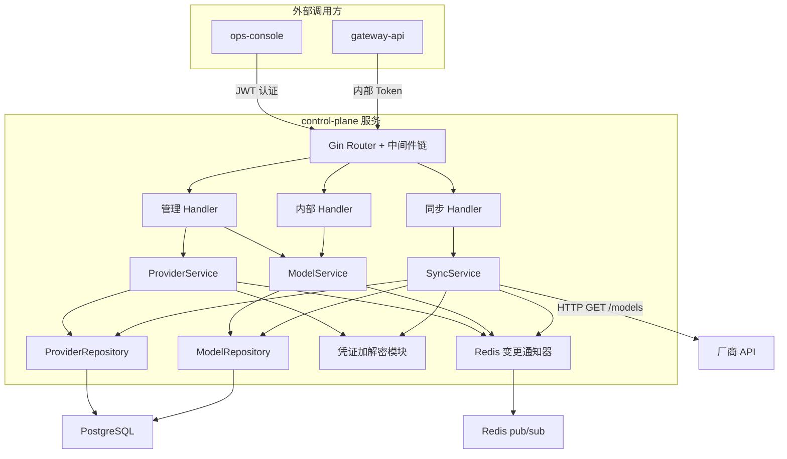

### 3.2 核心流程

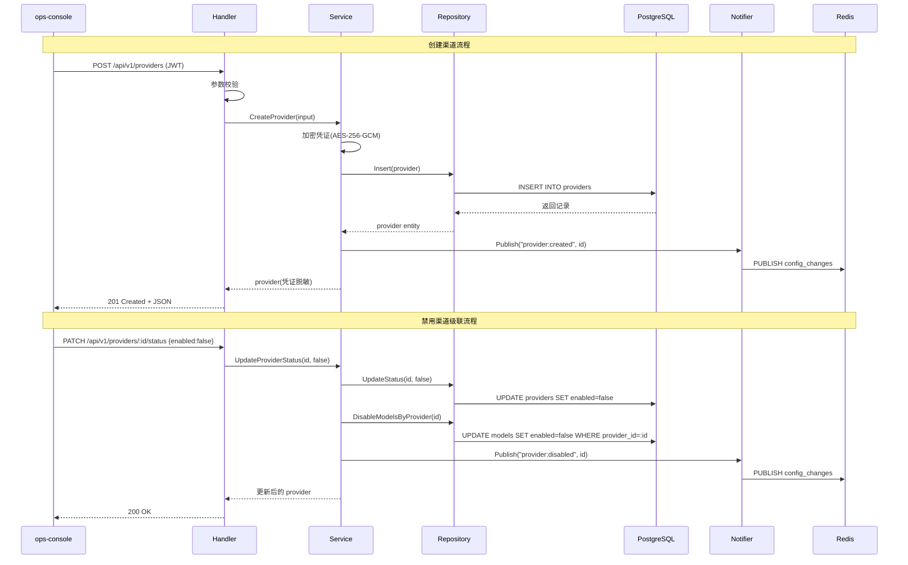

### 3.3 同步模型流程

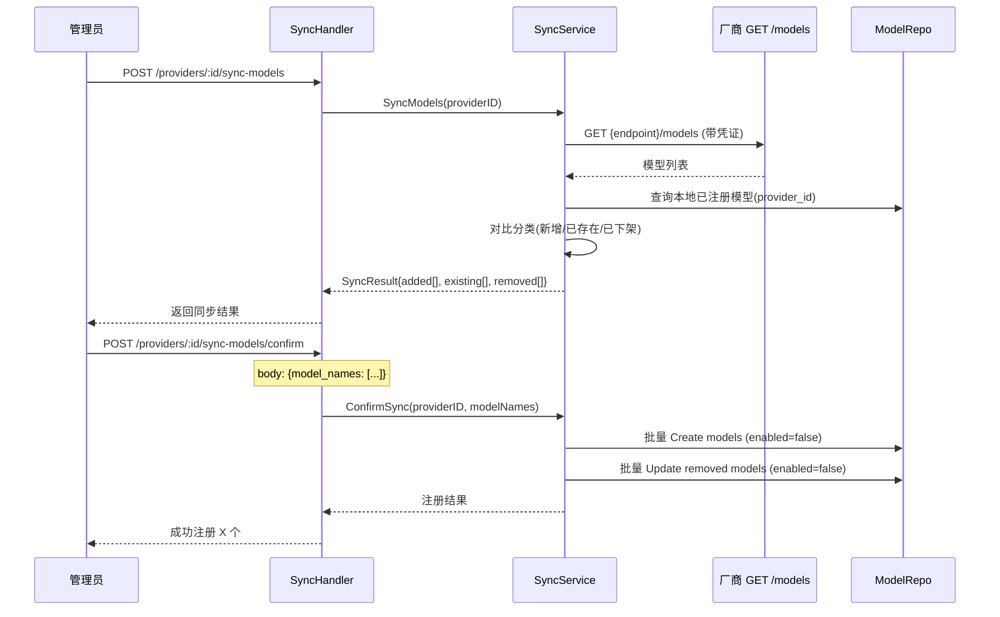

### 3.4 新增组件

| 组件 | 位置 | 职责 |
| :--- | :--- | :--- |
| SyncHandler | handler/sync_handler.go | 处理同步请求，调用 SyncService |
| SyncService | service/sync_service.go | 编排同步逻辑：调厂商 API → 对比本地 → 分类 → 批量写入/禁用 |

---

## 4. 技术选型与约束

| 领域 | 选型 | 理由 |
| :--- | :--- | :--- |
| 运行时 | Go 1.22+ | 公司技术栈统一要求，高性能低资源占用 |
| Web 框架 | Gin | 社区成熟，路由性能优秀，中间件生态丰富 |
| 数据库 | PostgreSQL 15+ | 支持 JSONB、强事务保证、企业级稳定性 |
| 缓存/消息 | Redis 7+ | 用于 pub/sub 变更通知，gateway-api 订阅刷新缓存 |
| ORM | GORM | Go 生态主流 ORM，支持迁移、钩子、事务管理 |
| 配置管理 | Viper | 支持多格式配置文件和环境变量覆盖 |
| 日志 | Zap | 高性能结构化日志，支持 JSON 输出 |
| 加密 | Go 标准库 crypto/aes | AES-256-GCM 加密渠道凭证 |

### 宪章合规性

- [x] 符合 `constitution.md` 的技术栈约束（Go + Gin + PostgreSQL + Redis）
- [x] 符合安全性要求（凭证加密存储、传输 TLS、认证鉴权）
- [x] 符合性能要求（管理面低 QPS，标准分层满足需求）

---

## 5. 中间件链

> 按执行顺序排列，靠前的先执行。

| 顺序 | 中间件 | 职责 | 失败时 |
| :---: | :--- | :--- | :--- |
| 1 | RequestID | 为每个请求生成唯一 UUID，注入上下文并写入 X-Request-ID 响应头 | — |
| 2 | StructuredLogger | 记录请求方法、路径、状态码、耗时，关联 request_id | — |
| 3 | Recovery | 捕获 panic，返回 500 并记录堆栈 | 500 Internal Server Error |
| 4 | CORS | 处理跨域请求，配置允许的 Origin/Method/Header | — |
| 5 | Authentication | 根据路由组验证 JWT（管理接口）或内部 Token（内部接口） | 401 Unauthorized |
| 6 | RateLimit | 按客户端 IP 限制请求速率（管理接口 60次/分钟） | 429 Too Many Requests |

---

## 6. 认证与授权

### 6.1 认证方案

| 字段 | 内容 |
| :--- | :--- |
| 方案 | 双认证模式：管理接口使用 JWT；内部接口使用预共享 Token |
| Token 存储（客户端） | Authorization: Bearer {token} |
| Token 有效期 | JWT Access Token: 30 min；内部 Token: 长期有效，定期轮换 |
| 刷新策略 | JWT 由 ops-console 自行刷新（不在本模块范围）；内部 Token 通过配置文件更新 |
| 密钥管理 | JWT 公钥通过环境变量注入；内部 Token 通过环境变量配置 |

### 6.2 授权模型

| 字段 | 内容 |
| :--- | :--- |
| 模型 | 简单角色校验：管理接口要求 JWT 中包含 admin 角色；内部接口仅验证 Token 有效性 |
| 角色定义 | admin（管理员，可执行所有管理操作） |
| 权限粒度 | 路由组级别：管理接口统一要求 admin 角色 |
| 鉴权时机 | Authentication 中间件统一处理，Handler 不再做额外权限判断 |

---

## 7. 数据存储与外部依赖

### 7.1 主数据库

| 字段 | 内容 |
| :--- | :--- |
| 数据库 | PostgreSQL 15+ |
| 连接池 | 最大连接数：20；最大空闲连接：5；连接最大生命周期：30 min |
| 读写分离 | 无（管理面写入量低，单主实例即可） |
| 事务隔离级别 | Read Committed（默认） |

### 7.2 缓存策略（适用时填）

| 字段 | 内容 |
| :--- | :--- |
| 缓存引擎 | 本模块不使用缓存读取，Redis 仅用于 pub/sub 通知 |
| 缓存模式 | 不适用（gateway-api 侧负责缓存，本模块是数据源） |
| TTL 策略 | 不适用 |
| 缓存击穿防护 | 不适用 |

### 7.3 外部服务依赖

| 服务 | 用途 | 超时配置 | 降级策略 |
| :--- | :--- | :---: | :--- |
| Redis 7+ | 发布配置变更通知 | 3000 ms | 通知失败不阻塞主流程，记录错误日志；gateway-api 有定时轮询兜底 |

---

## 8. 安全设计

| 威胁 | 防御措施 |
| :--- | :--- |
| SQL 注入 | GORM 参数化查询；禁止拼接原始 SQL |
| 凭证泄漏 | 渠道凭证使用 AES-256-GCM 加密存储；API 响应只返回尾 4 位；日志中不打印凭证明文 |
| 未授权访问 | 管理接口 JWT 验证 + admin 角色检查；内部接口预共享 Token 验证 |
| 密钥泄漏 | 加密密钥通过环境变量注入，不进入代码库和配置文件；生产环境使用 Secret Manager |
| 敏感数据传输 | 强制 TLS 1.2+；内部通信使用服务网格 mTLS |
| 暴力破解 | IP 级别限流（60 次/分钟）；认证失败返回统一错误消息，不泄漏用户是否存在 |

---

## 9. 观测与运维

### 9.1 质量目标

| 指标 | 目标值 | 测试条件 |
| :--- | :---: | :--- |
| P95 响应时间 | ≤ 100 ms | 正常负载（管理面 QPS < 10） |
| 可用性 | ≥ 99.9% | 滚动 30 天 |
| 错误率（5xx） | ≤ 0.1% | 正常流量 |

### 9.2 日志与追踪

| 维度 | 方案 |
| :--- | :--- |
| 日志格式 | JSON，必含：`request_id`、`level`、`timestamp`、`method`、`path`、`status`、`duration_ms`、`client_ip` |
| 日志聚合 | ELK（Elasticsearch + Logstash + Kibana） |
| 分布式追踪 | OpenTelemetry + Jaeger，通过 W3C Trace Context 传递 |
| 日志脱敏规则 | 凭证字段写入前替换为 `***`；JWT Token 不记录完整内容 |

### 9.3 健康检查端点

| 端点 | 用途 | 检查内容 |
| :--- | :--- | :--- |
| `GET /health` | 存活探针（Liveness） | 进程在线，返回 200 |
| `GET /ready` | 就绪探针（Readiness） | PostgreSQL 连接可用、Redis 连接可用 |

### 9.4 监控告警

| 指标 | 告警阈值 | 通知方式 |
| :--- | :--- | :--- |
| 响应时间 P99 | > 500 ms（持续 3 分钟） | 钉钉告警群 |
| 错误率 | > 1%（持续 2 分钟） | 钉钉告警群 |
| DB 连接池利用率 | > 80% | 钉钉告警群 |
| Redis 发布失败次数 | > 5 次/分钟 | 钉钉告警群 |

---

## 10. 失败模式与降级策略

| 失败场景 | 影响 | 降级策略 | 恢复方式 |
| :--- | :--- | :--- | :--- |
| PostgreSQL 不可用 | 所有管理和查询操作失败 | 就绪探针标记为 NotReady，K8s 停止流量分发；返回 503 | 自动重连（GORM 连接池内置重试） |
| Redis 不可用 | 配置变更通知无法发送 | 写入操作正常完成，通知失败仅记录错误日志；gateway-api 通过定时轮询（30s）兜底获取最新配置 | 自动重连 |
| 加密密钥缺失 | 无法创建/读取渠道凭证 | 启动时检查密钥存在性，缺失则启动失败；运行时降级为只读模式 | 重新注入密钥并重启服务 |
| 部署滚动更新 | 短暂的请求中断 | 滚动更新（maxSurge: 1, maxUnavailable: 0），配合优雅关闭（graceful shutdown 15s） | 自动完成 |

---

## 11. 待研究事项

不适用

---

## 12. 风险与对策

| 风险 | 概率 | 影响 | 对策 |
| :--- | :--- | :--- | :--- |
| 加密密钥轮换期间渠道凭证不可读 | 低 | 高 | 支持双密钥解密（新密钥加密写入，旧密钥兼容解密），轮换期间逐步重加密 |
| Redis pub/sub 消息丢失导致 gateway-api 缓存过期 | 中 | 中 | gateway-api 侧实现定时轮询（30s）作为兜底机制，不完全依赖 pub/sub |
| 渠道凭证被运维人员从数据库直接读取 | 低 | 高 | 数据库访问权限最小化；凭证列存储密文，无密钥无法解密 |
| 高并发禁用渠道时级联更新模型产生锁竞争 | 低 | 低 | 管理面操作频率极低；使用事务 + 行级锁，控制影响范围 |

---

## 13. 概要设计确认

- [x] 技术范围已界定
- [x] 架构方向已探索并选定
- [x] 架构方案已确认
- [x] 技术选型符合宪章
- [x] 待研究事项已识别（不适用）

---

## 14. 变更记录 — CHG-20260523-001

## 变更摘要

新增 Key CRUD 功能：在现有 Handler → Service → Repository 分层架构中引入 KeyHandler / KeyService / KeyRepository 三层组件，提供 API Key 的创建（sk- 前缀、明文仅返回一次、AES-256-GCM 加密存储）、脱敏列表查询、禁用/启用/删除管理，Key 强绑定 user_id 构成鉴权链路 API Key → User → Department。

## 架构变更

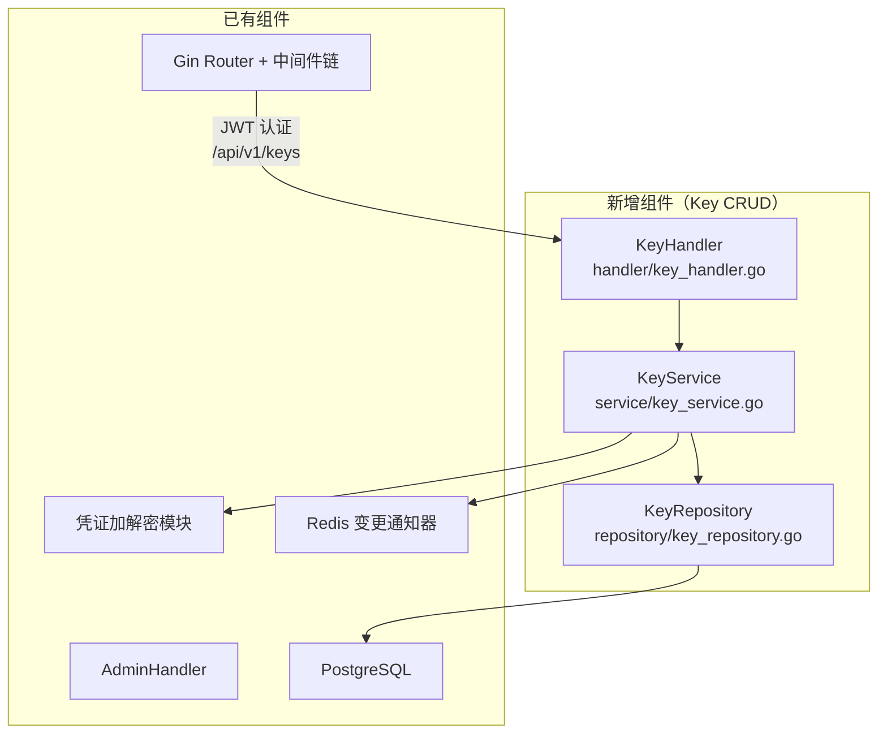

### Key 创建流程

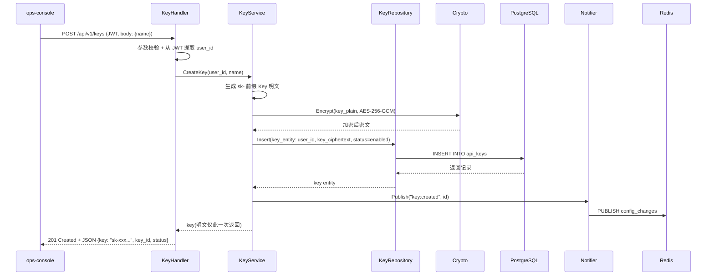

### Key 验证流程（供 gateway-api 调用）

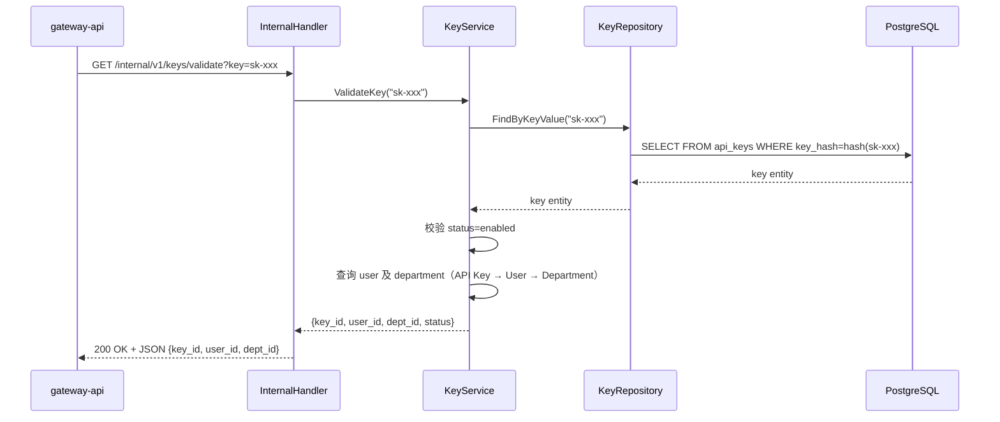

## 技术选型变更

无变更，沿用 Go + Gin + GORM + PostgreSQL + Redis 技术栈。

## 新增组件

| 组件 | 位置 | 职责 |
| :--- | :--- | :--- |
| KeyHandler | handler/key_handler.go | 处理 Key CRUD HTTP 请求（POST/GET/PATCH/DELETE），从 JWT 提取 user_id 强绑定 Key |
| KeyService | service/key_service.go | 编排 Key 逻辑：生成 sk- Key → 加密存储 → 脱敏返回 → 状态切换 → 校验身份链路（API Key → User → Department） |
| KeyRepository | repository/key_repository.go | Key 数据持久化：CRUD 操作 api_keys 表，按 user_id 过滤列表查询，按 key hash 查询验证 |

## 新增端点

| 端点 | 方法 | 认证 | 说明 |
| :--- | :--- | :--- | :--- |
| /api/v1/keys | POST | JWT (admin) | 创建 Key，明文仅此响应返回，存储加密 |
| /api/v1/keys | GET | JWT (admin) | 查询当前 user_id 名下 Key 列表（脱敏） |
| /api/v1/keys/:id/status | PATCH | JWT (admin) | 禁用/启用 Key，body: {enabled: bool} |
| /api/v1/keys/:id | DELETE | JWT (admin) | 永久删除 Key |
| /internal/v1/keys/validate | GET | 内部 Token | Key 验证接口，供 gateway-api 调用 |

## 数据存储变更

新增 `api_keys` 表：

| 字段 | 类型 | 说明 |
| :--- | :--- | :--- |
| id | UUID | 主键 |
| user_id | UUID | 强绑定用户，不可更改 |
| key_hash | VARCHAR(64) | sk- Key 的 SHA-256 哈希，用于验证查询 |
| key_ciphertext | TEXT | AES-256-GCM 加密后的 Key 密文 |
| key_suffix | VARCHAR(4) | Key 末尾 4 位，用于脱敏展示 |
| name | VARCHAR(128) | Key 名称标识 |
| status | ENUM(enabled, disabled) | Key 状态 |
| created_at | TIMESTAMP | 创建时间 |
| updated_at | TIMESTAMP | 更新时间 |

> Key 验证时通过 key_hash 定位记录（sk- Key → SHA-256 → 查询），避免密文全表扫描；key_ciphertext 仅在需要解密时使用（当前验证流程不需要解密，直接比对 hash）。

## 中间件链变更

无变更，Key CRUD 端点走已有 JWT 认证中间件（管理接口组）。

## 安全设计补充

| 威胁 | 防御措施 |
| :--- | :--- |
| Key 明文泄漏 | Key 明文仅在创建响应中返回一次，后续接口只提供脱敏值；存储使用 AES-256-GCM 加密（同渠道凭证加密方案） |
| Key 验证绕过 | Key 验证接口为内部 Token 保护，仅 gateway-api 可调用；验证结果包含完整身份链路（key_id → user_id → dept_id） |
| 禁用 Key 短窗口期 | Key 禁用后立即更新数据库状态，gateway-api 每次验证实时查库；极短窗口期（< 1s）为可接受边界 |

---

## 15. 变更记录 — CHG-20260525-001

## 变更摘要

在现有 Handler→Service→Repository 分层架构中新增模型组管理层：GroupHandler（HTTP 端点）、GroupService（业务逻辑+策略校验）、GroupRepository（数据持久化），以及 GroupModelAssoc 关联表管理。现有渠道和模型管理不受影响。

## 架构变更

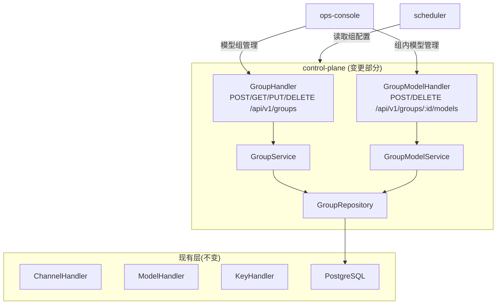

## 新增组件

| 组件 | 职责 | 端点 |
| :--- | :--- | :--- |
| GroupHandler | 模型组 CRUD 的 HTTP 入口 | POST/GET/PUT/DELETE `/api/v1/groups` |
| GroupService | 组名称唯一性校验、策略参数校验、组删除前的安全校验 | — |
| GroupRepository | 模型组和组内模型关联的持久化操作 | — |
| GroupModelHandler | 组内模型添加/移除/列表的 HTTP 入口 | POST/DELETE/GET `/api/v1/groups/:id/models` |
| GroupModelService | 模型存在性校验、同组重复添加检查、跨组允许 | — |
| SchedulerConfigEndpoint | scheduler 配置读取端点 | GET `/api/v1/internal/groups`（内部接口，预共享 Token 认证） |

## 数据模型变更

新增 `model_groups` 表和 `group_models` 关联表：

| 表 | 关键字段 | 说明 |
| :--- | :--- | :--- |
| model_groups | id, name(unique), description, strategy(enum), enabled | 模型组主表 |
| group_models | group_id, model_id, priority, weight | 组内模型关联，priority 用于优先级策略，weight 用于加权策略 |

## 技术选型

无新增技术选型。沿用现有 Go+Gin+GORM+PostgreSQL 技术栈，不引入新依赖。

---

# control-plane 概要设计变更 — CHG-20260526-001

> 基线：xspec/modules/control-plane/hld.md (v1.3)

## 变更摘要

在现有 Key CRUD 和 Group CRUD 分层架构上新增 Key↔模型组多对多绑定：key_group_bindings 关联表 + KeyGroupService 管理绑定关系 + 供 gateway-api 读取绑定的内部接口。Key 创建时可选择模型组，支持后续增删绑定，已启用的模型组列表供员工选择时查询。

## 架构变更

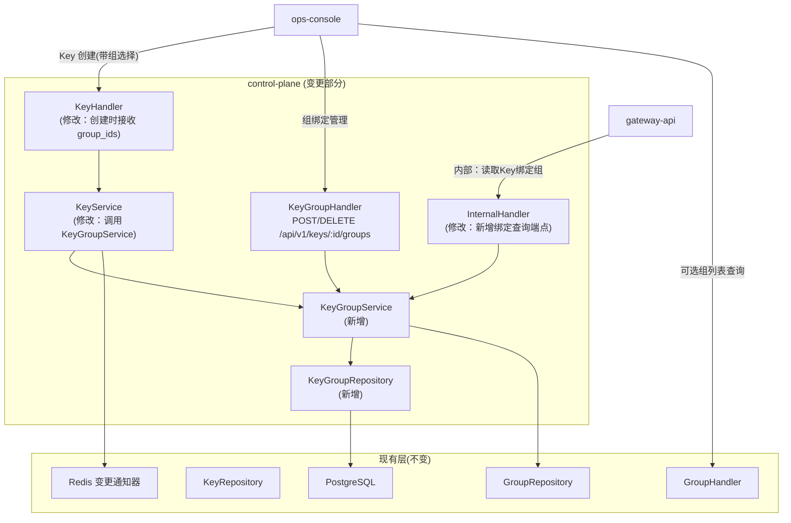

### Key 创建含组绑定流程

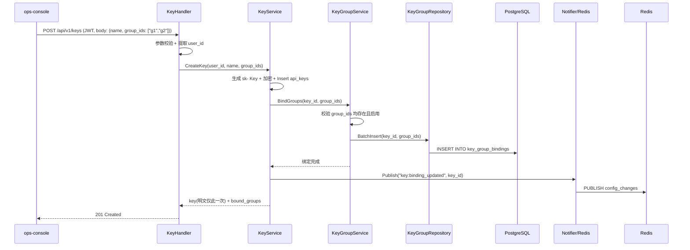

### 组绑定变更流程

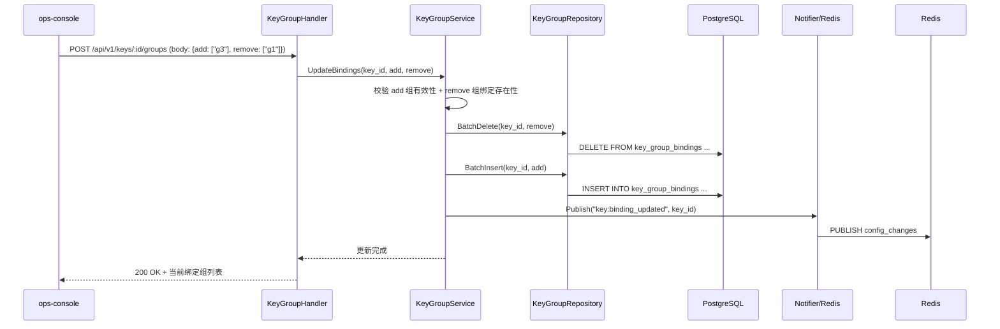

### gateway-api 查询 Key 绑定组流程

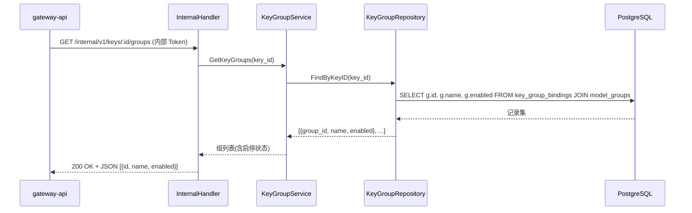

## 新增组件

| 组件 | 位置 | 职责 |
| :--- | :--- | :--- |
| KeyGroupHandler | handler/key_group_handler.go | Key 组绑定 HTTP 入口：POST 变更绑定（add+remove）、GET 查询绑定列表 |
| KeyGroupService | service/key_group_service.go | 绑定业务逻辑：组有效性校验、重复绑定检查、去重后的批量增删 |
| KeyGroupRepository | repository/key_group_repository.go | key_group_bindings 表持久化：BatchInsert、BatchDelete、FindByKeyID |

## 变更组件

| 组件 | 变更 | 说明 |
| :--- | :--- | :--- |
| KeyHandler | 修改 | POST /api/v1/keys 接收可选 group_ids 参数，传递给 KeyService |
| KeyService | 修改 | CreateKey 完成后调用 KeyGroupService.BindGroups 完成绑定 |
| InternalHandler | 修改 | 新增 GET /internal/v1/keys/:id/groups 端点，调 KeyGroupService 查询 |

## 新增端点

| 端点 | 方法 | 认证 | 说明 |
| :--- | :--- | :--- | :--- |
| /api/v1/keys/:id/groups | POST | JWT | 变更组绑定：{add: ["g3"], remove: ["g1"]} |
| /api/v1/keys/:id/groups | GET | JWT | 查询 Key 当前绑定组列表（含启停状态） |
| /api/v1/groups/available | GET | JWT | 查询所有已启用模型组，供 Key 创建时选择 |
| /internal/v1/keys/:id/groups | GET | 内部 Token | 供 gateway-api 读取 Key 绑定的组列表 |

## 数据存储变更

新增 `key_group_bindings` 表：

| 字段 | 类型 | 说明 |
| :--- | :--- | :--- |
| id | UUID | 主键 |
| key_id | UUID | FK → api_keys，ON DELETE CASCADE（Key 删除时联动删除绑定） |
| group_id | UUID | FK → model_groups |
| created_at | TIMESTAMP | 绑定创建时间 |

**约束**：UNIQUE(key_id, group_id) — 同一 Key 不可重复绑定同一组。

## 技术选型变更

无变更。沿用 Go + Gin + GORM + PostgreSQL + Redis 技术栈，不引入新依赖。

## 安全设计补充

| 威胁 | 防御措施 |
| :--- | :--- |
| Key 被删除后绑定残留 | ON DELETE CASCADE 自动清理；GORM 软删除模式使用 ForeignKey 约束 |
| 绑定已删除的模型组 | BatchInsert 前逐一校验 group_id 存在性；GetKeyGroups 时 JOIN model_groups 自动过滤已删除记录 |