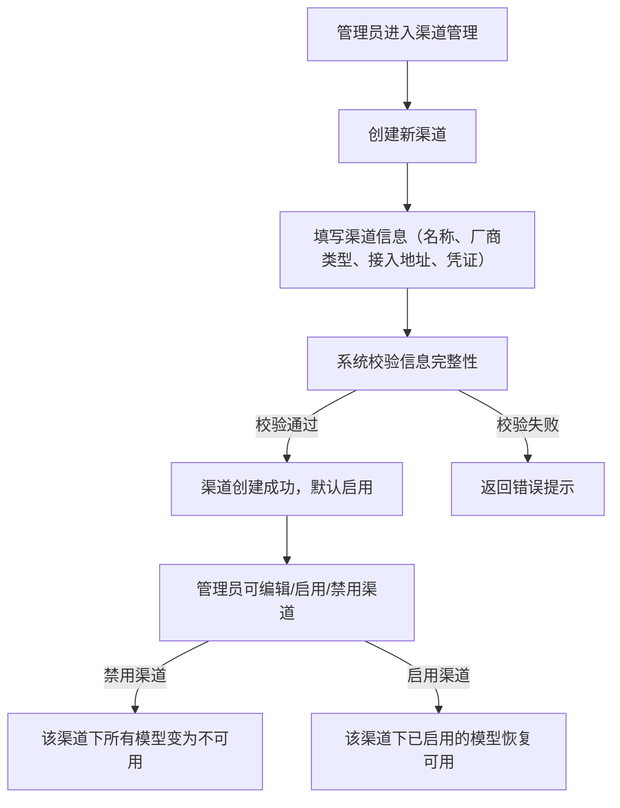
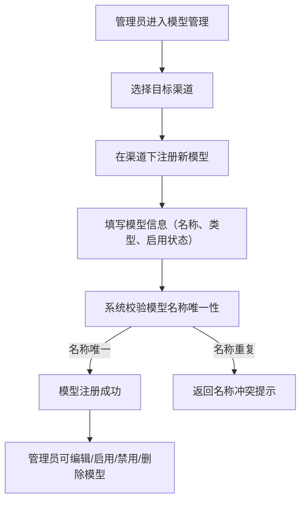
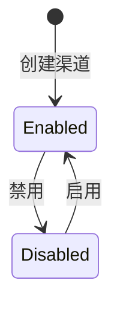
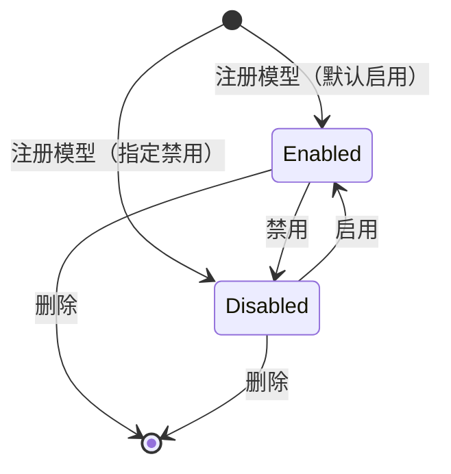

# control-plane Web 后端需求规范

## 0. 文档信息

| 属性 | 内容 |
| :--- | :--- |
| **所属变更** | CHG-20260521-001 |
| **模块名称** | control-plane |
| **模块类型** | web-backend |
| **创建时间** | 2026-05-21 |

### 修订记录

| 版本号 | 修改日期 | 修改内容摘要 | 修改人 |
| :--- | :--- | :--- | :--- |
| v1.0 | 2026-05-21 | 初稿创建 | OpenCode |
| v1.1 | 2026-05-23 | 新增模型同步需求（US-SYNC-01/02/03，AC-S01~S06） | OpenCode |
| v1.2 | 2026-05-25 | 新增 Key CRUD 需求（US-KEY-01~05，AC-KEY-01~06）— CHG-20260523-001 | OpenCode |
| v1.3 | 2026-05-26 | 新增模型组 CRUD + 故障切换配置 — CHG-20260525-001 | OpenCode |

---

## 1. 业务背景与系统目标

* **业务背景**：公司统一大模型网关需要一个集中的配置管理能力，负责维护厂商渠道连接信息和模型注册信息。gateway-api 需要稳定的配置源来决定模型可用性和路由分发，ops-console 需要治理接口来完成渠道与模型的日常管理操作。当前缺少这一配置管理层，导致渠道接入和模型注册无法被统一管控。
* **核心目标**：提供渠道配置管理与模型注册管理能力，使平台管理员能够完成厂商渠道的创建、启用/禁用和维护，以及在渠道下注册和管理模型，从而为 gateway-api 提供可靠的配置源、为 ops-console 提供可操作的治理接口。
* **关键衡量指标**：
  - 渠道配置变更在 5 秒内对 gateway-api 生效
  - 配置管理接口响应时间 P95 不超过 200 毫秒
  - 系统可用性不低于 99.9%

---

## 2. 关键概念

> 统一术语定义，后续所有章节直接引用此处概念名，避免歧义。

- **渠道（Channel）**：对接一个厂商模型服务的连接配置单元，包含该厂商的接入地址和认证凭证信息，是模型注册的承载容器。
- **模型注册（Model Registration）**：在某个渠道下登记一个具体可用模型的配置记录，包含模型名称、模型类型和启用状态，是 gateway-api 判断模型可用性和进行路由分发的依据。
- **模型类型（Model Type）**：标识模型的能力分类，当前支持对话补全（chat）和向量嵌入（embedding）两种类型。
- **渠道状态**：渠道的可用性标识，分为启用和禁用两种状态，决定该渠道及其下属所有模型是否对外提供服务。
- **凭证信息（Credential）**：渠道对接厂商服务所需的认证信息，属于敏感数据，必须加密存储、脱敏展示。

---

## 3. 超出范围

> 明确本次不做的内容，防止范围蔓延。

- 不做权限配置（部门权限模型组），本模块所有操作均限定为平台管理员角色
- 不做限额策略配置（TPM/RPM/Token 套餐）
- 不做用量统计和审计日志
- 不做模型组（低/中/高智力抽象层）
- 不做渠道健康探测与自动熔断

---

## 4. 角色与权限控制（RBAC）

| 角色名称 | 角色描述 | 菜单权限 | 操作权限 | 数据范围 |
| :--- | :--- | :--- | :--- | :--- |
| 平台管理员 | 负责配置和管理厂商渠道与模型注册的运维人员 | 渠道管理、模型管理 | 渠道的创建/查看/编辑/启用/禁用；模型注册的创建/查看/编辑/启用/禁用/删除 | 全局所有渠道和模型数据 |

---

## 5. 业务流程与状态机

### 5.1 渠道配置管理流程

### 5.2 模型注册管理流程

### 5.3 渠道状态机

| 当前状态 | 触发动作 | 目标状态 | 前置条件 |
| :--- | :--- | :--- | :--- |
| 无 | 创建渠道 | 启用 | 渠道信息校验通过 |
| 启用 | 管理员执行禁用 | 禁用 | 渠道当前为启用状态 |
| 禁用 | 管理员执行启用 | 启用 | 渠道当前为禁用状态 |

### 5.4 模型注册状态机

| 当前状态 | 触发动作 | 目标状态 | 前置条件 |
| :--- | :--- | :--- | :--- |
| 无 | 注册模型 | 启用/禁用 | 模型名称全局唯一且归属渠道存在 |
| 启用 | 管理员执行禁用 | 禁用 | 模型当前为启用状态 |
| 禁用 | 管理员执行启用 | 启用 | 模型当前为禁用状态且归属渠道为启用状态 |
| 启用/禁用 | 管理员执行删除 | 已删除 | 模型存在 |

---

## 6. 详细功能需求

### 6.1 渠道配置管理

**A. 功能说明**

平台管理员可以创建、查看、编辑、启用和禁用厂商渠道。每个渠道代表与一个厂商模型服务的连接配置，包含厂商类型（如百炼、DeepSeek、AWS Bedrock）、接入地址和认证凭证。渠道是模型注册的承载容器，gateway-api 基于渠道的启用状态和连接信息完成模型请求的路由分发。

**B. 数据实体与关系**

- 渠道：包含渠道名称、厂商类型、接入地址、凭证信息、启用状态、创建时间、更新时间。
- 渠道与模型注册为一对多关系：一个渠道下可注册多个模型。
- 渠道的启用状态影响其下所有模型的可用性。

**C. 接口概要**

| 接口 | 方法 | 路径 | 说明 |
| :--- | :--- | :--- | :--- |
| 创建渠道 | POST | /api/v1/channels | 创建新的厂商渠道配置 |
| 查询渠道列表 | GET | /api/v1/channels | 分页查询渠道列表，支持按名称和状态筛选 |
| 查询渠道详情 | GET | /api/v1/channels/{id} | 获取单个渠道的完整信息（凭证脱敏展示） |
| 编辑渠道 | PUT | /api/v1/channels/{id} | 修改渠道的基本信息和凭证 |
| 启用渠道 | PUT | /api/v1/channels/{id}/enable | 将渠道状态切换为启用 |
| 禁用渠道 | PUT | /api/v1/channels/{id}/disable | 将渠道状态切换为禁用 |

**D. 业务规则与校验**

- 渠道名称在系统内必须唯一，不允许重复
- 创建渠道时必须提供：渠道名称、厂商类型、接入地址、凭证信息
- 凭证信息必须加密存储，查询和列表展示时对凭证进行脱敏处理（仅展示末尾 4 位）
- 创建渠道后默认为启用状态
- 禁用渠道时，该渠道下所有已注册模型对 gateway-api 均不可用（无论模型自身启用状态如何）
- 重新启用渠道时，仅恢复该渠道下自身状态为启用的模型的可用性
- 渠道不支持物理删除；若渠道下存在任何模型注册记录，则禁止删除操作

**E. 异常与边界**

* **名称冲突**：创建或编辑渠道时，若名称与已有渠道重复，返回明确的名称冲突错误。
* **凭证格式校验**：凭证信息不能为空且长度不超过系统允许上限（4096 字符），超出时返回格式校验失败。
* **并发编辑**：同时编辑同一渠道时，后提交的请求应基于版本号判断冲突并返回冲突提示，避免静默覆盖。
* **渠道不存在**：对不存在的渠道 ID 执行查询、编辑、启用、禁用操作时，返回资源不存在错误。

### 6.2 模型注册管理

**A. 功能说明**

平台管理员可以在已有渠道下注册模型，并对已注册模型进行查看、编辑、启用、禁用和删除操作。每个模型注册记录包含模型名称、归属渠道、模型类型和启用状态。gateway-api 基于模型注册信息判断模型是否可用以及如何路由到对应渠道。

**B. 数据实体与关系**

- 模型注册：包含模型名称、归属渠道标识、模型类型（chat/embedding）、启用状态、创建时间、更新时间。
- 模型注册必须归属于一个已存在的渠道。
- 模型名称在全局范围内唯一（跨渠道不允许重名）。
- 模型的最终可用性 = 模型自身启用 且 归属渠道启用。

**C. 接口概要**

| 接口 | 方法 | 路径 | 说明 |
| :--- | :--- | :--- | :--- |
| 注册模型 | POST | /api/v1/models | 在指定渠道下注册新模型 |
| 查询模型列表 | GET | /api/v1/models | 分页查询模型列表，支持按名称、渠道、类型和状态筛选 |
| 查询模型详情 | GET | /api/v1/models/{id} | 获取单个模型注册记录的完整信息 |
| 编辑模型 | PUT | /api/v1/models/{id} | 修改模型注册信息（名称、类型等） |
| 启用模型 | PUT | /api/v1/models/{id}/enable | 将模型状态切换为启用 |
| 禁用模型 | PUT | /api/v1/models/{id}/disable | 将模型状态切换为禁用 |
| 删除模型 | DELETE | /api/v1/models/{id} | 删除模型注册记录 |

**D. 业务规则与校验**

- 模型名称在全局范围内必须唯一，不允许跨渠道重复
- 注册模型时必须提供：模型名称、归属渠道标识、模型类型
- 模型类型仅允许 chat 和 embedding 两种取值
- 注册模型时归属渠道必须存在，否则拒绝注册
- 模型自身启用且归属渠道启用时，该模型对 gateway-api 可用
- 启用一个归属渠道处于禁用状态的模型时，系统应明确提示该模型因渠道禁用仍不可用
- 编辑模型时不允许变更归属渠道（需先删除再重新注册）
- 删除模型为物理删除，删除后不可恢复

**E. 异常与边界**

* **模型名称冲突**：注册或编辑模型时，若名称与已有模型重复，返回明确的名称冲突错误。
* **归属渠道不存在**：注册模型时指定的渠道标识不存在，返回渠道不存在错误。
* **渠道禁用下启用模型**：在归属渠道处于禁用状态时启用模型，操作本身允许执行但返回警告信息说明模型因渠道禁用仍不对外可用。
* **模型不存在**：对不存在的模型 ID 执行查询、编辑、启用、禁用、删除操作时，返回资源不存在错误。
* **并发编辑**：同时编辑同一模型时，后提交的请求应基于版本号判断冲突并返回冲突提示。

### 6.3 模型同步管理

**A. 功能说明**

平台管理员可对已创建的渠道一键拉取厂商支持的模型列表，系统自动与本地已注册模型对比分类（新增/已存在/已下架），管理员勾选后批量注册，下架模型自动禁用。同步功能分为两步接口：先拉取对比，再确认注册，确保管理员有中间决策环节。

**B. 用户故事**

#### US-SYNC-01 — 一键同步模型列表 (P0)

**作为**平台管理员，**我想要**对已创建的渠道一键拉取厂商支持的模型列表，**以便**快速注册模型而不用逐个手动输入。

**功能说明**：
- 管理员触发同步后，系统调用该渠道厂商的模型列表查询能力
- 返回的模型列表与本地已注册模型对比：
  - 上游有、本地无 → 标记为"新增"（待管理员确认后写入，默认禁用）
  - 上游有、本地有 → 标记为"已存在"（跳过）
  - 上游无、本地有 → 标记为"已下架"（自动禁用）
- 同步结果返回给前端，由管理员勾选要注册的模型后批量写入

**异常与边界**：
- 厂商不支持模型列表查询能力（如 Anthropic/Bedrock）→ 返回明确提示"该渠道类型不支持自动同步，请使用预置模型列表"
- 厂商返回超时或网络错误 → 返回失败原因，不影响已有模型
- 厂商返回空列表 → 正常返回空结果，不做任何禁用操作（避免网络故障导致误禁用全部模型）

#### US-SYNC-02 — 批量注册与启用 (P0)

**作为**平台管理员，**我想要**在同步结果中勾选需要的模型并批量注册，**以便**一次性完成大量模型的注册操作。

**功能说明**：
- 同步结果展示模型列表，管理员可逐个勾选或一键全选
- 支持按关键词过滤（模型名称搜索）
- 确认后批量写入 models 表，所有新注册模型默认 enabled=false
- 管理员可在注册后手动启用需要的模型

**异常与边界**：
- 模型名与已有模型重名 → 跳过该模型，计入"已存在"数量
- 一次同步的模型数量超过 500 → 前端分页展示，后端分批写入

#### US-SYNC-03 — 下架模型自动禁用 (P1)

**作为**平台管理员，**我想要**系统在同步时自动发现已下架的模型并禁用，**以便**业务方不会调用到已不可用的模型。

**功能说明**：
- 同步时对比上游列表与本地已注册模型
- 本地有但上游列表中不存在的模型，自动将 enabled 设为 false
- 在同步结果中标记为"已下架"并展示给管理员
- 禁用操作仅在上游返回非空列表时执行（防止网络故障导致全量误禁用）

**异常与边界**：
- 上游返回空列表 → 不执行禁用操作，仅提示"上游返回空结果，跳过下架检测"
- 模型被自动禁用后管理员可手动重新启用

**C. 接口概要**

| 接口 | 方法 | 路径 | 说明 |
| :--- | :--- | :--- | :--- |
| 同步模型（拉取对比） | POST | /api/v1/providers/:id/sync-models | 从上游厂商拉取模型列表并与本地对比，返回分类结果 |
| 确认同步（批量注册+禁用） | POST | /api/v1/providers/:id/sync-models/confirm | 管理员勾选后批量注册新模型，禁用已下架模型 |

**D. 业务规则与校验**

- 同步功能分为两步：先拉取对比，再确认注册，不允许一次性全量导入
- 同步时渠道必须存在且启用状态，禁用渠道不允许同步
- 渠道类型不支持模型列表查询时返回明确提示（如 Anthropic/Bedrock）
- 批量注册的所有新模型默认 enabled=false，需管理员后续手动启用
- 下架检测仅在厂商返回非空列表时执行；空列表时不执行任何禁用操作
- 同步结果中的已存在模型跳过注册，不产生冲突错误

**E. 异常与边界**

* **渠道不存在**：对不存在的渠道 ID 执行同步操作时，返回资源不存在错误。
* **渠道已禁用**：对禁用状态的渠道执行同步操作时，返回渠道已禁用错误。
* **厂商不支持同步**：渠道类型不支持模型列表查询时，返回明确提示。
* **厂商超时或网络错误**：调用厂商 API 超时或失败时，返回上游错误，不影响已有模型。
* **厂商返回空列表**：正常返回空结果，不执行下架禁用操作，防止误禁用。

---

## 7. 数据流与外部接口

* **配置源输出**：control-plane 作为配置源，向 gateway-api 提供当前可用的渠道和模型注册信息，gateway-api 基于此信息判断模型可用性并执行路由分发。配置变更后需在 5 秒内对 gateway-api 生效。
* **治理接口输入**：ops-console 通过 control-plane 的管理接口完成渠道和模型的增删改查操作，control-plane 为其提供完整的 CRUD 能力。
* **消息/事件**：渠道状态变更（启用/禁用）时需通知 gateway-api 刷新本地配置缓存，确保路由行为与配置状态一致。

---

## 8. 非功能需求

* **安全性**：
  - 凭证信息必须加密存储，任何接口返回中不得明文暴露完整凭证
  - 所有管理接口必须经过身份认证，仅允许平台管理员角色访问
  - 接口返回中不得暴露内部系统实现细节

* **并发与性能**：
  - 管理接口响应时间 P95 不超过 200 毫秒
  - 配置查询接口支持并发读取，不因单次写操作阻塞查询
  - 配置变更在 5 秒内对下游消费方生效

* **可观测性**：
  - 所有管理操作形成结构化日志，包含操作人、操作对象、操作类型和结果
  - 关键操作（创建渠道、禁用渠道、删除模型）需记录操作前后状态

---

## 9. 验收标准

| 编号 | 关联 | Given（前置状态） | When（触发动作） | Then（预期结果） | 优先级 |
| :--- | :--- | :--- | :--- | :--- | :--- |
| AC-01 | 渠道配置管理-创建 | Given 平台管理员已登录且提供了完整的渠道信息（名称、厂商类型、接入地址、凭证） | When 调用创建渠道接口 | Then 渠道创建成功，返回渠道标识，渠道默认状态为启用 | P0 |
| AC-02 | 渠道配置管理-凭证安全 | Given 已存在一个包含凭证信息的渠道 | When 调用查询渠道详情接口 | Then 返回的凭证字段经过脱敏处理，仅展示末尾 4 位，完整凭证不可见 | P0 |
| AC-03 | 渠道配置管理-名称唯一 | Given 系统中已存在名称为"百炼生产渠道"的渠道 | When 创建另一个名称同为"百炼生产渠道"的渠道 | Then 返回名称冲突错误，渠道未被创建 | P0 |
| AC-04 | 渠道配置管理-禁用级联 | Given 渠道 A 处于启用状态且其下注册了 3 个启用状态的模型 | When 平台管理员禁用渠道 A | Then 渠道 A 变为禁用状态，其下 3 个模型对 gateway-api 均不可用 | P0 |
| AC-05 | 渠道配置管理-删除阻断 | Given 渠道 B 下存在 2 条模型注册记录 | When 平台管理员尝试删除渠道 B | Then 系统拒绝删除并返回明确提示：该渠道下存在模型注册记录，需先移除所有模型 | P0 |
| AC-06 | 渠道配置管理-启用恢复 | Given 渠道 A 处于禁用状态，其下有 2 个自身启用的模型和 1 个自身禁用的模型 | When 平台管理员重新启用渠道 A | Then 2 个自身启用的模型恢复对 gateway-api 可用，1 个自身禁用的模型仍不可用 | P1 |
| AC-07 | 模型注册管理-创建 | Given 平台管理员已登录且系统中存在一个启用状态的渠道 | When 在该渠道下注册一个模型（提供名称、类型为 chat） | Then 模型注册成功，返回模型标识，模型归属该渠道且对 gateway-api 可用 | P0 |
| AC-08 | 模型注册管理-名称唯一 | Given 系统中已存在名称为"gpt-4o"的模型注册记录 | When 在任意渠道下注册另一个名称同为"gpt-4o"的模型 | Then 返回模型名称冲突错误，模型未被注册 | P0 |
| AC-09 | 模型注册管理-渠道不存在 | Given 平台管理员提供了一个不存在的渠道标识 | When 尝试在该渠道下注册模型 | Then 返回渠道不存在错误，模型未被注册 | P1 |
| AC-10 | 模型注册管理-渠道禁用下启用模型 | Given 模型 X 归属的渠道当前处于禁用状态，模型 X 自身为禁用状态 | When 平台管理员启用模型 X | Then 模型 X 自身状态变为启用，但系统返回提示信息说明该模型因归属渠道禁用仍不对外可用 | P1 |
| AC-11 | 模型注册管理-并发编辑冲突 | Given 两个管理员同时获取了模型 Y 的编辑信息（版本号相同） | When 管理员 A 先提交编辑成功后管理员 B 再提交编辑 | Then 管理员 B 收到版本冲突错误，需刷新后重试 | P1 |
| AC-12 | 渠道配置管理-凭证加密存储 | Given 平台管理员创建渠道时提供了明文凭证信息 | When 渠道创建成功后查看持久化的数据 | Then 凭证在存储层以加密形态保存，非明文 | P0 |
| AC-S01 | 模型同步管理-拉取对比 | Given 管理员已创建一个百炼渠道且渠道启用 | When 触发同步模型操作 | Then 系统返回该渠道上游可用模型列表，标记每个模型为"新增"或"已存在" | P0 |
| AC-S02 | 模型同步管理-不支持同步 | Given 渠道类型为 Anthropic（不支持模型列表接口） | When 触发同步 | Then 返回明确提示"该渠道类型不支持自动同步" | P0 |
| AC-S03 | 模型同步管理-批量注册 | Given 同步结果中有 10 个新模型 | When 管理员勾选 5 个并确认注册 | Then 5 个模型写入 models 表且 enabled=false | P0 |
| AC-S04 | 模型同步管理-重名跳过 | Given 同步结果中有重名模型 | When 管理员勾选该模型 | Then 该模型被跳过，提示已存在 | P1 |
| AC-S05 | 模型同步管理-下架禁用 | Given 本地有模型 A 但上游列表中已不存在 | When 同步完成 | Then 模型 A 的 enabled 被设为 false，同步结果中标记为"已下架" | P1 |
| AC-S06 | 模型同步管理-空列表保护 | Given 上游返回空列表 | When 同步完成 | Then 不执行任何禁用操作，提示"上游返回空结果" | P1 |

---

## 10. 假设与依赖

- 假设平台管理员的身份认证由独立的认证服务提供，control-plane 直接消费认证结果（Token），不负责登录和用户管理
- 依赖 gateway-api 具备配置刷新机制，能够在 control-plane 配置变更后主动或被动获取最新配置
- 假设厂商类型为预定义枚举集合，首批支持百炼、DeepSeek、AWS Bedrock，后续新增厂商类型需扩展枚举
- 假设模型类型当前仅支持 chat 和 embedding 两种，后续如需增加新类型需要同步更新 control-plane 和 gateway-api
- 风险：若 gateway-api 的配置缓存刷新机制不可靠，可能导致配置变更后短时间内路由行为与管理面状态不一致

---

## 11. 变更记录 — CHG-20260523-001

### 新增功能：Key CRUD（版本 v1.2）

#### US-KEY-01 — 员工自助创建 API Key (P0)

**作为**员工，**我想要**自助创建一个 API Key，**以便**使用该 Key 调用大模型网关并追溯身份。

**功能说明**：
- 员工在 Key 管理页面触发创建，系统生成以 `sk-` 为前缀的 Key
- Key 明文仅在创建响应中返回一次，后续任何接口不再提供明文
- Key 以加密形态保存，不可逆恢复明文
- 创建时必须绑定当前员工的 user_id，不可指定其他用户

**异常与边界**：
- 同一员工创建 Key 数量达到上限 → 返回明确提示"已达最大 Key 数量限制"，拒绝创建 [待确认: 单用户最大 Key 数量上限值]
- Key 前缀冲突 → `sk-` 前缀为系统固定规则，不允许自定义前缀，若用户输入含 `sk-` 开头的自定义名称则截断前缀部分

#### US-KEY-02 — 员工列表查看自有 Key (P0)

**作为**员工，**我想要**查看我名下所有 Key 的列表，**以便**了解当前持有 Key 的状态与标识。

**功能说明**：
- 员工调用列表接口仅返回自己名下的 Key，不可查看他人 Key
- 列表中 Key 值以脱敏形式展示，仅保留末尾 4 位字符，其余以掩码替代
- 每个 Key 展示：Key 标识、脱敏 Key 值、创建时间、当前状态（启用/禁用）

**异常与边界**：
- 员工名下无 Key → 返回空列表，不报错
- 禁用状态的 Key 仍在列表中可见，状态字段标记为"禁用"

#### US-KEY-03 — 员工禁用/启用/删除自有 Key (P0)

**作为**员工，**我想要**对我名下的 Key 执行禁用、启用或删除操作，**以便**在 Key 泄露时立即阻断或在不再需要时清理。

**功能说明**：
- 禁用：将 Key 状态从启用切换为禁用，禁用后该 Key 立即不可用于任何 API 调用
- 启用：将 Key 状态从禁用切换为启用，启用后该 Key 恢复可用于 API 调用
- 删除：永久移除 Key 记录，删除后不可恢复
- 所有操作仅限对本人的 Key 执行，操作他人 Key 返回权限拒绝错误

**异常与边界**：
- 对已禁用 Key 再次执行禁用 → 返回提示"Key 已处于禁用状态"，不重复操作
- 对已删除 Key（不存在）执行任何操作 → 返回资源不存在错误

#### US-KEY-04 — Key 与 user_id 强绑定 (P0)

**作为**员工，**我想要**我创建的 Key 与我的身份强绑定，**以便**通过 Key 调用网关时系统能追溯到我及我所属部门。

**功能说明**：
- Key 创建时强制绑定创建者的 user_id，不可更改绑定对象
- 鉴权链路为：API Key → User → Department，任何通过该 Key 发起的调用均可定位到具体员工和所属部门
- Key 不可转让、不可共享绑定，一个 Key 唯一归属一个 user_id

**异常与边界**：
- 员工所属部门被变更 → Key 绑定的 user_id 不变，鉴权链路中 Department 取该 user_id 当前所属部门，自动跟随变更
- 员工账号被注销 → 该员工名下所有 Key 自动禁用，调用时返回身份已失效错误

#### US-KEY-05 — 禁用 Key 立即失效 (P1)

**作为**员工，**我想要**禁用 Key 后该 Key 立刻不可用于任何 API 调用，**以便**在发现 Key 泄露时能瞬时止损。

**功能说明**：
- Key 禁用后，任何使用该 Key 的 API 调用请求在鉴权环节即被拒绝
- 禁用生效不依赖任何延迟刷新机制，须保证即时生效
- 禁用操作返回成功后，该 Key 的后续调用必须在下一次请求时被拒绝

**异常与边界**：
- 禁用操作与并发调用同时发生 → 禁用成功后极短窗口期（小于 1 秒）内可能存在少量请求仍通过鉴权，此为可接受边界
- 禁用后立即尝试重新启用 → 重新启用成功后 Key 恢复可用，启用操作同样须即时生效

### 新增验收标准

| 编号 | 关联 | Given（前置状态） | When（触发动作） | Then（预期结果） | 优先级 |
| :--- | :--- | :--- | :--- | :--- | :--- |
| AC-KEY-01 | US-KEY-01 | Given 员工已登录且名下 Key 数量未达上限 | When 员工创建一个新 Key | Then 返回以 `sk-` 开头的 Key 明文，该明文仅在此响应中出现一次，存储层中 Key 为加密形态 | P0 |
| AC-KEY-02 | US-KEY-02 | Given 员工名下存在 2 个 Key（sk-abc…XYZ1 和 sk-def…XYZ2） | When 员工查询自有 Key 列表 | Then 列表仅包含该员工名下的 Key，每个 Key 值仅展示末尾 4 位（****XYZ1、****XYZ2），完整明文不可见 | P0 |
| AC-KEY-03 | US-KEY-03 | Given 员工名下有一个启用状态的 Key | When 员工禁用该 Key | Then Key 状态变为禁用，后续通过该 Key 的 API 调用在鉴权环节被拒绝 | P0 |
| AC-KEY-04 | US-KEY-04 | Given 员工 A（归属部门 X）创建了一个 Key | When 该 Key 被用于 API 调用并经过鉴权链路 | Then 鉴权结果定位到员工 A 及部门 X，构成 API Key → 员工 A → 部门 X 的完整链路 | P0 |
| AC-KEY-05 | US-KEY-05 | Given 员工刚禁用了自己的 Key K1 | When 在禁用操作返回成功后立即用 K1 发起 API 调用 | Then 调用在鉴权环节被拒绝，返回 Key 已禁用错误 | P1 |
| AC-KEY-06 | US-KEY-03 | Given 员工名下有一个 Key K2 | When 员工删除 K2 | Then K2 被永久移除，后续对 K2 的任何操作返回资源不存在错误 | P0 |

---

## 12. 变更记录 — CHG-20260525-001

## 变更摘要

新增模型组管理功能：平台管理员可创建/编辑/删除模型组（Group），在组内添加/移除已有模型（跨组允许），为每个组配置独立路由策略（轮询/优先级/加权）。模型组是智能调度的基础配置单元，供 scheduler 读取进行路由决策。

## 新增需求

### US-GROUP-01 — 管理员创建与编辑模型组 (P0)

**作为**平台管理员，**我想要**创建和编辑模型组，**以便**将按业务场景分组的模型聚合提供给业务方。

**功能说明**：
- 管理员创建模型组需提供：组名称（全局唯一）、组描述、路由策略类型（轮询/优先级/加权）
- 组创建后默认为启用状态，管理员可随时编辑组名称、描述和策略类型
- 编辑策略类型时，若策略参数与新类型不兼容（如从优先级切到加权），需重置策略参数为默认值
- 组删除前需确认组内无模型引用，或提供"清空组内模型后删除"的操作

**异常与边界**：
- 组名称与已有组重复 → 返回名称冲突错误
- 组名称长度超过限制（64 字符）→ 创建/编辑时校验拒绝
- 删除一个被 scheduler 正在使用的组 → 标记为禁用而非物理删除，调度层停止使用该组

### US-GROUP-02 — 组内模型管理 (P0)

**作为**平台管理员，**我想要**在模型组中添加和移除模型，**以便**灵活调整组内可用模型集合。

**功能说明**：
- 管理员可向组内添加已注册模型，一个模型可同时属于多个组
- 管理员可从组内移除模型，移除后该模型在该组中不再参与路由
- 添加模型到组时需提供策略相关参数：轮询策略无需额外参数，优先级策略需指定优先级数字，加权策略需指定权重值

**异常与边界**：
- 向组内添加不存在的模型 → 返回模型不存在错误
- 向组内添加已存在于该组的模型 → 返回模型已在组内提示，不做重复添加
- 组内移除模型后组变空 → 组仍然存在，调用方请求该组时返回"该模型组当前无可用模型"

### US-GROUP-03 — 路由策略配置 (P0)

**作为**平台管理员，**我想要**为每个模型组配置独立的路由策略及其参数，**以便**按业务场景需求控制组内模型的选择行为。

**功能说明**：
- 支持三种策略：轮询（无额外参数）、优先级（每模型需指定优先级数字，越小越优先）、加权（每模型需指定权重值 1-100）
- 策略配置保存在组配置中，scheduler 读取后按策略执行路由
- 策略变更后立即生效，不要求重启服务

**异常与边界**：
- 优先级策略下多个模型分配了相同优先级 → 允许，同优先级模型内部按轮询处理
- 加权策略下权重总和超过限制 → 不限制总和，按实际权重比例归一化计算
- 策略从一种类型切换到另一种 → 旧策略参数清除，管理员重新配置

## 新增验收标准

| 编号 | 关联 | Given（前置状态） | When（触发动作） | Then（预期结果） | 优先级 |
| :--- | :--- | :--- | :--- | :--- | :--- |
| AC-GROUP-01 | US-GROUP-01 | Given 管理员已登录 | When 创建模型组"日常推理"（策略=轮询） | Then 模型组创建成功，返回组标识，组状态为启用 | P0 |
| AC-GROUP-02 | US-GROUP-01 | Given 已存在模型组"日常推理" | When 创建同名模型组"日常推理" | Then 返回名称冲突错误，组未被创建 | P0 |
| AC-GROUP-03 | US-GROUP-02 | Given 模型组"日常推理"和模型 A（均存在） | When 将模型 A 添加到组"日常推理" | Then 模型 A 出现在该组的模型列表中 | P0 |
| AC-GROUP-04 | US-GROUP-02 | Given 模型 A 同时加入了组"日常推理"和组"高智能" | When 分别查询两个组的模型列表 | Then 两个组的模型列表中均包含模型 A | P0 |
| AC-GROUP-05 | US-GROUP-03 | Given 模型组"高智能"策略=优先级，有 A(1)、B(2) | When scheduler 查询该组配置 | Then 返回策略=优先级，模型 A 优先级=1，模型 B 优先级=2 | P0 |
| AC-GROUP-06 | US-GROUP-02 | Given 模型组"日常推理"内有 A、B、C 三个模型 | When 管理员移除模型 B | Then 组内模型只剩 A 和 C，B 不再参与该组路由 | P0 |
