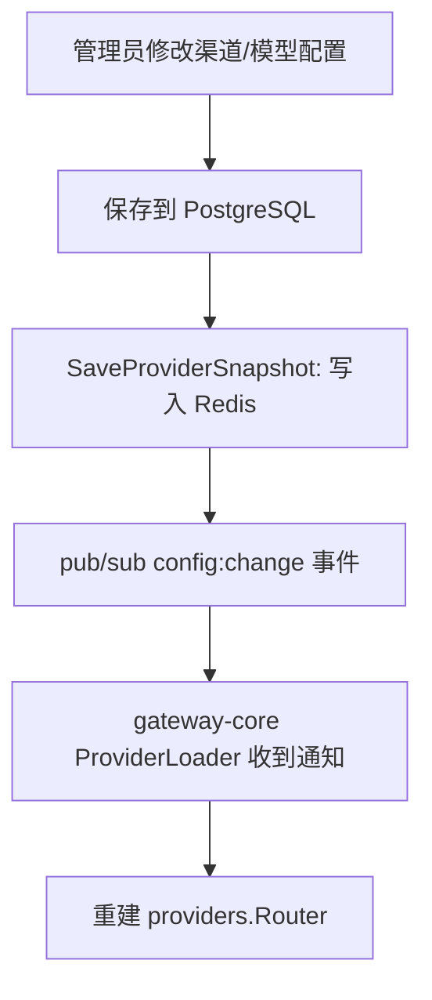
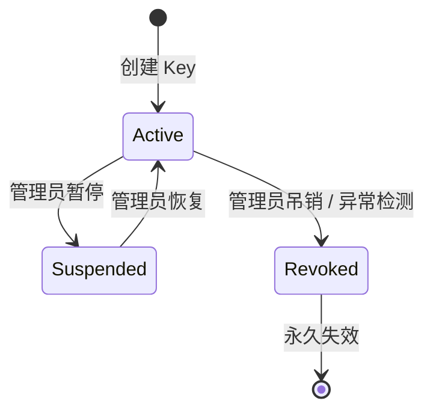
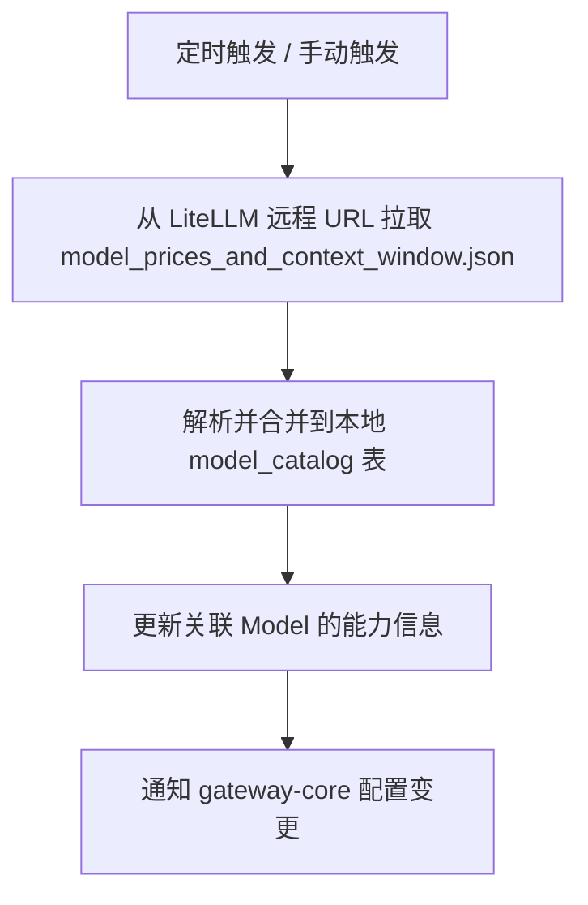

# control-plane 需求规范

## 0. 文档信息

| 属性 | 内容 |
| :--- | :--- |
| **所属变更** | baseline-v1.0 |
| **模块名称** | control-plane |
| **模块类型** | web-backend |
| **创建时间** | 2026-06-03 |

### 修订记录

| 版本号 | 修改日期 | 修改内容摘要 | 修改人 |
| :--- | :--- | :--- | :--- |
| v1.0 | 2026-06-03 | 基线初稿，记录已实现的 v1.0 能力 | Sisyphus |

---

## 1. 业务背景与系统目标

控制面是 LLM Gateway 的管理中枢，负责所有存量数据的持久化、管理 API 暴露、配置下发和业务编排。通过 RESTful API 为管理后台（ops-console）和内部服务（gateway-core）提供数据和配置服务。

- **业务背景**：需要一个集中的管理层来管理渠道、模型、API Key、模型组、Catalog 等核心实体
- **核心目标**：实现管理操作的完整 CRUD、配置的实时下发、组织架构的权限映射
- **关键衡量指标**：
  - 管理 API 可用率 ≥ 99.5%
  - 配置变更后 30s 内同步至 gateway-core
  - 支持 100+ 用户 Key 管理

---

## 2. 关键概念

- **渠道 (Channel)**：厂商对接配置，包含 API Key、Endpoint、超时等参数。一个厂商可有多个渠道（如不同 region）
- **模型 (Model)**：绑定到渠道的具体模型实例，对应 `model_catalog` 中的模型条目。包含渠道引用、权重、状态
- **模型组 (Group)**：对外暴露的模型名，组内包含多个 Model 成员。按策略聚合组内成员的能力信息
- **Model Catalog**：从 LiteLLM 同步的模型元数据（能力列表、定价、上下文窗口），作为模型能力的 SSOT
- **API Key**：用户身份凭证，绑定 SSO 用户、部门、限额、设备
- **Provider Snapshot**：控制面将当前 provider 配置写入 Redis，供 gateway-core 加载和热更新
- **OpenCode Config**：OpenCode IDE 插件的安装脚本和模型配置，通过 `/api/v1/opencode-config` 下发
- **Internal Auth**：内部服务间认证，通过 `X-Internal-Token` header 校验

---

## 3. 超出范围

- 不负责请求的实时转发和流式处理（由 gateway-core 负责）
- 不负责厂商 API 的适配和调用（由 provider-adapters 负责）
- 不负责前端 UI 的渲染和交互（由 ops-console 负责）
- 不负责计费结算（只做用量统计和限额管控）
- 不负责 Prompt 管理、Agent 编排

---

## 4. 角色与权限控制 (RBAC)

| 角色名称 | 角色描述 | 操作权限 | 数据范围 |
| :--- | :--- | :--- | :--- |
| 系统管理员 | 运维/基础设施团队 | 全面管理：渠道、模型、模型组、Key、Catalog 同步、系统设置 | 全部数据 |
| API Key 持有者 | 普通员工 | 查看自己的 Key、用量统计 | 个人数据 |
| 部门管理员 | 各部门负责人 | 管理部门内 Key、查看部门用量 | 本部门数据 |
| 内部服务 | gateway-core | 调用 `/internal/v1/auth/verify-key` | Internal Token 认证 |

---

## 5. 业务流程与状态机

### 配置下发流程

### Key 生命周期状态机

### Catalog 同步流程

---

## 6. 详细功能需求

### 6.1 渠道管理

**A. 功能说明**

管理系统对接的各厂商渠道配置。每个渠道属于一个 Provider 类型，包含 API Key、Base URL、超时、重试等连接参数。

**C. 接口概要**

| 接口 | 方法 | 路径 | 说明 |
| :--- | :--- | :--- | :--- |
| 渠道列表 | GET | /api/v1/channels | 分页查询所有渠道 |
| 创建渠道 | POST | /api/v1/channels | 新增渠道配置 |
| 渠道详情 | GET | /api/v1/channels/:id | 查询单个渠道 |
| 更新渠道 | PUT | /api/v1/channels/:id | 修改渠道配置 |
| 删除渠道 | DELETE | /api/v1/channels/:id | 删除渠道（软删除）|
| 渠道健康检查 | POST | /api/v1/channels/:id/health | 测试渠道连通性 |

**D. 业务规则与校验**

- 同一 Provider 类型可创建多个渠道（如不同 region 的 OpenAI）
- 删除渠道前需检查是否有关联的 Model，有则阻止删除或提示级联影响
- 渠道状态变更（启用/禁用）需同步更新 Provider Snapshot

**E. 异常与边界**

- **API Key 变更**：更新后立即触发 Provider Snapshot 刷新
- **渠道连通性检查失败**：不影响已有配置，记录失败日志

### 6.2 模型管理

**A. 功能说明**

管理绑定到渠道的具体模型实例。Model 关联 Channel 和可选的 Catalog 条目，包含权重、状态等调度参数。

**C. 接口概要**

| 接口 | 方法 | 路径 | 说明 |
| :--- | :--- | :--- | :--- |
| 模型列表 | GET | /api/v1/models | 分页查询所有模型 |
| 创建模型 | POST | /api/v1/models | 新增模型绑定 |
| 模型详情 | GET | /api/v1/models/:id | 查询单个模型 |
| 更新模型 | PUT | /api/v1/models/:id | 修改模型参数 |
| 删除模型 | DELETE | /api/v1/models/:id | 解除模型绑定 |

**D. 业务规则与校验**

- Model 必须关联一个有效的 Channel
- 可关联 Catalog 条目，自动填充能力/价格/上下文窗口信息
- 权重用于负载均衡调度

### 6.3 模型组管理

**A. 功能说明**

管理和配置对外暴露的模型组。一个模型组包含多个成员 Model，按策略调度，对外表现为单一模型名。

**C. 接口概要**

| 接口 | 方法 | 路径 | 说明 |
| :--- | :--- | :--- | :--- |
| 模型组列表 | GET | /api/v1/groups | 分页查询所有模型组 |
| 创建模型组 | POST | /api/v1/groups | 新增模型组 |
| 模型组详情 | GET | /api/v1/groups/:id | 查询模型组及成员 |
| 更新模型组 | PUT | /api/v1/groups/:id | 修改模型组配置 |
| 删除模型组 | DELETE | /api/v1/groups/:id | 删除模型组 |
| 组能力信息 | GET | /api/v1/groups/:id/capabilities | 查询组的聚合能力 |

**D. 业务规则与校验**

- 模型组名作为对外暴露的标识，需保证全局唯一
- 组能力采用保守聚合语义：组内所有成员都支持才算支持，token 上限取最小正值
- 模型组变更后需更新 Provider Snapshot

### 6.4 Key 管理

**A. 功能说明**

管理用户 API Key 的创建、权限绑定、限额设置、状态管控（启停/吊销）。Key 与用户 SSO 身份绑定。

**C. 接口概要**

| 接口 | 方法 | 路径 | 说明 |
| :--- | :--- | :--- | :--- |
| Key 列表 | GET | /api/v1/keys | 分页查询所有 Key |
| 创建 Key | POST | /api/v1/keys | 为用户创建 Key |
| Key 详情 | GET | /api/v1/keys/:id | 查询单个 Key |
| 吊销 Key | POST | /api/v1/keys/:id/revoke | 吊销 Key |
| 暂停 Key | POST | /api/v1/keys/:id/suspend | 暂停 Key |
| 恢复 Key | POST | /api/v1/keys/:id/resume | 恢复 Key |
| Key 使用统计 | GET | /api/v1/keys/:id/usage | 查询 Key 用量 |
| 我的 Key | GET | /api/v1/keys/mine | 当前用户自己的 Key |

**D. 业务规则与校验**

- Key 创建后生成唯一标识，以哈希存储，不存明文
- Key 可绑定设备列表，异常设备登录触发告警
- 吊销 Key 后需通过 Redis pub/sub 通知 gateway-core 清除缓存

### 6.5 Catalog 同步

**A. 功能说明**

从 LiteLLM 远程仓库同步模型元数据（能力、价格、上下文窗口），作为模型能力的 SSOT。支持定时同步和手动触发。

**C. 接口概要**

| 接口 | 方法 | 路径 | 说明 |
| :--- | :--- | :--- | :--- |
| 触发同步 | POST | /api/v1/catalog/sync | 手动触发同步 |
| 同步状态 | GET | /api/v1/catalog/sync/status | 查询同步状态 |
| Catalog 列表 | GET | /api/v1/catalog | 分页查询 Catalog |

### 6.6 配置下发

**A. 功能说明**

将渠道/模型/模型组的配置序列化为 Provider Snapshot，写入 Redis 并发布 config:change 事件，驱动 gateway-core 热更新。

**D. 业务规则与校验**

- 配置变更保存到 PostgreSQL 后立即触发 Snapshot 更新
- Snapshot 序列化格式需做前后兼容处理
- 下发失败不影响 PostgreSQL 中的数据一致性

### 6.7 OpenCode 配置下发

**A. 功能说明**

为 OpenCode IDE 用户提供一键安装脚本和插件 bundle，实现模型列表的自动发现。通过 `/api/v1/opencode-config` 接口提供。

**C. 接口概要**

| 接口 | 方法 | 路径 | 说明 |
| :--- | :--- | :--- | :--- |
| 获取安装脚本 | GET | /api/v1/opencode-config/install | 返回安装脚本 |
| 获取插件 Bundle | GET | /api/v1/opencode-config/bundle | 返回插件 bundle 文件 |
| 配置信息 | GET | /api/v1/opencode-config | 返回配置摘要 |

### 6.8 认证与授权

**A. 功能说明**

管理面的用户认证系统。支持 SSO / OIDC 登录，JWT Token 签发与刷新，内部服务 API 的 Token 认证。

**C. 接口概要**

| 接口 | 方法 | 路径 | 说明 |
| :--- | :--- | :--- | :--- |
| OAuth 登录 | GET | /api/v1/auth/login | 跳转 SSO 登录 |
| OAuth 回调 | GET | /api/v1/auth/callback | SSO 回调处理 |
| Token 刷新 | POST | /api/v1/auth/refresh | 刷新 JWT Token |
| 登出 | POST | /api/v1/auth/logout | 登出 |
| Key 验证 | POST | /internal/v1/auth/verify-key | gateway-core 内部调用 |

---

## 7. 数据流与外部接口

- **数据库**：PostgreSQL 存储所有管理数据（渠道、模型、Key、模型组、Catalog、用户、设置）
- **Redis**：Provider Snapshot 存储 + pub/sub config:change 事件
- **LiteLLM**：远程拉取 `model_prices_and_context_window.json` 做 Catalog 同步
- **SSO/OIDC**：对接公司统一身份认证系统

---

## 8. 非功能需求

- **安全性**：JWT Token 有效期合理（1h），支持刷新；内部 API 走 Internal Token 认证；API Key 不存明文
- **性能**：管理 API 响应时间 P95 < 500ms；Catalog 同步不阻塞管理操作
- **数据一致性**：配置变更是先写 PostgreSQL 再写 Redis；Snapshot 失败不影响数据库状态
- **可观测性**：所有管理操作记录审计日志；OTLP 链路追踪

---

## 9. 验收标准

| 编号 | 关联 | Given（前置状态） | When（触发动作） | Then（预期结果） | 优先级 |
| :--- | :--- | :--- | :--- | :--- | :--- |
| AC-01 | 渠道 | Given 管理员登录 | When 创建新渠道并填写配置 | Then 渠道保存成功，触发 Provider Snapshot 更新 | P0 |
| AC-02 | 模型组 | Given 模型组有 3 个成员 | When 查询组能力信息 | Then 返回保守聚合结果：全部支持的能力+最小 token 上限 | P0 |
| AC-03 | Key | Given 管理员吊销某 Key | When Key 被吊销 | Then gateway-core 的 KeyCache 在 30s 内清除该 Key | P0 |
| AC-04 | 配置下发 | Given 管理员修改了渠道配置 | When 保存成功 | Then Redis Snapshot 更新 + pub/sub 事件发出 | P0 |
| AC-05 | Catalog | Given LiteLLM 远程数据可访问 | When 触发 Catalog 同步 | Then model_catalog 表正确更新 | P1 |
| AC-06 | SSO | Given 用户无 JWT Token | When 访问管理 API | Then 返回 401，重定向到 SSO 登录 | P0 |
| AC-07 | 内部认证 | Given 请求带有效 Internal Token | When 调用 /internal/v1/* | Then 正常处理，不受 JWT 中间件拦截 | P0 |

---

## 10. 假设与依赖

- 假设 PostgreSQL 稳定运行，是数据一致性的最终保证
- 假设 Redis pub/sub 消息可靠传递
- 假设公司 SSO / OIDC 服务正常可用
- 依赖 LiteLLM 远程仓库持续维护 `model_prices_and_context_window.json`