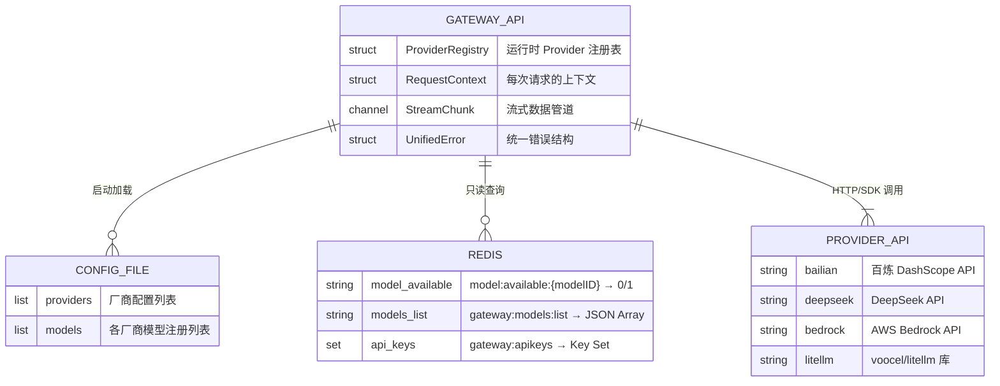
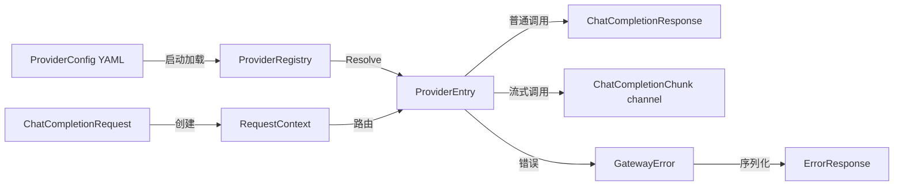
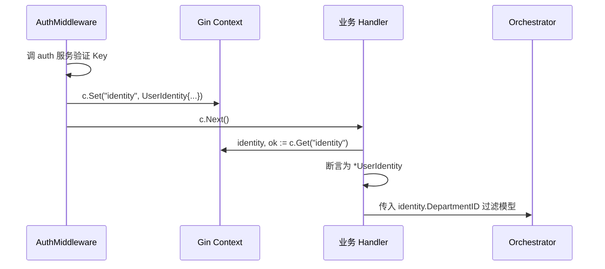
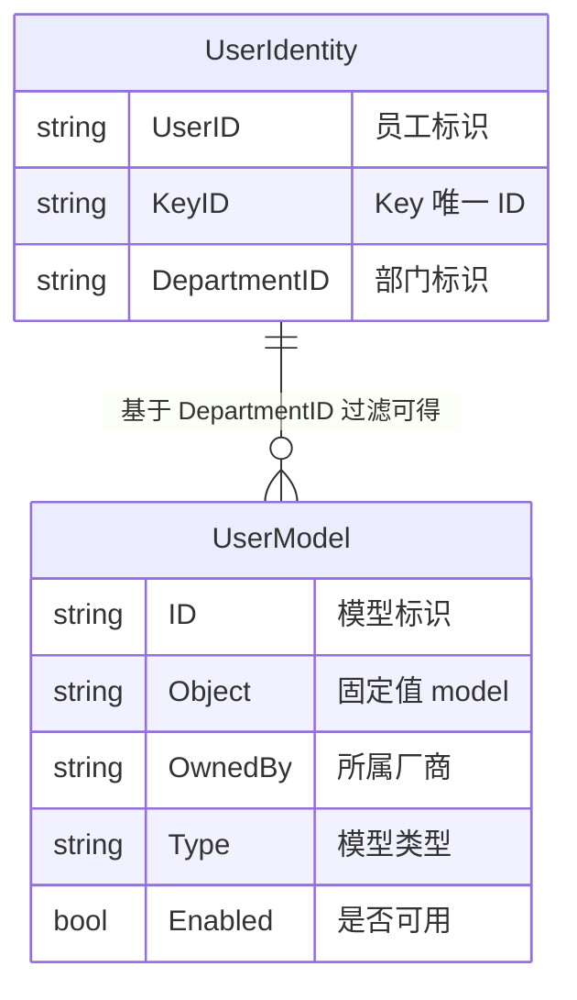

# gateway-api 数据模型

## 1. 文档概述

| 属性 | 内容 |
| :--- | :--- |
| **所属变更** | CHG-20260521-001 |
| **模块名称** | gateway-api |
| **模块类型** | web-backend |
| **创建时间** | 2026-05-21 |
| **修改人** | OpenCode |

### 修订记录

| 版本号 | 修改日期 | 修改内容摘要 | 修改人 |
| :--- | :--- | :--- | :--- |
| v1.0 | 2026-05-21 | 初稿创建 | OpenCode |
| v1.1 | 2026-05-25 | 新增 TokenCache 缓存结构 — CHG-20260523-001 | OpenCode |

本模块为无状态接入层，不持有业务数据表，仅消费外部数据。所有请求处理均为实时计算，模块自身无数据库连接、无事务、无持久化写入操作。

数据消费关系概述：

| 数据源 | 消费方式 | 用途 |
| :--- | :--- | :--- |
| 模型注册配置文件 | 启动时加载 + SIGHUP 热重载 | 构建 Provider Registry |
| API Key 集合 | 请求时只读查询 Redis | 认证校验 |
| 模型可用性缓存 | 请求时只读查询 Redis | 模型可用性校验 |
| 模型列表缓存 | 请求时只读查询 Redis | /v1/models 接口返回 |

---

## 2. 实体关系总览

本模块消费的外部数据实体及运行时数据结构之间的关系：



### 外部数据实体说明

| 实体 | 管理方 | 存储位置 | gateway-api 操作 |
| :--- | :--- | :--- | :--- |
| 模型配置 | control-plane / 运维 | config/models.yaml | 只读加载 |
| API Key 信息 | control-plane | Redis SET `gateway:apikeys` | SISMEMBER 只读校验 |
| 模型可用性状态 | control-plane | Redis STRING `model:available:{id}` | GET 只读查询 |
| 模型列表缓存 | control-plane / gateway-api | Redis STRING `gateway:models:list` | GET 只读查询（缓存未命中时从配置生成并写入） |

---

## 3. 实体定义

### 3.1 RequestContext — 请求处理上下文

每次请求在处理过程中携带的运行时上下文信息：

```go
// RequestContext 请求处理上下文
type RequestContext struct {
    RequestID  string    // 唯一请求标识（UUID v4），由中间件注入
    APIKey     string    // 调用方 API Key（脱敏：仅保留前 8 位 + 后 4 位）
    Model      string    // 请求指定的模型名称
    CallMode   CallMode  // 调用模式：Normal / Stream
    Provider   string    // 解析后匹配的 Provider 名称
    StartTime  time.Time // 请求开始时间（用于计算耗时）
}

// CallMode 调用模式枚举
type CallMode int

const (
    CallModeNormal CallMode = iota // 普通调用
    CallModeStream                  // 流式调用
)
```

### 3.2 ProviderEntry — Provider 注册条目

Provider 注册表中的每个条目：

```go
// ProviderEntry Provider 注册条目
type ProviderEntry struct {
    Prefix   string   // 模型名称匹配前缀，如 "qwen"、"deepseek"、"anthropic."
    Name     string   // Provider 名称标识，如 "bailian"、"deepseek"、"bedrock"
    Provider Provider // Provider 接口实例
    Models   []string // 该 Provider 支持的模型列表
}

// ProviderRegistry Provider 注册与分发
type ProviderRegistry struct {
    mu        sync.RWMutex
    entries   []ProviderEntry // 按前缀长度降序排列（最长匹配优先）
    providers map[string]Provider
    fallback  Provider // 兜底 Provider（voocel/litellm）
}
```

### 3.3 StreamChunk — 流式数据块

在 Go channel 中传递的流式响应数据块：

```go
// ChatCompletionChunk 流式响应数据块
type ChatCompletionChunk struct {
    ID      string        `json:"id"`       // 本次对话唯一 ID（同一流内所有 chunk 相同）
    Object  string        `json:"object"`   // 固定值 "chat.completion.chunk"
    Created int64         `json:"created"`  // Unix 时间戳（秒）
    Model   string        `json:"model"`    // 实际使用的模型名称
    Choices []ChunkChoice `json:"choices"`  // 选项列表
    Usage   *Usage        `json:"usage,omitempty"` // 仅最后一个 chunk 包含
}

// ChunkChoice 流式选项
type ChunkChoice struct {
    Index        int     `json:"index"`                   // 选项索引
    Delta        Delta   `json:"delta"`                   // 增量内容
    FinishReason *string `json:"finish_reason,omitempty"` // 结束原因
}

// Delta 增量消息
type Delta struct {
    Role    string `json:"role,omitempty"`    // 角色（仅第一个 chunk）
    Content string `json:"content,omitempty"` // 增量文本
}

// Usage token 用量统计
type Usage struct {
    PromptTokens     int `json:"prompt_tokens"`
    CompletionTokens int `json:"completion_tokens"`
    TotalTokens      int `json:"total_tokens"`
}
```

### 3.4 UnifiedError — 统一错误结构

所有错误在网关内部以此结构传递，最终序列化为统一错误响应体：

```go
// GatewayError 网关统一错误（内部传递）
type GatewayError struct {
    HTTPStatus int    // HTTP 状态码（400/401/404/500/502/503/504）
    Type       string // 错误类型标识（如 invalid_request_error）
    Message    string // 人类可读的错误描述
    Code       string // 机器可读的细分错误码（如 missing_required_field）
}

// Error 实现 error 接口
func (e *GatewayError) Error() string {
    return fmt.Sprintf("[%d] %s: %s", e.HTTPStatus, e.Type, e.Message)
}

// ErrorResponse HTTP 错误响应体（序列化输出给调用方）
type ErrorResponse struct {
    Error ErrorBody `json:"error"`
}

// ErrorBody 错误详情
type ErrorBody struct {
    Type    string `json:"type"`
    Message string `json:"message"`
    Code    string `json:"code,omitempty"`
}
```

### 3.5 辅助运行时结构

```go
// ChatCompletionRequest 对话补全请求（从调用方 JSON 反序列化）
type ChatCompletionRequest struct {
    Model            string    `json:"model" binding:"required"`
    Messages         []Message `json:"messages" binding:"required,min=1"`
    Stream           *bool     `json:"stream,omitempty"`
    Temperature      *float64  `json:"temperature,omitempty"`
    TopP             *float64  `json:"top_p,omitempty"`
    MaxTokens        *int      `json:"max_tokens,omitempty"`
    Stop             any       `json:"stop,omitempty"`
    PresencePenalty  *float64  `json:"presence_penalty,omitempty"`
    FrequencyPenalty *float64  `json:"frequency_penalty,omitempty"`
}

// Message 对话消息
type Message struct {
    Role    string `json:"role" binding:"required,oneof=system user assistant"`
    Content string `json:"content" binding:"required"`
}

// ChatCompletionResponse 对话补全响应（普通模式）
type ChatCompletionResponse struct {
    ID      string   `json:"id"`
    Object  string   `json:"object"`  // "chat.completion"
    Created int64    `json:"created"`
    Model   string   `json:"model"`
    Choices []Choice `json:"choices"`
    Usage   *Usage   `json:"usage,omitempty"`
}

// Choice 响应选项
type Choice struct {
    Index        int     `json:"index"`
    Message      Message `json:"message"`
    FinishReason string  `json:"finish_reason"`
}

// ProviderConfig 厂商配置（从 YAML 文件反序列化）
type ProviderConfig struct {
    Name       string        `yaml:"name"`
    Prefix     string        `yaml:"prefix"`
    Endpoint   string        `yaml:"endpoint"`
    AuthEnv    string        `yaml:"auth_env"`
    AuthType   string        `yaml:"auth_type"`
    Region     string        `yaml:"region"`
    Timeout    time.Duration `yaml:"timeout"`
    IsFallback bool          `yaml:"is_fallback"`
    Models     []string      `yaml:"models"`
}
```

---

## 4. 关系定义

### 4.1 运行时结构关系

| 源结构 | 关系 | 目标结构 | 说明 |
| :--- | :--- | :--- | :--- |
| RequestContext | 1:1 创建 | HTTP 请求 | 每个请求创建一个 RequestContext |
| RequestContext | N:1 引用 | ProviderEntry | 多个请求可路由到同一 Provider |
| ProviderRegistry | 1:N 包含 | ProviderEntry | 注册表持有多个 Provider 条目 |
| ProviderEntry | 1:1 实现 | Provider Interface | 每个条目绑定一个接口实例 |
| ChatCompletionRequest | 1:1 产出 | ChatCompletionResponse | 普通模式：一个请求对应一个完整响应 |
| ChatCompletionRequest | 1:N 产出 | ChatCompletionChunk | 流式模式：一个请求产出多个 chunk |
| GatewayError | 1:1 序列化为 | ErrorResponse | 错误发生时转换为响应体输出 |

### 4.2 数据流向关系



---

## 5. 索引设计

不适用——本模块不管理数据库表。

---

## 6. 事务边界

不适用——本模块无数据库写入操作。

---

## 7. 迁移策略

不适用——本模块无自有数据表。

---

## 8. 数据约束与规则

### 8.1 请求数据校验规则

| 字段 | 约束 | 失败错误码 |
| :--- | :--- | :--- |
| `model` | 必填，非空字符串 | `missing_required_field` |
| `messages` | 必填，数组长度 ≥ 1 且 ≤ 256 | `empty_messages` / `too_many_messages` |
| `messages[].role` | 必填，枚举值：system / user / assistant | `invalid_field_value` |
| `messages[].content` | 必填，非空字符串 | `invalid_field_value` |
| `temperature` | 可选，范围 [0, 2] | `invalid_field_value` |
| `top_p` | 可选，范围 (0, 1] | `invalid_field_value` |
| `max_tokens` | 可选，正整数 | `invalid_field_value` |
| `presence_penalty` | 可选，范围 [-2, 2] | `invalid_field_value` |
| `frequency_penalty` | 可选，范围 [-2, 2] | `invalid_field_value` |
| 请求体大小 | ≤ 1MB | `request_too_large` |
| JSON 格式 | 合法 JSON | `invalid_json` |

### 8.2 API Key 格式约束

| 约束 | 值 |
| :--- | :--- |
| 长度范围 | 32 ~ 128 字符 |
| 允许字符 | 字母（a-z A-Z）、数字（0-9）、连字符（-） |
| 传递方式 | HTTP Header `Authorization: Bearer {key}` |

### 8.3 运行时数据不变式

| 不变式 | 说明 |
| :--- | :--- |
| RequestContext.RequestID 非空 | 中间件保证注入，缺失时自动生成 UUID v4 |
| ProviderRegistry.fallback 非 nil | 初始化时必须设置兜底 Provider |
| ProviderRegistry.entries 按前缀长度降序 | 保证最长前缀优先匹配 |
| ChatCompletionChunk.ID 同流一致 | 同一次流式调用产出的所有 chunk 共享相同 ID |
| chunk channel 关闭表示流结束 | 消费方通过 channel 关闭判断流结束 |
| GatewayError.HTTPStatus 范围有效 | 仅允许 400/401/404/500/502/503/504 |

### 8.4 Redis 数据格式约束

| Key Pattern | 类型 | Value 格式 | 说明 |
| :--- | :--- | :--- | :--- |
| `model:available:{modelID}` | STRING | `"1"` 或 `"0"` | 1=可用，0=不可用 |
| `gateway:models:list` | STRING | JSON Array（Model 对象数组） | 模型列表缓存 |
| `gateway:apikeys` | SET | 每个成员为一个合法 API Key 字符串 | Key 校验集合 |

### 8.5 缓存未命中处理规则

| 场景 | 处理策略 | 理由 |
| :--- | :--- | :--- |
| `model:available:{id}` 未命中 | 视为可用（fail-open） | 避免缓存故障导致全部请求被拒 |
| `gateway:models:list` 未命中 | 从配置文件生成模型列表 | 保证接口可用 |
| `gateway:apikeys` 查询失败 | 降级为本地配置校验 | 保证认证链路可用 |
| Redis 完全不可达 | 所有校验降级放行 | 网关核心链路优先保可用性 |

---

## 9. 变更记录 — CHG-20260523-001

## 变更摘要

新增身份上下文结构 `UserIdentity` 与用户模型响应结构 `UserModel`，均为运行时 Go struct。gateway-api 保持无状态设计，无新增数据库表、无迁移需求。

---

## 1. 新增运行时结构

### 1.1 UserIdentity — 身份上下文

由 AuthMiddleware 在鉴权通过后写入 Gin Context，供后续 Handler 和中间件读取。字段来源为 auth 服务 `/internal/v1/auth/verify-key` 验证接口返回的 Key 元数据，或 JWT 验证结果。

```go
// UserIdentity 认证身份上下文
// 由 AuthMiddleware 注入 Gin Context，Key 为 "identity"
type UserIdentity struct {
    UserID       string `json:"user_id"`       // 员工标识（来自 control-plane 用户表）
    KeyID        string `json:"key_id"`        // API Key 唯一 ID
    DepartmentID string `json:"department_id"` // 部门标识，用于模型权限过滤
}
```

**字段约束**：

| 字段 | 类型 | 来源 | 约束 |
| :--- | :--- | :--- | :--- |
| `UserID` | string | auth 服务 → control-plane 用户表 | 非空，与员工一一对应 |
| `KeyID` | string | auth 服务 → control-plane Key 表 | 非空，唯一标识一个 API Key |
| `DepartmentID` | string | auth 服务 → control-plane 用户表（用户所属部门） | 非空，用于过滤模型可用性 |

**使用生命周期**：



**读取方式**：

```go
// Handler / 中间件中读取身份上下文
identity, exists := c.Get("identity")
if !exists {
    // 鉴权中间件未注入，视为异常——不应发生
    return errors.New("identity context missing")
}
userIdentity := identity.(*UserIdentity)
```

**不变式**：

| 不变式 | 说明 |
| :--- | :--- |
| `UserIdentity` 非 nil | 经过 AuthMiddleware 的请求必定携带完整 identity，后续 Handler 不判空 |
| `DepartmentID` 非空 | 所有用户必有部门归属，无部门用户无法获取 Key |
| Context Key 为 `"identity"` | 唯一约定 Key，全模块统一读取 |
| 只读约束 | Handler 和后续中间件只能读取 `UserIdentity`，不得修改其字段 |

---

### 1.2 UserModel — 用户可用模型

`GET /v1/me/models` 接口返回的模型列表项，保持 OpenAI `model` 列表兼容字段，并补充前端自服务页面所需的 `type` / `enabled` 字段。

```go
// UserModel 用户可用模型条目（GET /v1/me/models 响应）
type UserModel struct {
    ID      string `json:"id"`       // 模型标识，如 "qwen-plus"、"deepseek-chat"
    Object  string `json:"object"`   // 固定值 "model"
    OwnedBy string `json:"owned_by"` // 所属厂商，如 "bailian"、"deepseek"、"bedrock"
    Type    string `json:"type"`     // 模型类型：chat / embedding / rerank
    Enabled bool   `json:"enabled"`  // 当前用户是否有权限调用（始终为 true，仅返回可用模型）
}
```

**字段约束**：

| 字段 | 类型 | 约束 |
| :--- | :--- | :--- |
| `ID` | string | 模型唯一标识，与 `POST /v1/chat/completions` 中 `model` 字段取值一致 |
| `Object` | string | 固定为 `model`，与 `/v1/models` 保持一致 |
| `OwnedBy` | string | 厂商标识，枚举值由 Provider Registry 管理 |
| `Type` | string | 枚举值：`chat`、`embedding`、`rerank` |
| `Enabled` | bool | 过滤后返回的模型均为 `true`（不可用模型不出现在列表中） |

**过滤逻辑**：

1. 从 Context 读取 `UserIdentity.DepartmentID`
2. 调 Orchestrator 查询该部门关联的模型列表
3. 仅返回 `Enabled` 为 `true` 的模型（当前实现中过滤后列表全为 `true`）
4. 部门无任何模型权限时返回空数组 `[]`

---

## 2. 实体关系变更

### 2.1 新增运行时关系



### 2.2 数据消费关系扩充

在原有 Redis 只读消费基础上，新增 auth 服务的身份解析数据来源：

| 数据源 | 消费方式 | 用途 | 变更类型 |
| :--- | :--- | :--- | :--- |
| auth 服务 `/internal/v1/auth/verify-key` | 每次请求 HTTP POST 调用 | 验证 API Key 并解析 user_id / key_id / dept_id | 新增 |

---

## 3. 数据约束与规则扩充

### 3.1 新增身份上下文约束

| 约束 | 值 |
| :--- | :--- |
| `UserIdentity` 注入时序 | 必须在任何业务 Handler 执行前由 AuthMiddleware 注入 |
| Context Key | 固定字符串 `"identity"` |
| `UserIdentity` 生命周期 | 随请求生命周期，请求结束后 GC 回收 |

### 3.2 新增 API Key 验证路径约束

| 约束 | 值 |
| :--- | :--- |
| 验证接口 | `POST /internal/v1/auth/verify-key` |
| 超时 | 500ms |
| 重试 | 不重试（失败直接 503） |
| 缓存 | 不缓存（由 auth 服务侧缓存，gateway-api 每次请求均调验证接口） |

### 3.3 模型过滤不变式

| 不变式 | 说明 |
| :--- | :--- |
| `/v1/models` 过滤一致性 | 返回的模型列表与 `/v1/me/models` 基于同一身份过滤逻辑，结果等价 |
| 空列表即空列表 | 用户无可用模型时返回 `{"object":"list","data":[]}`，HTTP 200，不返回错误 |

### 3.4 `/v1/me/models` 响应封装

```go
type MeModelsResponse struct {
    Object string      `json:"object"` // 固定值 "list"
    Data   []UserModel `json:"data"`
}
```

映射说明：ops-console 仅消费 `data[].id`、`data[].type`、`data[].enabled` 三个字段；`object`、`data[].object`、`data[].owned_by` 保留用于与 OpenAI 风格列表响应对齐。

---

## 4. 数据库变更

**无变更。** gateway-api 保持无状态设计，无新增数据库表，无迁移需求。

现有外部数据消费（Redis、config/models.yaml）不变，新增的 auth 服务为 HTTP 接口调用，不产生持久化数据依赖。
