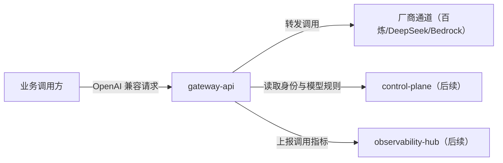
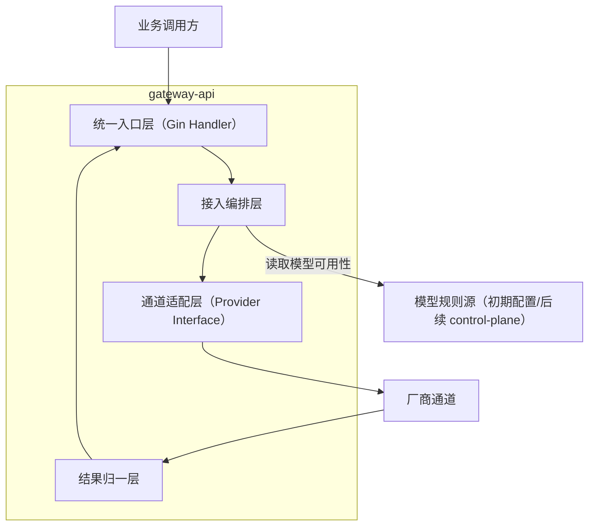
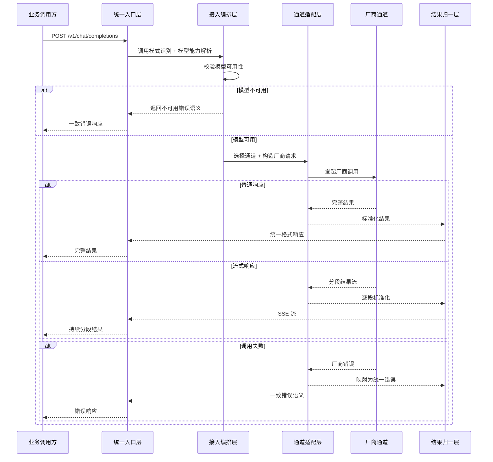
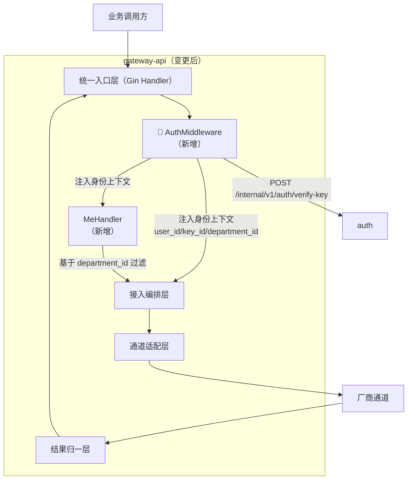
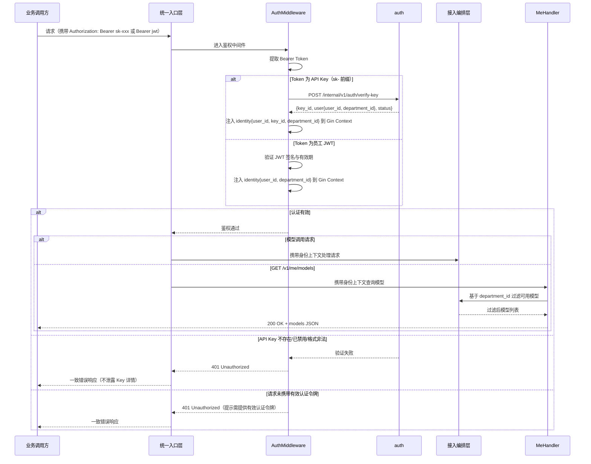

# gateway-api Web 后端概要设计

## 0. 文档信息

| 属性 | 内容 |
| :--- | :--- |
| **所属变更** | CHG-20260521-001 |
| **模块名称** | gateway-api |
| **模块类型** | web-backend |
| **创建时间** | 2026-05-21 |

### 修订记录

| 版本号 | 修改日期 | 修改内容摘要 | 修改人 |
| :--- | :--- | :--- | :--- |
| v1.0 | 2026-05-21 | 初稿创建 | OpenCode |
| v1.1 | 2026-05-25 | 新增 API Key 鉴权中间件与 /v1/me/models 接口架构 — CHG-20260523-001 | OpenCode |

---

## 1. 技术范围界定

### 1.1 起点与终点

| 维度 | 说明 |
| :--- | :--- |
| **起点** | 业务开发团队通过 OpenAI 兼容协议向统一入口发起模型调用请求（POST /v1/chat/completions）或查询可用模型（GET /v1/models） |
| **终点** | 统一入口向调用方返回普通完整响应、流式分段响应或一致错误语义结果 |
| **解决的问题** | 在不改变业务方接入方式的前提下，建立可替换 LiteLLM 的强兼容统一接入主链路 |

### 1.2 技术边界

- **上游依赖**：业务调用方（通过 OpenAI 兼容 SDK / curl）；后续 control-plane 提供身份与模型可用性规则
- **下游依赖**：多厂商模型通道（百炼 SDK / DeepSeek / AWS Bedrock / voocel/litellm 兜底）；后续 observability-hub 接收 OTLP 数据
- **不涉及**：完整权限治理配置、限额策略管理、日志分析看板、Prompt/Agent/工作流等范围外能力

---

## 2. 架构方向探索

| 方向 | 核心思路 | 适合场景 | 风险 |
| :--- | :--- | :--- | :--- |
| 集中式接入编排 | 以统一入口为核心，内部串联请求校验、模型解析、通道分发、结果归一和错误映射 | 当前阶段需要快速建立稳定入口并逐步替换 LiteLLM | 中期需要控制入口内部复杂度 |
| 单体直连最小化 | 以最少层次直接承接请求并连接厂商通道 | 极早期验证可行性 | 后续兼容能力增长时容易失控 |
| 分层路由中台 | 提前拆出独立路由/策略/通道抽象层 | 多团队并行开发大规模网关 | 当前版本复杂度偏高 |

**选定方向**：集中式接入编排
**选择理由**：当前阶段目标是尽快建立稳定统一入口并可替换 LiteLLM，集中式编排既能承接多厂商差异，又符合宪章"渐进演进"原则不过早拆分

---

## 3. 架构方案

### 3.1 整体架构

### 3.2 核心流程

---

## 4. 技术选型与约束

| 领域 | 选型 | 理由 |
| :--- | :--- | :--- |
| 运行时 | Go 1.22+ | 项目技术栈已确定，高并发友好，符合"极致聚焦"定位 |
| 框架 | Gin | 项目已选定，轻量成熟，社区生态广 |
| 多厂商适配 | Provider Interface + 厂商原生 SDK + voocel/litellm 兜底 | 分层策略：核心厂商原生 SDK 保证兼容性，冷门厂商用 voocel/litellm 兜底 |
| 数据存储 | 本次不引入新存储 | 统一入口层只消费外部提供的模型可用性与身份上下文，不自行持久化业务数据 |
| 缓存 | Redis（读取模型列表缓存） | 项目技术栈已包含 Redis，统一入口复用其模型列表缓存能力 |
| 消息队列 | 不引入 | 主流程保持同步请求-响应，流式通过长连接返回，不额外引入消息驱动 |

### 宪章合规性

- [x] 符合 `constitution.md` 单一入口原则：对外唯一暴露 OpenAI 兼容协议
- [x] 符合渐进演进原则：本次只做统一接入主链路，不超范围引入治理能力
- [x] 符合自主可控原则：通道适配层允许逐步用原生 SDK 替换社区方案
- [x] 符合核心聚焦原则：不涉及 Prompt/Agent/工作流等范围外能力

---

## 5. 中间件链

> 按执行顺序排列，靠前的先执行。

| 顺序 | 中间件 | 职责 | 失败时 |
| :---: | :--- | :--- | :--- |
| 1 | 请求 ID 注入 | 为每个请求生成唯一 ID，写入响应头 | — |
| 2 | Key 校验 | 验证 Authorization Bearer Token，注入调用主体上下文 | 401 Unauthorized |
| 3 | 结构化日志 | 记录请求路径、耗时、状态码 | — |
| 4 | 错误处理 | 捕获未处理异常，统一错误响应格式为一致错误语义 | 5xx |

> 注意：限流中间件（TPM/RPM/并发）和部门权限中间件不在本次变更范围内，后续版本补充。

---

## 6. 认证与授权

### 6.1 认证方案

| 字段 | 内容 |
| :--- | :--- |
| 方案 | API Key（Bearer Token） |
| Token 存储（客户端） | Authorization Header |
| Token 有效期 | 由 Key 生命周期管理（后续 control-plane 负责） |
| 刷新策略 | 不适用（API Key 长期有效直到撤销） |
| 密钥管理 | Key 存储在 PostgreSQL，校验时查缓存 |

### 6.2 授权模型

| 字段 | 内容 |
| :--- | :--- |
| 模型 | 本次仅做 Key 有效性校验，完整 RBAC 授权后续版本补充 |
| 角色定义 | 本次不区分角色，Key 有效即可调用可用模型 |
| 权限粒度 | 模型可用性级别（Key 绑定的调用主体能看到哪些模型） |
| 鉴权时机 | 中间件统一处理 |

---

## 7. 数据存储与外部依赖

### 7.1 主数据库

| 字段 | 内容 |
| :--- | :--- |
| 数据库 | PostgreSQL 15+（项目已选定） |
| 连接池 | 本次统一入口层为只读消费，不直接写入元数据库 |
| 读写分离 | 不适用（本模块本次只读取 Key 和模型配置） |
| 事务隔离级别 | 不适用 |

### 7.2 缓存策略

| 字段 | 内容 |
| :--- | :--- |
| 缓存引擎 | Redis 7+（项目已选定） |
| 缓存模式 | Cache-Aside（统一入口读取模型列表缓存，miss 时从配置源加载） |
| TTL 策略 | 模型列表缓存 60s |
| 缓存击穿防护 | 本次规模下暂不需要，后续按需补充 |

### 7.3 外部服务依赖

| 服务 | 用途 | 超时配置 | 降级策略 |
| :--- | :--- | :---: | :--- |
| 百炼 SDK | 模型调用转发 | 30000 ms | 返回临时失败错误语义 |
| DeepSeek API | 模型调用转发 | 30000 ms | 返回临时失败错误语义 |
| AWS Bedrock SDK | 模型调用转发 | 30000 ms | 返回临时失败错误语义 |
| voocel/litellm | 兜底厂商调用 | 30000 ms | 返回临时失败错误语义 |

---

## 8. 安全设计

| 威胁 | 防御措施 |
| :--- | :--- |
| Key 泄漏 | Key 绑定员工身份，异常使用可追溯；后续版本补设备监控 |
| 注入攻击 | 统一入口不拼接 SQL，模型请求参数透传不解释 |
| 敏感数据泄漏 | 错误响应不返回内部堆栈和厂商内部信息；OTLP 出口做 Prompt 脱敏 |
| 中间人攻击 | 对外入口强制 HTTPS；对厂商通道使用 TLS |
| 滥用 | 本次仅做 Key 有效性校验，TPM/RPM/并发限流后续版本补充 |

---

## 9. 观测与运维

### 9.1 质量目标

| 指标 | 目标值 | 测试条件 |
| :--- | :---: | :--- |
| P95 响应时间（非流式） | ≤ 5000 ms | 包含厂商调用耗时，试点流量 |
| 可用性 | ≥ 99.5% | 试点阶段滚动 7 天 |
| 错误率（5xx） | ≤ 1% | 试点流量 |

### 9.2 日志与追踪

| 维度 | 方案 |
| :--- | :--- |
| 日志格式 | JSON，必含：`request_id`、`level`、`timestamp`、`path`、`status`、`duration_ms`、`model` |
| 日志聚合 | OTLP exporter → Langfuse（项目已选定） |
| 分布式追踪 | OpenTelemetry SDK → OTLP 出口 |
| 日志脱敏规则 | Prompt 内容按配置策略脱敏（截断/关键字屏蔽/不记录） |

### 9.3 健康检查端点

| 端点 | 用途 | 检查内容 |
| :--- | :--- | :--- |
| `GET /health` | 存活探针 | 进程在线，返回 200 |
| `GET /ready` | 就绪探针 | Redis 连接可用、至少一个厂商通道可达 |

### 9.4 监控告警

| 指标 | 告警阈值 | 通知方式 |
| :--- | :--- | :--- |
| 响应时间 P99 | > 10000 ms | 钉钉群 |
| 错误率 | > 5% 持续 3 分钟 | 钉钉群 |
| 厂商通道全部不可达 | 持续 1 分钟 | 钉钉群 + 电话 |

---

## 10. 失败模式与降级策略

| 失败场景 | 影响 | 降级策略 | 恢复方式 |
| :--- | :--- | :--- | :--- |
| 单一厂商通道不可用 | 该厂商模型调用失败 | 返回临时失败错误语义，后续版本补自动切换 | 厂商恢复后自动可用 |
| Redis 不可用 | 模型列表缓存失效 | 直接从配置源加载模型列表，性能略降 | Redis 恢复后自动缓存 |
| Key 校验源不可达 | 所有调用被拒 | 返回 503 统一错误语义 | 校验源恢复后自动恢复 |
| 流式调用中途厂商断开 | 业务方收到不完整结果 | 在流中发送错误事件标识中断 | 业务方识别中断后可重试 |

---

## 11. 待研究事项

不适用

> 本次涉及的技术栈（Go + Gin + voocel/litellm + 厂商原生 SDK + Redis + OTLP）在项目技术文档中已有明确选型和验证路径，无需额外技术研究。

---

## 12. 风险与对策

| 风险 | 概率 | 影响 | 对策 |
| :--- | :--- | :--- | :--- |
| 百炼 SDK 流式 SSE 差异导致兼容性问题 | 中 | 中 | 通道适配层统一 SSE 格式标准化，后续按需 fork SDK |
| voocel/litellm 对冷门厂商覆盖不全 | 低 | 低 | 遇到不兼容时自行实现 HTTP 适配，不阻塞主链路 |
| 模型列表缓存与实际可用性不一致 | 中 | 中 | 缓存 TTL 控制在 60s，后续补 invalidation 机制 |

---

## 13. 概要设计确认

- [x] 技术范围已界定
- [x] 架构方向已探索并选定
- [x] 架构方案已确认
- [x] 技术选型符合宪章
- [x] 待研究事项已识别（无需研究）

👉 确认后进入详细设计阶段（`/xf/detail`）

---

## 14. 变更记录 — CHG-20260523-001

## 变更摘要

新增鉴权中间件：请求处理前通过调用 auth 内部接口验证 API Key 并解析为 user_id / key_id / department_id 身份上下文注入 Gin Context；新增 GET /v1/me/models 端点基于当前登录员工 JWT 身份返回可用模型列表。

## 架构变更

### 认证请求流程

## 技术选型变更

无变更，沿用 Go + Gin + Redis 技术栈。

## 新增组件

| 组件 | 位置 | 职责 |
| :--- | :--- | :--- |
| AuthMiddleware | middleware/auth.go | 在请求处理前提取 Bearer Token，按前缀分流到 API Key 验证或 JWT 验签，注入 user_id / key_id / department_id 到 Gin Context；验证失败直接返回 401 |
| MeHandler | handler/me_handler.go | 处理 GET /v1/me/models，从 Context 读取身份上下文，基于 department_id 过滤可用模型列表 |

## 新增端点

| 端点 | 方法 | 认证 | 说明 |
| :--- | :--- | :--- | :--- |
| /v1/me/models | GET | JWT Bearer Token | 返回当前登录员工可用模型列表，基于 user_id → department_id 过滤 |

## 中间件链变更

| 顺序 | 中间件 | 职责 | 失败时 | 变更类型 |
| :---: | :--- | :--- | :--- | :--- |
| 1 | 请求 ID 注入 | 生成唯一 ID，写入响应头 | — | 原有 |
| 2 | **AuthMiddleware** | **提取 Bearer Token → 分流到 auth 验证或 JWT 验签 → 注入身份上下文** | **401 Unauthorized** | **新增（替换原 Key 校验）** |
| 3 | 结构化日志 | 记录请求路径、耗时、状态码 | — | 原有 |
| 4 | 错误处理 | 捕获异常，统一错误格式 | 5xx | 原有 |

> 原中间件链中的"Key 校验"中间件（第 2 位）升级为 AuthMiddleware，从简单 Token 校验扩展为完整身份解析链路（API Key → User → Department），职责和调用范围增大。

## 外部服务依赖变更

| 服务 | 用途 | 超时配置 | 降级策略 | 变更类型 |
| :--- | :--- | :---: | :--- | :--- |
| auth /internal/v1/auth/verify-key | Key 验证与身份解析 | 500 ms | 验证不可达时所有请求返回 503 | 新增 |

## 认证与授权变更

原认证方案仅做 Key 有效性校验，本次升级为完整鉴权链路：

| 字段 | 变更前 | 变更后 |
| :--- | :--- | :--- |
| 方案 | API Key（Bearer Token）简单校验 | API Key → auth → User → Department 身份解析链路；`/v1/me/models` 额外支持员工 JWT |
| 授权模型 | Key 有效即可调用 | Key 有效或员工 JWT 有效 + 身份上下文注入（user_id / key_id / department_id），模型可用性基于 department_id 过滤 |

## 安全设计补充

| 威慑 | 防御措施 |
| :--- | :--- |
| Key 验证接口不可达导致全量拒绝 | AuthMiddleware 调 auth 超时（500ms）返回 503，不降级为无鉴权放行 |
| 身份上下文注入篡改 | identity 信息由 AuthMiddleware 写入 Gin Context，后续 Handler 只读取不修改 |
